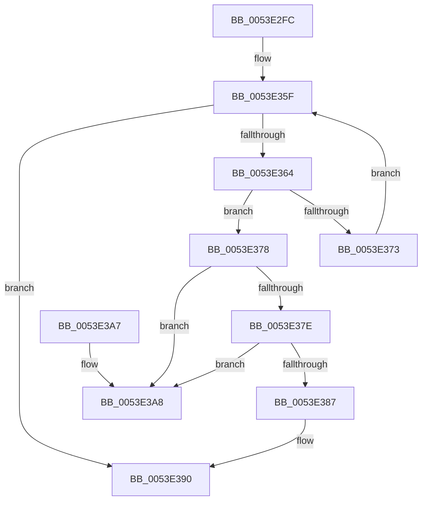

# HalpDmaRemoveAdapterFromMasterQueue

- RVA: `0x0053E2FC`–`0x0053E3AF` (길이 `179` bytes)
- VA: `0x000000014053E2FC`
- 실행 섹션: `.text`
- PDB 이름 있음: `예`; PDB Function 태그: `아니요`
- unwind 정보 RVA: `0x000A60F8`
- 디코드: `51`개 명령, `179/179` bytes 표시
- 미해석 바이트: `0` (있으면 어셈블리에 `.byte`로 보존)

> 이 문서는 커널 이미지의 기계어와 PDB 기호를 분석해 생성했습니다. 4번과 5번은 함수 원형과 자료형을 바이너리 사용 방식에서 추정한 C 해석이며 원본 소스 복구 결과는 아닙니다.

## 1. Dependencies

- 직접 호출 지점: **2**; 고유 호출 대상: **2**
- 직접 호출자로 확인된 함수: **4**
- RIP 상대 이미지 참조: **1**

### Outgoing calls
- `0x0053E33C` → [KeAcquireInStackQueuedSpinLock](../27/KeAcquireInStackQueuedSpinLock_function_002757A0.md) (function, `0x002757A0`)
- `0x0053E395` → [KeReleaseInStackQueuedSpinLock](../34/KeReleaseInStackQueuedSpinLock_function_00342CE0.md) (function, `0x00342CE0`)

### Direct callers
- [HalpAllocateDmaResourcesInternal](../3D/HalpAllocateDmaResourcesInternal_function_003DA7C4.md) at `0x003DA9C3`
- [HalCancelAdapterChannel](../55/HalCancelAdapterChannel_function_005502A0.md) at `0x005502F1`
- [HalCancelAdapterChannelDmarThin](../55/HalCancelAdapterChannelDmarThin_function_00552CD0.md) at `0x00552D56`
- [sub_006F9BD4](../6F/Unknown_function_006F9BD4.md) at `0x006F9C10`

### Static image references
- `0x0053E317` → RVA `0x00FC18A0` (`.data`; read)

## 2. Other-region calls and transfers

- 다른 실행 섹션으로 향하는 call: **0**
- 별도 외부 분기/꼬리 이동을 확인하지 못했습니다.

## 3. Assembly (complete function range)

```asm
0053E2FC  48 89 5C 24 08                  mov qword ptr [rsp + 8], rbx
0053E301  57                              push rdi
0053E302  48 83 EC 40                     sub rsp, 0x40
0053E306  48 8B 99 A0 00 00 00            mov rbx, qword ptr [rcx + 0xa0]
0053E30D  33 C0                           xor eax, eax
0053E30F  48 89 44 24 30                  mov qword ptr [rsp + 0x30], rax
0053E314  48 8B F9                        mov rdi, rcx
0053E317  8A 05 83 35 A8 00               mov al, byte ptr [rip + 0xa83583]
0053E31D  0F 57 C0                        xorps xmm0, xmm0
0053E320  F6 D8                           neg al
0053E322  48 8D 8B 80 00 00 00            lea rcx, [rbx + 0x80]
0053E329  48 1B D2                        sbb rdx, rdx
0053E32C  83 E2 20                        and edx, 0x20
0053E32F  48 03 CA                        add rcx, rdx
0053E332  48 8D 54 24 20                  lea rdx, [rsp + 0x20]
0053E337  0F 11 44 24 20                  movups xmmword ptr [rsp + 0x20], xmm0
0053E33C  E8 5F 74 D3 FF                  call 0x1402757a0
0053E341  8A 87 BA 01 00 00               mov al, byte ptr [rdi + 0x1ba]
0053E347  F6 D8                           neg al
0053E349  4D 1B C0                        sbb r8, r8
0053E34C  41 83 E0 10                     and r8d, 0x10
0053E350  49 81 C0 A8 00 00 00            add r8, 0xa8
0053E357  4C 03 C3                        add r8, rbx
0053E35A  32 DB                           xor bl, bl
0053E35C  49 8B 08                        mov rcx, qword ptr [r8]
0053E35F  49 3B C8                        cmp rcx, r8
0053E362  74 2C                           je 0x14053e390
0053E364  48 8B 11                        mov rdx, qword ptr [rcx]
0053E367  48 8D 87 A8 00 00 00            lea rax, [rdi + 0xa8]
0053E36E  48 3B C8                        cmp rcx, rax
0053E371  74 05                           je 0x14053e378
0053E373  48 8B CA                        mov rcx, rdx
0053E376  EB E7                           jmp 0x14053e35f
0053E378  48 39 4A 08                     cmp qword ptr [rdx + 8], rcx
0053E37C  75 2A                           jne 0x14053e3a8
0053E37E  48 8B 41 08                     mov rax, qword ptr [rcx + 8]
0053E382  48 39 08                        cmp qword ptr [rax], rcx
0053E385  75 21                           jne 0x14053e3a8
0053E387  48 89 10                        mov qword ptr [rax], rdx
0053E38A  B3 01                           mov bl, 1
0053E38C  48 89 42 08                     mov qword ptr [rdx + 8], rax
0053E390  48 8D 4C 24 20                  lea rcx, [rsp + 0x20]
0053E395  E8 46 49 E0 FF                  call 0x140342ce0
0053E39A  8A C3                           mov al, bl
0053E39C  48 8B 5C 24 50                  mov rbx, qword ptr [rsp + 0x50]
0053E3A1  48 83 C4 40                     add rsp, 0x40
0053E3A5  5F                              pop rdi
0053E3A6  C3                              ret
0053E3A7  CC                              int3
0053E3A8  B9 03 00 00 00                  mov ecx, 3
0053E3AD  CD 29                           int 0x29
```

## 4. C-style interpretation (structured pseudocode)

```c
__int64 __fastcall HalpDmaRemoveAdapterFromMasterQueue(__int64 a1, __int64 a2, __int64 a3)
{
    __int64 result;
    __int64 v_rbx;
    __int64 v_rsp;
    unsigned __int64 v_stack_m18;
    unsigned __int64 v_stack_m28;
    unsigned __int64 v_stack_p8;

    v_stack_p8 = v_rbx;
    v_rsp = (v_rsp) - (64);
    result = 0;
    v_stack_m18 = 0;
    result = (unsigned __int8)(-(*(unsigned __int8 *)(v_rip + 11023747)));
    a2 = (unsigned int)((a2) & (32));
    a1 = (*(unsigned __int64 *)(a1 + 160) + 128) + (a2);
    v_stack_m28 = v_xmm0;
    result = KeAcquireInStackQueuedSpinLock(a1, v_stack_m28, a3, a4);
    result = (unsigned __int8)(-(*(unsigned __int8 *)(a1 + 442)));
    a3 = (unsigned int)((a3) & (16));
    a3 = (a3) + (168);
    a3 = (a3) + (*(unsigned __int64 *)(a1 + 160));
    v_rbx = 0;
loc_0053E35F:
    if ((*(unsigned __int64 *)(a3)) == a3) goto loc_0053E390;
    if ((*(unsigned __int64 *)(a3)) == (a1 + 168)) goto loc_0053E378;
    goto loc_0053E35F;
loc_0053E378:
    if ((*(unsigned __int64 *)(*(unsigned __int64 *)(*(unsigned __int64 *)(a3)) + 8)) != (*(unsigned __int64 *)(*(unsigned __int64 *)(a3)))) goto loc_0053E3A8;
    if ((*(unsigned __int64 *)(*(unsigned __int64 *)(*(unsigned __int64 *)(*(unsigned __int64 *)(a3)) + 8))) != (*(unsigned __int64 *)(*(unsigned __int64 *)(a3)))) goto loc_0053E3A8;
    *(unsigned __int64 *)(*(unsigned __int64 *)(*(unsigned __int64 *)(*(unsigned __int64 *)(a3)) + 8)) = *(unsigned __int64 *)(*(unsigned __int64 *)(a3));
    *(unsigned __int64 *)(*(unsigned __int64 *)(*(unsigned __int64 *)(a3)) + 8) = *(unsigned __int64 *)(*(unsigned __int64 *)(*(unsigned __int64 *)(a3)) + 8);
loc_0053E390:
    result = KeReleaseInStackQueuedSpinLock(v_stack_m28, *(unsigned __int64 *)(*(unsigned __int64 *)(a3)), a3, a4);
    v_rsp = (v_rsp) + (64);
    return 1;
loc_0053E3A8:
    return 1;
}
```

## 5. (Beta) C Style

```c
int64_t HalpDmaRemoveAdapterFromMasterQueue(void *Arg1, int64_t Arg2, int64_t Arg3)
{
    uint8_t *arg1 = (uint8_t *)Arg1;

    int64_t result;
    int64_t local_rbx;
    int64_t local_rsp;
    uint64_t v_stack_m18;
    uint64_t v_stack_m28;
    uint64_t v_stack_p8;

    v_stack_p8 = local_rbx;
    local_rsp = (local_rsp) - (64);
    result = 0;
    v_stack_m18 = 0;
    result = (uint8_t)(-(*(uint8_t *)(v_rip + 0xA83583)));
    Arg2 = (uint32_t)((Arg2) & (32));
    Arg1 = (*(uint64_t *)(arg1 + 0xA0) + 128) + (Arg2);
    v_stack_m28 = v_xmm0;
    result = KeAcquireInStackQueuedSpinLock(Arg1, v_stack_m28, Arg3, a4);
    result = (uint8_t)(-(*(uint8_t *)(arg1 + 0x1BA)));
    Arg3 = (uint32_t)((Arg3) & (16));
    Arg3 = (Arg3) + (168);
    Arg3 = (Arg3) + (*(uint64_t *)(arg1 + 0xA0));
    local_rbx = 0;
loc_0053E35F:
    if ((*(uint64_t *)(Arg3)) == Arg3) goto loc_0053E390;
    if ((*(uint64_t *)(Arg3)) == (Arg1 + 168)) goto loc_0053E378;
    goto loc_0053E35F;
loc_0053E378:
    if ((*(uint64_t *)(*(uint64_t *)(*(uint64_t *)(Arg3)) + 0x8)) != (*(uint64_t *)(*(uint64_t *)(Arg3)))) goto loc_0053E3A8;
    if ((*(uint64_t *)(*(uint64_t *)(*(uint64_t *)(*(uint64_t *)(Arg3)) + 0x8))) != (*(uint64_t *)(*(uint64_t *)(Arg3)))) goto loc_0053E3A8;
    *(uint64_t *)(*(uint64_t *)(*(uint64_t *)(*(uint64_t *)(Arg3)) + 0x8)) = *(uint64_t *)(*(uint64_t *)(Arg3));
    *(uint64_t *)(*(uint64_t *)(*(uint64_t *)(Arg3)) + 0x8) = *(uint64_t *)(*(uint64_t *)(*(uint64_t *)(Arg3)) + 0x8);
loc_0053E390:
    result = KeReleaseInStackQueuedSpinLock(v_stack_m28, *(uint64_t *)(*(uint64_t *)(Arg3)), Arg3, a4);
    local_rsp = (local_rsp) + (64);
    return 1;
loc_0053E3A8:
    return 1;
}
```

### 관측된 메모리 오프셋

구조체 형식이 확인되지 않은 접근은 인자 기준의 오프셋으로만 기록했습니다.

| 기준 인자 | 오프셋 표현 | 폭 (bit) | 접근 |
|---|---:|---:|---|
| `Arg1` | `+ 0xA0` | `64` | `R` |
| `Arg1` | `+ 0xA8` | `64` | `R` |
| `Arg1` | `+ 0x1BA` | `8` | `R` |

## 6. Execution-region graph

[열기: 2D/3D 그래프와 함수 탐색 컨트롤 패널](../../../control-panel.html?section=text&rva=0x0053E2FC&view=graph)

- 2D 그래프는 위에서 아래로 흐르고, 3D 그래프는 빈 공간을 드래그해 회전합니다. Shift+드래그는 이동, 휠은 확대·축소, 함수 노드 선택은 대상 보고서 이동입니다.

### Static fallback


