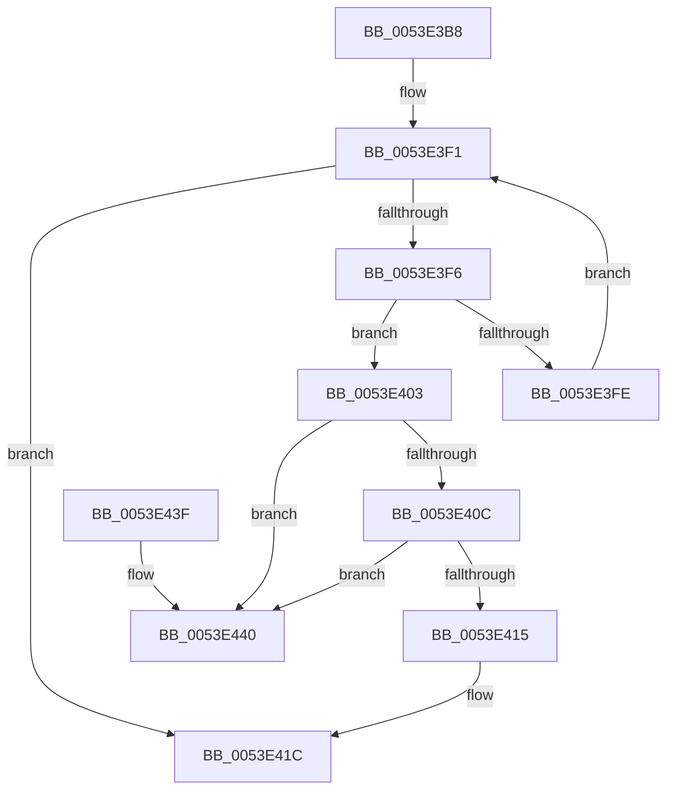

# HalpDmaRemoveFromEmergencyLogicalAddressQueue

- RVA: `0x0053E3B8`–`0x0053E447` (길이 `143` bytes)
- VA: `0x000000014053E3B8`
- 실행 섹션: `.text`
- PDB 이름 있음: `예`; PDB Function 태그: `아니요`
- unwind 정보 RVA: `0x00069AD0`
- 디코드: `42`개 명령, `143/143` bytes 표시
- 미해석 바이트: `0` (있으면 어셈블리에 `.byte`로 보존)

> 이 문서는 커널 이미지의 기계어와 PDB 기호를 분석해 생성했습니다. 4번과 5번은 함수 원형과 자료형을 바이너리 사용 방식에서 추정한 C 해석이며 원본 소스 복구 결과는 아닙니다.

## 1. Dependencies

- 직접 호출 지점: **2**; 고유 호출 대상: **2**
- 직접 호출자로 확인된 함수: **4**
- RIP 상대 이미지 참조: **0**

### Outgoing calls
- `0x0053E3DF` → [KeAcquireSpinLockRaiseToDpc](../20/KeAcquireSpinLockRaiseToDpc_function_00208470.md) (function, `0x00208470`)
- `0x0053E422` → [KeReleaseSpinLock](../39/KeReleaseSpinLock_function_00392BA0.md) (function, `0x00392BA0`)

### Direct callers
- [HalpAllocateDmaResourcesInternal](../3D/HalpAllocateDmaResourcesInternal_function_003DA7C4.md) at `0x003DA9B7`
- [HalCancelAdapterChannel](../55/HalCancelAdapterChannel_function_005502A0.md) at `0x005502E5`
- [HalCancelAdapterChannelDmarThin](../55/HalCancelAdapterChannelDmarThin_function_00552CD0.md) at `0x00552D0F`
- [HalCancelAdapterChannelDmarThin](../55/HalCancelAdapterChannelDmarThin_function_00552CD0.md) at `0x00552D4A`
- [sub_006F9BD4](../6F/Unknown_function_006F9BD4.md) at `0x006F9C04`

### Static image references
- 디코드된 RIP-relative 메모리 참조가 없습니다.

## 2. Other-region calls and transfers

- 다른 실행 섹션으로 향하는 call: **0**
- 별도 외부 분기/꼬리 이동을 확인하지 못했습니다.

## 3. Assembly (complete function range)

```asm
0053E3B8  48 89 5C 24 08                  mov qword ptr [rsp + 8], rbx
0053E3BD  48 89 6C 24 10                  mov qword ptr [rsp + 0x10], rbp
0053E3C2  48 89 74 24 18                  mov qword ptr [rsp + 0x18], rsi
0053E3C7  57                              push rdi
0053E3C8  48 83 EC 20                     sub rsp, 0x20
0053E3CC  48 8D B1 38 02 00 00            lea rsi, [rcx + 0x238]
0053E3D3  48 8B D9                        mov rbx, rcx
0053E3D6  48 8B CE                        mov rcx, rsi
0053E3D9  48 8B EA                        mov rbp, rdx
0053E3DC  40 32 FF                        xor dil, dil
0053E3DF  E8 8C A0 CC FF                  call 0x140208470
0053E3E4  48 81 C3 40 02 00 00            add rbx, 0x240
0053E3EB  44 8A C0                        mov r8b, al
0053E3EE  48 8B 03                        mov rax, qword ptr [rbx]
0053E3F1  48 3B C3                        cmp rax, rbx
0053E3F4  74 26                           je 0x14053e41c
0053E3F6  48 8B 08                        mov rcx, qword ptr [rax]
0053E3F9  48 3B C5                        cmp rax, rbp
0053E3FC  74 05                           je 0x14053e403
0053E3FE  48 8B C1                        mov rax, rcx
0053E401  EB EE                           jmp 0x14053e3f1
0053E403  40 B7 01                        mov dil, 1
0053E406  48 39 41 08                     cmp qword ptr [rcx + 8], rax
0053E40A  75 34                           jne 0x14053e440
0053E40C  48 8B 50 08                     mov rdx, qword ptr [rax + 8]
0053E410  48 39 02                        cmp qword ptr [rdx], rax
0053E413  75 2B                           jne 0x14053e440
0053E415  48 89 0A                        mov qword ptr [rdx], rcx
0053E418  48 89 51 08                     mov qword ptr [rcx + 8], rdx
0053E41C  41 8A D0                        mov dl, r8b
0053E41F  48 8B CE                        mov rcx, rsi
0053E422  E8 79 47 E5 FF                  call 0x140392ba0
0053E427  48 8B 5C 24 30                  mov rbx, qword ptr [rsp + 0x30]
0053E42C  40 8A C7                        mov al, dil
0053E42F  48 8B 6C 24 38                  mov rbp, qword ptr [rsp + 0x38]
0053E434  48 8B 74 24 40                  mov rsi, qword ptr [rsp + 0x40]
0053E439  48 83 C4 20                     add rsp, 0x20
0053E43D  5F                              pop rdi
0053E43E  C3                              ret
0053E43F  CC                              int3
0053E440  B9 03 00 00 00                  mov ecx, 3
0053E445  CD 29                           int 0x29
```

## 4. C-style interpretation (structured pseudocode)

```c
__int64 __fastcall HalpDmaRemoveFromEmergencyLogicalAddressQueue(__int64 a1, __int64 a2)
{
    __int64 result;
    __int64 v_rbx;
    __int64 v_rdi;
    __int64 v_rsp;
    unsigned __int64 v_stack_p10;
    unsigned __int64 v_stack_p18;
    unsigned __int64 v_stack_p8;

    v_stack_p8 = v_rbx;
    v_stack_p10 = v_rbp;
    v_stack_p18 = v_rsi;
    v_rsp = (v_rsp) - (32);
    v_rdi = 0;
    result = KeAcquireSpinLockRaiseToDpc(a1 + 568, a2, a3, a4);
    v_rbx = (a1) + (576);
loc_0053E3F1:
    if ((*(unsigned __int64 *)(v_rbx)) == v_rbx) goto loc_0053E41C;
    if ((*(unsigned __int64 *)(v_rbx)) == a2) goto loc_0053E403;
    goto loc_0053E3F1;
loc_0053E403:
    if ((*(unsigned __int64 *)(*(unsigned __int64 *)(*(unsigned __int64 *)(v_rbx)) + 8)) != (*(unsigned __int64 *)(*(unsigned __int64 *)(v_rbx)))) goto loc_0053E440;
    if ((*(unsigned __int64 *)(*(unsigned __int64 *)(*(unsigned __int64 *)(*(unsigned __int64 *)(v_rbx)) + 8))) != (*(unsigned __int64 *)(*(unsigned __int64 *)(v_rbx)))) goto loc_0053E440;
    *(unsigned __int64 *)(*(unsigned __int64 *)(*(unsigned __int64 *)(*(unsigned __int64 *)(v_rbx)) + 8)) = *(unsigned __int64 *)(*(unsigned __int64 *)(v_rbx));
    *(unsigned __int64 *)(*(unsigned __int64 *)(*(unsigned __int64 *)(v_rbx)) + 8) = *(unsigned __int64 *)(*(unsigned __int64 *)(*(unsigned __int64 *)(v_rbx)) + 8);
loc_0053E41C:
    result = KeReleaseSpinLock(a1 + 568, (unsigned __int8)((unsigned __int8)(result)), (unsigned __int8)(result), a4);
    v_rsp = (v_rsp) + (32);
    return 1;
loc_0053E440:
    return 1;
}
```

## 5. (Beta) C Style

```c
int64_t HalpDmaRemoveFromEmergencyLogicalAddressQueue(void *Arg1, int64_t Arg2)
{
    uint8_t *arg1 = (uint8_t *)Arg1;

    int64_t result;
    int64_t local_rbx;
    int64_t local_rdi;
    int64_t local_rsp;
    uint64_t v_stack_p10;
    uint64_t v_stack_p18;
    uint64_t v_stack_p8;

    v_stack_p8 = local_rbx;
    v_stack_p10 = local_rbp;
    v_stack_p18 = local_rsi;
    local_rsp = (local_rsp) - (32);
    local_rdi = 0;
    result = KeAcquireSpinLockRaiseToDpc(Arg1 + 568, Arg2, a3, a4);
    local_rbx = (Arg1) + (576);
loc_0053E3F1:
    if ((*(uint64_t *)(local_rbx)) == local_rbx) goto loc_0053E41C;
    if ((*(uint64_t *)(local_rbx)) == Arg2) goto loc_0053E403;
    goto loc_0053E3F1;
loc_0053E403:
    if ((*(uint64_t *)(*(uint64_t *)(*(uint64_t *)(local_rbx)) + 0x8)) != (*(uint64_t *)(*(uint64_t *)(local_rbx)))) goto loc_0053E440;
    if ((*(uint64_t *)(*(uint64_t *)(*(uint64_t *)(*(uint64_t *)(local_rbx)) + 0x8))) != (*(uint64_t *)(*(uint64_t *)(local_rbx)))) goto loc_0053E440;
    *(uint64_t *)(*(uint64_t *)(*(uint64_t *)(*(uint64_t *)(local_rbx)) + 0x8)) = *(uint64_t *)(*(uint64_t *)(local_rbx));
    *(uint64_t *)(*(uint64_t *)(*(uint64_t *)(local_rbx)) + 0x8) = *(uint64_t *)(*(uint64_t *)(*(uint64_t *)(local_rbx)) + 0x8);
loc_0053E41C:
    result = KeReleaseSpinLock(Arg1 + 568, (uint8_t)((uint8_t)(result)), (uint8_t)(result), a4);
    local_rsp = (local_rsp) + (32);
    return 1;
loc_0053E440:
    return 1;
}
```

### 관측된 메모리 오프셋

구조체 형식이 확인되지 않은 접근은 인자 기준의 오프셋으로만 기록했습니다.

| 기준 인자 | 오프셋 표현 | 폭 (bit) | 접근 |
|---|---:|---:|---|
| `Arg1` | `+ 0x0` | `64` | `R` |
| `Arg1` | `+ 0x238` | `64` | `R` |

## 6. Execution-region graph

[열기: 2D/3D 그래프와 함수 탐색 컨트롤 패널](../../../control-panel.html?section=text&rva=0x0053E3B8&view=graph)

- 2D 그래프는 위에서 아래로 흐르고, 3D 그래프는 빈 공간을 드래그해 회전합니다. Shift+드래그는 이동, 휠은 확대·축소, 함수 노드 선택은 대상 보고서 이동입니다.

### Static fallback


