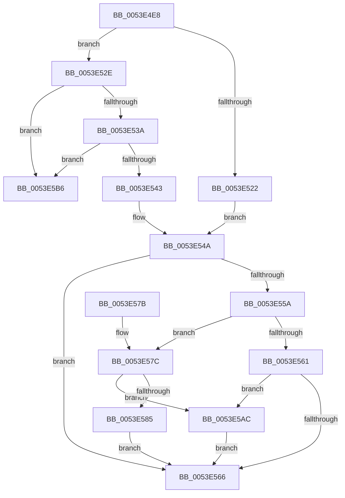

# HalpDmaReturnEmergencyLogicalAddressResources

- RVA: `0x0053E4E8`–`0x0053E5BD` (길이 `213` bytes)
- VA: `0x000000014053E4E8`
- 실행 섹션: `.text`
- PDB 이름 있음: `예`; PDB Function 태그: `아니요`
- unwind 정보 RVA: `0x000ABDCC`
- 디코드: `60`개 명령, `213/213` bytes 표시
- 미해석 바이트: `0` (있으면 어셈블리에 `.byte`로 보존)

> 이 문서는 커널 이미지의 기계어와 PDB 기호를 분석해 생성했습니다. 4번과 5번은 함수 원형과 자료형을 바이너리 사용 방식에서 추정한 C 해석이며 원본 소스 복구 결과는 아닙니다.

## 1. Dependencies

- 직접 호출 지점: **4**; 고유 호출 대상: **4**
- 직접 호출자로 확인된 함수: **2**
- RIP 상대 이미지 참조: **0**

### Outgoing calls
- `0x0053E50B` → [KeAcquireSpinLockRaiseToDpc](../20/KeAcquireSpinLockRaiseToDpc_function_00208470.md) (function, `0x00208470`)
- `0x0053E550` → [KeReleaseSpinLock](../39/KeReleaseSpinLock_function_00392BA0.md) (function, `0x00392BA0`)
- `0x0053E5A5` → [HalpAllocateDmaResourcesInternal](../3D/HalpAllocateDmaResourcesInternal_function_003DA7C4.md) (function, `0x003DA7C4`)
- `0x0053E5AF` → [HalpConstructScatterGatherListDmarThin](../46/HalpConstructScatterGatherListDmarThin_function_00467D30.md) (function, `0x00467D30`)

### Direct callers
- [HalPutScatterGatherListDmarThin](../30/HalPutScatterGatherListDmarThin_function_00306D50.md) at `0x00306DA4`
- [HalpDmaFreeLa](HalpDmaFreeLa_function_0053E1B8.md) at `0x0053E1F6`

### Static image references
- 디코드된 RIP-relative 메모리 참조가 없습니다.

## 2. Other-region calls and transfers

- 다른 실행 섹션으로 향하는 call: **0**
- 별도 외부 분기/꼬리 이동을 확인하지 못했습니다.

## 3. Assembly (complete function range)

```asm
0053E4E8  48 89 5C 24 08                  mov qword ptr [rsp + 8], rbx
0053E4ED  48 89 6C 24 10                  mov qword ptr [rsp + 0x10], rbp
0053E4F2  48 89 74 24 18                  mov qword ptr [rsp + 0x18], rsi
0053E4F7  57                              push rdi
0053E4F8  48 83 EC 20                     sub rsp, 0x20
0053E4FC  48 8D A9 38 02 00 00            lea rbp, [rcx + 0x238]
0053E503  48 8B D9                        mov rbx, rcx
0053E506  48 8B CD                        mov rcx, rbp
0053E509  33 FF                           xor edi, edi
0053E50B  E8 60 9F CC FF                  call 0x140208470
0053E510  48 8D 8B 40 02 00 00            lea rcx, [rbx + 0x240]
0053E517  44 8A C0                        mov r8b, al
0053E51A  48 8B 11                        mov rdx, qword ptr [rcx]
0053E51D  48 3B D1                        cmp rdx, rcx
0053E520  75 0C                           jne 0x14053e52e
0053E522  40 B6 01                        mov sil, 1
0053E525  40 88 BB 50 02 00 00            mov byte ptr [rbx + 0x250], dil
0053E52C  EB 1C                           jmp 0x14053e54a
0053E52E  40 32 F6                        xor sil, sil
0053E531  48 8B FA                        mov rdi, rdx
0053E534  48 39 4A 08                     cmp qword ptr [rdx + 8], rcx
0053E538  75 7C                           jne 0x14053e5b6
0053E53A  48 8B 02                        mov rax, qword ptr [rdx]
0053E53D  48 39 50 08                     cmp qword ptr [rax + 8], rdx
0053E541  75 73                           jne 0x14053e5b6
0053E543  48 89 01                        mov qword ptr [rcx], rax
0053E546  48 89 48 08                     mov qword ptr [rax + 8], rcx
0053E54A  41 8A D0                        mov dl, r8b
0053E54D  48 8B CD                        mov rcx, rbp
0053E550  E8 4B 46 E5 FF                  call 0x140392ba0
0053E555  40 84 F6                        test sil, sil
0053E558  75 0C                           jne 0x14053e566
0053E55A  8B 4F 10                        mov ecx, dword ptr [rdi + 0x10]
0053E55D  85 C9                           test ecx, ecx
0053E55F  74 1B                           je 0x14053e57c
0053E561  83 F9 01                        cmp ecx, 1
0053E564  74 46                           je 0x14053e5ac
0053E566  48 8B 5C 24 30                  mov rbx, qword ptr [rsp + 0x30]
0053E56B  48 8B 6C 24 38                  mov rbp, qword ptr [rsp + 0x38]
0053E570  48 8B 74 24 40                  mov rsi, qword ptr [rsp + 0x40]
0053E575  48 83 C4 20                     add rsp, 0x20
0053E579  5F                              pop rdi
0053E57A  C3                              ret
0053E57B  CC                              int3
0053E57C  83 BB 70 02 00 00 03            cmp dword ptr [rbx + 0x270], 3
0053E583  75 27                           jne 0x14053e5ac
0053E585  48 8B 8B F0 00 00 00            mov rcx, qword ptr [rbx + 0xf0]
0053E58C  45 33 C0                        xor r8d, r8d
0053E58F  48 8B 83 30 02 00 00            mov rax, qword ptr [rbx + 0x230]
0053E596  B2 01                           mov dl, 1
0053E598  48 89 41 18                     mov qword ptr [rcx + 0x18], rax
0053E59C  48 8B CB                        mov rcx, rbx
0053E59F  FF 83 70 02 00 00               inc dword ptr [rbx + 0x270]
0053E5A5  E8 1A C2 E9 FF                  call 0x1403da7c4
0053E5AA  EB BA                           jmp 0x14053e566
0053E5AC  48 8B CF                        mov rcx, rdi
0053E5AF  E8 7C 97 F2 FF                  call 0x140467d30
0053E5B4  EB B0                           jmp 0x14053e566
0053E5B6  B9 03 00 00 00                  mov ecx, 3
0053E5BB  CD 29                           int 0x29
```

## 4. C-style interpretation (structured pseudocode)

```c
__int64 __fastcall HalpDmaReturnEmergencyLogicalAddressResources(__int64 a1)
{
    __int64 result;
    __int64 v_rdi;
    __int64 v_rsi;
    __int64 v_rsp;
    unsigned __int64 v_stack_p10;
    unsigned __int64 v_stack_p18;
    unsigned __int64 v_stack_p8;

    v_stack_p8 = v_rbx;
    v_stack_p10 = v_rbp;
    v_stack_p18 = v_rsi;
    v_rsp = (v_rsp) - (32);
    v_rdi = 0;
    result = KeAcquireSpinLockRaiseToDpc(a1 + 568, a2, a3, a4);
    if ((*(unsigned __int64 *)(a1 + 576)) != (a1 + 576)) goto loc_0053E52E;
    *(unsigned __int8 *)(a1 + 592) = 0;
    goto loc_0053E54A;
loc_0053E52E:
    v_rsi = 0;
    if ((*(unsigned __int64 *)(*(unsigned __int64 *)(a1 + 576) + 8)) != (a1 + 576)) goto loc_0053E5B6;
    if ((*(unsigned __int64 *)(*(unsigned __int64 *)(*(unsigned __int64 *)(a1 + 576)) + 8)) != (*(unsigned __int64 *)(a1 + 576))) goto loc_0053E5B6;
    *(unsigned __int64 *)(a1 + 576) = *(unsigned __int64 *)(*(unsigned __int64 *)(a1 + 576));
    *(unsigned __int64 *)(*(unsigned __int64 *)(*(unsigned __int64 *)(a1 + 576)) + 8) = a1 + 576;
loc_0053E54A:
    result = KeReleaseSpinLock(a1 + 568, (unsigned __int8)((unsigned __int8)(result)), (unsigned __int8)(result), a4);
    if (0 != 0) goto loc_0053E566;
    if ((unsigned int)((unsigned int)(*(unsigned int *)(*(unsigned __int64 *)(a1 + 576) + 16))) == 0) goto loc_0053E57C;
    if (((unsigned int)((unsigned int)(*(unsigned int *)(*(unsigned __int64 *)(a1 + 576) + 16)))) == 1) goto loc_0053E5AC;
loc_0053E566:
    v_rsp = (v_rsp) + (32);
    return result;
loc_0053E57C:
    if ((*(unsigned int *)(v_stack_p8 + 624)) != 3) goto loc_0053E5AC;
    a3 = 0;
    *(unsigned __int64 *)(*(unsigned __int64 *)(v_stack_p8 + 240) + 24) = *(unsigned __int64 *)(v_stack_p8 + 560);
    result = HalpAllocateDmaResourcesInternal(v_stack_p8, 1, a3, a4);
    goto loc_0053E566;
loc_0053E5AC:
    result = HalpConstructScatterGatherListDmarThin(*(unsigned __int64 *)(a1 + 576), 1, a3, a4);
    goto loc_0053E566;
loc_0053E5B6:
    return result;
}
```

## 5. (Beta) C Style

```c
int64_t HalpDmaReturnEmergencyLogicalAddressResources(void *Arg1)
{
    uint8_t *arg1 = (uint8_t *)Arg1;

    int64_t result;
    int64_t local_rdi;
    int64_t local_rsi;
    int64_t local_rsp;
    uint64_t v_stack_p10;
    uint64_t v_stack_p18;
    uint64_t v_stack_p8;

    v_stack_p8 = local_rbx;
    v_stack_p10 = local_rbp;
    v_stack_p18 = local_rsi;
    local_rsp = (local_rsp) - (32);
    local_rdi = 0;
    result = KeAcquireSpinLockRaiseToDpc(Arg1 + 568, a2, a3, a4);
    if ((*(uint64_t *)(arg1 + 0x240)) != (Arg1 + 576)) goto loc_0053E52E;
    *(uint8_t *)(arg1 + 0x250) = 0;
    goto loc_0053E54A;
loc_0053E52E:
    local_rsi = 0;
    if ((*(uint64_t *)(*(uint64_t *)(arg1 + 0x240) + 0x8)) != (Arg1 + 576)) goto loc_0053E5B6;
    if ((*(uint64_t *)(*(uint64_t *)(*(uint64_t *)(arg1 + 0x240)) + 0x8)) != (*(uint64_t *)(arg1 + 0x240))) goto loc_0053E5B6;
    *(uint64_t *)(arg1 + 0x240) = *(uint64_t *)(*(uint64_t *)(arg1 + 0x240));
    *(void **)(*(uint64_t *)(*(uint64_t *)(arg1 + 0x240)) + 0x8) = Arg1 + 576;
loc_0053E54A:
    result = KeReleaseSpinLock(Arg1 + 568, (uint8_t)((uint8_t)(result)), (uint8_t)(result), a4);
    if (0 != 0) goto loc_0053E566;
    if ((uint32_t)((uint32_t)(*(uint32_t *)(*(uint64_t *)(arg1 + 0x240) + 0x10))) == 0) goto loc_0053E57C;
    if (((uint32_t)((uint32_t)(*(uint32_t *)(*(uint64_t *)(arg1 + 0x240) + 0x10)))) == 1) goto loc_0053E5AC;
loc_0053E566:
    local_rsp = (local_rsp) + (32);
    return result;
loc_0053E57C:
    if ((*(uint32_t *)(v_stack_p8 + 0x270)) != 3) goto loc_0053E5AC;
    a3 = 0;
    *(uint64_t *)(*(uint64_t *)(v_stack_p8 + 0xF0) + 0x18) = *(uint64_t *)(v_stack_p8 + 0x230);
    result = HalpAllocateDmaResourcesInternal(v_stack_p8, 1, a3, a4);
    goto loc_0053E566;
loc_0053E5AC:
    result = HalpConstructScatterGatherListDmarThin(*(uint64_t *)(arg1 + 0x240), 1, a3, a4);
    goto loc_0053E566;
loc_0053E5B6:
    return result;
}
```

### 관측된 메모리 오프셋

구조체 형식이 확인되지 않은 접근은 인자 기준의 오프셋으로만 기록했습니다.

| 기준 인자 | 오프셋 표현 | 폭 (bit) | 접근 |
|---|---:|---:|---|
| `Arg1` | `+ 0x0` | `64` | `R` |
| `Arg1` | `+ 0x0` | `64` | `W` |
| `Arg1` | `+ 0xF0` | `64` | `R` |
| `Arg1` | `+ 0x230` | `64` | `R` |
| `Arg1` | `+ 0x238` | `64` | `R` |
| `Arg1` | `+ 0x240` | `64` | `R` |
| `Arg1` | `+ 0x250` | `8` | `W` |
| `Arg1` | `+ 0x270` | `32` | `R` |
| `Arg1` | `+ 0x270` | `32` | `R/W` |

## 6. Execution-region graph

[열기: 2D/3D 그래프와 함수 탐색 컨트롤 패널](../../../control-panel.html?section=text&rva=0x0053E4E8&view=graph)

- 2D 그래프는 위에서 아래로 흐르고, 3D 그래프는 빈 공간을 드래그해 회전합니다. Shift+드래그는 이동, 휠은 확대·축소, 함수 노드 선택은 대상 보고서 이동입니다.

### Static fallback


