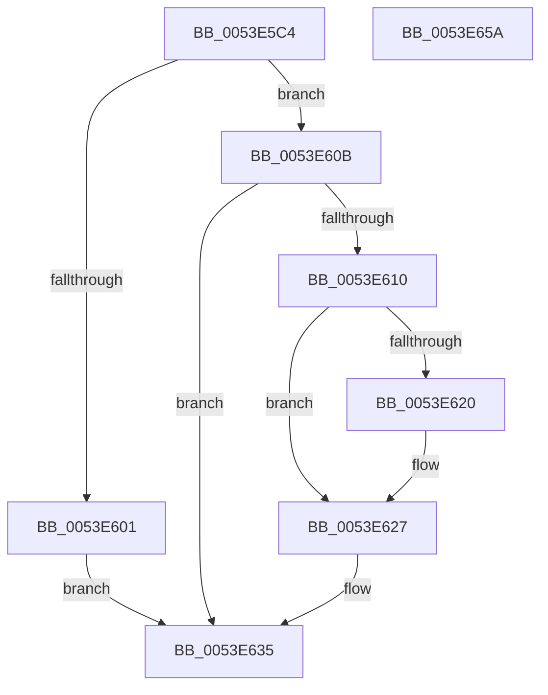

# HalpDmaUseEmergencyLogicalAddressResources

- RVA: `0x0053E5C4`–`0x0053E65B` (길이 `151` bytes)
- VA: `0x000000014053E5C4`
- 실행 섹션: `.text`
- PDB 이름 있음: `예`; PDB Function 태그: `아니요`
- unwind 정보 RVA: `0x0005E6B4`
- 디코드: `43`개 명령, `151/151` bytes 표시
- 미해석 바이트: `0` (있으면 어셈블리에 `.byte`로 보존)

> 이 문서는 커널 이미지의 기계어와 PDB 기호를 분석해 생성했습니다. 4번과 5번은 함수 원형과 자료형을 바이너리 사용 방식에서 추정한 C 해석이며 원본 소스 복구 결과는 아닙니다.

## 1. Dependencies

- 직접 호출 지점: **2**; 고유 호출 대상: **2**
- 직접 호출자로 확인된 함수: **2**
- RIP 상대 이미지 참조: **0**

### Outgoing calls
- `0x0053E5F0` → [KeAcquireSpinLockRaiseToDpc](../20/KeAcquireSpinLockRaiseToDpc_function_00208470.md) (function, `0x00208470`)
- `0x0053E638` → [KeReleaseSpinLock](../39/KeReleaseSpinLock_function_00392BA0.md) (function, `0x00392BA0`)

### Direct callers
- [sub_006E9B50](../6E/Unknown_function_006E9B50.md) at `0x006E9BCE`
- [sub_006F2DEA](../6F/Unknown_function_006F2DEA.md) at `0x006F2E6A`

### Static image references
- 디코드된 RIP-relative 메모리 참조가 없습니다.

## 2. Other-region calls and transfers

- 다른 실행 섹션으로 향하는 call: **0**
- 별도 외부 분기/꼬리 이동을 확인하지 못했습니다.

## 3. Assembly (complete function range)

```asm
0053E5C4  48 8B C4                        mov rax, rsp
0053E5C7  48 89 58 08                     mov qword ptr [rax + 8], rbx
0053E5CB  48 89 68 10                     mov qword ptr [rax + 0x10], rbp
0053E5CF  48 89 70 18                     mov qword ptr [rax + 0x18], rsi
0053E5D3  48 89 78 20                     mov qword ptr [rax + 0x20], rdi
0053E5D7  41 56                           push r14
0053E5D9  48 83 EC 20                     sub rsp, 0x20
0053E5DD  48 8D A9 38 02 00 00            lea rbp, [rcx + 0x238]
0053E5E4  48 8B F1                        mov rsi, rcx
0053E5E7  48 8B CD                        mov rcx, rbp
0053E5EA  45 8A F0                        mov r14b, r8b
0053E5ED  48 8B FA                        mov rdi, rdx
0053E5F0  E8 7B 9E CC FF                  call 0x140208470
0053E5F5  32 DB                           xor bl, bl
0053E5F7  8A D0                           mov dl, al
0053E5F9  38 9E 50 02 00 00               cmp byte ptr [rsi + 0x250], bl
0053E5FF  75 0A                           jne 0x14053e60b
0053E601  B3 01                           mov bl, 1
0053E603  88 9E 50 02 00 00               mov byte ptr [rsi + 0x250], bl
0053E609  EB 2A                           jmp 0x14053e635
0053E60B  45 84 F6                        test r14b, r14b
0053E60E  74 25                           je 0x14053e635
0053E610  48 8D 86 40 02 00 00            lea rax, [rsi + 0x240]
0053E617  48 8B 48 08                     mov rcx, qword ptr [rax + 8]
0053E61B  48 39 01                        cmp qword ptr [rcx], rax
0053E61E  74 07                           je 0x14053e627
0053E620  B9 03 00 00 00                  mov ecx, 3
0053E625  CD 29                           int 0x29
0053E627  48 89 07                        mov qword ptr [rdi], rax
0053E62A  48 89 4F 08                     mov qword ptr [rdi + 8], rcx
0053E62E  48 89 39                        mov qword ptr [rcx], rdi
0053E631  48 89 78 08                     mov qword ptr [rax + 8], rdi
0053E635  48 8B CD                        mov rcx, rbp
0053E638  E8 63 45 E5 FF                  call 0x140392ba0
0053E63D  48 8B 6C 24 38                  mov rbp, qword ptr [rsp + 0x38]
0053E642  8A C3                           mov al, bl
0053E644  48 8B 5C 24 30                  mov rbx, qword ptr [rsp + 0x30]
0053E649  48 8B 74 24 40                  mov rsi, qword ptr [rsp + 0x40]
0053E64E  48 8B 7C 24 48                  mov rdi, qword ptr [rsp + 0x48]
0053E653  48 83 C4 20                     add rsp, 0x20
0053E657  41 5E                           pop r14
0053E659  C3                              ret
0053E65A  CC                              int3
```

## 4. C-style interpretation (structured pseudocode)

```c
__int64 __fastcall HalpDmaUseEmergencyLogicalAddressResources(__int64 a1, __int64 a2, unsigned __int8 a3)
{
    __int64 result;
    __int64 v_rbx;
    __int64 v_rsp;
    unsigned __int64 v_stack_p10;
    unsigned __int64 v_stack_p18;
    unsigned __int64 v_stack_p20;
    unsigned __int64 v_stack_p8;

    *(unsigned __int64 *)(v_rsp + 8) = v_rbx;
    *(unsigned __int64 *)(v_rsp + 16) = v_rbp;
    *(unsigned __int64 *)(v_rsp + 24) = v_rsi;
    *(unsigned __int64 *)(v_rsp + 32) = v_rdi;
    v_rsp = (v_rsp) - (32);
    result = KeAcquireSpinLockRaiseToDpc(a1 + 568, a2, a3, a4);
    v_rbx = 0;
    if ((*(unsigned __int8 *)(a1 + 592)) != 0) goto loc_0053E60B;
    *(unsigned __int8 *)(a1 + 592) = 1;
    goto loc_0053E635;
loc_0053E60B:
    if (a3 == 0) goto loc_0053E635;
    if ((*(unsigned __int64 *)(*(unsigned __int64 *)(a1 + 576 + 8))) != (a1 + 576)) {
        a1 = 3;
    }
    *(unsigned __int64 *)(a2) = a1 + 576;
    *(unsigned __int64 *)(a2 + 8) = a1;
    *(unsigned __int64 *)(a1) = a2;
    *(unsigned __int64 *)(a1 + 576 + 8) = a2;
loc_0053E635:
    result = KeReleaseSpinLock(a1 + 568, (unsigned __int8)(result), a3, a4);
    v_rsp = (v_rsp) + (32);
    return 1;
}
```

## 5. (Beta) C Style

```c
int64_t HalpDmaUseEmergencyLogicalAddressResources(void *Arg1, void *Arg2, uint8_t Arg3)
{
    uint8_t *arg1 = (uint8_t *)Arg1;
    uint8_t *arg2 = (uint8_t *)Arg2;

    int64_t result;
    int64_t local_rbx;
    int64_t local_rsp;
    uint64_t v_stack_p10;
    uint64_t v_stack_p18;
    uint64_t v_stack_p20;
    uint64_t v_stack_p8;

    *(uint64_t *)(local_rsp + 0x8) = local_rbx;
    *(uint64_t *)(local_rsp + 0x10) = local_rbp;
    *(uint64_t *)(local_rsp + 0x18) = local_rsi;
    *(uint64_t *)(local_rsp + 0x20) = local_rdi;
    local_rsp = (local_rsp) - (32);
    result = KeAcquireSpinLockRaiseToDpc(Arg1 + 568, Arg2, Arg3, a4);
    local_rbx = 0;
    if ((*(uint8_t *)(arg1 + 0x250)) != 0) goto loc_0053E60B;
    *(uint8_t *)(arg1 + 0x250) = 1;
    goto loc_0053E635;
loc_0053E60B:
    if (Arg3 == 0) goto loc_0053E635;
    if ((*(uint64_t *)(*(uint64_t *)(arg1 + 0x240 + 0x8))) != (Arg1 + 576)) {
        Arg1 = 3;
    }
    *(void **)(arg2) = Arg1 + 576;
    *(void **)(arg2 + 0x8) = Arg1;
    *(void **)(arg1) = Arg2;
    *(void **)(arg1 + 0x240 + 0x8) = Arg2;
loc_0053E635:
    result = KeReleaseSpinLock(Arg1 + 568, (uint8_t)(result), Arg3, a4);
    local_rsp = (local_rsp) + (32);
    return 1;
}
```

### 관측된 메모리 오프셋

구조체 형식이 확인되지 않은 접근은 인자 기준의 오프셋으로만 기록했습니다.

| 기준 인자 | 오프셋 표현 | 폭 (bit) | 접근 |
|---|---:|---:|---|
| `Arg1` | `+ 0x8` | `64` | `R` |
| `Arg1` | `+ 0x8` | `64` | `W` |
| `Arg1` | `+ 0x238` | `64` | `R` |
| `Arg1` | `+ 0x240` | `64` | `R` |
| `Arg1` | `+ 0x250` | `8` | `R` |
| `Arg1` | `+ 0x250` | `8` | `W` |
| `Arg2` | `+ 0x0` | `64` | `W` |
| `Arg2` | `+ 0x8` | `64` | `W` |

## 6. Execution-region graph

[열기: 2D/3D 그래프와 함수 탐색 컨트롤 패널](../../../control-panel.html?section=text&rva=0x0053E5C4&view=graph)

- 2D 그래프는 위에서 아래로 흐르고, 3D 그래프는 빈 공간을 드래그해 회전합니다. Shift+드래그는 이동, 휠은 확대·축소, 함수 노드 선택은 대상 보고서 이동입니다.

### Static fallback


