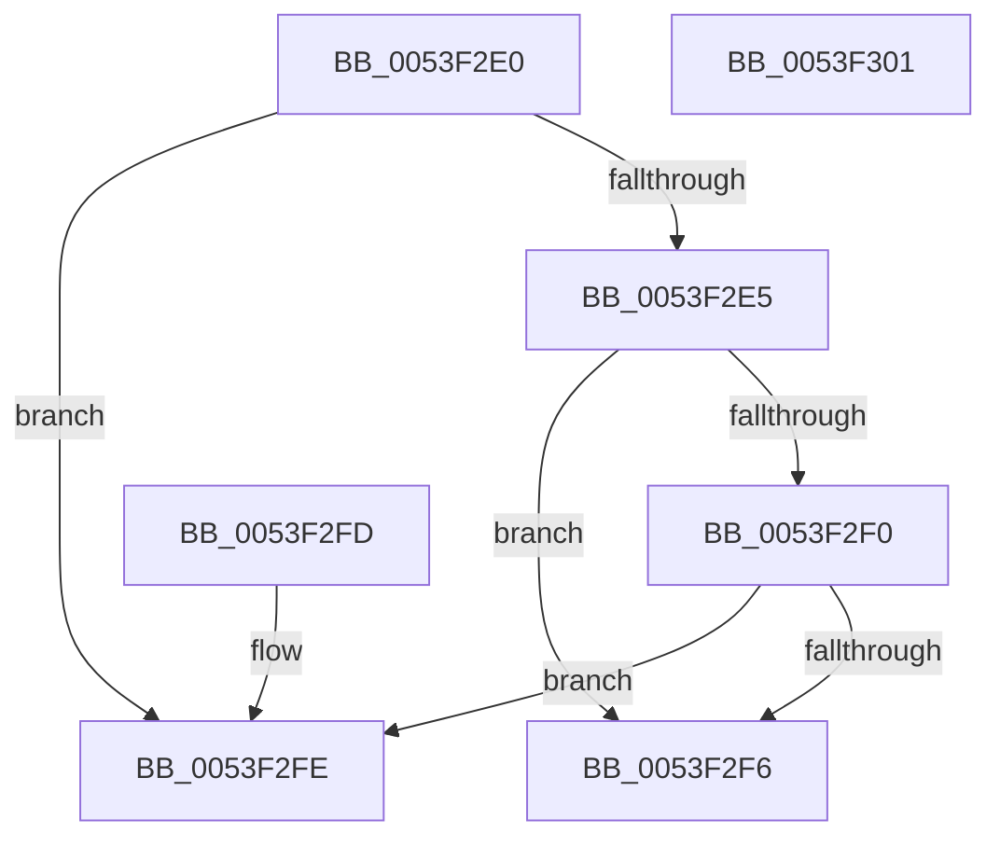

# HalpFindBusAddressTranslation

- RVA: `0x0053F2E0`–`0x0053F302` (길이 `34` bytes)
- VA: `0x000000014053F2E0`
- 실행 섹션: `.text`
- PDB 이름 있음: `예`; PDB Function 태그: `아니요`
- unwind 정보 RVA: `0x000DB714`
- 디코드: `14`개 명령, `34/34` bytes 표시
- 미해석 바이트: `0` (있으면 어셈블리에 `.byte`로 보존)

> 이 문서는 커널 이미지의 기계어와 PDB 기호를 분석해 생성했습니다. 4번과 5번은 함수 원형과 자료형을 바이너리 사용 방식에서 추정한 C 해석이며 원본 소스 복구 결과는 아닙니다.

## 1. Dependencies

- 직접 호출 지점: **0**; 고유 호출 대상: **0**
- 직접 호출자로 확인된 함수: **0**
- RIP 상대 이미지 참조: **0**

### Outgoing calls
- 직접 디코드된 call 명령이 없습니다.

### Direct callers
- 이 함수 시작 RVA로 연결되는 직접 call은 확인되지 않았습니다. 간접 호출은 완전히 역산할 수 없습니다.

### Static image references
- 디코드된 RIP-relative 메모리 참조가 없습니다.

## 2. Other-region calls and transfers

- 다른 실행 섹션으로 향하는 call: **0**
- 별도 외부 분기/꼬리 이동을 확인하지 못했습니다.

## 3. Assembly (complete function range)

```asm
0053F2E0  4D 85 C9                        test r9, r9
0053F2E3  74 19                           je 0x14053f2fe
0053F2E5  49 83 39 00                     cmp qword ptr [r9], 0
0053F2E9  B8 01 00 00 00                  mov eax, 1
0053F2EE  74 06                           je 0x14053f2f6
0053F2F0  38 44 24 28                     cmp byte ptr [rsp + 0x28], al
0053F2F4  74 08                           je 0x14053f2fe
0053F2F6  49 89 01                        mov qword ptr [r9], rax
0053F2F9  49 89 08                        mov qword ptr [r8], rcx
0053F2FC  C3                              ret
0053F2FD  CC                              int3
0053F2FE  32 C0                           xor al, al
0053F300  C3                              ret
0053F301  CC                              int3
```

## 4. C-style interpretation (structured pseudocode)

```c
__int64 __fastcall HalpFindBusAddressTranslation(__int64 a1, __int64 a2, __int64 a3, __int64 a4, unsigned __int8 a5)
{
    __int64 result;

    if (a4 == 0) goto loc_0053F2FE;
    if ((*(unsigned __int64 *)(a4)) == 0) goto loc_0053F2F6;
    if (a5 == 1) goto loc_0053F2FE;
loc_0053F2F6:
    *(unsigned __int64 *)(a4) = 1;
    *(unsigned __int64 *)(a3) = a1;
    return 1;
loc_0053F2FE:
    result = 0;
    return result;
}
```

## 5. (Beta) C Style

```c
int64_t HalpFindBusAddressTranslation(int64_t Arg1, int64_t Arg2, void *Arg3, int64_t Arg4, uint8_t Arg5)
{
    uint8_t *arg3 = (uint8_t *)Arg3;

    int64_t result;

    if (Arg4 == 0) goto loc_0053F2FE;
    if ((*(uint64_t *)(Arg4)) == 0) goto loc_0053F2F6;
    if (Arg5 == 1) goto loc_0053F2FE;
loc_0053F2F6:
    *(uint64_t *)(Arg4) = 1;
    *(uint64_t *)(arg3) = Arg1;
    return 1;
loc_0053F2FE:
    result = 0;
    return result;
}
```

### 관측된 메모리 오프셋

구조체 형식이 확인되지 않은 접근은 인자 기준의 오프셋으로만 기록했습니다.

| 기준 인자 | 오프셋 표현 | 폭 (bit) | 접근 |
|---|---:|---:|---|
| `Arg3` | `+ 0x0` | `64` | `W` |

## 6. Execution-region graph

[열기: 2D/3D 그래프와 함수 탐색 컨트롤 패널](../../../control-panel.html?section=text&rva=0x0053F2E0&view=graph)

- 2D 그래프는 위에서 아래로 흐르고, 3D 그래프는 빈 공간을 드래그해 회전합니다. Shift+드래그는 이동, 휠은 확대·축소, 함수 노드 선택은 대상 보고서 이동입니다.

### Static fallback


