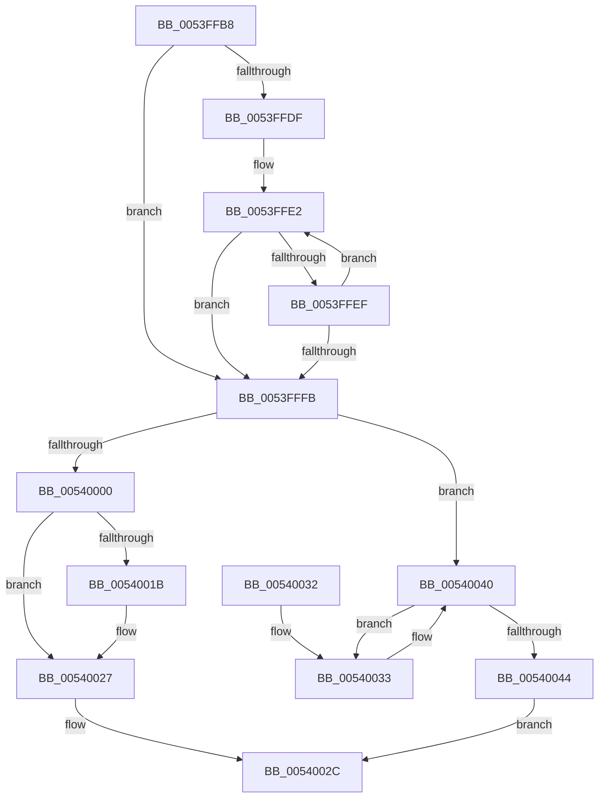

# HalpGetFullPmuOwnership

- RVA: `0x0053FFB8`–`0x0054004B` (길이 `147` bytes)
- VA: `0x000000014053FFB8`
- 실행 섹션: `.text`
- PDB 이름 있음: `예`; PDB Function 태그: `아니요`
- unwind 정보 RVA: `0x0008C174`
- 디코드: `44`개 명령, `147/147` bytes 표시
- 미해석 바이트: `0` (있으면 어셈블리에 `.byte`로 보존)

> 이 문서는 커널 이미지의 기계어와 PDB 기호를 분석해 생성했습니다. 4번과 5번은 함수 원형과 자료형을 바이너리 사용 방식에서 추정한 C 해석이며 원본 소스 복구 결과는 아닙니다.

## 1. Dependencies

- 직접 호출 지점: **1**; 고유 호출 대상: **1**
- 직접 호출자로 확인된 함수: **1**
- RIP 상대 이미지 참조: **3**

### Outgoing calls
- `0x0053FFC6` → [KeQueryActiveProcessorCountEx](../24/KeQueryActiveProcessorCountEx_function_00249EF0.md) (function, `0x00249EF0`)

### Direct callers
- [HalAllocateHardwareCounters](../../page/70/HalAllocateHardwareCounters_function_00707050.md) at `0x007070C7`

### Static image references
- `0x0053FFCD` → RVA `0x00FC8C40` (`ALMOSTRO`; read)
- `0x00540000` → RVA `0x00E0A760` (`.data`; read)
- `0x0054000F` → RVA `0x00E0A760` (`.data`; write)

## 2. Other-region calls and transfers

- 다른 실행 섹션으로 향하는 call: **0**
- 별도 외부 분기/꼬리 이동을 확인하지 못했습니다.

## 3. Assembly (complete function range)

```asm
0053FFB8  40 53                           push rbx
0053FFBA  48 83 EC 20                     sub rsp, 0x20
0053FFBE  48 8B D9                        mov rbx, rcx
0053FFC1  B9 FF FF 00 00                  mov ecx, 0xffff
0053FFC6  E8 25 9F D0 FF                  call 0x140249ef0
0053FFCB  33 D2                           xor edx, edx
0053FFCD  4C 8D 1D 6C 8C A8 00            lea r11, [rip + 0xa88c6c]
0053FFD4  44 8B C8                        mov r9d, eax
0053FFD7  44 8D 52 01                     lea r10d, [rdx + 1]
0053FFDB  85 C0                           test eax, eax
0053FFDD  74 1C                           je 0x14053fffb
0053FFDF  4D 8B C3                        mov r8, r11
0053FFE2  49 8B 08                        mov rcx, qword ptr [r8]
0053FFE5  33 C0                           xor eax, eax
0053FFE7  F0 44 0F B1 51 60               lock cmpxchg dword ptr [rcx + 0x60], r10d
0053FFED  75 0C                           jne 0x14053fffb
0053FFEF  41 03 D2                        add edx, r10d
0053FFF2  49 83 C0 08                     add r8, 8
0053FFF6  41 3B D1                        cmp edx, r9d
0053FFF9  72 E7                           jb 0x14053ffe2
0053FFFB  41 3B D1                        cmp edx, r9d
0053FFFE  75 40                           jne 0x140540040
00540000  48 8B 05 59 A7 8C 00            mov rax, qword ptr [rip + 0x8ca759]
00540007  B9 00 00 00 C0                  mov ecx, 0xc0000000
0054000C  49 03 C2                        add rax, r10
0054000F  48 89 05 4A A7 8C 00            mov qword ptr [rip + 0x8ca74a], rax
00540016  48 3B C1                        cmp rax, rcx
00540019  75 0C                           jne 0x140540027
0054001B  B8 00 00 00 80                  mov eax, 0x80000000
00540020  48 89 05 39 A7 8C 00            mov qword ptr [rip + 0x8ca739], rax
00540027  48 89 03                        mov qword ptr [rbx], rax
0054002A  33 C0                           xor eax, eax
0054002C  48 83 C4 20                     add rsp, 0x20
00540030  5B                              pop rbx
00540031  C3                              ret
00540032  CC                              int3
00540033  8D 42 FF                        lea eax, [rdx - 1]
00540036  8B D0                           mov edx, eax
00540038  49 8B 04 C3                     mov rax, qword ptr [r11 + rax*8]
0054003C  F0 FF 48 60                     lock dec dword ptr [rax + 0x60]
00540040  85 D2                           test edx, edx
00540042  75 EF                           jne 0x140540033
00540044  B8 9A 00 00 C0                  mov eax, 0xc000009a
00540049  EB E1                           jmp 0x14054002c
```

## 4. C-style interpretation (structured pseudocode)

```c
__int64 __fastcall HalpGetFullPmuOwnership(__int64 a1, int a2)
{
    __int64 result;
    __int64 v_rsp;

    v_rsp = (v_rsp) - (32);
    result = KeQueryActiveProcessorCountEx((unsigned int)(0xFFFFULL), a2, a3, a4);
    a2 = 0;
    if ((unsigned int)(result) == 0) goto loc_0053FFFB;
loc_0053FFE2:
    result = 0;
    if (condition_is_not_equal) goto loc_0053FFFB;
    a2 = (unsigned int)((a2) + ((unsigned int)(a2 + 1)));
    a3 = (v_rip + 11045996) + (8);
    if (a2 < ((unsigned int)((unsigned int)((unsigned int)(result))))) goto loc_0053FFE2;
loc_0053FFFB:
    if (a2 != ((unsigned int)((unsigned int)((unsigned int)(result))))) goto loc_00540040;
    result = (*(unsigned __int64 *)(v_rip + 9217881)) + (a2 + 1);
    *(unsigned __int64 *)(v_rip + 9217866) = result;
    if (result == ((unsigned int)(0xC0000000ULL))) {
        result = 0x80000000ULL;
        *(unsigned __int64 *)(v_rip + 9217849) = result;
    }
    *(unsigned __int64 *)(a1) = result;
    result = 0;
loc_0054002C:
    v_rsp = (v_rsp) + (32);
    return result;
loc_00540033:
loc_00540040:
    if ((unsigned int)((unsigned int)((unsigned int)(a2 - 1))) != 0) goto loc_00540033;
    goto loc_0054002C;
}
```

## 5. (Beta) C Style

```c
int64_t HalpGetFullPmuOwnership(void *Arg1, int32_t Arg2)
{
    uint8_t *arg1 = (uint8_t *)Arg1;

    int64_t result;
    int64_t local_rsp;

    local_rsp = (local_rsp) - (32);
    result = KeQueryActiveProcessorCountEx((uint32_t)(0xFFFFULL), Arg2, a3, a4);
    Arg2 = 0;
    if ((uint32_t)(result) == 0) goto loc_0053FFFB;
loc_0053FFE2:
    result = 0;
    if (condition_is_not_equal) goto loc_0053FFFB;
    Arg2 = (uint32_t)((Arg2) + ((uint32_t)(Arg2 + 1)));
    a3 = (v_rip + 11045996) + (8);
    if (Arg2 < ((uint32_t)((uint32_t)((uint32_t)(result))))) goto loc_0053FFE2;
loc_0053FFFB:
    if (Arg2 != ((uint32_t)((uint32_t)((uint32_t)(result))))) goto loc_00540040;
    result = (*(uint64_t *)(v_rip + 0x8CA759)) + (Arg2 + 1);
    *(uint64_t *)(v_rip + 0x8CA74A) = result;
    if (result == ((uint32_t)(0xC0000000ULL))) {
        result = 0x80000000ULL;
        *(uint64_t *)(v_rip + 0x8CA739) = result;
    }
    *(uint64_t *)(arg1) = result;
    result = 0;
loc_0054002C:
    local_rsp = (local_rsp) + (32);
    return result;
loc_00540033:
loc_00540040:
    if ((uint32_t)((uint32_t)((uint32_t)(Arg2 - 1))) != 0) goto loc_00540033;
    goto loc_0054002C;
}
```

### 관측된 메모리 오프셋

구조체 형식이 확인되지 않은 접근은 인자 기준의 오프셋으로만 기록했습니다.

| 기준 인자 | 오프셋 표현 | 폭 (bit) | 접근 |
|---|---:|---:|---|
| `Arg1` | `+ 0x0` | `64` | `W` |

## 6. Execution-region graph

[열기: 2D/3D 그래프와 함수 탐색 컨트롤 패널](../../../control-panel.html?section=text&rva=0x0053FFB8&view=graph)

- 2D 그래프는 위에서 아래로 흐르고, 3D 그래프는 빈 공간을 드래그해 회전합니다. Shift+드래그는 이동, 휠은 확대·축소, 함수 노드 선택은 대상 보고서 이동입니다.

### Static fallback


