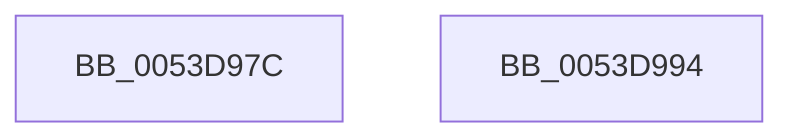

# HalpInitializeLateSystemActions

- RVA: `0x0053D97C`–`0x0053D995` (길이 `25` bytes)
- VA: `0x000000014053D97C`
- 실행 섹션: `.text`
- PDB 이름 있음: `예`; PDB Function 태그: `아니요`
- unwind 정보 RVA: `0x0005C788`
- 디코드: `8`개 명령, `25/25` bytes 표시
- 미해석 바이트: `0` (있으면 어셈블리에 `.byte`로 보존)

> 이 문서는 커널 이미지의 기계어와 PDB 기호를 분석해 생성했습니다. 4번과 5번은 함수 원형과 자료형을 바이너리 사용 방식에서 추정한 C 해석이며 원본 소스 복구 결과는 아닙니다.

## 1. Dependencies

- 직접 호출 지점: **1**; 고유 호출 대상: **1**
- 직접 호출자로 확인된 함수: **1**
- RIP 상대 이미지 참조: **0**

### Outgoing calls
- `0x0053D98A` → [HalpInitSystemHelper](../../pagelk/B5/HalpInitSystemHelper_function_00B5B738.md) (function, `0x00B5B738`)

### Direct callers
- [sub_00B46B8A](../../page/B4/Unknown_function_00B46B8A.md) at `0x00B46BFD`

### Static image references
- 디코드된 RIP-relative 메모리 참조가 없습니다.

## 2. Other-region calls and transfers

- 다른 실행 섹션으로 향하는 call: **1**
  - `0x0053D98A` → [HalpInitSystemHelper](../../pagelk/B5/HalpInitSystemHelper_function_00B5B738.md) (`.text` → `PAGELK`)
- 별도 외부 분기/꼬리 이동을 확인하지 못했습니다.

## 3. Assembly (complete function range)

```asm
0053D97C  48 83 EC 28                     sub rsp, 0x28
0053D980  45 33 C0                        xor r8d, r8d
0053D983  41 8D 50 21                     lea edx, [r8 + 0x21]
0053D987  8D 4A FE                        lea ecx, [rdx - 2]
0053D98A  E8 A9 DD 61 00                  call 0x140b5b738
0053D98F  48 83 C4 28                     add rsp, 0x28
0053D993  C3                              ret
0053D994  CC                              int3
```

## 4. C-style interpretation (structured pseudocode)

```c
__int64 __fastcall HalpInitializeLateSystemActions(__int64 a1, __int64 a2, int a3)
{
    __int64 result;
    __int64 v_rsp;

    v_rsp = (v_rsp) - (40);
    a3 = 0;
    result = HalpInitSystemHelper(a3 + 33 - 2, a3 + 33, a3, a4);
    v_rsp = (v_rsp) + (40);
    return result;
}
```

## 5. (Beta) C Style

```c
int64_t HalpInitializeLateSystemActions(int64_t Arg1, int64_t Arg2, int32_t Arg3)
{
    int64_t result;
    int64_t local_rsp;

    local_rsp = (local_rsp) - (40);
    Arg3 = 0;
    result = HalpInitSystemHelper(Arg3 + 33 - 2, Arg3 + 33, Arg3, a4);
    local_rsp = (local_rsp) + (40);
    return result;
}
```

## 6. Execution-region graph

[열기: 2D/3D 그래프와 함수 탐색 컨트롤 패널](../../../control-panel.html?section=text&rva=0x0053D97C&view=graph)

- 2D 그래프는 위에서 아래로 흐르고, 3D 그래프는 빈 공간을 드래그해 회전합니다. Shift+드래그는 이동, 휠은 확대·축소, 함수 노드 선택은 대상 보고서 이동입니다.

### Static fallback


