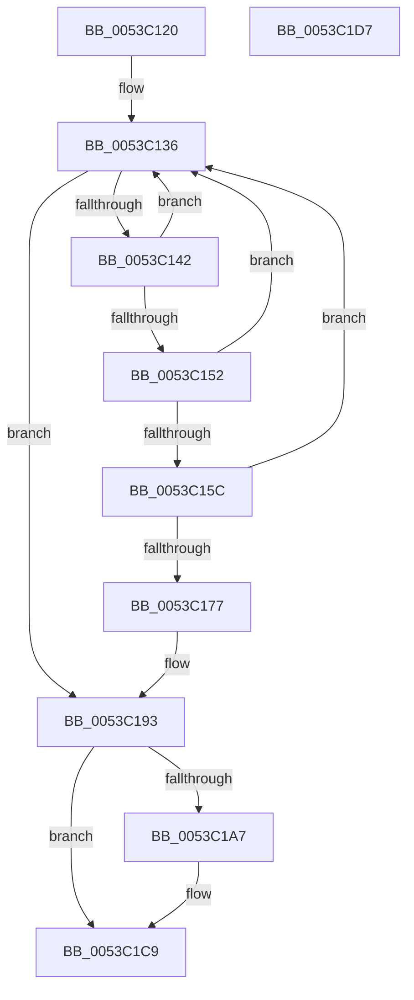

# HalpInitializePnTimers

- RVA: `0x0053C120`–`0x0053C1D8` (길이 `184` bytes)
- VA: `0x000000014053C120`
- 실행 섹션: `.text`
- PDB 이름 있음: `예`; PDB Function 태그: `아니요`
- unwind 정보 RVA: `0x0006E5F8`
- 디코드: `48`개 명령, `184/184` bytes 표시
- 미해석 바이트: `0` (있으면 어셈블리에 `.byte`로 보존)

> 이 문서는 커널 이미지의 기계어와 PDB 기호를 분석해 생성했습니다. 4번과 5번은 함수 원형과 자료형을 바이너리 사용 방식에서 추정한 C 해석이며 원본 소스 복구 결과는 아닙니다.

## 1. Dependencies

- 직접 호출 지점: **4**; 고유 호출 대상: **4**
- 직접 호출자로 확인된 함수: **1**
- RIP 상대 이미지 참조: **5**

### Outgoing calls
- `0x0053C15F` → [HalpTimerGetInternalData](../20/HalpTimerGetInternalData_function_00209500.md) (function, `0x00209500`)
- `0x0053C16B` → [guard_dispatch_icall](../6B/guard_dispatch_icall_function_006BAAD0.md) (function, `0x006BAAD0`)
- `0x0053C18E` → [HalpTimerSetProblemEx](../4F/HalpTimerSetProblemEx_function_004FAEC4.md) (function, `0x004FAEC4`)
- `0x0053C1C3` → [KeBugCheckEx](../4F/KeBugCheckEx_function_004FD660.md) (function, `0x004FD660`)

### Direct callers
- [HalpTimerInitSystem](HalpTimerInitSystem_function_0053CB70.md) at `0x0053CD79`

### Static image references
- `0x0053C12A` → RVA `0x00FC4120` (`.data`; read)
- `0x0053C177` → RVA `0x0001BE98` (`.rdata`; read)
- `0x0053C193` → RVA `0x00FC4058` (`.data`; read/write)
- `0x0053C19B` → RVA `0x00E0A758` (`.data`; write)
- `0x0053C1A7` → RVA `0x00E10358` (`.data`; read)

## 2. Other-region calls and transfers

- 다른 실행 섹션으로 향하는 call: **0**
- 별도 외부 분기/꼬리 이동을 확인하지 못했습니다.

## 3. Assembly (complete function range)

```asm
0053C120  48 89 5C 24 08                  mov qword ptr [rsp + 8], rbx
0053C125  57                              push rdi
0053C126  48 83 EC 30                     sub rsp, 0x30
0053C12A  48 8B 3D EF 7F A8 00            mov rdi, qword ptr [rip + 0xa87fef]
0053C131  45 33 C0                        xor r8d, r8d
0053C134  33 DB                           xor ebx, ebx
0053C136  48 8D 05 E3 7F A8 00            lea rax, [rip + 0xa87fe3]
0053C13D  48 3B F8                        cmp rdi, rax
0053C140  74 51                           je 0x14053c193
0053C142  48 8B DF                        mov rbx, rdi
0053C145  48 8B 3F                        mov rdi, qword ptr [rdi]
0053C148  8B 83 B8 00 00 00               mov eax, dword ptr [rbx + 0xb8]
0053C14E  A8 04                           test al, 4
0053C150  74 E4                           je 0x14053c136
0053C152  8B 83 E0 00 00 00               mov eax, dword ptr [rbx + 0xe0]
0053C158  A8 01                           test al, 1
0053C15A  74 DA                           je 0x14053c136
0053C15C  48 8B CB                        mov rcx, rbx
0053C15F  E8 9C D3 CC FF                  call 0x140209500
0053C164  48 8B C8                        mov rcx, rax
0053C167  48 8B 43 68                     mov rax, qword ptr [rbx + 0x68]
0053C16B  E8 60 E9 17 00                  call 0x1406baad0
0053C170  44 8B C0                        mov r8d, eax
0053C173  85 C0                           test eax, eax
0053C175  79 BF                           jns 0x14053c136
0053C177  4C 8D 0D 1A FD AD FF            lea r9, [rip - 0x5202e6]
0053C17E  C7 44 24 20 D2 06 00 00         mov dword ptr [rsp + 0x20], 0x6d2
0053C186  BA 0F 00 00 00                  mov edx, 0xf
0053C18B  48 8B CB                        mov rcx, rbx
0053C18E  E8 31 ED FB FF                  call 0x1404faec4
0053C193  48 83 25 BD 7E A8 00 00         and qword ptr [rip + 0xa87ebd], 0
0053C19B  C6 05 B6 E5 8C 00 00            mov byte ptr [rip + 0x8ce5b6], 0
0053C1A2  45 85 C0                        test r8d, r8d
0053C1A5  79 22                           jns 0x14053c1c9
0053C1A7  4C 63 0D AA 41 8D 00            movsxd r9, dword ptr [rip + 0x8d41aa]
0053C1AE  BA 10 01 00 00                  mov edx, 0x110
0053C1B3  49 63 C0                        movsxd rax, r8d
0053C1B6  B9 5C 00 00 00                  mov ecx, 0x5c
0053C1BB  4C 8B C3                        mov r8, rbx
0053C1BE  48 89 44 24 20                  mov qword ptr [rsp + 0x20], rax
0053C1C3  E8 98 14 FC FF                  call 0x1404fd660
0053C1C8  CC                              int3
0053C1C9  48 8B 5C 24 40                  mov rbx, qword ptr [rsp + 0x40]
0053C1CE  41 8B C0                        mov eax, r8d
0053C1D1  48 83 C4 30                     add rsp, 0x30
0053C1D5  5F                              pop rdi
0053C1D6  C3                              ret
0053C1D7  CC                              int3
```

## 4. C-style interpretation (structured pseudocode)

```c
__int64 __fastcall HalpInitializePnTimers(__int64 a1, __int64 a2, int a3)
{
    __int64 result;
    __int64 v_rbx;
    __int64 v_rsp;
    unsigned int v_stack_m18;
    unsigned __int64 v_stack_p8;

    v_stack_p8 = v_rbx;
    v_rsp = (v_rsp) - (48);
    a3 = 0;
    v_rbx = 0;
loc_0053C136:
    if ((*(unsigned __int64 *)(v_rip + 11042799)) == (v_rip + 11042787)) goto loc_0053C193;
    if ((((unsigned __int8)((unsigned int)(*(unsigned int *)(*(unsigned __int64 *)(v_rip + 11042799) + 184)))) & (4)) == 0) goto loc_0053C136;
    if ((((unsigned __int8)((unsigned int)(*(unsigned int *)(*(unsigned __int64 *)(v_rip + 11042799) + 224)))) & (1)) == 0) goto loc_0053C136;
    result = HalpTimerGetInternalData(*(unsigned __int64 *)(v_rip + 11042799), a2, a3, a4);
    result = guard_dispatch_icall(result, a2, a3, a4);
    if (!sign_flag) goto loc_0053C136;
    v_stack_m18 = 0x6D2ULL;
    result = HalpTimerSetProblemEx(*(unsigned __int64 *)(v_rip + 11042799), 15, (unsigned int)((unsigned int)(result)), v_rip - 5374694);
loc_0053C193:
    *(unsigned __int8 *)(v_rip + 9233846) = 0;
    if (sign_flag) {
        a4 = (int)(*(unsigned int *)(v_rip + 9257386));
        a2 = 272;
        result = (int)((unsigned int)((unsigned int)((unsigned int)(result))));
        a1 = 92;
        a3 = *(unsigned __int64 *)(v_rip + 11042799);
        v_stack_m18 = result;
        result = KeBugCheckEx(a1, a2, a3, a4);
    }
    v_rsp = (v_rsp) + (48);
    return (unsigned int)(a3);
}
```

## 5. (Beta) C Style

```c
int64_t HalpInitializePnTimers(int64_t Arg1, int64_t Arg2, int32_t Arg3)
{
    int64_t result;
    int64_t local_rbx;
    int64_t local_rsp;
    uint32_t v_stack_m18;
    uint64_t v_stack_p8;

    v_stack_p8 = local_rbx;
    local_rsp = (local_rsp) - (48);
    Arg3 = 0;
    local_rbx = 0;
loc_0053C136:
    if ((*(uint64_t *)(v_rip + 0xA87FEF)) == (v_rip + 11042787)) goto loc_0053C193;
    if ((((uint8_t)((uint32_t)(*(uint32_t *)(*(uint64_t *)(v_rip + 0xA87FEF) + 0xB8)))) & (4)) == 0) goto loc_0053C136;
    if ((((uint8_t)((uint32_t)(*(uint32_t *)(*(uint64_t *)(v_rip + 0xA87FEF) + 0xE0)))) & (1)) == 0) goto loc_0053C136;
    result = HalpTimerGetInternalData(*(uint64_t *)(v_rip + 0xA87FEF), Arg2, Arg3, a4);
    result = guard_dispatch_icall(result, Arg2, Arg3, a4);
    if (!sign_flag) goto loc_0053C136;
    v_stack_m18 = 0x6D2ULL;
    result = HalpTimerSetProblemEx(*(uint64_t *)(v_rip + 0xA87FEF), 15, (uint32_t)((uint32_t)(result)), v_rip - 5374694);
loc_0053C193:
    *(uint8_t *)(v_rip + 0x8CE5B6) = 0;
    if (sign_flag) {
        a4 = (int32_t)(*(uint32_t *)(v_rip + 0x8D41AA));
        Arg2 = 272;
        result = (int32_t)((uint32_t)((uint32_t)((uint32_t)(result))));
        Arg1 = 92;
        Arg3 = *(uint64_t *)(v_rip + 0xA87FEF);
        v_stack_m18 = result;
        result = KeBugCheckEx(Arg1, Arg2, Arg3, a4);
    }
    local_rsp = (local_rsp) + (48);
    return (uint32_t)(Arg3);
}
```

## 6. Execution-region graph

[열기: 2D/3D 그래프와 함수 탐색 컨트롤 패널](../../../control-panel.html?section=text&rva=0x0053C120&view=graph)

- 2D 그래프는 위에서 아래로 흐르고, 3D 그래프는 빈 공간을 드래그해 회전합니다. Shift+드래그는 이동, 휠은 확대·축소, 함수 노드 선택은 대상 보고서 이동입니다.

### Static fallback


