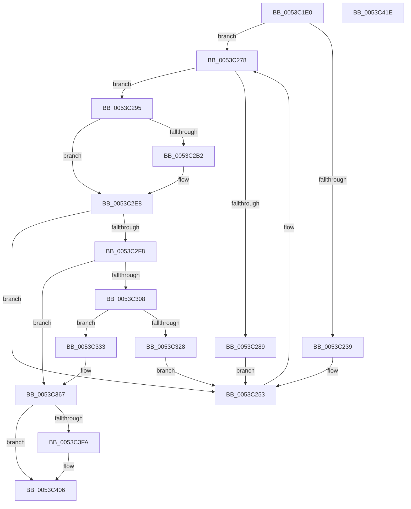

# HalpInitializeTimers

- RVA: `0x0053C1E0`–`0x0053C41F` (길이 `575` bytes)
- VA: `0x000000014053C1E0`
- 실행 섹션: `.text`
- PDB 이름 있음: `예`; PDB Function 태그: `아니요`
- unwind 정보 RVA: `0x000C38C4`
- 디코드: `120`개 명령, `575/575` bytes 표시
- 미해석 바이트: `0` (있으면 어셈블리에 `.byte`로 보존)

> 이 문서는 커널 이미지의 기계어와 PDB 기호를 분석해 생성했습니다. 4번과 5번은 함수 원형과 자료형을 바이너리 사용 방식에서 추정한 C 해석이며 원본 소스 복구 결과는 아닙니다.

## 1. Dependencies

- 직접 호출 지점: **13**; 고유 호출 대상: **12**
- 직접 호출자로 확인된 함수: **1**
- RIP 상대 이미지 참조: **28**

### Outgoing calls
- `0x0053C202` → [memset](../6C/memset_function_006C6C40.md) (function, `0x006C6C40`)
- `0x0053C21F` → [HalpTimerGetInternalData](../20/HalpTimerGetInternalData_function_00209500.md) (function, `0x00209500`)
- `0x0053C22B` → [guard_dispatch_icall](../6B/guard_dispatch_icall_function_006BAAD0.md) (function, `0x006BAAD0`)
- `0x0053C24E` → [HalpTimerSetProblemEx](../4F/HalpTimerSetProblemEx_function_004FAEC4.md) (function, `0x004FAEC4`)
- `0x0053C272` → [KeBugCheckEx](../4F/KeBugCheckEx_function_004FD660.md) (function, `0x004FD660`)
- `0x0053C27D` → [HalpTimerRegisterBuiltinPluginsCommon](../54/HalpTimerRegisterBuiltinPluginsCommon_function_0054A014.md) (function, `0x0054A014`)
- `0x0053C2A8` → [HalpFindTimer](../54/HalpFindTimer_function_005488D0.md) (function, `0x005488D0`)
- `0x0053C2E3` → [HalpTimerBuildKnownResourceIdString](../54/HalpTimerBuildKnownResourceIdString_function_00548A10.md) (function, `0x00548A10`)
- `0x0053C2E8` → [HalpTimerSelectRoles](HalpTimerSelectRoles_function_0053D4B0.md) (function, `0x0053D4B0`)
- `0x0053C314` → [HalpMmAllocateMemoryInternal](../54/HalpMmAllocateMemoryInternal_function_00544990.md) (function, `0x00544990`)
- `0x0053C33B` → [memset](../6C/memset_function_006C6C40.md) (function, `0x006C6C40`)
- `0x0053C35E` → [RtlUdiv128](../5E/RtlUdiv128_function_005EEC60.md) (function, `0x005EEC60`)
- `0x0053C3FA` → [HalpTimerCalculateMaximumAllowableDrift](../54/HalpTimerCalculateMaximumAllowableDrift_function_00548A60.md) (function, `0x00548A60`)

### Direct callers
- [HalpTimerInitSystem](HalpTimerInitSystem_function_0053CB70.md) at `0x0053CE87`

### Static image references
- `0x0053C207` → RVA `0x00FC4058` (`.data`; write)
- `0x0053C20E` → RVA `0x00FC4100` (`.data`; read)
- `0x0053C218` → RVA `0x00FC4038` (`.data`; write)
- `0x0053C239` → RVA `0x0001BE98` (`.rdata`; read)
- `0x0053C253` → RVA `0x00E10358` (`.data`; read)
- `0x0053C289` → RVA `0x00E10358` (`.data`; write)
- `0x0053C2F8` → RVA `0x00FC3FD0` (`.data`; read)
- `0x0053C319` → RVA `0x00FC40E0` (`.data`; write)
- `0x0053C367` → RVA `0x00FC4140` (`.data`; read)
- `0x0053C36E` → RVA `0x004B2870` (`HalpTimerDpcRoutine`; read)
- `0x0053C375` → RVA `0x00FC4098` (`.data`; write)
- `0x0053C37F` → RVA `0x00FC3FE8` (`.data`; read)
- `0x0053C386` → RVA `0x00FC3FE0` (`.data`; write)
- `0x0053C38D` → RVA `0x00FC3FF0` (`.data`; write)
- `0x0053C394` → RVA `0x00FC3FE8` (`.data`; write)
- `0x0053C39B` → RVA `0x004BF5C0` (`HalpTimerReportIdleStateUsage`; read)
- `0x0053C3A2` → RVA `0x00E00908` (`.data`; write)
- `0x0053C3A9` → RVA `0x004B14D0` (`HalpTimerQueryWakeTime`; read)
- `0x0053C3B0` → RVA `0x00E00900` (`.data`; write)
- `0x0053C3B7` → RVA `0x00FC3FC8` (`.data`; write)
- `0x0053C3BE` → RVA `0x00FC4080` (`.data`; write)
- `0x0053C3C8` → RVA `0x00FC40A0` (`.data`; write)
- `0x0053C3CF` → RVA `0x00FC40B8` (`.data`; write)
- `0x0053C3D6` → RVA `0x00FC4090` (`.data`; write)
- `0x0053C3E4` → RVA `0x00FC3FF8` (`.data`; write)
- `0x0053C3EB` → RVA `0x00FC401C` (`.data`; write)
- `0x0053C3F1` → RVA `0x00FC4018` (`.data`; write)
- `0x0053C3FF` → RVA `0x00FC40D0` (`.data`; write)

## 2. Other-region calls and transfers

- 다른 실행 섹션으로 향하는 call: **0**
- 별도 외부 분기/꼬리 이동을 확인하지 못했습니다.

## 3. Assembly (complete function range)

```asm
0053C1E0  48 89 5C 24 08                  mov qword ptr [rsp + 8], rbx
0053C1E5  48 89 74 24 10                  mov qword ptr [rsp + 0x10], rsi
0053C1EA  57                              push rdi
0053C1EB  48 81 EC C0 00 00 00            sub rsp, 0xc0
0053C1F2  48 8B D9                        mov rbx, rcx
0053C1F5  33 D2                           xor edx, edx
0053C1F7  48 8D 4C 24 30                  lea rcx, [rsp + 0x30]
0053C1FC  41 B8 88 00 00 00               mov r8d, 0x88
0053C202  E8 39 AA 18 00                  call 0x1406c6c40
0053C207  48 89 1D 4A 7E A8 00            mov qword ptr [rip + 0xa87e4a], rbx
0053C20E  48 8B 1D EB 7E A8 00            mov rbx, qword ptr [rip + 0xa87eeb]
0053C215  48 8B CB                        mov rcx, rbx
0053C218  48 89 1D 19 7E A8 00            mov qword ptr [rip + 0xa87e19], rbx
0053C21F  E8 DC D2 CC FF                  call 0x140209500
0053C224  48 8B C8                        mov rcx, rax
0053C227  48 8B 43 68                     mov rax, qword ptr [rbx + 0x68]
0053C22B  E8 A0 E8 17 00                  call 0x1406baad0
0053C230  33 F6                           xor esi, esi
0053C232  44 8B C0                        mov r8d, eax
0053C235  85 C0                           test eax, eax
0053C237  79 3F                           jns 0x14053c278
0053C239  4C 8D 0D 58 FC AD FF            lea r9, [rip - 0x5203a8]
0053C240  C7 44 24 20 1E 06 00 00         mov dword ptr [rsp + 0x20], 0x61e
0053C248  8D 56 0F                        lea edx, [rsi + 0xf]
0053C24B  48 8B CB                        mov rcx, rbx
0053C24E  E8 71 EC FB FF                  call 0x1404faec4
0053C253  4C 63 0D FE 40 8D 00            movsxd r9, dword ptr [rip + 0x8d40fe]
0053C25A  BA 10 01 00 00                  mov edx, 0x110
0053C25F  49 63 C0                        movsxd rax, r8d
0053C262  B9 5C 00 00 00                  mov ecx, 0x5c
0053C267  41 B8 31 06 25 05               mov r8d, 0x5250631
0053C26D  48 89 44 24 20                  mov qword ptr [rsp + 0x20], rax
0053C272  E8 E9 13 FC FF                  call 0x1404fd660
0053C277  CC                              int3
0053C278  B9 01 00 00 00                  mov ecx, 1
0053C27D  E8 92 DD 00 00                  call 0x14054a014
0053C282  44 8B C0                        mov r8d, eax
0053C285  85 C0                           test eax, eax
0053C287  79 0C                           jns 0x14053c295
0053C289  C7 05 C5 40 8D 00 0E 00 00 00   mov dword ptr [rip + 0x8d40c5], 0xe
0053C293  EB BE                           jmp 0x14053c253
0053C295  33 D2                           xor edx, edx
0053C297  C7 44 24 20 01 00 00 00         mov dword ptr [rsp + 0x20], 1
0053C29F  45 33 C9                        xor r9d, r9d
0053C2A2  45 33 C0                        xor r8d, r8d
0053C2A5  8D 4A 05                        lea ecx, [rdx + 5]
0053C2A8  E8 23 C6 00 00                  call 0x1405488d0
0053C2AD  48 85 C0                        test rax, rax
0053C2B0  74 36                           je 0x14053c2e8
0053C2B2  4C 8B 80 20 01 00 00            mov r8, qword ptr [rax + 0x120]
0053C2B9  8B 88 E4 00 00 00               mov ecx, dword ptr [rax + 0xe4]
0053C2BF  8B 80 1C 01 00 00               mov eax, dword ptr [rax + 0x11c]
0053C2C5  89 8C 24 B8 00 00 00            mov dword ptr [rsp + 0xb8], ecx
0053C2CC  48 8D 4C 24 30                  lea rcx, [rsp + 0x30]
0053C2D1  41 0F B7 50 18                  movzx edx, word ptr [r8 + 0x18]
0053C2D6  4D 8B 40 20                     mov r8, qword ptr [r8 + 0x20]
0053C2DA  D1 EA                           shr edx, 1
0053C2DC  89 84 24 BC 00 00 00            mov dword ptr [rsp + 0xbc], eax
0053C2E3  E8 28 C7 00 00                  call 0x140548a10
0053C2E8  E8 C3 11 00 00                  call 0x14053d4b0
0053C2ED  44 8B C0                        mov r8d, eax
0053C2F0  85 C0                           test eax, eax
0053C2F2  0F 88 5B FF FF FF               js 0x14053c253
0053C2F8  48 8B 1D D1 7C A8 00            mov rbx, qword ptr [rip + 0xa87cd1]
0053C2FF  83 BB E4 00 00 00 05            cmp dword ptr [rbx + 0xe4], 5
0053C306  75 5F                           jne 0x14053c367
0053C308  BB 00 10 00 00                  mov ebx, 0x1000
0053C30D  BA 01 00 00 00                  mov edx, 1
0053C312  8B CB                           mov ecx, ebx
0053C314  E8 77 86 00 00                  call 0x140544990
0053C319  48 89 05 C0 7D A8 00            mov qword ptr [rip + 0xa87dc0], rax
0053C320  48 8B F8                        mov rdi, rax
0053C323  48 85 C0                        test rax, rax
0053C326  75 0B                           jne 0x14053c333
0053C328  41 B8 9A 00 00 C0               mov r8d, 0xc000009a
0053C32E  E9 20 FF FF FF                  jmp 0x14053c253
0053C333  4C 8B C3                        mov r8, rbx
0053C336  33 D2                           xor edx, edx
0053C338  48 8B CF                        mov rcx, rdi
0053C33B  E8 00 A9 18 00                  call 0x1406c6c40
0053C340  48 8B 1D 89 7C A8 00            mov rbx, qword ptr [rip + 0xa87c89]
0053C347  45 33 C9                        xor r9d, r9d
0053C34A  C7 07 48 61 6C 54               mov dword ptr [rdi], 0x546c6148
0053C350  33 D2                           xor edx, edx
0053C352  B9 80 96 98 00                  mov ecx, 0x989680
0053C357  4C 8B 83 C0 00 00 00            mov r8, qword ptr [rbx + 0xc0]
0053C35E  E8 FD 28 0B 00                  call 0x1405eec60
0053C363  48 89 47 08                     mov qword ptr [rdi + 8], rax
0053C367  48 39 35 D2 7D A8 00            cmp qword ptr [rip + 0xa87dd2], rsi
0053C36E  48 8D 05 FB 64 F7 FF            lea rax, [rip - 0x89b05]
0053C375  48 89 05 1C 7D A8 00            mov qword ptr [rip + 0xa87d1c], rax
0053C37C  44 8B CE                        mov r9d, esi
0053C37F  48 8D 05 62 7C A8 00            lea rax, [rip + 0xa87c62]
0053C386  48 89 35 53 7C A8 00            mov qword ptr [rip + 0xa87c53], rsi
0053C38D  48 89 05 5C 7C A8 00            mov qword ptr [rip + 0xa87c5c], rax
0053C394  48 89 05 4D 7C A8 00            mov qword ptr [rip + 0xa87c4d], rax
0053C39B  48 8D 05 1E 32 F8 FF            lea rax, [rip - 0x7cde2]
0053C3A2  48 89 05 5F 45 8C 00            mov qword ptr [rip + 0x8c455f], rax
0053C3A9  48 8D 05 20 51 F7 FF            lea rax, [rip - 0x8aee0]
0053C3B0  48 89 05 49 45 8C 00            mov qword ptr [rip + 0x8c4549], rax
0053C3B7  48 89 1D 0A 7C A8 00            mov qword ptr [rip + 0xa87c0a], rbx
0053C3BE  C7 05 B8 7C A8 00 13 01 00 00   mov dword ptr [rip + 0xa87cb8], 0x113
0053C3C8  48 89 35 D1 7C A8 00            mov qword ptr [rip + 0xa87cd1], rsi
0053C3CF  48 89 35 E2 7C A8 00            mov qword ptr [rip + 0xa87ce2], rsi
0053C3D6  48 89 35 B3 7C A8 00            mov qword ptr [rip + 0xa87cb3], rsi
0053C3DD  C6 05 FC 7B A8 00 08            mov byte ptr [rip + 0xa87bfc], 8
0053C3E4  48 89 35 0D 7C A8 00            mov qword ptr [rip + 0xa87c0d], rsi
0053C3EB  89 35 2B 7C A8 00               mov dword ptr [rip + 0xa87c2b], esi
0053C3F1  66 89 35 20 7C A8 00            mov word ptr [rip + 0xa87c20], si
0053C3F8  74 0C                           je 0x14053c406
0053C3FA  E8 61 C6 00 00                  call 0x140548a60
0053C3FF  48 89 05 CA 7C A8 00            mov qword ptr [rip + 0xa87cca], rax
0053C406  4C 8D 9C 24 C0 00 00 00         lea r11, [rsp + 0xc0]
0053C40E  41 8B C1                        mov eax, r9d
0053C411  49 8B 5B 10                     mov rbx, qword ptr [r11 + 0x10]
0053C415  49 8B 73 18                     mov rsi, qword ptr [r11 + 0x18]
0053C419  49 8B E3                        mov rsp, r11
0053C41C  5F                              pop rdi
0053C41D  C3                              ret
0053C41E  CC                              int3
```

## 4. C-style interpretation (structured pseudocode)

```c
__int64 __fastcall HalpInitializeTimers(__int64 a1, int a2)
{
    __int64 result;
    __int64 v_rsi;
    __int64 v_rsp;
    unsigned int v_stack_m10;
    unsigned __int64 v_stack_m8;
    unsigned __int64 v_stack_m98;
    unsigned int v_stack_mA8;
    unsigned int v_stack_mC;
    unsigned __int64 v_stack_p10;
    unsigned __int64 v_stack_p8;

    v_stack_p8 = v_rbx;
    v_stack_p10 = v_rsi;
    v_rsp = (v_rsp) - (192);
    a2 = 0;
    result = memset(v_stack_m98, a2, 136, a4);
    *(unsigned __int64 *)(v_rip + 11042378) = a1;
    *(unsigned __int64 *)(v_rip + 11042329) = *(unsigned __int64 *)(v_rip + 11042539);
    result = HalpTimerGetInternalData(*(unsigned __int64 *)(v_rip + 11042539), a2, 136, a4);
    result = guard_dispatch_icall(result, a2, 136, a4);
    v_rsi = 0;
    if (!sign_flag) goto loc_0053C278;
    v_stack_mA8 = 0x61EULL;
    result = HalpTimerSetProblemEx(*(unsigned __int64 *)(v_rip + 11042539), v_rsi + 15, (unsigned int)((unsigned int)(result)), v_rip - 5374888);
loc_0053C253:
    v_stack_mA8 = (int)((unsigned int)((unsigned int)((unsigned int)(result))));
    result = KeBugCheckEx(92, 272, (unsigned int)(0x5250631ULL), (int)(*(unsigned int *)(v_rip + 9257214)));
loc_0053C278:
    result = HalpTimerRegisterBuiltinPluginsCommon(1, 272, (unsigned int)(0x5250631ULL), (int)(*(unsigned int *)(v_rip + 9257214)));
    if (!sign_flag) goto loc_0053C295;
    *(unsigned int *)(v_rip + 9257157) = 14;
    goto loc_0053C253;
loc_0053C295:
    a2 = 0;
    v_stack_mA8 = 1;
    a4 = 0;
    a3 = 0;
    result = HalpFindTimer(a2 + 5, a2, a3, a4);
    if (result != 0) {
        a3 = *(unsigned __int64 *)(result + 288);
        a1 = *(unsigned int *)(result + 228);
        result = *(unsigned int *)(result + 284);
        v_stack_m10 = (unsigned int)(a1);
        a1 = v_stack_m98;
        a2 = *(unsigned __int16 *)(a3 + 24);
        a3 = *(unsigned __int64 *)(a3 + 32);
        a2 = (unsigned int)((a2) >> (1));
        v_stack_mC = (unsigned int)(result);
        result = HalpTimerBuildKnownResourceIdString(a1, a2, a3, a4);
    }
    result = HalpTimerSelectRoles(a1, a2, a3, a4);
    if (sign_flag) goto loc_0053C253;
    if ((*(unsigned int *)(*(unsigned __int64 *)(v_rip + 11042001) + 228)) != 5) goto loc_0053C367;
    result = HalpMmAllocateMemoryInternal((unsigned int)((unsigned int)((unsigned int)(0x1000ULL))), 1, (unsigned int)((unsigned int)(result)), a4);
    *(unsigned __int64 *)(v_rip + 11042240) = result;
    if (result != 0) goto loc_0053C333;
    goto loc_0053C253;
loc_0053C333:
    a2 = 0;
    result = memset(result, a2, (unsigned int)(0x1000ULL), a4);
    a4 = 0;
    *(unsigned int *)(result) = 0x546C6148ULL;
    a2 = 0;
    result = RtlUdiv128((unsigned int)(0x989680ULL), a2, *(unsigned __int64 *)(*(unsigned __int64 *)(v_rip + 11041929) + 192), a4);
    *(unsigned __int64 *)(result + 8) = result;
loc_0053C367:
    *(unsigned __int64 *)(v_rip + 11042076) = v_rip - 563973;
    *(unsigned __int64 *)(v_rip + 11041875) = 0;
    *(unsigned __int64 *)(v_rip + 11041884) = v_rip + 11041890;
    *(unsigned __int64 *)(v_rip + 11041869) = v_rip + 11041890;
    *(unsigned __int64 *)(v_rip + 9192799) = v_rip - 511458;
    *(unsigned __int64 *)(v_rip + 9192777) = v_rip - 569056;
    *(unsigned __int64 *)(v_rip + 11041802) = *(unsigned __int64 *)(v_rip + 11041929);
    *(unsigned int *)(v_rip + 11041976) = 275;
    *(unsigned __int64 *)(v_rip + 11042001) = 0;
    *(unsigned __int64 *)(v_rip + 11042018) = 0;
    *(unsigned __int64 *)(v_rip + 11041971) = 0;
    *(unsigned __int8 *)(v_rip + 11041788) = 8;
    *(unsigned __int64 *)(v_rip + 11041805) = 0;
    *(unsigned int *)(v_rip + 11041835) = 0;
    *(unsigned __int16 *)(v_rip + 11041824) = 0;
    result = v_rip - 569056;
    if ((*(unsigned __int64 *)(v_rip + 11042258)) != 0) {
        result = HalpTimerCalculateMaximumAllowableDrift((unsigned int)(0x989680ULL), a2, *(unsigned __int64 *)(*(unsigned __int64 *)(v_rip + 11041929) + 192), 0);
        *(unsigned __int64 *)(v_rip + 11041994) = result;
    }
    return 0;
}
```

## 5. (Beta) C Style

```c
int64_t HalpInitializeTimers(int64_t Arg1, int32_t Arg2)
{
    int64_t result;
    int64_t local_rsi;
    int64_t local_rsp;
    uint32_t v_stack_m10;
    uint64_t v_stack_m8;
    uint64_t v_stack_m98;
    uint32_t v_stack_mA8;
    uint32_t v_stack_mC;
    uint64_t v_stack_p10;
    uint64_t v_stack_p8;

    v_stack_p8 = local_rbx;
    v_stack_p10 = local_rsi;
    local_rsp = (local_rsp) - (192);
    Arg2 = 0;
    result = memset(v_stack_m98, Arg2, 136, a4);
    *(uint64_t *)(v_rip + 0xA87E4A) = Arg1;
    *(uint64_t *)(v_rip + 0xA87E19) = *(uint64_t *)(v_rip + 0xA87EEB);
    result = HalpTimerGetInternalData(*(uint64_t *)(v_rip + 0xA87EEB), Arg2, 136, a4);
    result = guard_dispatch_icall(result, Arg2, 136, a4);
    local_rsi = 0;
    if (!sign_flag) goto loc_0053C278;
    v_stack_mA8 = 0x61EULL;
    result = HalpTimerSetProblemEx(*(uint64_t *)(v_rip + 0xA87EEB), local_rsi + 15, (uint32_t)((uint32_t)(result)), v_rip - 5374888);
loc_0053C253:
    v_stack_mA8 = (int32_t)((uint32_t)((uint32_t)((uint32_t)(result))));
    result = KeBugCheckEx(92, 272, (uint32_t)(0x5250631ULL), (int32_t)(*(uint32_t *)(v_rip + 0x8D40FE)));
loc_0053C278:
    result = HalpTimerRegisterBuiltinPluginsCommon(1, 272, (uint32_t)(0x5250631ULL), (int32_t)(*(uint32_t *)(v_rip + 0x8D40FE)));
    if (!sign_flag) goto loc_0053C295;
    *(uint32_t *)(v_rip + 0x8D40C5) = 14;
    goto loc_0053C253;
loc_0053C295:
    Arg2 = 0;
    v_stack_mA8 = 1;
    a4 = 0;
    a3 = 0;
    result = HalpFindTimer(Arg2 + 5, Arg2, a3, a4);
    if (result != 0) {
        a3 = *(uint64_t *)(result + 0x120);
        Arg1 = *(uint32_t *)(result + 0xE4);
        result = *(uint32_t *)(result + 0x11C);
        v_stack_m10 = (uint32_t)(Arg1);
        Arg1 = v_stack_m98;
        Arg2 = *(uint16_t *)(a3 + 0x18);
        a3 = *(uint64_t *)(a3 + 0x20);
        Arg2 = (uint32_t)((Arg2) >> (1));
        v_stack_mC = (uint32_t)(result);
        result = HalpTimerBuildKnownResourceIdString(Arg1, Arg2, a3, a4);
    }
    result = HalpTimerSelectRoles(Arg1, Arg2, a3, a4);
    if (sign_flag) goto loc_0053C253;
    if ((*(uint32_t *)(*(uint64_t *)(v_rip + 0xA87CD1) + 0xE4)) != 5) goto loc_0053C367;
    result = HalpMmAllocateMemoryInternal((uint32_t)((uint32_t)((uint32_t)(0x1000ULL))), 1, (uint32_t)((uint32_t)(result)), a4);
    *(uint64_t *)(v_rip + 0xA87DC0) = result;
    if (result != 0) goto loc_0053C333;
    goto loc_0053C253;
loc_0053C333:
    Arg2 = 0;
    result = memset(result, Arg2, (uint32_t)(0x1000ULL), a4);
    a4 = 0;
    *(uint32_t *)(result) = 0x546C6148ULL;
    Arg2 = 0;
    result = RtlUdiv128((uint32_t)(0x989680ULL), Arg2, *(uint64_t *)(*(uint64_t *)(v_rip + 0xA87C89) + 0xC0), a4);
    *(uint64_t *)(result + 0x8) = result;
loc_0053C367:
    *(uint64_t *)(v_rip + 0xA87D1C) = v_rip - 563973;
    *(uint64_t *)(v_rip + 0xA87C53) = 0;
    *(uint64_t *)(v_rip + 0xA87C5C) = v_rip + 11041890;
    *(uint64_t *)(v_rip + 0xA87C4D) = v_rip + 11041890;
    *(uint64_t *)(v_rip + 0x8C455F) = v_rip - 511458;
    *(uint64_t *)(v_rip + 0x8C4549) = v_rip - 569056;
    *(uint64_t *)(v_rip + 0xA87C0A) = *(uint64_t *)(v_rip + 0xA87C89);
    *(uint32_t *)(v_rip + 0xA87CB8) = 275;
    *(uint64_t *)(v_rip + 0xA87CD1) = 0;
    *(uint64_t *)(v_rip + 0xA87CE2) = 0;
    *(uint64_t *)(v_rip + 0xA87CB3) = 0;
    *(uint8_t *)(v_rip + 0xA87BFC) = 8;
    *(uint64_t *)(v_rip + 0xA87C0D) = 0;
    *(uint32_t *)(v_rip + 0xA87C2B) = 0;
    *(uint16_t *)(v_rip + 0xA87C20) = 0;
    result = v_rip - 569056;
    if ((*(uint64_t *)(v_rip + 0xA87DD2)) != 0) {
        result = HalpTimerCalculateMaximumAllowableDrift((uint32_t)(0x989680ULL), Arg2, *(uint64_t *)(*(uint64_t *)(v_rip + 0xA87C89) + 0xC0), 0);
        *(uint64_t *)(v_rip + 0xA87CCA) = result;
    }
    return 0;
}
```

## 6. Execution-region graph

[열기: 2D/3D 그래프와 함수 탐색 컨트롤 패널](../../../control-panel.html?section=text&rva=0x0053C1E0&view=graph)

- 2D 그래프는 위에서 아래로 흐르고, 3D 그래프는 빈 공간을 드래그해 회전합니다. Shift+드래그는 이동, 휠은 확대·축소, 함수 노드 선택은 대상 보고서 이동입니다.

### Static fallback


