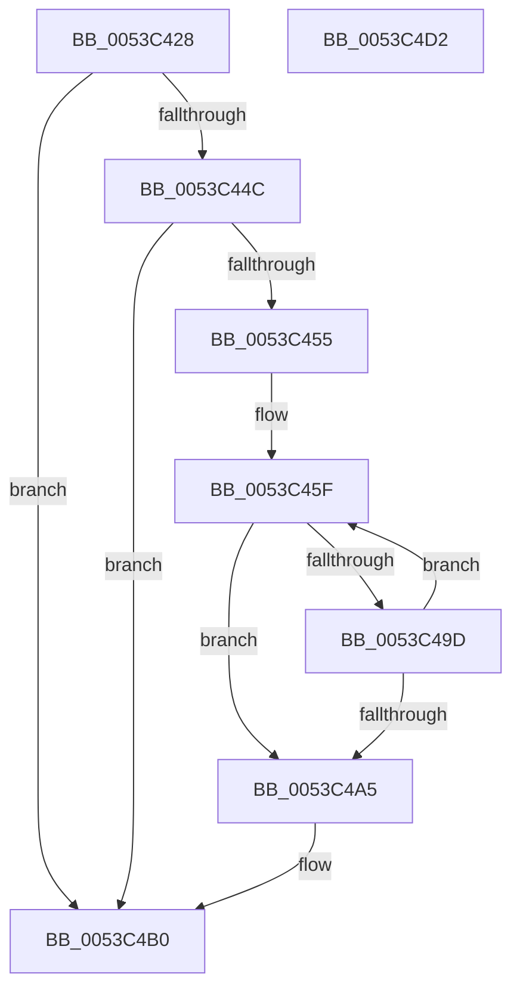

# HalpTimerCaptureCloestAuxiliaryQpcPair

- RVA: `0x0053C428`–`0x0053C4D3` (길이 `171` bytes)
- VA: `0x000000014053C428`
- 실행 섹션: `.text`
- PDB 이름 있음: `예`; PDB Function 태그: `아니요`
- unwind 정보 RVA: `0x0005E6B4`
- 디코드: `47`개 명령, `171/171` bytes 표시
- 미해석 바이트: `0` (있으면 어셈블리에 `.byte`로 보존)

> 이 문서는 커널 이미지의 기계어와 PDB 기호를 분석해 생성했습니다. 4번과 5번은 함수 원형과 자료형을 바이너리 사용 방식에서 추정한 C 해석이며 원본 소스 복구 결과는 아닙니다.

## 1. Dependencies

- 직접 호출 지점: **4**; 고유 호출 대상: **3**
- 직접 호출자로 확인된 함수: **1**
- RIP 상대 이미지 참조: **3**

### Outgoing calls
- `0x0053C461` → [KeQueryPerformanceCounter](../37/KeQueryPerformanceCounter_function_0037E7E0.md) (function, `0x0037E7E0`)
- `0x0053C473` → [HalpTimerGetInternalData](../20/HalpTimerGetInternalData_function_00209500.md) (function, `0x00209500`)
- `0x0053C47F` → [guard_dispatch_icall](../6B/guard_dispatch_icall_function_006BAAD0.md) (function, `0x006BAAD0`)
- `0x0053C486` → [KeQueryPerformanceCounter](../37/KeQueryPerformanceCounter_function_0037E7E0.md) (function, `0x0037E7E0`)

### Direct callers
- [HalpTimerInitSystem](HalpTimerInitSystem_function_0053CB70.md) at `0x0053CD58`

### Static image references
- `0x0053C443` → RVA `0x00FC3FD0` (`.data`; read)
- `0x0053C44C` → RVA `0x00FC4130` (`.data`; read)
- `0x0053C4BF` → RVA `0x00FC3FA8` (`.data`; write)

## 2. Other-region calls and transfers

- 다른 실행 섹션으로 향하는 call: **0**
- 별도 외부 분기/꼬리 이동을 확인하지 못했습니다.

## 3. Assembly (complete function range)

```asm
0053C428  48 8B C4                        mov rax, rsp
0053C42B  48 89 58 08                     mov qword ptr [rax + 8], rbx
0053C42F  48 89 68 10                     mov qword ptr [rax + 0x10], rbp
0053C433  48 89 70 18                     mov qword ptr [rax + 0x18], rsi
0053C437  48 89 78 20                     mov qword ptr [rax + 0x20], rdi
0053C43B  41 56                           push r14
0053C43D  48 83 EC 20                     sub rsp, 0x20
0053C441  33 FF                           xor edi, edi
0053C443  48 39 3D 86 7B A8 00            cmp qword ptr [rip + 0xa87b86], rdi
0053C44A  74 64                           je 0x14053c4b0
0053C44C  48 39 3D DD 7C A8 00            cmp qword ptr [rip + 0xa87cdd], rdi
0053C453  74 5B                           je 0x14053c4b0
0053C455  8B EF                           mov ebp, edi
0053C457  44 8D 77 01                     lea r14d, [rdi + 1]
0053C45B  48 83 CE FF                     or rsi, 0xffffffffffffffff
0053C45F  33 C9                           xor ecx, ecx
0053C461  E8 7A 23 E4 FF                  call 0x14037e7e0
0053C466  48 8B 15 C3 7C A8 00            mov rdx, qword ptr [rip + 0xa87cc3]
0053C46D  48 8B D8                        mov rbx, rax
0053C470  48 8B CA                        mov rcx, rdx
0053C473  E8 88 D0 CC FF                  call 0x140209500
0053C478  48 8B C8                        mov rcx, rax
0053C47B  48 8B 42 70                     mov rax, qword ptr [rdx + 0x70]
0053C47F  E8 4C E6 17 00                  call 0x1406baad0
0053C484  33 C9                           xor ecx, ecx
0053C486  E8 55 23 E4 FF                  call 0x14037e7e0
0053C48B  48 2B C3                        sub rax, rbx
0053C48E  48 3B F0                        cmp rsi, rax
0053C491  48 0F 46 C6                     cmovbe rax, rsi
0053C495  48 8B F0                        mov rsi, rax
0053C498  49 3B C6                        cmp rax, r14
0053C49B  76 08                           jbe 0x14053c4a5
0053C49D  41 03 EE                        add ebp, r14d
0053C4A0  83 FD 0A                        cmp ebp, 0xa
0053C4A3  72 BA                           jb 0x14053c45f
0053C4A5  48 85 F6                        test rsi, rsi
0053C4A8  49 0F 44 F6                     cmove rsi, r14
0053C4AC  48 8D 3C 36                     lea rdi, [rsi + rsi]
0053C4B0  48 8B 5C 24 30                  mov rbx, qword ptr [rsp + 0x30]
0053C4B5  48 8B 6C 24 38                  mov rbp, qword ptr [rsp + 0x38]
0053C4BA  48 8B 74 24 40                  mov rsi, qword ptr [rsp + 0x40]
0053C4BF  48 89 3D E2 7A A8 00            mov qword ptr [rip + 0xa87ae2], rdi
0053C4C6  48 8B 7C 24 48                  mov rdi, qword ptr [rsp + 0x48]
0053C4CB  48 83 C4 20                     add rsp, 0x20
0053C4CF  41 5E                           pop r14
0053C4D1  C3                              ret
0053C4D2  CC                              int3
```

## 4. C-style interpretation (structured pseudocode)

```c
__int64 __fastcall HalpTimerCaptureCloestAuxiliaryQpcPair(int a1)
{
    __int64 result;
    __int64 v_rbp;
    __int64 v_rdi;
    __int64 v_rsi;
    __int64 v_rsp;
    unsigned __int64 v_stack_p10;
    unsigned __int64 v_stack_p18;
    unsigned __int64 v_stack_p20;
    unsigned __int64 v_stack_p8;

    *(unsigned __int64 *)(v_rsp + 8) = v_rbx;
    *(unsigned __int64 *)(v_rsp + 16) = v_rbp;
    *(unsigned __int64 *)(v_rsp + 24) = v_rsi;
    *(unsigned __int64 *)(v_rsp + 32) = v_rdi;
    v_rsp = (v_rsp) - (32);
    v_rdi = 0;
    if ((*(unsigned __int64 *)(v_rip + 11041670)) == 0) goto loc_0053C4B0;
    if ((*(unsigned __int64 *)(v_rip + 11042013)) == 0) goto loc_0053C4B0;
    v_rsi = (v_rsi) | (-1);
loc_0053C45F:
    a1 = 0;
    result = KeQueryPerformanceCounter(a1, a2, a3, a4);
    result = HalpTimerGetInternalData(*(unsigned __int64 *)(v_rip + 11041987), *(unsigned __int64 *)(v_rip + 11041987), a3, a4);
    result = guard_dispatch_icall(result, *(unsigned __int64 *)(v_rip + 11041987), a3, a4);
    a1 = 0;
    result = KeQueryPerformanceCounter(a1, *(unsigned __int64 *)(v_rip + 11041987), a3, a4);
    result = (result) - (result);
    if (v_rsi <= result) { result = v_rsi; }
    if (result <= (v_rdi + 1)) goto loc_0053C4A5;
    v_rbp = (unsigned int)((0) + ((unsigned int)(v_rdi + 1)));
    if (((unsigned int)(v_rbp)) < 10) goto loc_0053C45F;
loc_0053C4A5:
    v_rsi = result;
    if (result == 0) { v_rsi = v_rdi + 1; }
loc_0053C4B0:
    *(unsigned __int64 *)(v_rip + 11041506) = v_rsi + v_rsi * 1;
    v_rsp = (v_rsp) + (32);
    return result;
}
```

## 5. (Beta) C Style

```c
int64_t HalpTimerCaptureCloestAuxiliaryQpcPair(int32_t Arg1)
{
    int64_t result;
    int64_t local_rbp;
    int64_t local_rdi;
    int64_t local_rsi;
    int64_t local_rsp;
    uint64_t v_stack_p10;
    uint64_t v_stack_p18;
    uint64_t v_stack_p20;
    uint64_t v_stack_p8;

    *(uint64_t *)(local_rsp + 0x8) = local_rbx;
    *(uint64_t *)(local_rsp + 0x10) = local_rbp;
    *(uint64_t *)(local_rsp + 0x18) = local_rsi;
    *(uint64_t *)(local_rsp + 0x20) = local_rdi;
    local_rsp = (local_rsp) - (32);
    local_rdi = 0;
    if ((*(uint64_t *)(v_rip + 0xA87B86)) == 0) goto loc_0053C4B0;
    if ((*(uint64_t *)(v_rip + 0xA87CDD)) == 0) goto loc_0053C4B0;
    local_rsi = (local_rsi) | (-1);
loc_0053C45F:
    Arg1 = 0;
    result = KeQueryPerformanceCounter(Arg1, a2, a3, a4);
    result = HalpTimerGetInternalData(*(uint64_t *)(v_rip + 0xA87CC3), *(uint64_t *)(v_rip + 0xA87CC3), a3, a4);
    result = guard_dispatch_icall(result, *(uint64_t *)(v_rip + 0xA87CC3), a3, a4);
    Arg1 = 0;
    result = KeQueryPerformanceCounter(Arg1, *(uint64_t *)(v_rip + 0xA87CC3), a3, a4);
    result = (result) - (result);
    if (local_rsi <= result) { result = local_rsi; }
    if (result <= (local_rdi + 1)) goto loc_0053C4A5;
    local_rbp = (uint32_t)((0) + ((uint32_t)(local_rdi + 1)));
    if (((uint32_t)(local_rbp)) < 10) goto loc_0053C45F;
loc_0053C4A5:
    local_rsi = result;
    if (result == 0) { local_rsi = local_rdi + 1; }
loc_0053C4B0:
    *(uint64_t *)(v_rip + 0xA87AE2) = local_rsi + local_rsi * 1;
    local_rsp = (local_rsp) + (32);
    return result;
}
```

## 6. Execution-region graph

[열기: 2D/3D 그래프와 함수 탐색 컨트롤 패널](../../../control-panel.html?section=text&rva=0x0053C428&view=graph)

- 2D 그래프는 위에서 아래로 흐르고, 3D 그래프는 빈 공간을 드래그해 회전합니다. Shift+드래그는 이동, 휠은 확대·축소, 함수 노드 선택은 대상 보고서 이동입니다.

### Static fallback


