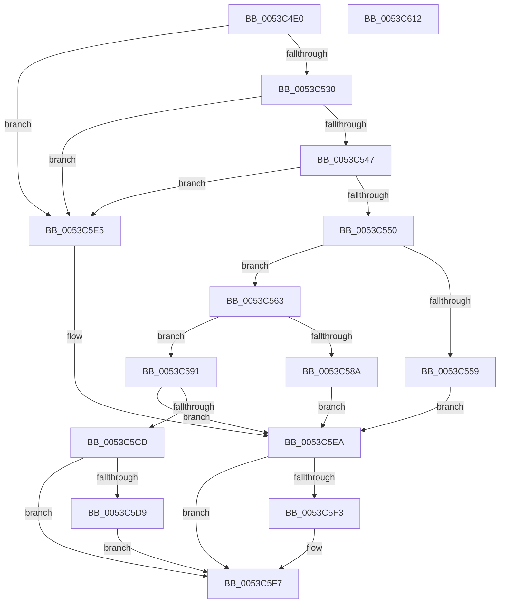

# HalpTimerConvertPerformanceCounterToAuxiliaryCounter

- RVA: `0x0053C4E0`–`0x0053C613` (길이 `307` bytes)
- VA: `0x000000014053C4E0`
- 실행 섹션: `.text`
- PDB 이름 있음: `예`; PDB Function 태그: `아니요`
- unwind 정보 RVA: `0x000C38F4`
- 디코드: `85`개 명령, `307/307` bytes 표시
- 미해석 바이트: `0` (있으면 어셈블리에 `.byte`로 보존)

> 이 문서는 커널 이미지의 기계어와 PDB 기호를 분석해 생성했습니다. 4번과 5번은 함수 원형과 자료형을 바이너리 사용 방식에서 추정한 C 해석이며 원본 소스 복구 결과는 아닙니다.

## 1. Dependencies

- 직접 호출 지점: **3**; 고유 호출 대상: **3**
- 직접 호출자로 확인된 함수: **0**
- RIP 상대 이미지 참조: **3**

### Outgoing calls
- `0x0053C56F` → [HalpTimerCaptureCurrentAuxiliaryQpcPair](../48/HalpTimerCaptureCurrentAuxiliaryQpcPair_function_0048E0D4.md) (function, `0x0048E0D4`)
- `0x0053C581` → [RtlULongLongMult](../43/RtlULongLongMult_function_0043E530.md) (function, `0x0043E530`)
- `0x0053C5C2` → [HalpTimerConvertAuxiliaryCounter](../49/HalpTimerConvertAuxiliaryCounter_function_0049D624.md) (function, `0x0049D624`)

### Direct callers
- 이 함수 시작 RVA로 연결되는 직접 call은 확인되지 않았습니다. 간접 호출은 완전히 역산할 수 없습니다.

### Static image references
- `0x0053C520` → RVA `0x00FC4130` (`.data`; read)
- `0x0053C530` → RVA `0x00FC4020` (`.data`; read)
- `0x0053C550` → RVA `0x00FC4030` (`.data`; read)

## 2. Other-region calls and transfers

- 다른 실행 섹션으로 향하는 call: **0**
- 별도 외부 분기/꼬리 이동을 확인하지 못했습니다.

## 3. Assembly (complete function range)

```asm
0053C4E0  48 89 5C 24 08                  mov qword ptr [rsp + 8], rbx
0053C4E5  48 89 74 24 10                  mov qword ptr [rsp + 0x10], rsi
0053C4EA  55                              push rbp
0053C4EB  57                              push rdi
0053C4EC  41 54                           push r12
0053C4EE  41 56                           push r14
0053C4F0  41 57                           push r15
0053C4F2  48 8B EC                        mov rbp, rsp
0053C4F5  48 83 EC 70                     sub rsp, 0x70
0053C4F9  48 83 65 D8 00                  and qword ptr [rbp - 0x28], 0
0053C4FE  49 8B D8                        mov rbx, r8
0053C501  48 83 65 E0 00                  and qword ptr [rbp - 0x20], 0
0053C506  48 8B FA                        mov rdi, rdx
0053C509  48 83 65 48 00                  and qword ptr [rbp + 0x48], 0
0053C50E  4C 8B F9                        mov r15, rcx
0053C511  48 83 65 D0 00                  and qword ptr [rbp - 0x30], 0
0053C516  48 83 65 E8 00                  and qword ptr [rbp - 0x18], 0
0053C51B  48 83 65 F0 00                  and qword ptr [rbp - 0x10], 0
0053C520  48 8B 05 09 7C A8 00            mov rax, qword ptr [rip + 0xa87c09]
0053C527  48 85 C0                        test rax, rax
0053C52A  0F 84 B5 00 00 00               je 0x14053c5e5
0053C530  48 8B 35 E9 7A A8 00            mov rsi, qword ptr [rip + 0xa87ae9]
0053C537  4C 8B B0 C0 00 00 00            mov r14, qword ptr [rax + 0xc0]
0053C53E  48 85 F6                        test rsi, rsi
0053C541  0F 84 9E 00 00 00               je 0x14053c5e5
0053C547  4D 85 F6                        test r14, r14
0053C54A  0F 84 95 00 00 00               je 0x14053c5e5
0053C550  48 3B 0D D9 7A A8 00            cmp rcx, qword ptr [rip + 0xa87ad9]
0053C557  73 0A                           jae 0x14053c563
0053C559  BA 0D 00 00 C0                  mov edx, 0xc000000d
0053C55E  E9 87 00 00 00                  jmp 0x14053c5ea
0053C563  4C 8D 45 48                     lea r8, [rbp + 0x48]
0053C567  48 8D 55 D8                     lea rdx, [rbp - 0x28]
0053C56B  48 8D 4D E0                     lea rcx, [rbp - 0x20]
0053C56F  E8 60 1B F5 FF                  call 0x14048e0d4
0053C574  48 8B 4D 48                     mov rcx, qword ptr [rbp + 0x48]
0053C578  4C 8D 45 D0                     lea r8, [rbp - 0x30]
0053C57C  BA 00 CA 9A 3B                  mov edx, 0x3b9aca00
0053C581  E8 AA 1F F0 FF                  call 0x14043e530
0053C586  85 C0                           test eax, eax
0053C588  79 07                           jns 0x14053c591
0053C58A  BA 01 00 00 C0                  mov edx, 0xc0000001
0053C58F  EB 59                           jmp 0x14053c5ea
0053C591  48 8B 45 D0                     mov rax, qword ptr [rbp - 0x30]
0053C595  33 D2                           xor edx, edx
0053C597  4C 8B 45 D8                     mov r8, qword ptr [rbp - 0x28]
0053C59B  4D 8B CE                        mov r9, r14
0053C59E  48 8B 4D E0                     mov rcx, qword ptr [rbp - 0x20]
0053C5A2  48 F7 F6                        div rsi
0053C5A5  48 8B D6                        mov rdx, rsi
0053C5A8  4C 8B E0                        mov r12, rax
0053C5AB  48 8D 45 F0                     lea rax, [rbp - 0x10]
0053C5AF  48 89 44 24 30                  mov qword ptr [rsp + 0x30], rax
0053C5B4  48 8D 45 E8                     lea rax, [rbp - 0x18]
0053C5B8  48 89 44 24 28                  mov qword ptr [rsp + 0x28], rax
0053C5BD  4C 89 7C 24 20                  mov qword ptr [rsp + 0x20], r15
0053C5C2  E8 5D 10 F6 FF                  call 0x14049d624
0053C5C7  8B D0                           mov edx, eax
0053C5C9  85 C0                           test eax, eax
0053C5CB  78 1D                           js 0x14053c5ea
0053C5CD  48 8B 45 E8                     mov rax, qword ptr [rbp - 0x18]
0053C5D1  48 89 07                        mov qword ptr [rdi], rax
0053C5D4  48 85 DB                        test rbx, rbx
0053C5D7  74 1E                           je 0x14053c5f7
0053C5D9  48 8B 4D F0                     mov rcx, qword ptr [rbp - 0x10]
0053C5DD  49 03 CC                        add rcx, r12
0053C5E0  48 89 0B                        mov qword ptr [rbx], rcx
0053C5E3  EB 12                           jmp 0x14053c5f7
0053C5E5  BA BB 00 00 C0                  mov edx, 0xc00000bb
0053C5EA  48 83 27 00                     and qword ptr [rdi], 0
0053C5EE  48 85 DB                        test rbx, rbx
0053C5F1  74 04                           je 0x14053c5f7
0053C5F3  48 83 23 00                     and qword ptr [rbx], 0
0053C5F7  4C 8D 5C 24 70                  lea r11, [rsp + 0x70]
0053C5FC  8B C2                           mov eax, edx
0053C5FE  49 8B 5B 30                     mov rbx, qword ptr [r11 + 0x30]
0053C602  49 8B 73 38                     mov rsi, qword ptr [r11 + 0x38]
0053C606  49 8B E3                        mov rsp, r11
0053C609  41 5F                           pop r15
0053C60B  41 5E                           pop r14
0053C60D  41 5C                           pop r12
0053C60F  5F                              pop rdi
0053C610  5D                              pop rbp
0053C611  C3                              ret
0053C612  CC                              int3
```

## 4. C-style interpretation (structured pseudocode)

```c
__int64 __fastcall HalpTimerConvertPerformanceCounterToAuxiliaryCounter(__int64 a1, __int64 a2, __int64 a3)
{
    __int64 result;
    __int64 v_rsp;
    unsigned __int64 v_stack_m28;
    unsigned __int64 v_stack_m38;
    unsigned __int64 v_stack_m40;
    unsigned __int64 v_stack_m48;
    unsigned __int64 v_stack_m50;
    unsigned __int64 v_stack_m58;
    unsigned __int64 v_stack_m68;
    unsigned __int64 v_stack_m70;
    unsigned __int64 v_stack_m78;
    unsigned __int64 v_stack_p10;
    unsigned __int64 v_stack_p20;
    unsigned __int64 v_stack_p8;

    v_stack_p8 = v_rbx;
    v_stack_p10 = v_rsi;
    v_rsp = (v_rsp) - (112);
    if (*(unsigned __int64 *)(v_rip + 11041801) == 0) goto loc_0053C5E5;
    if (*(unsigned __int64 *)(v_rip + 11041513) == 0) goto loc_0053C5E5;
    if (*(unsigned __int64 *)(*(unsigned __int64 *)(v_rip + 11041801) + 192) == 0) goto loc_0053C5E5;
    if (a1 >= (*(unsigned __int64 *)(v_rip + 11041497))) goto loc_0053C563;
    goto loc_0053C5EA;
loc_0053C563:
    result = HalpTimerCaptureCurrentAuxiliaryQpcPair(v_stack_m48, v_stack_m50, v_stack_p20, a4);
    result = RtlULongLongMult(v_stack_p20, (unsigned int)(0x3B9ACA00ULL), v_stack_m58, a4);
    if (!sign_flag) goto loc_0053C591;
    goto loc_0053C5EA;
loc_0053C591:
    a2 = 0;
    v_stack_m68 = v_stack_m38;
    v_stack_m70 = v_stack_m40;
    v_stack_m78 = a1;
    result = HalpTimerConvertAuxiliaryCounter(v_stack_m48, *(unsigned __int64 *)(v_rip + 11041513), v_stack_m50, *(unsigned __int64 *)(*(unsigned __int64 *)(v_rip + 11041801) + 192));
    if (sign_flag) goto loc_0053C5EA;
    *(unsigned __int64 *)(a2) = v_stack_m40;
    if (a3 == 0) goto loc_0053C5F7;
    a1 = (v_stack_m38) + (v_stack_m58);
    *(unsigned __int64 *)(a3) = a1;
    goto loc_0053C5F7;
loc_0053C5E5:
loc_0053C5EA:
    if (a3 != 0) {
    }
    return (unsigned int)((unsigned int)((unsigned int)(0xC00000BBULL)));
}
```

## 5. (Beta) C Style

```c
int64_t HalpTimerConvertPerformanceCounterToAuxiliaryCounter(int64_t Arg1, void *Arg2, int64_t Arg3)
{
    uint8_t *arg2 = (uint8_t *)Arg2;

    int64_t result;
    int64_t local_rsp;
    uint64_t v_stack_m28;
    uint64_t v_stack_m38;
    uint64_t v_stack_m40;
    uint64_t v_stack_m48;
    uint64_t v_stack_m50;
    uint64_t v_stack_m58;
    uint64_t v_stack_m68;
    uint64_t v_stack_m70;
    uint64_t v_stack_m78;
    uint64_t v_stack_p10;
    uint64_t v_stack_p20;
    uint64_t v_stack_p8;

    v_stack_p8 = local_rbx;
    v_stack_p10 = local_rsi;
    local_rsp = (local_rsp) - (112);
    if (*(uint64_t *)(v_rip + 0xA87C09) == 0) goto loc_0053C5E5;
    if (*(uint64_t *)(v_rip + 0xA87AE9) == 0) goto loc_0053C5E5;
    if (*(uint64_t *)(*(uint64_t *)(v_rip + 0xA87C09) + 0xC0) == 0) goto loc_0053C5E5;
    if (Arg1 >= (*(uint64_t *)(v_rip + 0xA87AD9))) goto loc_0053C563;
    goto loc_0053C5EA;
loc_0053C563:
    result = HalpTimerCaptureCurrentAuxiliaryQpcPair(v_stack_m48, v_stack_m50, v_stack_p20, a4);
    result = RtlULongLongMult(v_stack_p20, (uint32_t)(0x3B9ACA00ULL), v_stack_m58, a4);
    if (!sign_flag) goto loc_0053C591;
    goto loc_0053C5EA;
loc_0053C591:
    Arg2 = 0;
    v_stack_m68 = v_stack_m38;
    v_stack_m70 = v_stack_m40;
    v_stack_m78 = Arg1;
    result = HalpTimerConvertAuxiliaryCounter(v_stack_m48, *(uint64_t *)(v_rip + 0xA87AE9), v_stack_m50, *(uint64_t *)(*(uint64_t *)(v_rip + 0xA87C09) + 0xC0));
    if (sign_flag) goto loc_0053C5EA;
    *(uint64_t *)(arg2) = v_stack_m40;
    if (Arg3 == 0) goto loc_0053C5F7;
    Arg1 = (v_stack_m38) + (v_stack_m58);
    *(uint64_t *)(Arg3) = Arg1;
    goto loc_0053C5F7;
loc_0053C5E5:
loc_0053C5EA:
    if (Arg3 != 0) {
    }
    return (uint32_t)((uint32_t)((uint32_t)(0xC00000BBULL)));
}
```

### 관측된 메모리 오프셋

구조체 형식이 확인되지 않은 접근은 인자 기준의 오프셋으로만 기록했습니다.

| 기준 인자 | 오프셋 표현 | 폭 (bit) | 접근 |
|---|---:|---:|---|
| `Arg2` | `+ 0x0` | `64` | `R/W` |
| `Arg2` | `+ 0x0` | `64` | `W` |

## 6. Execution-region graph

[열기: 2D/3D 그래프와 함수 탐색 컨트롤 패널](../../../control-panel.html?section=text&rva=0x0053C4E0&view=graph)

- 2D 그래프는 위에서 아래로 흐르고, 3D 그래프는 빈 공간을 드래그해 회전합니다. Shift+드래그는 이동, 휠은 확대·축소, 함수 노드 선택은 대상 보고서 이동입니다.

### Static fallback


