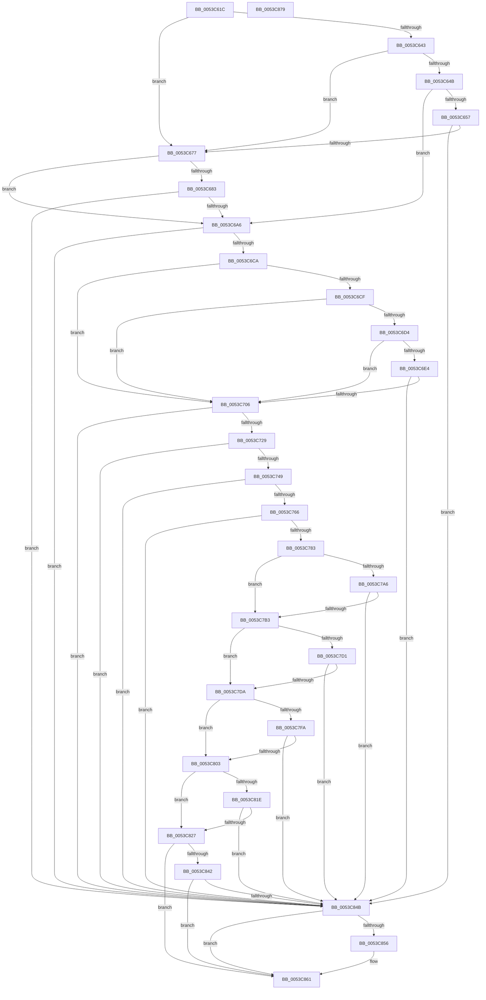

# HalpTimerFindIdealClockSource

- RVA: `0x0053C61C`–`0x0053C87A` (길이 `606` bytes)
- VA: `0x000000014053C61C`
- 실행 섹션: `.text`
- PDB 이름 있음: `예`; PDB Function 태그: `아니요`
- unwind 정보 RVA: `0x00066400`
- 디코드: `158`개 명령, `606/606` bytes 표시
- 미해석 바이트: `0` (있으면 어셈블리에 `.byte`로 보존)

> 이 문서는 커널 이미지의 기계어와 PDB 기호를 분석해 생성했습니다. 4번과 5번은 함수 원형과 자료형을 바이너리 사용 방식에서 추정한 C 해석이며 원본 소스 복구 결과는 아닙니다.

## 1. Dependencies

- 직접 호출 지점: **13**; 고유 호출 대상: **1**
- 직접 호출자로 확인된 함수: **1**
- RIP 상대 이미지 참조: **5**

### Outgoing calls
- `0x0053C669` → [HalpFindTimer](../54/HalpFindTimer_function_005488D0.md) (function, `0x005488D0`)
- `0x0053C698` → [HalpFindTimer](../54/HalpFindTimer_function_005488D0.md) (function, `0x005488D0`)
- `0x0053C6BC` → [HalpFindTimer](../54/HalpFindTimer_function_005488D0.md) (function, `0x005488D0`)
- `0x0053C6F8` → [HalpFindTimer](../54/HalpFindTimer_function_005488D0.md) (function, `0x005488D0`)
- `0x0053C71B` → [HalpFindTimer](../54/HalpFindTimer_function_005488D0.md) (function, `0x005488D0`)
- `0x0053C73B` → [HalpFindTimer](../54/HalpFindTimer_function_005488D0.md) (function, `0x005488D0`)
- `0x0053C758` → [HalpFindTimer](../54/HalpFindTimer_function_005488D0.md) (function, `0x005488D0`)
- `0x0053C775` → [HalpFindTimer](../54/HalpFindTimer_function_005488D0.md) (function, `0x005488D0`)
- `0x0053C797` → [HalpFindTimer](../54/HalpFindTimer_function_005488D0.md) (function, `0x005488D0`)
- `0x0053C7C7` → [HalpFindTimer](../54/HalpFindTimer_function_005488D0.md) (function, `0x005488D0`)
- `0x0053C7F0` → [HalpFindTimer](../54/HalpFindTimer_function_005488D0.md) (function, `0x005488D0`)
- `0x0053C814` → [HalpFindTimer](../54/HalpFindTimer_function_005488D0.md) (function, `0x005488D0`)
- `0x0053C838` → [HalpFindTimer](../54/HalpFindTimer_function_005488D0.md) (function, `0x005488D0`)

### Direct callers
- [HalpTimerSelectRoles](HalpTimerSelectRoles_function_0053D4B0.md) at `0x0053D506`

### Static image references
- `0x0053C630` → RVA `0x00FC1ED1` (`.data`; read)
- `0x0053C643` → RVA `0x00FC1ED0` (`.data`; read)
- `0x0053C64B` → RVA `0x00FC40F8` (`.data`; read)
- `0x0053C6D4` → RVA `0x000071E0` (`.rdata`; read)
- `0x0053C6DB` → RVA `0x00E03B20` (`.data`; read)

## 2. Other-region calls and transfers

- 다른 실행 섹션으로 향하는 call: **0**
- 별도 외부 분기/꼬리 이동을 확인하지 못했습니다.

## 3. Assembly (complete function range)

```asm
0053C61C  48 8B C4                        mov rax, rsp
0053C61F  48 89 58 08                     mov qword ptr [rax + 8], rbx
0053C623  48 89 68 10                     mov qword ptr [rax + 0x10], rbp
0053C627  48 89 70 18                     mov qword ptr [rax + 0x18], rsi
0053C62B  57                              push rdi
0053C62C  48 83 EC 30                     sub rsp, 0x30
0053C630  40 8A 35 9A 58 A8 00            mov sil, byte ptr [rip + 0xa8589a]
0053C637  33 DB                           xor ebx, ebx
0053C639  BD 00 0F 00 00                  mov ebp, 0xf00
0053C63E  40 84 F6                        test sil, sil
0053C641  74 34                           je 0x14053c677
0053C643  38 1D 87 58 A8 00               cmp byte ptr [rip + 0xa85887], bl
0053C649  74 2C                           je 0x14053c677
0053C64B  40 8A 3D A6 7A A8 00            mov dil, byte ptr [rip + 0xa87aa6]
0053C652  40 84 FF                        test dil, dil
0053C655  75 4F                           jne 0x14053c6a6
0053C657  44 8D 4B 50                     lea r9d, [rbx + 0x50]
0053C65B  89 58 E8                        mov dword ptr [rax - 0x18], ebx
0053C65E  45 33 C0                        xor r8d, r8d
0053C661  8D 4B 0B                        lea ecx, [rbx + 0xb]
0053C664  BA 20 02 00 00                  mov edx, 0x220
0053C669  E8 62 C2 00 00                  call 0x1405488d0
0053C66E  48 85 C0                        test rax, rax
0053C671  0F 85 D4 01 00 00               jne 0x14053c84b
0053C677  40 8A 3D 7A 7A A8 00            mov dil, byte ptr [rip + 0xa87a7a]
0053C67E  40 84 FF                        test dil, dil
0053C681  75 23                           jne 0x14053c6a6
0053C683  BA 60 00 00 00                  mov edx, 0x60
0053C688  89 5C 24 20                     mov dword ptr [rsp + 0x20], ebx
0053C68C  44 8B CD                        mov r9d, ebp
0053C68F  41 B8 00 60 00 00               mov r8d, 0x6000
0053C695  8D 4A A8                        lea ecx, [rdx - 0x58]
0053C698  E8 33 C2 00 00                  call 0x1405488d0
0053C69D  48 85 C0                        test rax, rax
0053C6A0  0F 85 A5 01 00 00               jne 0x14053c84b
0053C6A6  41 B9 50 00 00 00               mov r9d, 0x50
0053C6AC  89 5C 24 20                     mov dword ptr [rsp + 0x20], ebx
0053C6B0  45 33 C0                        xor r8d, r8d
0053C6B3  BA 20 02 00 00                  mov edx, 0x220
0053C6B8  41 8D 49 BB                     lea ecx, [r9 - 0x45]
0053C6BC  E8 0F C2 00 00                  call 0x1405488d0
0053C6C1  48 85 C0                        test rax, rax
0053C6C4  0F 85 81 01 00 00               jne 0x14053c84b
0053C6CA  40 84 FF                        test dil, dil
0053C6CD  75 37                           jne 0x14053c706
0053C6CF  40 84 F6                        test sil, sil
0053C6D2  75 32                           jne 0x14053c706
0053C6D4  48 8D 05 05 AB AC FF            lea rax, [rip - 0x5354fb]
0053C6DB  48 39 05 3E 74 8C 00            cmp qword ptr [rip + 0x8c743e], rax
0053C6E2  74 22                           je 0x14053c706
0053C6E4  44 8B CD                        mov r9d, ebp
0053C6E7  89 5C 24 20                     mov dword ptr [rsp + 0x20], ebx
0053C6EB  BA 21 00 00 00                  mov edx, 0x21
0053C6F0  33 C9                           xor ecx, ecx
0053C6F2  41 B8 00 60 00 00               mov r8d, 0x6000
0053C6F8  E8 D3 C1 00 00                  call 0x1405488d0
0053C6FD  48 85 C0                        test rax, rax
0053C700  0F 85 45 01 00 00               jne 0x14053c84b
0053C706  45 33 C9                        xor r9d, r9d
0053C709  89 5C 24 20                     mov dword ptr [rsp + 0x20], ebx
0053C70D  45 33 C0                        xor r8d, r8d
0053C710  BA 60 01 00 00                  mov edx, 0x160
0053C715  41 8D 79 03                     lea edi, [r9 + 3]
0053C719  8B CF                           mov ecx, edi
0053C71B  E8 B0 C1 00 00                  call 0x1405488d0
0053C720  48 85 C0                        test rax, rax
0053C723  0F 85 22 01 00 00               jne 0x14053c84b
0053C729  41 B9 00 01 00 00               mov r9d, 0x100
0053C72F  89 5C 24 20                     mov dword ptr [rsp + 0x20], ebx
0053C733  45 33 C0                        xor r8d, r8d
0053C736  8D 57 2D                        lea edx, [rdi + 0x2d]
0053C739  8B CF                           mov ecx, edi
0053C73B  E8 90 C1 00 00                  call 0x1405488d0
0053C740  48 85 C0                        test rax, rax
0053C743  0F 85 02 01 00 00               jne 0x14053c84b
0053C749  44 8B CD                        mov r9d, ebp
0053C74C  89 5C 24 20                     mov dword ptr [rsp + 0x20], ebx
0053C750  45 33 C0                        xor r8d, r8d
0053C753  8D 57 5D                        lea edx, [rdi + 0x5d]
0053C756  8B CF                           mov ecx, edi
0053C758  E8 73 C1 00 00                  call 0x1405488d0
0053C75D  48 85 C0                        test rax, rax
0053C760  0F 85 E5 00 00 00               jne 0x14053c84b
0053C766  44 8B CD                        mov r9d, ebp
0053C769  89 5C 24 20                     mov dword ptr [rsp + 0x20], ebx
0053C76D  45 33 C0                        xor r8d, r8d
0053C770  8D 57 2D                        lea edx, [rdi + 0x2d]
0053C773  8B CF                           mov ecx, edi
0053C775  E8 56 C1 00 00                  call 0x1405488d0
0053C77A  48 85 C0                        test rax, rax
0053C77D  0F 85 C8 00 00 00               jne 0x14053c84b
0053C783  44 8B CD                        mov r9d, ebp
0053C786  89 5C 24 20                     mov dword ptr [rsp + 0x20], ebx
0053C78A  BA 60 80 00 00                  mov edx, 0x8060
0053C78F  33 C9                           xor ecx, ecx
0053C791  41 B8 00 60 00 00               mov r8d, 0x6000
0053C797  E8 34 C1 00 00                  call 0x1405488d0
0053C79C  BF D0 07 00 00                  mov edi, 0x7d0
0053C7A1  48 85 C0                        test rax, rax
0053C7A4  74 0D                           je 0x14053c7b3
0053C7A6  48 39 B8 C0 00 00 00            cmp qword ptr [rax + 0xc0], rdi
0053C7AD  0F 83 98 00 00 00               jae 0x14053c84b
0053C7B3  44 8B CD                        mov r9d, ebp
0053C7B6  89 5C 24 20                     mov dword ptr [rsp + 0x20], ebx
0053C7BA  BA 30 80 00 00                  mov edx, 0x8030
0053C7BF  33 C9                           xor ecx, ecx
0053C7C1  41 B8 00 60 00 00               mov r8d, 0x6000
0053C7C7  E8 04 C1 00 00                  call 0x1405488d0
0053C7CC  48 85 C0                        test rax, rax
0053C7CF  74 09                           je 0x14053c7da
0053C7D1  48 39 B8 C0 00 00 00            cmp qword ptr [rax + 0xc0], rdi
0053C7D8  73 71                           jae 0x14053c84b
0053C7DA  BE 00 E0 00 00                  mov esi, 0xe000
0053C7DF  89 5C 24 20                     mov dword ptr [rsp + 0x20], ebx
0053C7E3  44 8B C6                        mov r8d, esi
0053C7E6  45 33 C9                        xor r9d, r9d
0053C7E9  BA 60 02 00 00                  mov edx, 0x260
0053C7EE  33 C9                           xor ecx, ecx
0053C7F0  E8 DB C0 00 00                  call 0x1405488d0
0053C7F5  48 85 C0                        test rax, rax
0053C7F8  74 09                           je 0x14053c803
0053C7FA  48 39 B8 C0 00 00 00            cmp qword ptr [rax + 0xc0], rdi
0053C801  73 48                           jae 0x14053c84b
0053C803  44 8B CD                        mov r9d, ebp
0053C806  89 5C 24 20                     mov dword ptr [rsp + 0x20], ebx
0053C80A  44 8B C6                        mov r8d, esi
0053C80D  BA 60 00 00 00                  mov edx, 0x60
0053C812  33 C9                           xor ecx, ecx
0053C814  E8 B7 C0 00 00                  call 0x1405488d0
0053C819  48 85 C0                        test rax, rax
0053C81C  74 09                           je 0x14053c827
0053C81E  48 39 B8 C0 00 00 00            cmp qword ptr [rax + 0xc0], rdi
0053C825  73 24                           jae 0x14053c84b
0053C827  44 8B CD                        mov r9d, ebp
0053C82A  89 5C 24 20                     mov dword ptr [rsp + 0x20], ebx
0053C82E  44 8B C6                        mov r8d, esi
0053C831  BA 30 00 00 00                  mov edx, 0x30
0053C836  33 C9                           xor ecx, ecx
0053C838  E8 93 C0 00 00                  call 0x1405488d0
0053C83D  48 85 C0                        test rax, rax
0053C840  74 1F                           je 0x14053c861
0053C842  48 39 B8 C0 00 00 00            cmp qword ptr [rax + 0xc0], rdi
0053C849  72 16                           jb 0x14053c861
0053C84B  8B 88 E0 00 00 00               mov ecx, dword ptr [rax + 0xe0]
0053C851  F6 C1 50                        test cl, 0x50
0053C854  74 0B                           je 0x14053c861
0053C856  80 E1 20                        and cl, 0x20
0053C859  F6 D9                           neg cl
0053C85B  48 1B DB                        sbb rbx, rbx
0053C85E  48 23 D8                        and rbx, rax
0053C861  48 8B 6C 24 48                  mov rbp, qword ptr [rsp + 0x48]
0053C866  48 8B C3                        mov rax, rbx
0053C869  48 8B 5C 24 40                  mov rbx, qword ptr [rsp + 0x40]
0053C86E  48 8B 74 24 50                  mov rsi, qword ptr [rsp + 0x50]
0053C873  48 83 C4 30                     add rsp, 0x30
0053C877  5F                              pop rdi
0053C878  C3                              ret
0053C879  CC                              int3
```

## 4. C-style interpretation (structured pseudocode)

```c
__int64 __fastcall HalpTimerFindIdealClockSource(__int64 a1, __int64 a2, int a3)
{
    __int64 result;
    __int64 v_rbx;
    __int64 v_rsp;
    unsigned int v_stack_m18;
    unsigned __int64 v_stack_p10;
    unsigned __int64 v_stack_p18;
    unsigned __int64 v_stack_p8;

    *(unsigned __int64 *)(v_rsp + 8) = v_rbx;
    *(unsigned __int64 *)(v_rsp + 16) = v_rbp;
    *(unsigned __int64 *)(v_rsp + 24) = v_rsi;
    v_rsp = (v_rsp) - (48);
    v_rbx = 0;
    if ((unsigned __int8)(*(unsigned __int8 *)(v_rip + 11032730)) == 0) goto loc_0053C677;
    if ((*(unsigned __int8 *)(v_rip + 11032711)) == 0) goto loc_0053C677;
    if ((unsigned __int8)(*(unsigned __int8 *)(v_rip + 11041446)) != 0) goto loc_0053C6A6;
    *(unsigned int *)(v_rsp - 24) = 0;
    a3 = 0;
    result = HalpFindTimer(v_rbx + 11, 544, a3, v_rbx + 80);
    if (result != 0) goto loc_0053C84B;
loc_0053C677:
    if ((unsigned __int8)(*(unsigned __int8 *)(v_rip + 11041402)) != 0) goto loc_0053C6A6;
    v_stack_m18 = 0;
    result = HalpFindTimer(96 - 88, 96, (unsigned int)(0x6000ULL), (unsigned int)((unsigned int)((unsigned int)(0xF00ULL))));
    if (result != 0) goto loc_0053C84B;
loc_0053C6A6:
    v_stack_m18 = 0;
    a3 = 0;
    result = HalpFindTimer(80 - 69, 544, a3, 80);
    if (result != 0) goto loc_0053C84B;
    if ((unsigned __int8)(*(unsigned __int8 *)(v_rip + 11041402)) != 0) goto loc_0053C706;
    if ((unsigned __int8)(*(unsigned __int8 *)(v_rip + 11032730)) != 0) goto loc_0053C706;
    if ((*(unsigned __int64 *)(v_rip + 9204798)) == (v_rip - 5461243)) goto loc_0053C706;
    v_stack_m18 = 0;
    a1 = 0;
    result = HalpFindTimer(a1, 33, (unsigned int)(0x6000ULL), (unsigned int)((unsigned int)((unsigned int)(0xF00ULL))));
    if (result != 0) goto loc_0053C84B;
loc_0053C706:
    a4 = 0;
    v_stack_m18 = 0;
    a3 = 0;
    result = HalpFindTimer((unsigned int)((unsigned int)(a4 + 3)), 352, a3, a4);
    if (result != 0) goto loc_0053C84B;
    v_stack_m18 = 0;
    a3 = 0;
    result = HalpFindTimer((unsigned int)((unsigned int)(a4 + 3)), a4 + 3 + 45, a3, 256);
    if (result != 0) goto loc_0053C84B;
    v_stack_m18 = 0;
    a3 = 0;
    result = HalpFindTimer((unsigned int)((unsigned int)(a4 + 3)), a4 + 3 + 93, a3, (unsigned int)((unsigned int)((unsigned int)(0xF00ULL))));
    if (result != 0) goto loc_0053C84B;
    v_stack_m18 = 0;
    a3 = 0;
    result = HalpFindTimer((unsigned int)((unsigned int)(a4 + 3)), a4 + 3 + 45, a3, (unsigned int)((unsigned int)((unsigned int)(0xF00ULL))));
    if (result != 0) goto loc_0053C84B;
    v_stack_m18 = 0;
    a1 = 0;
    result = HalpFindTimer(a1, (unsigned int)(0x8060ULL), (unsigned int)(0x6000ULL), (unsigned int)((unsigned int)((unsigned int)(0xF00ULL))));
    if (result == 0) goto loc_0053C7B3;
    if ((*(unsigned __int64 *)(result + 192)) >= ((unsigned int)(0x7D0ULL))) goto loc_0053C84B;
loc_0053C7B3:
    v_stack_m18 = 0;
    a1 = 0;
    result = HalpFindTimer(a1, (unsigned int)(0x8030ULL), (unsigned int)(0x6000ULL), (unsigned int)((unsigned int)((unsigned int)(0xF00ULL))));
    if (result == 0) goto loc_0053C7DA;
    if ((*(unsigned __int64 *)(result + 192)) >= ((unsigned int)(0x7D0ULL))) goto loc_0053C84B;
loc_0053C7DA:
    v_stack_m18 = 0;
    a4 = 0;
    a1 = 0;
    result = HalpFindTimer(a1, 608, (unsigned int)((unsigned int)((unsigned int)(0xE000ULL))), a4);
    if (result == 0) goto loc_0053C803;
    if ((*(unsigned __int64 *)(result + 192)) >= ((unsigned int)(0x7D0ULL))) goto loc_0053C84B;
loc_0053C803:
    v_stack_m18 = 0;
    a1 = 0;
    result = HalpFindTimer(a1, 96, (unsigned int)((unsigned int)((unsigned int)(0xE000ULL))), (unsigned int)((unsigned int)((unsigned int)(0xF00ULL))));
    if (result == 0) goto loc_0053C827;
    if ((*(unsigned __int64 *)(result + 192)) >= ((unsigned int)(0x7D0ULL))) goto loc_0053C84B;
loc_0053C827:
    v_stack_m18 = 0;
    a1 = 0;
    result = HalpFindTimer(a1, 48, (unsigned int)((unsigned int)((unsigned int)(0xE000ULL))), (unsigned int)((unsigned int)((unsigned int)(0xF00ULL))));
    if (result == 0) goto loc_0053C861;
    if ((*(unsigned __int64 *)(result + 192)) < ((unsigned int)(0x7D0ULL))) goto loc_0053C861;
loc_0053C84B:
    if ((((unsigned __int8)((unsigned int)(*(unsigned int *)(result + 224)))) & (80)) != 0) {
        a1 = (unsigned __int8)(((unsigned int)(*(unsigned int *)(result + 224))) & (32));
        a1 = (unsigned __int8)(-(a1));
        v_rbx = (v_rbx) & (result);
    }
    v_rsp = (v_rsp) + (48);
    return v_rbx;
}
```

## 5. (Beta) C Style

```c
int64_t HalpTimerFindIdealClockSource(int64_t Arg1, int64_t Arg2, int32_t Arg3)
{
    int64_t result;
    int64_t local_rbx;
    int64_t local_rsp;
    uint32_t v_stack_m18;
    uint64_t v_stack_p10;
    uint64_t v_stack_p18;
    uint64_t v_stack_p8;

    *(uint64_t *)(local_rsp + 0x8) = local_rbx;
    *(uint64_t *)(local_rsp + 0x10) = local_rbp;
    *(uint64_t *)(local_rsp + 0x18) = local_rsi;
    local_rsp = (local_rsp) - (48);
    local_rbx = 0;
    if ((uint8_t)(*(uint8_t *)(v_rip + 0xA8589A)) == 0) goto loc_0053C677;
    if ((*(uint8_t *)(v_rip + 0xA85887)) == 0) goto loc_0053C677;
    if ((uint8_t)(*(uint8_t *)(v_rip + 0xA87AA6)) != 0) goto loc_0053C6A6;
    *(uint32_t *)(local_rsp - 0x18) = 0;
    Arg3 = 0;
    result = HalpFindTimer(local_rbx + 11, 544, Arg3, local_rbx + 80);
    if (result != 0) goto loc_0053C84B;
loc_0053C677:
    if ((uint8_t)(*(uint8_t *)(v_rip + 0xA87A7A)) != 0) goto loc_0053C6A6;
    v_stack_m18 = 0;
    result = HalpFindTimer(96 - 88, 96, (uint32_t)(0x6000ULL), (uint32_t)((uint32_t)((uint32_t)(0xF00ULL))));
    if (result != 0) goto loc_0053C84B;
loc_0053C6A6:
    v_stack_m18 = 0;
    Arg3 = 0;
    result = HalpFindTimer(80 - 69, 544, Arg3, 80);
    if (result != 0) goto loc_0053C84B;
    if ((uint8_t)(*(uint8_t *)(v_rip + 0xA87A7A)) != 0) goto loc_0053C706;
    if ((uint8_t)(*(uint8_t *)(v_rip + 0xA8589A)) != 0) goto loc_0053C706;
    if ((*(uint64_t *)(v_rip + 0x8C743E)) == (v_rip - 5461243)) goto loc_0053C706;
    v_stack_m18 = 0;
    Arg1 = 0;
    result = HalpFindTimer(Arg1, 33, (uint32_t)(0x6000ULL), (uint32_t)((uint32_t)((uint32_t)(0xF00ULL))));
    if (result != 0) goto loc_0053C84B;
loc_0053C706:
    a4 = 0;
    v_stack_m18 = 0;
    Arg3 = 0;
    result = HalpFindTimer((uint32_t)((uint32_t)(a4 + 3)), 352, Arg3, a4);
    if (result != 0) goto loc_0053C84B;
    v_stack_m18 = 0;
    Arg3 = 0;
    result = HalpFindTimer((uint32_t)((uint32_t)(a4 + 3)), a4 + 3 + 45, Arg3, 256);
    if (result != 0) goto loc_0053C84B;
    v_stack_m18 = 0;
    Arg3 = 0;
    result = HalpFindTimer((uint32_t)((uint32_t)(a4 + 3)), a4 + 3 + 93, Arg3, (uint32_t)((uint32_t)((uint32_t)(0xF00ULL))));
    if (result != 0) goto loc_0053C84B;
    v_stack_m18 = 0;
    Arg3 = 0;
    result = HalpFindTimer((uint32_t)((uint32_t)(a4 + 3)), a4 + 3 + 45, Arg3, (uint32_t)((uint32_t)((uint32_t)(0xF00ULL))));
    if (result != 0) goto loc_0053C84B;
    v_stack_m18 = 0;
    Arg1 = 0;
    result = HalpFindTimer(Arg1, (uint32_t)(0x8060ULL), (uint32_t)(0x6000ULL), (uint32_t)((uint32_t)((uint32_t)(0xF00ULL))));
    if (result == 0) goto loc_0053C7B3;
    if ((*(uint64_t *)(result + 0xC0)) >= ((uint32_t)(0x7D0ULL))) goto loc_0053C84B;
loc_0053C7B3:
    v_stack_m18 = 0;
    Arg1 = 0;
    result = HalpFindTimer(Arg1, (uint32_t)(0x8030ULL), (uint32_t)(0x6000ULL), (uint32_t)((uint32_t)((uint32_t)(0xF00ULL))));
    if (result == 0) goto loc_0053C7DA;
    if ((*(uint64_t *)(result + 0xC0)) >= ((uint32_t)(0x7D0ULL))) goto loc_0053C84B;
loc_0053C7DA:
    v_stack_m18 = 0;
    a4 = 0;
    Arg1 = 0;
    result = HalpFindTimer(Arg1, 608, (uint32_t)((uint32_t)((uint32_t)(0xE000ULL))), a4);
    if (result == 0) goto loc_0053C803;
    if ((*(uint64_t *)(result + 0xC0)) >= ((uint32_t)(0x7D0ULL))) goto loc_0053C84B;
loc_0053C803:
    v_stack_m18 = 0;
    Arg1 = 0;
    result = HalpFindTimer(Arg1, 96, (uint32_t)((uint32_t)((uint32_t)(0xE000ULL))), (uint32_t)((uint32_t)((uint32_t)(0xF00ULL))));
    if (result == 0) goto loc_0053C827;
    if ((*(uint64_t *)(result + 0xC0)) >= ((uint32_t)(0x7D0ULL))) goto loc_0053C84B;
loc_0053C827:
    v_stack_m18 = 0;
    Arg1 = 0;
    result = HalpFindTimer(Arg1, 48, (uint32_t)((uint32_t)((uint32_t)(0xE000ULL))), (uint32_t)((uint32_t)((uint32_t)(0xF00ULL))));
    if (result == 0) goto loc_0053C861;
    if ((*(uint64_t *)(result + 0xC0)) < ((uint32_t)(0x7D0ULL))) goto loc_0053C861;
loc_0053C84B:
    if ((((uint8_t)((uint32_t)(*(uint32_t *)(result + 0xE0)))) & (80)) != 0) {
        Arg1 = (uint8_t)(((uint32_t)(*(uint32_t *)(result + 0xE0))) & (32));
        Arg1 = (uint8_t)(-(Arg1));
        local_rbx = (local_rbx) & (result);
    }
    local_rsp = (local_rsp) + (48);
    return local_rbx;
}
```

## 6. Execution-region graph

[열기: 2D/3D 그래프와 함수 탐색 컨트롤 패널](../../../control-panel.html?section=text&rva=0x0053C61C&view=graph)

- 2D 그래프는 위에서 아래로 흐르고, 3D 그래프는 빈 공간을 드래그해 회전합니다. Shift+드래그는 이동, 휠은 확대·축소, 함수 노드 선택은 대상 보고서 이동입니다.

### Static fallback


