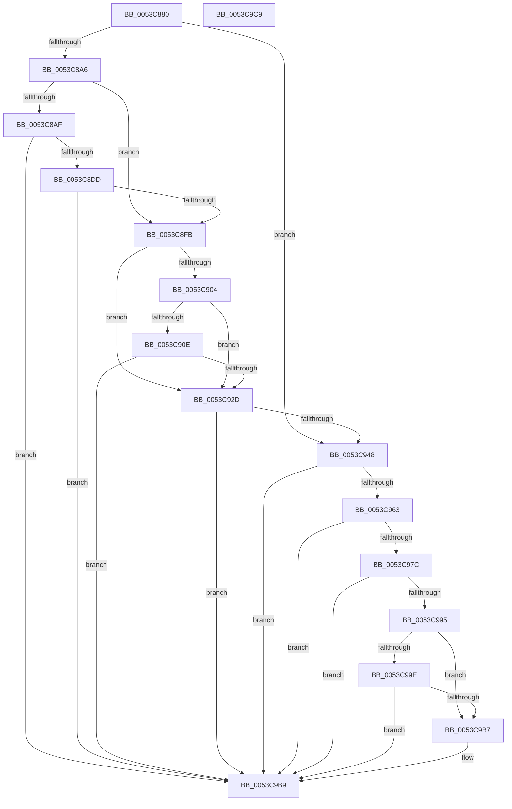

# HalpTimerFindIdealPerformanceCounterSource

- RVA: `0x0053C880`–`0x0053C9CA` (길이 `330` bytes)
- VA: `0x000000014053C880`
- 실행 섹션: `.text`
- PDB 이름 있음: `예`; PDB Function 태그: `아니요`
- unwind 정보 RVA: `0x000B6B54`
- 디코드: `92`개 명령, `330/330` bytes 표시
- 미해석 바이트: `0` (있으면 어셈블리에 `.byte`로 보존)

> 이 문서는 커널 이미지의 기계어와 PDB 기호를 분석해 생성했습니다. 4번과 5번은 함수 원형과 자료형을 바이너리 사용 방식에서 추정한 C 해석이며 원본 소스 복구 결과는 아닙니다.

## 1. Dependencies

- 직접 호출 지점: **10**; 고유 호출 대상: **2**
- 직접 호출자로 확인된 함수: **1**
- RIP 상대 이미지 참조: **4**

### Outgoing calls
- `0x0053C8A6` → [HalpIsHvPresent](../4A/HalpIsHvPresent_function_004AFA10.md) (function, `0x004AFA10`)
- `0x0053C8CF` → [HalpFindTimer](../54/HalpFindTimer_function_005488D0.md) (function, `0x005488D0`)
- `0x0053C8ED` → [HalpFindTimer](../54/HalpFindTimer_function_005488D0.md) (function, `0x005488D0`)
- `0x0053C91F` → [HalpFindTimer](../54/HalpFindTimer_function_005488D0.md) (function, `0x005488D0`)
- `0x0053C93E` → [HalpFindTimer](../54/HalpFindTimer_function_005488D0.md) (function, `0x005488D0`)
- `0x0053C959` → [HalpFindTimer](../54/HalpFindTimer_function_005488D0.md) (function, `0x005488D0`)
- `0x0053C972` → [HalpFindTimer](../54/HalpFindTimer_function_005488D0.md) (function, `0x005488D0`)
- `0x0053C98B` → [HalpFindTimer](../54/HalpFindTimer_function_005488D0.md) (function, `0x005488D0`)
- `0x0053C995` → [HalpIsHvPresent](../4A/HalpIsHvPresent_function_004AFA10.md) (function, `0x004AFA10`)
- `0x0053C9AD` → [HalpFindTimer](../54/HalpFindTimer_function_005488D0.md) (function, `0x005488D0`)

### Direct callers
- [HalpTimerSelectRoles](HalpTimerSelectRoles_function_0053D4B0.md) at `0x0053D550`
- [HalpTimerSelectRoles](HalpTimerSelectRoles_function_0053D4B0.md) at `0x0053D844`

### Static image references
- `0x0053C88F` → RVA `0x00FC4050` (`.data`; read)
- `0x0053C8AF` → RVA `0x00FC3FA4` (`.data`; read)
- `0x0053C8FB` → RVA `0x00FC1ED0` (`.data`; read)
- `0x0053C904` → RVA `0x00FC1C88` (`.data`; read)

## 2. Other-region calls and transfers

- 다른 실행 섹션으로 향하는 call: **0**
- 별도 외부 분기/꼬리 이동을 확인하지 못했습니다.

## 3. Assembly (complete function range)

```asm
0053C880  48 89 5C 24 08                  mov qword ptr [rsp + 8], rbx
0053C885  48 89 6C 24 10                  mov qword ptr [rsp + 0x10], rbp
0053C88A  56                              push rsi
0053C88B  48 83 EC 30                     sub rsp, 0x30
0053C88F  80 3D BA 77 A8 00 00            cmp byte ptr [rip + 0xa877ba], 0
0053C896  BD 00 60 00 00                  mov ebp, 0x6000
0053C89B  BE 02 00 00 00                  mov esi, 2
0053C8A0  0F 85 A2 00 00 00               jne 0x14053c948
0053C8A6  E8 65 31 F7 FF                  call 0x1404afa10
0053C8AB  84 C0                           test al, al
0053C8AD  75 4C                           jne 0x14053c8fb
0053C8AF  80 3D EE 76 A8 00 01            cmp byte ptr [rip + 0xa876ee], 1
0053C8B6  8D 56 01                        lea edx, [rsi + 1]
0053C8B9  BB 00 20 00 00                  mov ebx, 0x2000
0053C8BE  8D 4E 03                        lea ecx, [rsi + 3]
0053C8C1  0F 47 DD                        cmova ebx, ebp
0053C8C4  83 64 24 20 00                  and dword ptr [rsp + 0x20], 0
0053C8C9  44 8B C3                        mov r8d, ebx
0053C8CC  45 33 C9                        xor r9d, r9d
0053C8CF  E8 FC BF 00 00                  call 0x1405488d0
0053C8D4  48 85 C0                        test rax, rax
0053C8D7  0F 85 DC 00 00 00               jne 0x14053c9b9
0053C8DD  21 44 24 20                     and dword ptr [rsp + 0x20], eax
0053C8E1  8D 56 01                        lea edx, [rsi + 1]
0053C8E4  45 33 C9                        xor r9d, r9d
0053C8E7  8D 4E 08                        lea ecx, [rsi + 8]
0053C8EA  44 8B C3                        mov r8d, ebx
0053C8ED  E8 DE BF 00 00                  call 0x1405488d0
0053C8F2  48 85 C0                        test rax, rax
0053C8F5  0F 85 BE 00 00 00               jne 0x14053c9b9
0053C8FB  80 3D CE 55 A8 00 00            cmp byte ptr [rip + 0xa855ce], 0
0053C902  74 29                           je 0x14053c92d
0053C904  48 83 3D 7C 53 A8 00 00         cmp qword ptr [rip + 0xa8537c], 0
0053C90C  75 1F                           jne 0x14053c92d
0053C90E  83 64 24 20 00                  and dword ptr [rsp + 0x20], 0
0053C913  45 33 C9                        xor r9d, r9d
0053C916  44 8B C5                        mov r8d, ebp
0053C919  8B D6                           mov edx, esi
0053C91B  41 8D 49 03                     lea ecx, [r9 + 3]
0053C91F  E8 AC BF 00 00                  call 0x1405488d0
0053C924  48 85 C0                        test rax, rax
0053C927  0F 85 8C 00 00 00               jne 0x14053c9b9
0053C92D  83 64 24 20 00                  and dword ptr [rsp + 0x20], 0
0053C932  45 33 C9                        xor r9d, r9d
0053C935  45 33 C0                        xor r8d, r8d
0053C938  8B D6                           mov edx, esi
0053C93A  41 8D 49 08                     lea ecx, [r9 + 8]
0053C93E  E8 8D BF 00 00                  call 0x1405488d0
0053C943  48 85 C0                        test rax, rax
0053C946  75 71                           jne 0x14053c9b9
0053C948  83 64 24 20 00                  and dword ptr [rsp + 0x20], 0
0053C94D  45 33 C9                        xor r9d, r9d
0053C950  44 8B C5                        mov r8d, ebp
0053C953  8B D6                           mov edx, esi
0053C955  41 8D 49 0B                     lea ecx, [r9 + 0xb]
0053C959  E8 72 BF 00 00                  call 0x1405488d0
0053C95E  48 85 C0                        test rax, rax
0053C961  75 56                           jne 0x14053c9b9
0053C963  21 44 24 20                     and dword ptr [rsp + 0x20], eax
0053C967  8D 48 03                        lea ecx, [rax + 3]
0053C96A  45 33 C9                        xor r9d, r9d
0053C96D  44 8B C5                        mov r8d, ebp
0053C970  8B D6                           mov edx, esi
0053C972  E8 59 BF 00 00                  call 0x1405488d0
0053C977  48 85 C0                        test rax, rax
0053C97A  75 3D                           jne 0x14053c9b9
0053C97C  21 44 24 20                     and dword ptr [rsp + 0x20], eax
0053C980  8D 48 01                        lea ecx, [rax + 1]
0053C983  45 33 C9                        xor r9d, r9d
0053C986  44 8B C5                        mov r8d, ebp
0053C989  8B D6                           mov edx, esi
0053C98B  E8 40 BF 00 00                  call 0x1405488d0
0053C990  48 85 C0                        test rax, rax
0053C993  75 24                           jne 0x14053c9b9
0053C995  E8 76 30 F7 FF                  call 0x1404afa10
0053C99A  84 C0                           test al, al
0053C99C  75 19                           jne 0x14053c9b7
0053C99E  83 64 24 20 00                  and dword ptr [rsp + 0x20], 0
0053C9A3  45 33 C9                        xor r9d, r9d
0053C9A6  44 8B C5                        mov r8d, ebp
0053C9A9  8B D6                           mov edx, esi
0053C9AB  33 C9                           xor ecx, ecx
0053C9AD  E8 1E BF 00 00                  call 0x1405488d0
0053C9B2  48 85 C0                        test rax, rax
0053C9B5  75 02                           jne 0x14053c9b9
0053C9B7  33 C0                           xor eax, eax
0053C9B9  48 8B 5C 24 40                  mov rbx, qword ptr [rsp + 0x40]
0053C9BE  48 8B 6C 24 48                  mov rbp, qword ptr [rsp + 0x48]
0053C9C3  48 83 C4 30                     add rsp, 0x30
0053C9C7  5E                              pop rsi
0053C9C8  C3                              ret
0053C9C9  CC                              int3
```

## 4. C-style interpretation (structured pseudocode)

```c
__int64 __fastcall HalpTimerFindIdealPerformanceCounterSource(__int64 a1, __int64 a2, __int64 a3, int a4)
{
    __int64 result;
    __int64 v_rbx;
    __int64 v_rsp;
    unsigned int v_stack_m18;
    unsigned __int64 v_stack_p10;
    unsigned __int64 v_stack_p8;

    v_stack_p8 = v_rbx;
    v_stack_p10 = v_rbp;
    v_rsp = (v_rsp) - (48);
    if ((*(unsigned __int8 *)(v_rip + 11040698)) != 0) goto loc_0053C948;
    result = HalpIsHvPresent(a1, a2, a3, a4);
    if ((unsigned __int8)(result) != 0) goto loc_0053C8FB;
    v_rbx = (unsigned int)(0x2000ULL);
    if ((*(unsigned __int8 *)(v_rip + 11040494)) > 1) { v_rbx = (unsigned int)((unsigned int)(0x6000ULL)); }
    a4 = 0;
    result = HalpFindTimer(2 + 3, 2 + 1, (unsigned int)((unsigned int)(v_rbx)), a4);
    if (result != 0) goto loc_0053C9B9;
    a4 = 0;
    result = HalpFindTimer(2 + 8, 2 + 1, (unsigned int)((unsigned int)(v_rbx)), a4);
    if (result != 0) goto loc_0053C9B9;
loc_0053C8FB:
    if ((*(unsigned __int8 *)(v_rip + 11032014)) == 0) goto loc_0053C92D;
    if ((*(unsigned __int64 *)(v_rip + 11031420)) != 0) goto loc_0053C92D;
    a4 = 0;
    result = HalpFindTimer(a4 + 3, 2, (unsigned int)((unsigned int)((unsigned int)(0x6000ULL))), a4);
    if (result != 0) goto loc_0053C9B9;
loc_0053C92D:
    a4 = 0;
    a3 = 0;
    result = HalpFindTimer(a4 + 8, 2, a3, a4);
    if (result != 0) goto loc_0053C9B9;
loc_0053C948:
    a4 = 0;
    result = HalpFindTimer(a4 + 11, 2, (unsigned int)((unsigned int)((unsigned int)(0x6000ULL))), a4);
    if (result != 0) goto loc_0053C9B9;
    a4 = 0;
    result = HalpFindTimer(result + 3, 2, (unsigned int)((unsigned int)((unsigned int)(0x6000ULL))), a4);
    if (result != 0) goto loc_0053C9B9;
    a4 = 0;
    result = HalpFindTimer(result + 1, 2, (unsigned int)((unsigned int)((unsigned int)(0x6000ULL))), a4);
    if (result != 0) goto loc_0053C9B9;
    result = HalpIsHvPresent(result + 1, 2, (unsigned int)((unsigned int)((unsigned int)(0x6000ULL))), a4);
    if ((unsigned __int8)(result) != 0) goto loc_0053C9B7;
    a4 = 0;
    a1 = 0;
    result = HalpFindTimer(a1, 2, (unsigned int)((unsigned int)((unsigned int)(0x6000ULL))), a4);
    if (result == 0) {
        result = 0;
    }
    v_rsp = (v_rsp) + (48);
    return result;
}
```

## 5. (Beta) C Style

```c
int64_t HalpTimerFindIdealPerformanceCounterSource(int64_t Arg1, int64_t Arg2, int64_t Arg3, int32_t Arg4)
{
    int64_t result;
    int64_t local_rbx;
    int64_t local_rsp;
    uint32_t v_stack_m18;
    uint64_t v_stack_p10;
    uint64_t v_stack_p8;

    v_stack_p8 = local_rbx;
    v_stack_p10 = local_rbp;
    local_rsp = (local_rsp) - (48);
    if ((*(uint8_t *)(v_rip + 0xA877BA)) != 0) goto loc_0053C948;
    result = HalpIsHvPresent(Arg1, Arg2, Arg3, Arg4);
    if ((uint8_t)(result) != 0) goto loc_0053C8FB;
    local_rbx = (uint32_t)(0x2000ULL);
    if ((*(uint8_t *)(v_rip + 0xA876EE)) > 1) { local_rbx = (uint32_t)((uint32_t)(0x6000ULL)); }
    Arg4 = 0;
    result = HalpFindTimer(2 + 3, 2 + 1, (uint32_t)((uint32_t)(local_rbx)), Arg4);
    if (result != 0) goto loc_0053C9B9;
    Arg4 = 0;
    result = HalpFindTimer(2 + 8, 2 + 1, (uint32_t)((uint32_t)(local_rbx)), Arg4);
    if (result != 0) goto loc_0053C9B9;
loc_0053C8FB:
    if ((*(uint8_t *)(v_rip + 0xA855CE)) == 0) goto loc_0053C92D;
    if ((*(uint64_t *)(v_rip + 0xA8537C)) != 0) goto loc_0053C92D;
    Arg4 = 0;
    result = HalpFindTimer(Arg4 + 3, 2, (uint32_t)((uint32_t)((uint32_t)(0x6000ULL))), Arg4);
    if (result != 0) goto loc_0053C9B9;
loc_0053C92D:
    Arg4 = 0;
    Arg3 = 0;
    result = HalpFindTimer(Arg4 + 8, 2, Arg3, Arg4);
    if (result != 0) goto loc_0053C9B9;
loc_0053C948:
    Arg4 = 0;
    result = HalpFindTimer(Arg4 + 11, 2, (uint32_t)((uint32_t)((uint32_t)(0x6000ULL))), Arg4);
    if (result != 0) goto loc_0053C9B9;
    Arg4 = 0;
    result = HalpFindTimer(result + 3, 2, (uint32_t)((uint32_t)((uint32_t)(0x6000ULL))), Arg4);
    if (result != 0) goto loc_0053C9B9;
    Arg4 = 0;
    result = HalpFindTimer(result + 1, 2, (uint32_t)((uint32_t)((uint32_t)(0x6000ULL))), Arg4);
    if (result != 0) goto loc_0053C9B9;
    result = HalpIsHvPresent(result + 1, 2, (uint32_t)((uint32_t)((uint32_t)(0x6000ULL))), Arg4);
    if ((uint8_t)(result) != 0) goto loc_0053C9B7;
    Arg4 = 0;
    Arg1 = 0;
    result = HalpFindTimer(Arg1, 2, (uint32_t)((uint32_t)((uint32_t)(0x6000ULL))), Arg4);
    if (result == 0) {
        result = 0;
    }
    local_rsp = (local_rsp) + (48);
    return result;
}
```

## 6. Execution-region graph

[열기: 2D/3D 그래프와 함수 탐색 컨트롤 패널](../../../control-panel.html?section=text&rva=0x0053C880&view=graph)

- 2D 그래프는 위에서 아래로 흐르고, 3D 그래프는 빈 공간을 드래그해 회전합니다. Shift+드래그는 이동, 휠은 확대·축소, 함수 노드 선택은 대상 보고서 이동입니다.

### Static fallback


