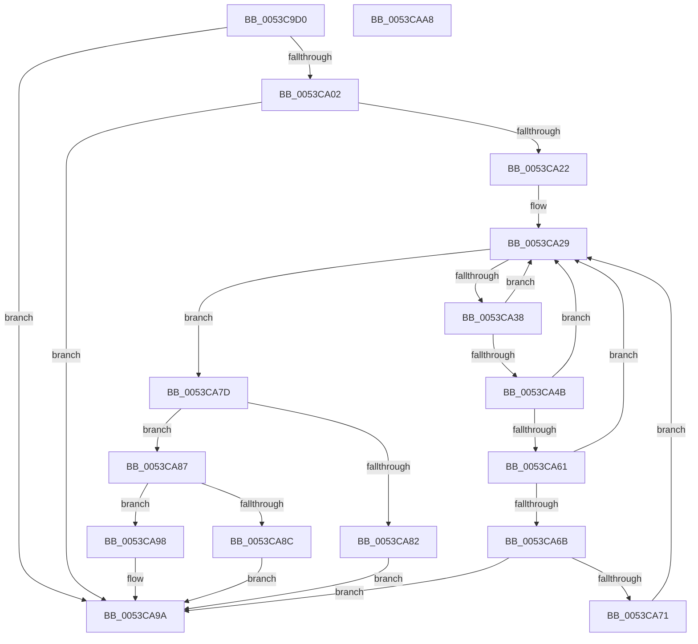

# HalpTimerFindIdealScalingSource

- RVA: `0x0053C9D0`–`0x0053CAA9` (길이 `217` bytes)
- VA: `0x000000014053C9D0`
- 실행 섹션: `.text`
- PDB 이름 있음: `예`; PDB Function 태그: `아니요`
- unwind 정보 RVA: `0x0006E5F8`
- 디코드: `62`개 명령, `217/217` bytes 표시
- 미해석 바이트: `0` (있으면 어셈블리에 `.byte`로 보존)

> 이 문서는 커널 이미지의 기계어와 PDB 기호를 분석해 생성했습니다. 4번과 5번은 함수 원형과 자료형을 바이너리 사용 방식에서 추정한 C 해석이며 원본 소스 복구 결과는 아닙니다.

## 1. Dependencies

- 직접 호출 지점: **2**; 고유 호출 대상: **1**
- 직접 호출자로 확인된 함수: **1**
- RIP 상대 이미지 참조: **1**

### Outgoing calls
- `0x0053C9F1` → [HalpFindTimer](../54/HalpFindTimer_function_005488D0.md) (function, `0x005488D0`)
- `0x0053CA15` → [HalpFindTimer](../54/HalpFindTimer_function_005488D0.md) (function, `0x005488D0`)

### Direct callers
- [HalpTimerSelectRoles](HalpTimerSelectRoles_function_0053D4B0.md) at `0x0053D4C4`

### Static image references
- `0x0053CA22` → RVA `0x00FC4120` (`.data`; read)

## 2. Other-region calls and transfers

- 다른 실행 섹션으로 향하는 call: **0**
- 별도 외부 분기/꼬리 이동을 확인하지 못했습니다.

## 3. Assembly (complete function range)

```asm
0053C9D0  48 89 5C 24 08                  mov qword ptr [rsp + 8], rbx
0053C9D5  57                              push rdi
0053C9D6  48 83 EC 30                     sub rsp, 0x30
0053C9DA  33 FF                           xor edi, edi
0053C9DC  33 DB                           xor ebx, ebx
0053C9DE  21 5C 24 20                     and dword ptr [rsp + 0x20], ebx
0053C9E2  45 33 C9                        xor r9d, r9d
0053C9E5  41 B8 00 60 00 00               mov r8d, 0x6000
0053C9EB  8D 57 02                        lea edx, [rdi + 2]
0053C9EE  8D 4F 01                        lea ecx, [rdi + 1]
0053C9F1  E8 DA BE 00 00                  call 0x1405488d0
0053C9F6  48 8B C8                        mov rcx, rax
0053C9F9  48 85 C0                        test rax, rax
0053C9FC  0F 85 98 00 00 00               jne 0x14053ca9a
0053CA02  21 5C 24 20                     and dword ptr [rsp + 0x20], ebx
0053CA06  8D 57 02                        lea edx, [rdi + 2]
0053CA09  45 33 C9                        xor r9d, r9d
0053CA0C  8D 4F 03                        lea ecx, [rdi + 3]
0053CA0F  41 B8 00 60 00 00               mov r8d, 0x6000
0053CA15  E8 B6 BE 00 00                  call 0x1405488d0
0053CA1A  48 8B C8                        mov rcx, rax
0053CA1D  48 85 C0                        test rax, rax
0053CA20  75 78                           jne 0x14053ca9a
0053CA22  48 8B 15 F7 76 A8 00            mov rdx, qword ptr [rip + 0xa876f7]
0053CA29  48 8D 05 F0 76 A8 00            lea rax, [rip + 0xa876f0]
0053CA30  4C 8B C2                        mov r8, rdx
0053CA33  48 3B D0                        cmp rdx, rax
0053CA36  74 45                           je 0x14053ca7d
0053CA38  48 8B CA                        mov rcx, rdx
0053CA3B  48 8B 12                        mov rdx, qword ptr [rdx]
0053CA3E  44 8B 89 B8 00 00 00            mov r9d, dword ptr [rcx + 0xb8]
0053CA45  41 F6 C1 01                     test r9b, 1
0053CA49  75 DE                           jne 0x14053ca29
0053CA4B  48 83 B9 B0 00 00 00 00         cmp qword ptr [rcx + 0xb0], 0
0053CA53  8B 81 E0 00 00 00               mov eax, dword ptr [rcx + 0xe0]
0053CA59  48 0F 45 F9                     cmovne rdi, rcx
0053CA5D  A8 02                           test al, 2
0053CA5F  74 C8                           je 0x14053ca29
0053CA61  48 83 B9 C0 00 00 00 00         cmp qword ptr [rcx + 0xc0], 0
0053CA69  74 BE                           je 0x14053ca29
0053CA6B  41 F6 C1 08                     test r9b, 8
0053CA6F  74 29                           je 0x14053ca9a
0053CA71  48 85 DB                        test rbx, rbx
0053CA74  4C 0F 45 C3                     cmovne r8, rbx
0053CA78  49 8B D8                        mov rbx, r8
0053CA7B  EB AC                           jmp 0x14053ca29
0053CA7D  48 85 FF                        test rdi, rdi
0053CA80  74 05                           je 0x14053ca87
0053CA82  48 8B CF                        mov rcx, rdi
0053CA85  EB 13                           jmp 0x14053ca9a
0053CA87  48 85 DB                        test rbx, rbx
0053CA8A  74 0C                           je 0x14053ca98
0053CA8C  83 A3 B8 00 00 00 F7            and dword ptr [rbx + 0xb8], 0xfffffff7
0053CA93  48 8B CB                        mov rcx, rbx
0053CA96  EB 02                           jmp 0x14053ca9a
0053CA98  33 C9                           xor ecx, ecx
0053CA9A  48 8B 5C 24 40                  mov rbx, qword ptr [rsp + 0x40]
0053CA9F  48 8B C1                        mov rax, rcx
0053CAA2  48 83 C4 30                     add rsp, 0x30
0053CAA6  5F                              pop rdi
0053CAA7  C3                              ret
0053CAA8  CC                              int3
```

## 4. C-style interpretation (structured pseudocode)

```c
__int64 __fastcall HalpTimerFindIdealScalingSource(__int64 a1, __int64 a2, __int64 a3, int a4)
{
    __int64 result;
    __int64 v_rbx;
    __int64 v_rdi;
    __int64 v_rsp;
    unsigned int v_stack_m18;
    unsigned __int64 v_stack_p8;

    v_stack_p8 = v_rbx;
    v_rsp = (v_rsp) - (48);
    v_rdi = 0;
    v_rbx = 0;
    a4 = 0;
    result = HalpFindTimer(v_rdi + 1, v_rdi + 2, (unsigned int)(0x6000ULL), a4);
    if (result != 0) goto loc_0053CA9A;
    a4 = 0;
    result = HalpFindTimer(v_rdi + 3, v_rdi + 2, (unsigned int)(0x6000ULL), a4);
    if (result != 0) goto loc_0053CA9A;
loc_0053CA29:
    if ((*(unsigned __int64 *)(v_rip + 11040503)) == (v_rip + 11040496)) goto loc_0053CA7D;
    if ((((unsigned __int8)((unsigned int)(*(unsigned int *)(*(unsigned __int64 *)(v_rip + 11040503) + 184)))) & (1)) != 0) goto loc_0053CA29;
    if ((*(unsigned __int64 *)(*(unsigned __int64 *)(v_rip + 11040503) + 176)) != 0) { v_rdi = *(unsigned __int64 *)(v_rip + 11040503); }
    if ((((unsigned __int8)((unsigned int)(*(unsigned int *)(*(unsigned __int64 *)(v_rip + 11040503) + 224)))) & (2)) == 0) goto loc_0053CA29;
    if ((*(unsigned __int64 *)(*(unsigned __int64 *)(v_rip + 11040503) + 192)) == 0) goto loc_0053CA29;
    if ((((unsigned __int8)((unsigned int)(*(unsigned int *)(*(unsigned __int64 *)(v_rip + 11040503) + 184)))) & (8)) == 0) goto loc_0053CA9A;
    a3 = *(unsigned __int64 *)(v_rip + 11040503);
    if (0 != 0) { a3 = 0; }
    goto loc_0053CA29;
loc_0053CA7D:
    if (v_rdi == 0) goto loc_0053CA87;
    goto loc_0053CA9A;
loc_0053CA87:
    if (a3 == 0) goto loc_0053CA98;
    goto loc_0053CA9A;
loc_0053CA98:
    a1 = 0;
loc_0053CA9A:
    v_rsp = (v_rsp) + (48);
    return 0;
}
```

## 5. (Beta) C Style

```c
int64_t HalpTimerFindIdealScalingSource(int64_t Arg1, int64_t Arg2, int64_t Arg3, int32_t Arg4)
{
    int64_t result;
    int64_t local_rbx;
    int64_t local_rdi;
    int64_t local_rsp;
    uint32_t v_stack_m18;
    uint64_t v_stack_p8;

    v_stack_p8 = local_rbx;
    local_rsp = (local_rsp) - (48);
    local_rdi = 0;
    local_rbx = 0;
    Arg4 = 0;
    result = HalpFindTimer(local_rdi + 1, local_rdi + 2, (uint32_t)(0x6000ULL), Arg4);
    if (result != 0) goto loc_0053CA9A;
    Arg4 = 0;
    result = HalpFindTimer(local_rdi + 3, local_rdi + 2, (uint32_t)(0x6000ULL), Arg4);
    if (result != 0) goto loc_0053CA9A;
loc_0053CA29:
    if ((*(uint64_t *)(v_rip + 0xA876F7)) == (v_rip + 11040496)) goto loc_0053CA7D;
    if ((((uint8_t)((uint32_t)(*(uint32_t *)(*(uint64_t *)(v_rip + 0xA876F7) + 0xB8)))) & (1)) != 0) goto loc_0053CA29;
    if ((*(uint64_t *)(*(uint64_t *)(v_rip + 0xA876F7) + 0xB0)) != 0) { local_rdi = *(uint64_t *)(v_rip + 0xA876F7); }
    if ((((uint8_t)((uint32_t)(*(uint32_t *)(*(uint64_t *)(v_rip + 0xA876F7) + 0xE0)))) & (2)) == 0) goto loc_0053CA29;
    if ((*(uint64_t *)(*(uint64_t *)(v_rip + 0xA876F7) + 0xC0)) == 0) goto loc_0053CA29;
    if ((((uint8_t)((uint32_t)(*(uint32_t *)(*(uint64_t *)(v_rip + 0xA876F7) + 0xB8)))) & (8)) == 0) goto loc_0053CA9A;
    Arg3 = *(uint64_t *)(v_rip + 0xA876F7);
    if (0 != 0) { Arg3 = 0; }
    goto loc_0053CA29;
loc_0053CA7D:
    if (local_rdi == 0) goto loc_0053CA87;
    goto loc_0053CA9A;
loc_0053CA87:
    if (Arg3 == 0) goto loc_0053CA98;
    goto loc_0053CA9A;
loc_0053CA98:
    Arg1 = 0;
loc_0053CA9A:
    local_rsp = (local_rsp) + (48);
    return 0;
}
```

## 6. Execution-region graph

[열기: 2D/3D 그래프와 함수 탐색 컨트롤 패널](../../../control-panel.html?section=text&rva=0x0053C9D0&view=graph)

- 2D 그래프는 위에서 아래로 흐르고, 3D 그래프는 빈 공간을 드래그해 회전합니다. Shift+드래그는 이동, 휠은 확대·축소, 함수 노드 선택은 대상 보고서 이동입니다.

### Static fallback


