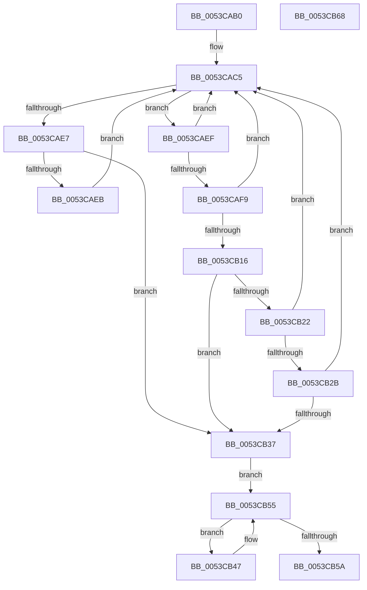

# HalpTimerFindIdealWatchdog

- RVA: `0x0053CAB0`–`0x0053CB69` (길이 `185` bytes)
- VA: `0x000000014053CAB0`
- 실행 섹션: `.text`
- PDB 이름 있음: `예`; PDB Function 태그: `아니요`
- unwind 정보 RVA: `0x00097BC4`
- 디코드: `47`개 명령, `185/185` bytes 표시
- 미해석 바이트: `0` (있으면 어셈블리에 `.byte`로 보존)

> 이 문서는 커널 이미지의 기계어와 PDB 기호를 분석해 생성했습니다. 4번과 5번은 함수 원형과 자료형을 바이너리 사용 방식에서 추정한 C 해석이며 원본 소스 복구 결과는 아닙니다.

## 1. Dependencies

- 직접 호출 지점: **2**; 고유 호출 대상: **2**
- 직접 호출자로 확인된 함수: **1**
- RIP 상대 이미지 참조: **1**

### Outgoing calls
- `0x0053CADA` → [HalpFindTimer](../54/HalpFindTimer_function_005488D0.md) (function, `0x005488D0`)
- `0x0053CB06` → [HalpTimerGetClockRates](../54/HalpTimerGetClockRates_function_005483AC.md) (function, `0x005483AC`)

### Direct callers
- [HalpTimerSelectRoles](HalpTimerSelectRoles_function_0053D4B0.md) at `0x0053D8E2`

### Static image references
- `0x0053CB37` → RVA `0x00FC4120` (`.data`; read)

## 2. Other-region calls and transfers

- 다른 실행 섹션으로 향하는 call: **0**
- 별도 외부 분기/꼬리 이동을 확인하지 못했습니다.

## 3. Assembly (complete function range)

```asm
0053CAB0  48 89 5C 24 18                  mov qword ptr [rsp + 0x18], rbx
0053CAB5  57                              push rdi
0053CAB6  48 83 EC 30                     sub rsp, 0x30
0053CABA  48 83 64 24 48 00               and qword ptr [rsp + 0x48], 0
0053CAC0  BF 0B 00 00 00                  mov edi, 0xb
0053CAC5  45 33 C9                        xor r9d, r9d
0053CAC8  C7 44 24 20 04 00 00 00         mov dword ptr [rsp + 0x20], 4
0053CAD0  45 33 C0                        xor r8d, r8d
0053CAD3  BA 20 80 02 00                  mov edx, 0x28020
0053CAD8  8B CF                           mov ecx, edi
0053CADA  E8 F1 BD 00 00                  call 0x1405488d0
0053CADF  48 8B D8                        mov rbx, rax
0053CAE2  48 85 C0                        test rax, rax
0053CAE5  75 08                           jne 0x14053caef
0053CAE7  85 FF                           test edi, edi
0053CAE9  74 4C                           je 0x14053cb37
0053CAEB  33 FF                           xor edi, edi
0053CAED  EB D6                           jmp 0x14053cac5
0053CAEF  48 83 B8 C0 00 00 00 00         cmp qword ptr [rax + 0xc0], 0
0053CAF7  74 CC                           je 0x14053cac5
0053CAF9  4C 8D 44 24 40                  lea r8, [rsp + 0x40]
0053CAFE  48 8B CB                        mov rcx, rbx
0053CB01  48 8D 54 24 48                  lea rdx, [rsp + 0x48]
0053CB06  E8 A1 B8 00 00                  call 0x1405483ac
0053CB0B  48 81 7C 24 48 00 A3 E1 11      cmp qword ptr [rsp + 0x48], 0x11e1a300
0053CB14  72 AF                           jb 0x14053cac5
0053CB16  B8 00 5E D0 B2                  mov eax, 0xb2d05e00
0053CB1B  48 39 44 24 48                  cmp qword ptr [rsp + 0x48], rax
0053CB20  73 15                           jae 0x14053cb37
0053CB22  83 BB E4 00 00 00 08            cmp dword ptr [rbx + 0xe4], 8
0053CB29  74 9A                           je 0x14053cac5
0053CB2B  F7 83 E0 00 00 00 00 00 08 00   test dword ptr [rbx + 0xe0], 0x80000
0053CB35  74 8E                           je 0x14053cac5
0053CB37  48 8B 0D E2 75 A8 00            mov rcx, qword ptr [rip + 0xa875e2]
0053CB3E  48 8D 15 DB 75 A8 00            lea rdx, [rip + 0xa875db]
0053CB45  EB 0E                           jmp 0x14053cb55
0053CB47  48 8D 01                        lea rax, [rcx]
0053CB4A  48 8B 09                        mov rcx, qword ptr [rcx]
0053CB4D  0F BA B0 B8 00 00 00 08         btr dword ptr [rax + 0xb8], 8
0053CB55  48 3B CA                        cmp rcx, rdx
0053CB58  75 ED                           jne 0x14053cb47
0053CB5A  48 8B C3                        mov rax, rbx
0053CB5D  48 8B 5C 24 50                  mov rbx, qword ptr [rsp + 0x50]
0053CB62  48 83 C4 30                     add rsp, 0x30
0053CB66  5F                              pop rdi
0053CB67  C3                              ret
0053CB68  CC                              int3
```

## 4. C-style interpretation (structured pseudocode)

```c
__int64 __fastcall HalpTimerFindIdealWatchdog(__int64 a1, __int64 a2, int a3, int a4)
{
    __int64 result;
    __int64 v_rdi;
    __int64 v_rsp;
    unsigned int v_stack_m18;
    unsigned __int64 v_stack_p10;
    unsigned __int64 v_stack_p18;
    unsigned __int64 v_stack_p8;

    v_stack_p18 = v_rbx;
    v_rsp = (v_rsp) - (48);
loc_0053CAC5:
    a4 = 0;
    v_stack_m18 = 4;
    a3 = 0;
    result = HalpFindTimer(11, (unsigned int)(0x28020ULL), a3, a4);
    if (result != 0) goto loc_0053CAEF;
    if (11 == 0) goto loc_0053CB37;
    v_rdi = 0;
    goto loc_0053CAC5;
loc_0053CAEF:
    if ((*(unsigned __int64 *)(result + 192)) == 0) goto loc_0053CAC5;
    result = HalpTimerGetClockRates(result, v_stack_p10, v_stack_p8, a4);
    if (v_stack_p10 < 0x11E1A300ULL) goto loc_0053CAC5;
    if (v_stack_p10 >= ((unsigned int)(0xB2D05E00ULL))) goto loc_0053CB37;
    if ((*(unsigned int *)(result + 228)) == 8) goto loc_0053CAC5;
    if (((*(unsigned int *)(result + 224)) & (0x80000ULL)) == 0) goto loc_0053CAC5;
loc_0053CB37:
    goto loc_0053CB55;
loc_0053CB47:
loc_0053CB55:
    if ((*(unsigned __int64 *)(*(unsigned __int64 *)(v_rip + 11040226))) != (v_rip + 11040219)) goto loc_0053CB47;
    v_rsp = (v_rsp) + (48);
    return result;
}
```

## 5. (Beta) C Style

```c
int64_t HalpTimerFindIdealWatchdog(int64_t Arg1, int64_t Arg2, int32_t Arg3, int32_t Arg4)
{
    int64_t result;
    int64_t local_rdi;
    int64_t local_rsp;
    uint32_t v_stack_m18;
    uint64_t v_stack_p10;
    uint64_t v_stack_p18;
    uint64_t v_stack_p8;

    v_stack_p18 = local_rbx;
    local_rsp = (local_rsp) - (48);
loc_0053CAC5:
    Arg4 = 0;
    v_stack_m18 = 4;
    Arg3 = 0;
    result = HalpFindTimer(11, (uint32_t)(0x28020ULL), Arg3, Arg4);
    if (result != 0) goto loc_0053CAEF;
    if (11 == 0) goto loc_0053CB37;
    local_rdi = 0;
    goto loc_0053CAC5;
loc_0053CAEF:
    if ((*(uint64_t *)(result + 0xC0)) == 0) goto loc_0053CAC5;
    result = HalpTimerGetClockRates(result, v_stack_p10, v_stack_p8, Arg4);
    if (v_stack_p10 < 0x11E1A300ULL) goto loc_0053CAC5;
    if (v_stack_p10 >= ((uint32_t)(0xB2D05E00ULL))) goto loc_0053CB37;
    if ((*(uint32_t *)(result + 0xE4)) == 8) goto loc_0053CAC5;
    if (((*(uint32_t *)(result + 0xE0)) & (0x80000ULL)) == 0) goto loc_0053CAC5;
loc_0053CB37:
    goto loc_0053CB55;
loc_0053CB47:
loc_0053CB55:
    if ((*(uint64_t *)(*(uint64_t *)(v_rip + 0xA875E2))) != (v_rip + 11040219)) goto loc_0053CB47;
    local_rsp = (local_rsp) + (48);
    return result;
}
```

## 6. Execution-region graph

[열기: 2D/3D 그래프와 함수 탐색 컨트롤 패널](../../../control-panel.html?section=text&rva=0x0053CAB0&view=graph)

- 2D 그래프는 위에서 아래로 흐르고, 3D 그래프는 빈 공간을 드래그해 회전합니다. Shift+드래그는 이동, 휠은 확대·축소, 함수 노드 선택은 대상 보고서 이동입니다.

### Static fallback


