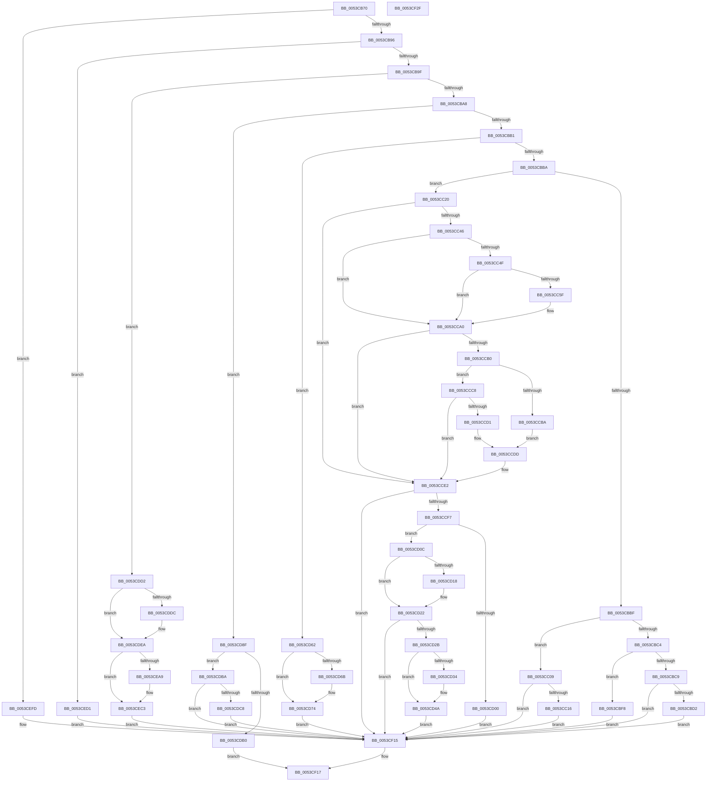

# HalpTimerInitSystem

- RVA: `0x0053CB70`–`0x0053CF30` (길이 `960` bytes)
- VA: `0x000000014053CB70`
- 실행 섹션: `.text`
- PDB 이름 있음: `예`; PDB Function 태그: `아니요`
- unwind 정보 RVA: `0x000BBED8`
- 디코드: `204`개 명령, `960/960` bytes 표시
- 미해석 바이트: `0` (있으면 어셈블리에 `.byte`로 보존)

> 이 문서는 커널 이미지의 기계어와 PDB 기호를 분석해 생성했습니다. 4번과 5번은 함수 원형과 자료형을 바이너리 사용 방식에서 추정한 C 해석이며 원본 소스 복구 결과는 아닙니다.

## 1. Dependencies

- 직접 호출 지점: **33**; 고유 호출 대상: **28**
- 직접 호출자로 확인된 함수: **0**
- RIP 상대 이미지 참조: **52**

### Outgoing calls
- `0x0053CBE4` → [HalpTimerQueryAndResetRtcErrors](../4D/HalpTimerQueryAndResetRtcErrors_function_004D9B30.md) (function, `0x004D9B30`)
- `0x0053CBE9` → [HalpTimerTraceTimingHardware](../../page/70/HalpTimerTraceTimingHardware_function_00706350.md) (function, `0x00706350`)
- `0x0053CBEE` → [HalpTscReportSyncStatus](../../page/70/HalpTscReportSyncStatus_function_00707E44.md) (function, `0x00707E44`)
- `0x0053CBF8` → [HalpTimerInitPowerManagement](../54/HalpTimerInitPowerManagement_function_00549298.md) (function, `0x00549298`)
- `0x0053CBFF` → [HalpTimerWatchdogLogReset](../../page/70/HalpTimerWatchdogLogReset_function_00707F84.md) (function, `0x00707F84`)
- `0x0053CC16` → [HalpTimerInitializeSystemWatchdog](../54/HalpTimerInitializeSystemWatchdog_function_0054C58C.md) (function, `0x0054C58C`)
- `0x0053CC20` → [HalpTimerSchedulePeriodicQueries](HalpTimerSchedulePeriodicQueries_function_0053D388.md) (function, `0x0053D388`)
- `0x0053CC25` → [HalpTimerConfigureQpcBypass](../54/HalpTimerConfigureQpcBypass_function_0054BDAC.md) (function, `0x0054BDAC`)
- `0x0053CC38` → [HalpInterruptModel](../4A/HalpInterruptModel_function_004ACA38.md) (function, `0x004ACA38`)
- `0x0053CC72` → [KeQueryActiveProcessorCountEx](../24/KeQueryActiveProcessorCountEx_function_00249EF0.md) (function, `0x00249EF0`)
- `0x0053CC9B` → [KeIpiGenericCall](../47/KeIpiGenericCall_function_00471720.md) (function, `0x00471720`)
- `0x0053CCDD` → [HalpTscFallbackToPlatformSource](../54/HalpTscFallbackToPlatformSource_function_0054AD14.md) (function, `0x0054AD14`)
- `0x0053CD39` → [KeQueryPerformanceCounter](../37/KeQueryPerformanceCounter_function_0037E7E0.md) (function, `0x0037E7E0`)
- `0x0053CD4C` → [KeQueryPerformanceCounter](../37/KeQueryPerformanceCounter_function_0037E7E0.md) (function, `0x0037E7E0`)
- `0x0053CD58` → [HalpTimerCaptureCloestAuxiliaryQpcPair](HalpTimerCaptureCloestAuxiliaryQpcPair_function_0053C428.md) (function, `0x0053C428`)
- `0x0053CD74` → [HalpTimerSaveProcessorFrequency](../54/HalpTimerSaveProcessorFrequency_function_0054BECC.md) (function, `0x0054BECC`)
- `0x0053CD79` → [HalpInitializePnTimers](HalpInitializePnTimers_function_0053C120.md) (function, `0x0053C120`)
- `0x0053CD7E` → [HalpTimerInitializeClockPn](../54/HalpTimerInitializeClockPn_function_00548614.md) (function, `0x00548614`)
- `0x0053CD83` → [HalpTimerInitializeProfiling](../54/HalpTimerInitializeProfiling_function_0054B4FC.md) (function, `0x0054B4FC`)
- `0x0053CD8F` → [HalpTscReserveResources](../54/HalpTscReserveResources_function_0054AE20.md) (function, `0x0054AE20`)
- `0x0053CD94` → [HalQueryMaximumProcessorCount](../4A/HalQueryMaximumProcessorCount_function_004AC9A0.md) (function, `0x004AC9A0`)
- `0x0053CD9F` → [HalpMmAllocCtxAlloc](../3E/HalpMmAllocCtxAlloc_function_003E10B8.md) (function, `0x003E10B8`)
- `0x0053CDBA` → [HalpInterruptModel](../4A/HalpInterruptModel_function_004ACA38.md) (function, `0x004ACA38`)
- `0x0053CDC8` → [HalpTimerInitializeHypervisorTimer](../54/HalpTimerInitializeHypervisorTimer_function_0054B8F4.md) (function, `0x0054B8F4`)
- `0x0053CDD2` → [HalpInterruptModel](../4A/HalpInterruptModel_function_004ACA38.md) (function, `0x004ACA38`)
- `0x0053CE87` → [HalpInitializeTimers](HalpInitializeTimers_function_0053C1E0.md) (function, `0x0053C1E0`)
- `0x0053CE8C` → [HalpTimerSaveProcessorFrequency](../54/HalpTimerSaveProcessorFrequency_function_0054BECC.md) (function, `0x0054BECC`)
- `0x0053CE91` → [HalpTimerInitializeClock](../54/HalpTimerInitializeClock_function_00548424.md) (function, `0x00548424`)
- `0x0053CE9D` → [HalpTimerInitializeProfiling](../54/HalpTimerInitializeProfiling_function_0054B4FC.md) (function, `0x0054B4FC`)
- `0x0053CEBD` → [KeBugCheckEx](../4F/KeBugCheckEx_function_004FD660.md) (function, `0x004FD660`)
- `0x0053CECA` → [HalpTimerPropagateQpcBiasUpdate](../4A/HalpTimerPropagateQpcBiasUpdate_function_004AB9F4.md) (function, `0x004AB9F4`)
- `0x0053CF00` → [HalpTimerInitializeEarlyStallSource](HalpTimerInitializeEarlyStallSource_function_0053CFDC.md) (function, `0x0053CFDC`)
- `0x0053CF1F` → [_security_check_cookie](../6A/_security_check_cookie_function_006AC640.md) (function, `0x006AC640`)

### Direct callers
- 이 함수 시작 RVA로 연결되는 직접 call은 확인되지 않았습니다. 간접 호출은 완전히 역산할 수 없습니다.

### Static image references
- `0x0053CB7A` → RVA `0x00E0A740` (`.data`; read)
- `0x0053CBD2` → RVA `0x004D9B30` (`HalpTimerQueryAndResetRtcErrors`; read)
- `0x0053CBDD` → RVA `0x00E00BA8` (`.data`; write)
- `0x0053CC09` → RVA `0x00FC4028` (`.data`; read)
- `0x0053CC2A` → RVA `0x0053D230` (`HalpTimerQueryHostPerformanceCounter`; read)
- `0x0053CC31` → RVA `0x00E00C40` (`.data`; write)
- `0x0053CC46` → RVA `0x00FC4118` (`.data`; read)
- `0x0053CC4F` → RVA `0x00FC3FD0` (`.data`; read)
- `0x0053CC84` → RVA `0x0054D910` (`HalpTimerMeasureProcessorsWorker`; read)
- `0x0053CCB0` → RVA `0x00FC2200` (`.data`; read)
- `0x0053CCBF` → RVA `0x000222E0` (`.rdata`; read)
- `0x0053CCC8` → RVA `0x00FC2230` (`.data`; read)
- `0x0053CCD6` → RVA `0x00022AF8` (`.rdata`; read)
- `0x0053CCE2` → RVA `0x00FC4130` (`.data`; read)
- `0x0053CCF7` → RVA `0x00FC40E8` (`.data`; read)
- `0x0053CD00` → RVA `0x00FC4130` (`.data`; write)
- `0x0053CD2B` → RVA `0x00FC4020` (`.data`; read)
- `0x0053CD43` → RVA `0x00FC4020` (`.data`; write)
- `0x0053CD51` → RVA `0x00FC4030` (`.data`; write)
- `0x0053CD62` → RVA `0x00FC1C88` (`.data`; read)
- `0x0053CDA4` → RVA `0x00FC4040` (`.data`; write)
- `0x0053CDDC` → RVA `0x0054AFC0` (`HalpTscSynchronization`; read)
- `0x0053CDE3` → RVA `0x00E00910` (`.data`; write)
- `0x0053CDEA` → RVA `0x005480B0` (`HalpTimerClockActivate`; read)
- `0x0053CDF4` → RVA `0x00E00AD8` (`.data`; write)
- `0x0053CDFB` → RVA `0x00548130` (`HalpTimerClockInitialize`; read)
- `0x0053CE02` → RVA `0x00E00AE0` (`.data`; write)
- `0x0053CE09` → RVA `0x004C0690` (`HalpTimerClockStop`; read)
- `0x0053CE10` → RVA `0x00E00AE8` (`.data`; write)
- `0x0053CE17` → RVA `0x0042B950` (`HalpTimerClockArm`; read)
- `0x0053CE1E` → RVA `0x00E00AF0` (`.data`; write)
- `0x0053CE25` → RVA `0x00548300` (`HalpTimerGetClockConfiguration`; read)
- `0x0053CE2C` → RVA `0x00E00AD0` (`.data`; write)
- `0x0053CE33` → RVA `0x00548700` (`HalpTimerOnlyClockInterruptPending`; read)
- `0x0053CE3A` → RVA `0x00E00AF8` (`.data`; write)
- `0x0053CE41` → RVA `0x0053D1D0` (`HalpTimerQueryCycleCounter`; read)
- `0x0053CE48` → RVA `0x00E00A50` (`.data`; write)
- `0x0053CE4F` → RVA `0x004C4280` (`HalpTimerGetReferencePage`; read)
- `0x0053CE56` → RVA `0x00E00C60` (`.data`; write)
- `0x0053CE5D` → RVA `0x0048DF60` (`HalpTimerConvertAuxiliaryCounterToPerformanceCounter`; read)
- `0x0053CE64` → RVA `0x00E00B88` (`.data`; write)
- `0x0053CE6B` → RVA `0x0053C4E0` (`HalpTimerConvertPerformanceCounterToAuxiliaryCounter`; read)
- `0x0053CE72` → RVA `0x00E00B80` (`.data`; write)
- `0x0053CE79` → RVA `0x0053D1A0` (`HalpTimerQueryAuxiliaryCounterFrequency`; read)
- `0x0053CE80` → RVA `0x00E00B90` (`.data`; write)
- `0x0053CE96` → RVA `0x00FC501A` (`ALMOSTRO`; write)
- `0x0053CED1` → RVA `0x00FC1B4C` (`.data`; read)
- `0x0053CEE7` → RVA `0x00FC1700` (`.data`; write)
- `0x0053CEED` → RVA `0x0053D930` (`HalpTimerQueryRtcErrors`; read)
- `0x0053CEF4` → RVA `0x00E00CF8` (`.data`; write)
- `0x0053CF07` → RVA `0x0053D150` (`HalpTimerNotifyProcessorFreeze`; read)
- `0x0053CF0E` → RVA `0x00E00998` (`.data`; write)

## 2. Other-region calls and transfers

- 다른 실행 섹션으로 향하는 call: **3**
  - `0x0053CBE9` → [HalpTimerTraceTimingHardware](../../page/70/HalpTimerTraceTimingHardware_function_00706350.md) (`.text` → `PAGE`)
  - `0x0053CBEE` → [HalpTscReportSyncStatus](../../page/70/HalpTscReportSyncStatus_function_00707E44.md) (`.text` → `PAGE`)
  - `0x0053CBFF` → [HalpTimerWatchdogLogReset](../../page/70/HalpTimerWatchdogLogReset_function_00707F84.md) (`.text` → `PAGE`)
- 별도 외부 분기/꼬리 이동을 확인하지 못했습니다.

## 3. Assembly (complete function range)

```asm
0053CB70  48 89 5C 24 08                  mov qword ptr [rsp + 8], rbx
0053CB75  57                              push rdi
0053CB76  48 83 EC 60                     sub rsp, 0x60
0053CB7A  48 8B 05 BF DB 8C 00            mov rax, qword ptr [rip + 0x8cdbbf]
0053CB81  48 33 C4                        xor rax, rsp
0053CB84  48 89 44 24 50                  mov qword ptr [rsp + 0x50], rax
0053CB89  33 FF                           xor edi, edi
0053CB8B  8B DF                           mov ebx, edi
0053CB8D  83 E9 01                        sub ecx, 1
0053CB90  0F 84 67 03 00 00               je 0x14053cefd
0053CB96  83 E9 07                        sub ecx, 7
0053CB99  0F 84 32 03 00 00               je 0x14053ced1
0053CB9F  83 E9 06                        sub ecx, 6
0053CBA2  0F 84 2A 02 00 00               je 0x14053cdd2
0053CBA8  83 E9 03                        sub ecx, 3
0053CBAB  0F 84 DE 01 00 00               je 0x14053cd8f
0053CBB1  83 E9 02                        sub ecx, 2
0053CBB4  0F 84 A8 01 00 00               je 0x14053cd62
0053CBBA  83 E9 02                        sub ecx, 2
0053CBBD  74 61                           je 0x14053cc20
0053CBBF  83 E9 04                        sub ecx, 4
0053CBC2  74 45                           je 0x14053cc09
0053CBC4  83 E9 04                        sub ecx, 4
0053CBC7  74 2F                           je 0x14053cbf8
0053CBC9  83 F9 03                        cmp ecx, 3
0053CBCC  0F 85 43 03 00 00               jne 0x14053cf15
0053CBD2  48 8D 05 57 CF F9 FF            lea rax, [rip - 0x630a9]
0053CBD9  B2 01                           mov dl, 1
0053CBDB  33 C9                           xor ecx, ecx
0053CBDD  48 89 05 C4 3F 8C 00            mov qword ptr [rip + 0x8c3fc4], rax
0053CBE4  E8 47 CF F9 FF                  call 0x1404d9b30
0053CBE9  E8 62 97 1C 00                  call 0x140706350
0053CBEE  E8 51 B2 1C 00                  call 0x140707e44
0053CBF3  E9 1D 03 00 00                  jmp 0x14053cf15
0053CBF8  E8 9B C6 00 00                  call 0x140549298
0053CBFD  8B D8                           mov ebx, eax
0053CBFF  E8 80 B3 1C 00                  call 0x140707f84
0053CC04  E9 0C 03 00 00                  jmp 0x14053cf15
0053CC09  48 39 3D 18 74 A8 00            cmp qword ptr [rip + 0xa87418], rdi
0053CC10  0F 84 FF 02 00 00               je 0x14053cf15
0053CC16  E8 71 F9 00 00                  call 0x14054c58c
0053CC1B  E9 F5 02 00 00                  jmp 0x14053cf15
0053CC20  E8 63 07 00 00                  call 0x14053d388
0053CC25  E8 82 F1 00 00                  call 0x14054bdac
0053CC2A  48 8D 05 FF 05 00 00            lea rax, [rip + 0x5ff]
0053CC31  48 89 05 08 40 8C 00            mov qword ptr [rip + 0x8c4008], rax
0053CC38  E8 FB FD F6 FF                  call 0x1404aca38
0053CC3D  83 F8 01                        cmp eax, 1
0053CC40  0F 85 9C 00 00 00               jne 0x14053cce2
0053CC46  40 38 3D CB 74 A8 00            cmp byte ptr [rip + 0xa874cb], dil
0053CC4D  75 51                           jne 0x14053cca0
0053CC4F  48 8B 05 7A 73 A8 00            mov rax, qword ptr [rip + 0xa8737a]
0053CC56  83 B8 E4 00 00 00 05            cmp dword ptr [rax + 0xe4], 5
0053CC5D  74 41                           je 0x14053cca0
0053CC5F  0F 57 C0                        xorps xmm0, xmm0
0053CC62  33 C0                           xor eax, eax
0053CC64  B9 FF FF 00 00                  mov ecx, 0xffff
0053CC69  89 44 24 48                     mov dword ptr [rsp + 0x48], eax
0053CC6D  0F 11 44 24 38                  movups xmmword ptr [rsp + 0x38], xmm0
0053CC72  E8 79 D2 D0 FF                  call 0x140249ef0
0053CC77  89 44 24 38                     mov dword ptr [rsp + 0x38], eax
0053CC7B  48 8D 54 24 38                  lea rdx, [rsp + 0x38]
0053CC80  89 7C 24 3C                     mov dword ptr [rsp + 0x3c], edi
0053CC84  48 8D 0D 85 0C 01 00            lea rcx, [rip + 0x10c85]
0053CC8B  89 7C 24 40                     mov dword ptr [rsp + 0x40], edi
0053CC8F  89 7C 24 44                     mov dword ptr [rsp + 0x44], edi
0053CC93  C7 44 24 48 05 00 00 00         mov dword ptr [rsp + 0x48], 5
0053CC9B  E8 80 4A F3 FF                  call 0x140471720
0053CCA0  48 8B 05 29 73 A8 00            mov rax, qword ptr [rip + 0xa87329]
0053CCA7  83 B8 E4 00 00 00 05            cmp dword ptr [rax + 0xe4], 5
0053CCAE  75 32                           jne 0x14053cce2
0053CCB0  8A 05 4A 55 A8 00               mov al, byte ptr [rip + 0xa8554a]
0053CCB6  84 C0                           test al, al
0053CCB8  74 0E                           je 0x14053ccc8
0053CCBA  BA 01 00 00 00                  mov edx, 1
0053CCBF  48 8D 0D 1A 56 AE FF            lea rcx, [rip - 0x51a9e6]
0053CCC6  EB 15                           jmp 0x14053ccdd
0053CCC8  40 38 3D 61 55 A8 00            cmp byte ptr [rip + 0xa85561], dil
0053CCCF  74 11                           je 0x14053cce2
0053CCD1  BA 02 00 00 00                  mov edx, 2
0053CCD6  48 8D 0D 1B 5E AE FF            lea rcx, [rip - 0x51a1e5]
0053CCDD  E8 32 E0 00 00                  call 0x14054ad14
0053CCE2  48 8B 0D 47 74 A8 00            mov rcx, qword ptr [rip + 0xa87447]
0053CCE9  48 89 7C 24 30                  mov qword ptr [rsp + 0x30], rdi
0053CCEE  48 85 C9                        test rcx, rcx
0053CCF1  0F 84 1E 02 00 00               je 0x14053cf15
0053CCF7  40 38 3D EA 73 A8 00            cmp byte ptr [rip + 0xa873ea], dil
0053CCFE  75 0C                           jne 0x14053cd0c
0053CD00  48 89 3D 29 74 A8 00            mov qword ptr [rip + 0xa87429], rdi
0053CD07  E9 09 02 00 00                  jmp 0x14053cf15
0053CD0C  F7 81 E0 00 00 00 00 60 00 00   test dword ptr [rcx + 0xe0], 0x6000
0053CD16  74 0A                           je 0x14053cd22
0053CD18  48 8B CF                        mov rcx, rdi
0053CD1B  48 89 0D 0E 74 A8 00            mov qword ptr [rip + 0xa8740e], rcx
0053CD22  48 85 C9                        test rcx, rcx
0053CD25  0F 84 EA 01 00 00               je 0x14053cf15
0053CD2B  48 39 3D EE 72 A8 00            cmp qword ptr [rip + 0xa872ee], rdi
0053CD32  75 16                           jne 0x14053cd4a
0053CD34  48 8D 4C 24 30                  lea rcx, [rsp + 0x30]
0053CD39  E8 A2 1A E4 FF                  call 0x14037e7e0
0053CD3E  48 8B 44 24 30                  mov rax, qword ptr [rsp + 0x30]
0053CD43  48 89 05 D6 72 A8 00            mov qword ptr [rip + 0xa872d6], rax
0053CD4A  33 C9                           xor ecx, ecx
0053CD4C  E8 8F 1A E4 FF                  call 0x14037e7e0
0053CD51  48 89 05 D8 72 A8 00            mov qword ptr [rip + 0xa872d8], rax
0053CD58  E8 CB F6 FF FF                  call 0x14053c428
0053CD5D  E9 B3 01 00 00                  jmp 0x14053cf15
0053CD62  48 39 3D 1F 4F A8 00            cmp qword ptr [rip + 0xa84f1f], rdi
0053CD69  75 09                           jne 0x14053cd74
0053CD6B  33 C0                           xor eax, eax
0053CD6D  33 D2                           xor edx, edx
0053CD6F  8D 48 10                        lea ecx, [rax + 0x10]
0053CD72  0F 30                           wrmsr
0053CD74  E8 53 F1 00 00                  call 0x14054becc
0053CD79  E8 A2 F3 FF FF                  call 0x14053c120
0053CD7E  E8 91 B8 00 00                  call 0x140548614
0053CD83  E8 74 E7 00 00                  call 0x14054b4fc
0053CD88  8B D8                           mov ebx, eax
0053CD8A  E9 86 01 00 00                  jmp 0x14053cf15
0053CD8F  E8 8C E0 00 00                  call 0x14054ae20
0053CD94  E8 07 FC F6 FF                  call 0x1404ac9a0
0053CD99  8B D0                           mov edx, eax
0053CD9B  48 C1 E2 03                     shl rdx, 3
0053CD9F  E8 14 43 EA FF                  call 0x1403e10b8
0053CDA4  48 89 05 95 72 A8 00            mov qword ptr [rip + 0xa87295], rax
0053CDAB  48 85 C0                        test rax, rax
0053CDAE  75 0A                           jne 0x14053cdba
0053CDB0  B8 9A 00 00 C0                  mov eax, 0xc000009a
0053CDB5  E9 5D 01 00 00                  jmp 0x14053cf17
0053CDBA  E8 79 FC F6 FF                  call 0x1404aca38
0053CDBF  83 F8 01                        cmp eax, 1
0053CDC2  0F 85 4D 01 00 00               jne 0x14053cf15
0053CDC8  E8 27 EB 00 00                  call 0x14054b8f4
0053CDCD  E9 43 01 00 00                  jmp 0x14053cf15
0053CDD2  E8 61 FC F6 FF                  call 0x1404aca38
0053CDD7  83 F8 01                        cmp eax, 1
0053CDDA  75 0E                           jne 0x14053cdea
0053CDDC  48 8D 05 DD E1 00 00            lea rax, [rip + 0xe1dd]
0053CDE3  48 89 05 26 3B 8C 00            mov qword ptr [rip + 0x8c3b26], rax
0053CDEA  48 8D 05 BF B2 00 00            lea rax, [rip + 0xb2bf]
0053CDF1  49 8B C8                        mov rcx, r8
0053CDF4  48 89 05 DD 3C 8C 00            mov qword ptr [rip + 0x8c3cdd], rax
0053CDFB  48 8D 05 2E B3 00 00            lea rax, [rip + 0xb32e]
0053CE02  48 89 05 D7 3C 8C 00            mov qword ptr [rip + 0x8c3cd7], rax
0053CE09  48 8D 05 80 38 F8 FF            lea rax, [rip - 0x7c780]
0053CE10  48 89 05 D1 3C 8C 00            mov qword ptr [rip + 0x8c3cd1], rax
0053CE17  48 8D 05 32 EB EE FF            lea rax, [rip - 0x1114ce]
0053CE1E  48 89 05 CB 3C 8C 00            mov qword ptr [rip + 0x8c3ccb], rax
0053CE25  48 8D 05 D4 B4 00 00            lea rax, [rip + 0xb4d4]
0053CE2C  48 89 05 9D 3C 8C 00            mov qword ptr [rip + 0x8c3c9d], rax
0053CE33  48 8D 05 C6 B8 00 00            lea rax, [rip + 0xb8c6]
0053CE3A  48 89 05 B7 3C 8C 00            mov qword ptr [rip + 0x8c3cb7], rax
0053CE41  48 8D 05 88 03 00 00            lea rax, [rip + 0x388]
0053CE48  48 89 05 01 3C 8C 00            mov qword ptr [rip + 0x8c3c01], rax
0053CE4F  48 8D 05 2A 74 F8 FF            lea rax, [rip - 0x78bd6]
0053CE56  48 89 05 03 3E 8C 00            mov qword ptr [rip + 0x8c3e03], rax
0053CE5D  48 8D 05 FC 10 F5 FF            lea rax, [rip - 0xaef04]
0053CE64  48 89 05 1D 3D 8C 00            mov qword ptr [rip + 0x8c3d1d], rax
0053CE6B  48 8D 05 6E F6 FF FF            lea rax, [rip - 0x992]
0053CE72  48 89 05 07 3D 8C 00            mov qword ptr [rip + 0x8c3d07], rax
0053CE79  48 8D 05 20 03 00 00            lea rax, [rip + 0x320]
0053CE80  48 89 05 09 3D 8C 00            mov qword ptr [rip + 0x8c3d09], rax
0053CE87  E8 54 F3 FF FF                  call 0x14053c1e0
0053CE8C  E8 3B F0 00 00                  call 0x14054becc
0053CE91  E8 8E B5 00 00                  call 0x140548424
0053CE96  C6 05 7D 81 A8 00 0F            mov byte ptr [rip + 0xa8817d], 0xf
0053CE9D  E8 5A E6 00 00                  call 0x14054b4fc
0053CEA2  48 63 D8                        movsxd rbx, eax
0053CEA5  85 C0                           test eax, eax
0053CEA7  79 1A                           jns 0x14053cec3
0053CEA9  45 33 C9                        xor r9d, r9d
0053CEAC  48 89 7C 24 20                  mov qword ptr [rsp + 0x20], rdi
0053CEB1  4C 8B C3                        mov r8, rbx
0053CEB4  BA 10 01 00 00                  mov edx, 0x110
0053CEB9  41 8D 49 5C                     lea ecx, [r9 + 0x5c]
0053CEBD  E8 9E 07 FC FF                  call 0x1404fd660
0053CEC2  CC                              int3
0053CEC3  48 8B 0D 06 71 A8 00            mov rcx, qword ptr [rip + 0xa87106]
0053CECA  E8 25 EB F6 FF                  call 0x1404ab9f4
0053CECF  EB 44                           jmp 0x14053cf15
0053CED1  0F B6 05 74 4C A8 00            movzx eax, byte ptr [rip + 0xa84c74]
0053CED8  BA 32 00 00 00                  mov edx, 0x32
0053CEDD  84 C0                           test al, al
0053CEDF  8B C8                           mov ecx, eax
0053CEE1  0F 44 CA                        cmove ecx, edx
0053CEE4  0F B6 C1                        movzx eax, cl
0053CEE7  89 05 13 48 A8 00               mov dword ptr [rip + 0xa84813], eax
0053CEED  48 8D 05 3C 0A 00 00            lea rax, [rip + 0xa3c]
0053CEF4  48 89 05 FD 3D 8C 00            mov qword ptr [rip + 0x8c3dfd], rax
0053CEFB  EB 18                           jmp 0x14053cf15
0053CEFD  49 8B C8                        mov rcx, r8
0053CF00  E8 D7 00 00 00                  call 0x14053cfdc
0053CF05  8B D8                           mov ebx, eax
0053CF07  48 8D 05 42 02 00 00            lea rax, [rip + 0x242]
0053CF0E  48 89 05 83 3A 8C 00            mov qword ptr [rip + 0x8c3a83], rax
0053CF15  8B C3                           mov eax, ebx
0053CF17  48 8B 4C 24 50                  mov rcx, qword ptr [rsp + 0x50]
0053CF1C  48 33 CC                        xor rcx, rsp
0053CF1F  E8 1C F7 16 00                  call 0x1406ac640
0053CF24  48 8B 5C 24 70                  mov rbx, qword ptr [rsp + 0x70]
0053CF29  48 83 C4 60                     add rsp, 0x60
0053CF2D  5F                              pop rdi
0053CF2E  C3                              ret
0053CF2F  CC                              int3
```

## 4. C-style interpretation (structured pseudocode)

```c
__int64 __fastcall HalpTimerInitSystem(int a1, __int64 a2, __int64 a3, int a4)
{
    __int64 result;
    __int64 v_rdi;
    __int64 v_rsp;
    unsigned __int64 v_stack_m18;
    unsigned int v_stack_m20;
    unsigned int v_stack_m24;
    unsigned int v_stack_m28;
    unsigned int v_stack_m2C;
    unsigned __int64 v_stack_m30;
    unsigned __int64 v_stack_m38;
    unsigned __int64 v_stack_m48;
    unsigned __int64 v_stack_p8;

    v_stack_p8 = v_rbx;
    v_rsp = (v_rsp) - (96);
    result = (*(unsigned __int64 *)(v_rip + 9231295)) ^ (v_rsp);
    v_stack_m18 = result;
    v_rdi = 0;
    a1 = (unsigned int)((a1) - (1));
    if (condition_is_equal) goto loc_0053CEFD;
    a1 = (unsigned int)((a1) - (7));
    if (condition_is_equal) goto loc_0053CED1;
    a1 = (unsigned int)((a1) - (6));
    if (condition_is_equal) goto loc_0053CDD2;
    a1 = (unsigned int)((a1) - (3));
    if (condition_is_equal) goto loc_0053CD8F;
    a1 = (unsigned int)((a1) - (2));
    if (condition_is_equal) goto loc_0053CD62;
    a1 = (unsigned int)((a1) - (2));
    if (condition_is_equal) goto loc_0053CC20;
    a1 = (unsigned int)((a1) - (4));
    if (condition_is_equal) goto loc_0053CC09;
    a1 = (unsigned int)((a1) - (4));
    if (condition_is_equal) goto loc_0053CBF8;
    if (a1 != 3) goto loc_0053CF15;
    a1 = 0;
    *(unsigned __int64 *)(v_rip + 9191364) = v_rip - 405673;
    result = HalpTimerQueryAndResetRtcErrors(a1, 1, a3, a4);
    result = HalpTimerTraceTimingHardware(a1, 1, a3, a4);
    result = HalpTscReportSyncStatus(a1, 1, a3, a4);
    goto loc_0053CF15;
loc_0053CBF8:
    result = HalpTimerInitPowerManagement(a1, 1, a3, a4);
    result = HalpTimerWatchdogLogReset(a1, 1, a3, a4);
    goto loc_0053CF15;
loc_0053CC09:
    if ((*(unsigned __int64 *)(v_rip + 11039768)) == 0) goto loc_0053CF15;
    result = HalpTimerInitializeSystemWatchdog(a1, 1, a3, a4);
    goto loc_0053CF15;
loc_0053CC20:
    result = HalpTimerSchedulePeriodicQueries(a1, 1, a3, a4);
    result = HalpTimerConfigureQpcBypass(a1, 1, a3, a4);
    *(unsigned __int64 *)(v_rip + 9191432) = v_rip + 1535;
    result = HalpInterruptModel(a1, 1, a3, a4);
    if (((unsigned int)(result)) != 1) goto loc_0053CCE2;
    if ((*(unsigned __int8 *)(v_rip + 11039947)) != 0) goto loc_0053CCA0;
    result = *(unsigned __int64 *)(v_rip + 11039610);
    if ((*(unsigned int *)(*(unsigned __int64 *)(v_rip + 11039610) + 228)) != 5) {
        result = 0;
        a1 = 0xFFFFULL;
        v_stack_m20 = 0;
        v_stack_m30 = v_xmm0;
        result = KeQueryActiveProcessorCountEx(a1, 1, a3, a4);
        v_stack_m30 = (unsigned int)(result);
        a2 = v_stack_m30;
        v_stack_m2C = 0;
        a1 = v_rip + 68741;
        v_stack_m28 = 0;
        v_stack_m24 = 0;
        v_stack_m20 = 5;
        result = KeIpiGenericCall(a1, a2, a3, a4);
    }
    if ((*(unsigned int *)(*(unsigned __int64 *)(v_rip + 11039529) + 228)) != 5) goto loc_0053CCE2;
    if ((unsigned __int8)(*(unsigned __int8 *)(v_rip + 11031882)) == 0) goto loc_0053CCC8;
    goto loc_0053CCDD;
loc_0053CCC8:
    if ((*(unsigned __int8 *)(v_rip + 11031905)) == 0) goto loc_0053CCE2;
loc_0053CCDD:
    result = HalpTscFallbackToPlatformSource(v_rip - 5349861, 2, a3, a4);
loc_0053CCE2:
    v_stack_m38 = 0;
    if (*(unsigned __int64 *)(v_rip + 11039815) == 0) goto loc_0053CF15;
    if ((*(unsigned __int8 *)(v_rip + 11039722)) != 0) goto loc_0053CD0C;
    *(unsigned __int64 *)(v_rip + 11039785) = 0;
    goto loc_0053CF15;
loc_0053CD0C:
    if (((*(unsigned int *)(*(unsigned __int64 *)(v_rip + 11039815) + 224)) & (0x6000ULL)) != 0) {
        a1 = 0;
        *(unsigned __int64 *)(v_rip + 11039758) = a1;
    }
    if (a1 == 0) goto loc_0053CF15;
    if ((*(unsigned __int64 *)(v_rip + 11039470)) == 0) {
        a1 = v_stack_m38;
        result = KeQueryPerformanceCounter(a1, 2, a3, a4);
        result = v_stack_m38;
        *(unsigned __int64 *)(v_rip + 11039446) = result;
    }
    a1 = 0;
    result = KeQueryPerformanceCounter(a1, 2, a3, a4);
    *(unsigned __int64 *)(v_rip + 11039448) = result;
    result = HalpTimerCaptureCloestAuxiliaryQpcPair(a1, 2, a3, a4);
    goto loc_0053CF15;
loc_0053CD62:
    if ((*(unsigned __int64 *)(v_rip + 11030303)) == 0) {
        result = 0;
        a2 = 0;
        a1 = result + 16;
    }
    result = HalpTimerSaveProcessorFrequency(a1, a2, a3, a4);
    result = HalpInitializePnTimers(a1, a2, a3, a4);
    result = HalpTimerInitializeClockPn(a1, a2, a3, a4);
    result = HalpTimerInitializeProfiling(a1, a2, a3, a4);
    goto loc_0053CF15;
loc_0053CD8F:
    result = HalpTscReserveResources(a1, a2, a3, a4);
    result = HalQueryMaximumProcessorCount(a1, a2, a3, a4);
    a2 = ((unsigned int)((unsigned int)(result))) << (3);
    result = HalpMmAllocCtxAlloc(a1, a2, a3, a4);
    *(unsigned __int64 *)(v_rip + 11039381) = result;
    if (result != 0) goto loc_0053CDBA;
    goto loc_0053CF17;
loc_0053CDBA:
    result = HalpInterruptModel(a1, a2, a3, a4);
    if (((unsigned int)(result)) != 1) goto loc_0053CF15;
    result = HalpTimerInitializeHypervisorTimer(a1, a2, a3, a4);
    goto loc_0053CF15;
loc_0053CDD2:
    result = HalpInterruptModel(a1, a2, a3, a4);
    if (((unsigned int)(result)) == 1) {
        result = v_rip + 57821;
        *(unsigned __int64 *)(v_rip + 9190182) = result;
    }
    *(unsigned __int64 *)(v_rip + 9190621) = v_rip + 45759;
    *(unsigned __int64 *)(v_rip + 9190615) = v_rip + 45870;
    *(unsigned __int64 *)(v_rip + 9190609) = v_rip - 509824;
    *(unsigned __int64 *)(v_rip + 9190603) = v_rip - 1119438;
    *(unsigned __int64 *)(v_rip + 9190557) = v_rip + 46292;
    *(unsigned __int64 *)(v_rip + 9190583) = v_rip + 47302;
    *(unsigned __int64 *)(v_rip + 9190401) = v_rip + 904;
    *(unsigned __int64 *)(v_rip + 9190915) = v_rip - 494550;
    *(unsigned __int64 *)(v_rip + 9190685) = v_rip - 716548;
    *(unsigned __int64 *)(v_rip + 9190663) = v_rip - 2450;
    *(unsigned __int64 *)(v_rip + 9190665) = v_rip + 800;
    result = HalpInitializeTimers(a3, a2, a3, a4);
    result = HalpTimerSaveProcessorFrequency(a3, a2, a3, a4);
    result = HalpTimerInitializeClock(a3, a2, a3, a4);
    *(unsigned __int8 *)(v_rip + 11043197) = 15;
    result = HalpTimerInitializeProfiling(a3, a2, a3, a4);
    if (sign_flag) {
        a4 = 0;
        v_stack_m48 = 0;
        a3 = (int)((unsigned int)(result));
        a2 = 272;
        a1 = a4 + 92;
        result = KeBugCheckEx(a1, a2, a3, a4);
    }
    result = HalpTimerPropagateQpcBiasUpdate(*(unsigned __int64 *)(v_rip + 11038982), a2, a3, a4);
    goto loc_0053CF15;
loc_0053CED1:
    a1 = (unsigned int)((unsigned int)(*(unsigned __int8 *)(v_rip + 11029620)));
    if ((unsigned __int8)(*(unsigned __int8 *)(v_rip + 11029620)) == 0) { a1 = 50; }
    *(unsigned int *)(v_rip + 11028499) = (unsigned int)((unsigned __int8)(a1));
    *(unsigned __int64 *)(v_rip + 9190909) = v_rip + 2620;
    goto loc_0053CF15;
loc_0053CEFD:
    result = HalpTimerInitializeEarlyStallSource(a3, 50, a3, a4);
    *(unsigned __int64 *)(v_rip + 9190019) = v_rip + 578;
loc_0053CF15:
loc_0053CF17:
    a1 = (v_stack_m18) ^ (v_rsp);
    result = _security_check_cookie(a1, 50, a3, a4);
    v_rsp = (v_rsp) + (96);
    return result;
}
```

## 5. (Beta) C Style

```c
int64_t HalpTimerInitSystem(int32_t Arg1, int64_t Arg2, int64_t Arg3, int32_t Arg4)
{
    int64_t result;
    int64_t local_rdi;
    int64_t local_rsp;
    uint64_t v_stack_m18;
    uint32_t v_stack_m20;
    uint32_t v_stack_m24;
    uint32_t v_stack_m28;
    uint32_t v_stack_m2C;
    uint64_t v_stack_m30;
    uint64_t v_stack_m38;
    uint64_t v_stack_m48;
    uint64_t v_stack_p8;

    v_stack_p8 = local_rbx;
    local_rsp = (local_rsp) - (96);
    result = (*(uint64_t *)(v_rip + 0x8CDBBF)) ^ (local_rsp);
    v_stack_m18 = result;
    local_rdi = 0;
    Arg1 = (uint32_t)((Arg1) - (1));
    if (condition_is_equal) goto loc_0053CEFD;
    Arg1 = (uint32_t)((Arg1) - (7));
    if (condition_is_equal) goto loc_0053CED1;
    Arg1 = (uint32_t)((Arg1) - (6));
    if (condition_is_equal) goto loc_0053CDD2;
    Arg1 = (uint32_t)((Arg1) - (3));
    if (condition_is_equal) goto loc_0053CD8F;
    Arg1 = (uint32_t)((Arg1) - (2));
    if (condition_is_equal) goto loc_0053CD62;
    Arg1 = (uint32_t)((Arg1) - (2));
    if (condition_is_equal) goto loc_0053CC20;
    Arg1 = (uint32_t)((Arg1) - (4));
    if (condition_is_equal) goto loc_0053CC09;
    Arg1 = (uint32_t)((Arg1) - (4));
    if (condition_is_equal) goto loc_0053CBF8;
    if (Arg1 != 3) goto loc_0053CF15;
    Arg1 = 0;
    *(uint64_t *)(v_rip + 0x8C3FC4) = v_rip - 405673;
    result = HalpTimerQueryAndResetRtcErrors(Arg1, 1, Arg3, Arg4);
    result = HalpTimerTraceTimingHardware(Arg1, 1, Arg3, Arg4);
    result = HalpTscReportSyncStatus(Arg1, 1, Arg3, Arg4);
    goto loc_0053CF15;
loc_0053CBF8:
    result = HalpTimerInitPowerManagement(Arg1, 1, Arg3, Arg4);
    result = HalpTimerWatchdogLogReset(Arg1, 1, Arg3, Arg4);
    goto loc_0053CF15;
loc_0053CC09:
    if ((*(uint64_t *)(v_rip + 0xA87418)) == 0) goto loc_0053CF15;
    result = HalpTimerInitializeSystemWatchdog(Arg1, 1, Arg3, Arg4);
    goto loc_0053CF15;
loc_0053CC20:
    result = HalpTimerSchedulePeriodicQueries(Arg1, 1, Arg3, Arg4);
    result = HalpTimerConfigureQpcBypass(Arg1, 1, Arg3, Arg4);
    *(uint64_t *)(v_rip + 0x8C4008) = v_rip + 1535;
    result = HalpInterruptModel(Arg1, 1, Arg3, Arg4);
    if (((uint32_t)(result)) != 1) goto loc_0053CCE2;
    if ((*(uint8_t *)(v_rip + 0xA874CB)) != 0) goto loc_0053CCA0;
    result = *(uint64_t *)(v_rip + 0xA8737A);
    if ((*(uint32_t *)(*(uint64_t *)(v_rip + 0xA8737A) + 0xE4)) != 5) {
        result = 0;
        Arg1 = 0xFFFFULL;
        v_stack_m20 = 0;
        v_stack_m30 = v_xmm0;
        result = KeQueryActiveProcessorCountEx(Arg1, 1, Arg3, Arg4);
        v_stack_m30 = (uint32_t)(result);
        Arg2 = v_stack_m30;
        v_stack_m2C = 0;
        Arg1 = v_rip + 68741;
        v_stack_m28 = 0;
        v_stack_m24 = 0;
        v_stack_m20 = 5;
        result = KeIpiGenericCall(Arg1, Arg2, Arg3, Arg4);
    }
    if ((*(uint32_t *)(*(uint64_t *)(v_rip + 0xA87329) + 0xE4)) != 5) goto loc_0053CCE2;
    if ((uint8_t)(*(uint8_t *)(v_rip + 0xA8554A)) == 0) goto loc_0053CCC8;
    goto loc_0053CCDD;
loc_0053CCC8:
    if ((*(uint8_t *)(v_rip + 0xA85561)) == 0) goto loc_0053CCE2;
loc_0053CCDD:
    result = HalpTscFallbackToPlatformSource(v_rip - 5349861, 2, Arg3, Arg4);
loc_0053CCE2:
    v_stack_m38 = 0;
    if (*(uint64_t *)(v_rip + 0xA87447) == 0) goto loc_0053CF15;
    if ((*(uint8_t *)(v_rip + 0xA873EA)) != 0) goto loc_0053CD0C;
    *(uint64_t *)(v_rip + 0xA87429) = 0;
    goto loc_0053CF15;
loc_0053CD0C:
    if (((*(uint32_t *)(*(uint64_t *)(v_rip + 0xA87447) + 0xE0)) & (0x6000ULL)) != 0) {
        Arg1 = 0;
        *(uint64_t *)(v_rip + 0xA8740E) = Arg1;
    }
    if (Arg1 == 0) goto loc_0053CF15;
    if ((*(uint64_t *)(v_rip + 0xA872EE)) == 0) {
        Arg1 = v_stack_m38;
        result = KeQueryPerformanceCounter(Arg1, 2, Arg3, Arg4);
        result = v_stack_m38;
        *(uint64_t *)(v_rip + 0xA872D6) = result;
    }
    Arg1 = 0;
    result = KeQueryPerformanceCounter(Arg1, 2, Arg3, Arg4);
    *(uint64_t *)(v_rip + 0xA872D8) = result;
    result = HalpTimerCaptureCloestAuxiliaryQpcPair(Arg1, 2, Arg3, Arg4);
    goto loc_0053CF15;
loc_0053CD62:
    if ((*(uint64_t *)(v_rip + 0xA84F1F)) == 0) {
        result = 0;
        Arg2 = 0;
        Arg1 = result + 16;
    }
    result = HalpTimerSaveProcessorFrequency(Arg1, Arg2, Arg3, Arg4);
    result = HalpInitializePnTimers(Arg1, Arg2, Arg3, Arg4);
    result = HalpTimerInitializeClockPn(Arg1, Arg2, Arg3, Arg4);
    result = HalpTimerInitializeProfiling(Arg1, Arg2, Arg3, Arg4);
    goto loc_0053CF15;
loc_0053CD8F:
    result = HalpTscReserveResources(Arg1, Arg2, Arg3, Arg4);
    result = HalQueryMaximumProcessorCount(Arg1, Arg2, Arg3, Arg4);
    Arg2 = ((uint32_t)((uint32_t)(result))) << (3);
    result = HalpMmAllocCtxAlloc(Arg1, Arg2, Arg3, Arg4);
    *(uint64_t *)(v_rip + 0xA87295) = result;
    if (result != 0) goto loc_0053CDBA;
    goto loc_0053CF17;
loc_0053CDBA:
    result = HalpInterruptModel(Arg1, Arg2, Arg3, Arg4);
    if (((uint32_t)(result)) != 1) goto loc_0053CF15;
    result = HalpTimerInitializeHypervisorTimer(Arg1, Arg2, Arg3, Arg4);
    goto loc_0053CF15;
loc_0053CDD2:
    result = HalpInterruptModel(Arg1, Arg2, Arg3, Arg4);
    if (((uint32_t)(result)) == 1) {
        result = v_rip + 57821;
        *(uint64_t *)(v_rip + 0x8C3B26) = result;
    }
    *(uint64_t *)(v_rip + 0x8C3CDD) = v_rip + 45759;
    *(uint64_t *)(v_rip + 0x8C3CD7) = v_rip + 45870;
    *(uint64_t *)(v_rip + 0x8C3CD1) = v_rip - 509824;
    *(uint64_t *)(v_rip + 0x8C3CCB) = v_rip - 1119438;
    *(uint64_t *)(v_rip + 0x8C3C9D) = v_rip + 46292;
    *(uint64_t *)(v_rip + 0x8C3CB7) = v_rip + 47302;
    *(uint64_t *)(v_rip + 0x8C3C01) = v_rip + 904;
    *(uint64_t *)(v_rip + 0x8C3E03) = v_rip - 494550;
    *(uint64_t *)(v_rip + 0x8C3D1D) = v_rip - 716548;
    *(uint64_t *)(v_rip + 0x8C3D07) = v_rip - 2450;
    *(uint64_t *)(v_rip + 0x8C3D09) = v_rip + 800;
    result = HalpInitializeTimers(Arg3, Arg2, Arg3, Arg4);
    result = HalpTimerSaveProcessorFrequency(Arg3, Arg2, Arg3, Arg4);
    result = HalpTimerInitializeClock(Arg3, Arg2, Arg3, Arg4);
    *(uint8_t *)(v_rip + 0xA8817D) = 15;
    result = HalpTimerInitializeProfiling(Arg3, Arg2, Arg3, Arg4);
    if (sign_flag) {
        Arg4 = 0;
        v_stack_m48 = 0;
        Arg3 = (int32_t)((uint32_t)(result));
        Arg2 = 272;
        Arg1 = Arg4 + 92;
        result = KeBugCheckEx(Arg1, Arg2, Arg3, Arg4);
    }
    result = HalpTimerPropagateQpcBiasUpdate(*(uint64_t *)(v_rip + 0xA87106), Arg2, Arg3, Arg4);
    goto loc_0053CF15;
loc_0053CED1:
    Arg1 = (uint32_t)((uint32_t)(*(uint8_t *)(v_rip + 0xA84C74)));
    if ((uint8_t)(*(uint8_t *)(v_rip + 0xA84C74)) == 0) { Arg1 = 50; }
    *(uint32_t *)(v_rip + 0xA84813) = (uint32_t)((uint8_t)(Arg1));
    *(uint64_t *)(v_rip + 0x8C3DFD) = v_rip + 2620;
    goto loc_0053CF15;
loc_0053CEFD:
    result = HalpTimerInitializeEarlyStallSource(Arg3, 50, Arg3, Arg4);
    *(uint64_t *)(v_rip + 0x8C3A83) = v_rip + 578;
loc_0053CF15:
loc_0053CF17:
    Arg1 = (v_stack_m18) ^ (local_rsp);
    result = _security_check_cookie(Arg1, 50, Arg3, Arg4);
    local_rsp = (local_rsp) + (96);
    return result;
}
```

## 6. Execution-region graph

[열기: 2D/3D 그래프와 함수 탐색 컨트롤 패널](../../../control-panel.html?section=text&rva=0x0053CB70&view=graph)

- 2D 그래프는 위에서 아래로 흐르고, 3D 그래프는 빈 공간을 드래그해 회전합니다. Shift+드래그는 이동, 휠은 확대·축소, 함수 노드 선택은 대상 보고서 이동입니다.

### Static fallback


