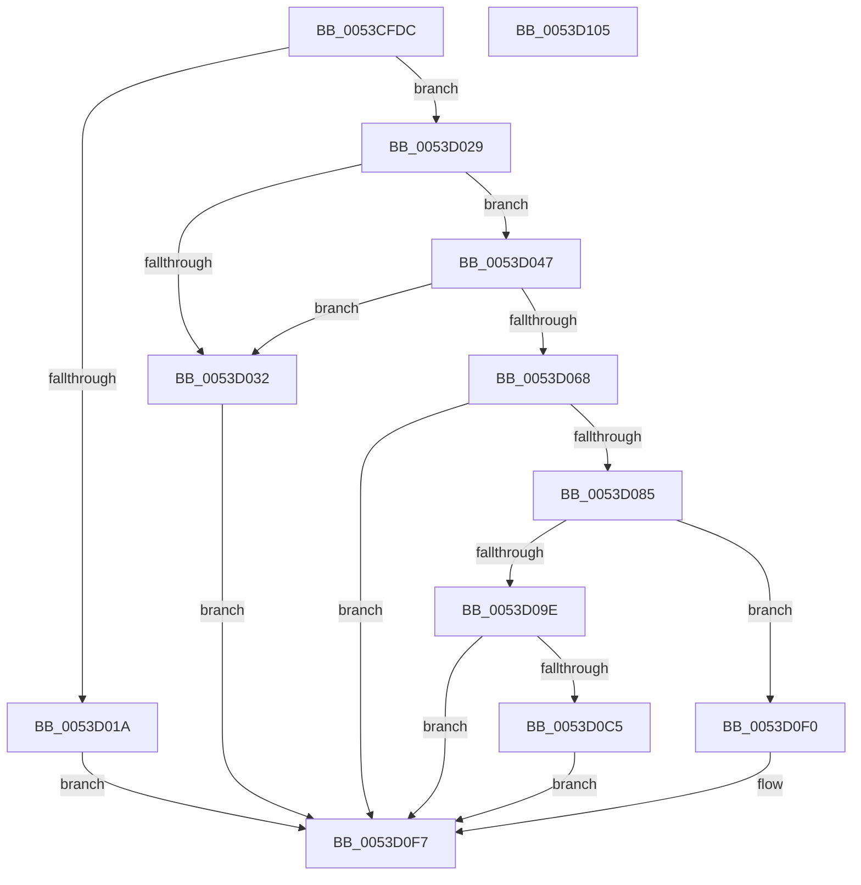

# HalpTimerInitializeEarlyStallSource

- RVA: `0x0053CFDC`–`0x0053D106` (길이 `298` bytes)
- VA: `0x000000014053CFDC`
- 실행 섹션: `.text`
- PDB 이름 있음: `예`; PDB Function 태그: `아니요`
- unwind 정보 RVA: `0x0006E5F8`
- 디코드: `64`개 명령, `298/298` bytes 표시
- 미해석 바이트: `0` (있으면 어셈블리에 `.byte`로 보존)

> 이 문서는 커널 이미지의 기계어와 PDB 기호를 분석해 생성했습니다. 4번과 5번은 함수 원형과 자료형을 바이너리 사용 방식에서 추정한 C 해석이며 원본 소스 복구 결과는 아닙니다.

## 1. Dependencies

- 직접 호출 지점: **4**; 고유 호출 대상: **4**
- 직접 호출자로 확인된 함수: **1**
- RIP 상대 이미지 참조: **11**

### Outgoing calls
- `0x0053D00E` → [HalpTimerRegisterBuiltinPluginsCommon](../54/HalpTimerRegisterBuiltinPluginsCommon_function_0054A014.md) (function, `0x0054A014`)
- `0x0053D05B` → [HalpFindTimer](../54/HalpFindTimer_function_005488D0.md) (function, `0x005488D0`)
- `0x0053D079` → [HalpTimerInitialize](HalpTimerInitialize_function_0053CF38.md) (function, `0x0053CF38`)
- `0x0053D0E9` → [HalpTimerSetProblemEx](../4F/HalpTimerSetProblemEx_function_004FAEC4.md) (function, `0x004FAEC4`)

### Direct callers
- [HalpTimerInitSystem](HalpTimerInitSystem_function_0053CB70.md) at `0x0053CF00`

### Static image references
- `0x0053CFE6` → RVA `0x00FC413C` (`.data`; read/write)
- `0x0053CFED` → RVA `0x00FC4120` (`.data`; read)
- `0x0053CFF7` → RVA `0x00FC4058` (`.data`; write)
- `0x0053D000` → RVA `0x00FC4128` (`.data`; write)
- `0x0053D007` → RVA `0x00FC4120` (`.data`; write)
- `0x0053D01A` → RVA `0x00E10358` (`.data`; write)
- `0x0053D029` → RVA `0x00FC413C` (`.data`; read)
- `0x0053D06B` → RVA `0x00FC3FD0` (`.data`; write)
- `0x0053D072` → RVA `0x00FC4100` (`.data`; write)
- `0x0053D0D3` → RVA `0x0001BE98` (`.rdata`; read)
- `0x0053D0F0` → RVA `0x00FC4118` (`.data`; write)

## 2. Other-region calls and transfers

- 다른 실행 섹션으로 향하는 call: **0**
- 별도 외부 분기/꼬리 이동을 확인하지 못했습니다.

## 3. Assembly (complete function range)

```asm
0053CFDC  48 89 5C 24 08                  mov qword ptr [rsp + 8], rbx
0053CFE1  57                              push rdi
0053CFE2  48 83 EC 30                     sub rsp, 0x30
0053CFE6  83 25 4F 71 A8 00 00            and dword ptr [rip + 0xa8714f], 0
0053CFED  48 8D 05 2C 71 A8 00            lea rax, [rip + 0xa8712c]
0053CFF4  48 8B F9                        mov rdi, rcx
0053CFF7  48 89 0D 5A 70 A8 00            mov qword ptr [rip + 0xa8705a], rcx
0053CFFE  33 C9                           xor ecx, ecx
0053D000  48 89 05 21 71 A8 00            mov qword ptr [rip + 0xa87121], rax
0053D007  48 89 05 12 71 A8 00            mov qword ptr [rip + 0xa87112], rax
0053D00E  E8 01 D0 00 00                  call 0x14054a014
0053D013  44 8B D0                        mov r10d, eax
0053D016  85 C0                           test eax, eax
0053D018  79 0F                           jns 0x14053d029
0053D01A  C7 05 34 33 8D 00 0E 00 00 00   mov dword ptr [rip + 0x8d3334], 0xe
0053D024  E9 CE 00 00 00                  jmp 0x14053d0f7
0053D029  83 3D 0C 71 A8 00 00            cmp dword ptr [rip + 0xa8710c], 0
0053D030  75 15                           jne 0x14053d047
0053D032  41 BA 01 00 00 C0               mov r10d, 0xc0000001
0053D038  C7 05 16 33 8D 00 15 00 00 00   mov dword ptr [rip + 0x8d3316], 0x15
0053D042  E9 B0 00 00 00                  jmp 0x14053d0f7
0053D047  45 33 C9                        xor r9d, r9d
0053D04A  C7 44 24 20 01 00 00 00         mov dword ptr [rsp + 0x20], 1
0053D052  45 33 C0                        xor r8d, r8d
0053D055  33 C9                           xor ecx, ecx
0053D057  41 8D 51 02                     lea edx, [r9 + 2]
0053D05B  E8 70 B8 00 00                  call 0x1405488d0
0053D060  48 8B D8                        mov rbx, rax
0053D063  48 85 C0                        test rax, rax
0053D066  74 CA                           je 0x14053d032
0053D068  48 8B C8                        mov rcx, rax
0053D06B  48 89 05 5E 6F A8 00            mov qword ptr [rip + 0xa86f5e], rax
0053D072  48 89 05 87 70 A8 00            mov qword ptr [rip + 0xa87087], rax
0053D079  E8 BA FE FF FF                  call 0x14053cf38
0053D07E  44 8B D0                        mov r10d, eax
0053D081  85 C0                           test eax, eax
0053D083  78 72                           js 0x14053d0f7
0053D085  8B 83 B8 00 00 00               mov eax, dword ptr [rbx + 0xb8]
0053D08B  83 E0 FB                        and eax, 0xfffffffb
0053D08E  48 83 BB C0 00 00 00 00         cmp qword ptr [rbx + 0xc0], 0
0053D096  89 83 B8 00 00 00               mov dword ptr [rbx + 0xb8], eax
0053D09C  75 52                           jne 0x14053d0f0
0053D09E  83 C8 08                        or eax, 8
0053D0A1  89 83 B8 00 00 00               mov dword ptr [rbx + 0xb8], eax
0053D0A7  48 8B 87 F0 00 00 00            mov rax, qword ptr [rdi + 0xf0]
0053D0AE  48 8B 88 C0 09 00 00            mov rcx, qword ptr [rax + 0x9c0]
0053D0B5  48 89 8B C0 00 00 00            mov qword ptr [rbx + 0xc0], rcx
0053D0BC  48 81 F9 E8 03 00 00            cmp rcx, 0x3e8
0053D0C3  73 32                           jae 0x14053d0f7
0053D0C5  45 33 C0                        xor r8d, r8d
0053D0C8  48 C7 83 C0 00 00 00 28 6B EE 00  mov qword ptr [rbx + 0xc0], 0xee6b28
0053D0D3  4C 8D 0D BE ED AD FF            lea r9, [rip - 0x521242]
0053D0DA  C7 44 24 20 A9 04 00 00         mov dword ptr [rsp + 0x20], 0x4a9
0053D0E2  48 8B CB                        mov rcx, rbx
0053D0E5  41 8D 50 28                     lea edx, [r8 + 0x28]
0053D0E9  E8 D6 DD FB FF                  call 0x1404faec4
0053D0EE  EB 07                           jmp 0x14053d0f7
0053D0F0  C6 05 21 70 A8 00 01            mov byte ptr [rip + 0xa87021], 1
0053D0F7  48 8B 5C 24 40                  mov rbx, qword ptr [rsp + 0x40]
0053D0FC  41 8B C2                        mov eax, r10d
0053D0FF  48 83 C4 30                     add rsp, 0x30
0053D103  5F                              pop rdi
0053D104  C3                              ret
0053D105  CC                              int3
```

## 4. C-style interpretation (structured pseudocode)

```c
__int64 __fastcall HalpTimerInitializeEarlyStallSource(__int64 a1, __int64 a2, int a3, int a4)
{
    __int64 result;
    __int64 v_rsp;
    unsigned int v_stack_m18;
    unsigned __int64 v_stack_p8;

    v_stack_p8 = v_rbx;
    v_rsp = (v_rsp) - (48);
    *(unsigned __int64 *)(v_rip + 11038810) = a1;
    a1 = 0;
    *(unsigned __int64 *)(v_rip + 11039009) = v_rip + 11039020;
    *(unsigned __int64 *)(v_rip + 11038994) = v_rip + 11039020;
    result = HalpTimerRegisterBuiltinPluginsCommon(a1, a2, a3, a4);
    if (!sign_flag) goto loc_0053D029;
    *(unsigned int *)(v_rip + 9253684) = 14;
    goto loc_0053D0F7;
loc_0053D029:
    if ((*(unsigned int *)(v_rip + 11038988)) != 0) goto loc_0053D047;
loc_0053D032:
    *(unsigned int *)(v_rip + 9253654) = 21;
    goto loc_0053D0F7;
loc_0053D047:
    a4 = 0;
    v_stack_m18 = 1;
    a3 = 0;
    a1 = 0;
    result = HalpFindTimer(a1, a4 + 2, a3, a4);
    if (result == 0) goto loc_0053D032;
    *(unsigned __int64 *)(v_rip + 11038558) = result;
    *(unsigned __int64 *)(v_rip + 11038855) = result;
    result = HalpTimerInitialize(result, a4 + 2, a3, a4);
    if (sign_flag) goto loc_0053D0F7;
    result = (unsigned int)(((unsigned int)(*(unsigned int *)(result + 184))) & (0xFFFFFFFBULL));
    *(unsigned int *)(result + 184) = (unsigned int)(result);
    if ((*(unsigned __int64 *)(result + 192)) != 0) goto loc_0053D0F0;
    result = (unsigned int)((result) | (8));
    *(unsigned int *)(result + 184) = (unsigned int)(result);
    *(unsigned __int64 *)(result + 192) = *(unsigned __int64 *)(*(unsigned __int64 *)(a1 + 240) + 2496);
    if ((*(unsigned __int64 *)(*(unsigned __int64 *)(a1 + 240) + 2496)) >= 1000) goto loc_0053D0F7;
    a3 = 0;
    *(unsigned __int64 *)(result + 192) = 0xEE6B28ULL;
    v_stack_m18 = 0x4A9ULL;
    result = HalpTimerSetProblemEx(result, a3 + 40, a3, v_rip - 5378626);
    goto loc_0053D0F7;
loc_0053D0F0:
    *(unsigned __int8 *)(v_rip + 11038753) = 1;
loc_0053D0F7:
    v_rsp = (v_rsp) + (48);
    return (unsigned int)((unsigned int)((unsigned int)((unsigned int)(result))));
}
```

## 5. (Beta) C Style

```c
int64_t HalpTimerInitializeEarlyStallSource(void *Arg1, int64_t Arg2, int32_t Arg3, int32_t Arg4)
{
    uint8_t *arg1 = (uint8_t *)Arg1;

    int64_t result;
    int64_t local_rsp;
    uint32_t v_stack_m18;
    uint64_t v_stack_p8;

    v_stack_p8 = local_rbx;
    local_rsp = (local_rsp) - (48);
    *(void **)(v_rip + 0xA8705A) = Arg1;
    Arg1 = 0;
    *(uint64_t *)(v_rip + 0xA87121) = v_rip + 11039020;
    *(uint64_t *)(v_rip + 0xA87112) = v_rip + 11039020;
    result = HalpTimerRegisterBuiltinPluginsCommon(Arg1, Arg2, Arg3, Arg4);
    if (!sign_flag) goto loc_0053D029;
    *(uint32_t *)(v_rip + 0x8D3334) = 14;
    goto loc_0053D0F7;
loc_0053D029:
    if ((*(uint32_t *)(v_rip + 0xA8710C)) != 0) goto loc_0053D047;
loc_0053D032:
    *(uint32_t *)(v_rip + 0x8D3316) = 21;
    goto loc_0053D0F7;
loc_0053D047:
    Arg4 = 0;
    v_stack_m18 = 1;
    Arg3 = 0;
    Arg1 = 0;
    result = HalpFindTimer(Arg1, Arg4 + 2, Arg3, Arg4);
    if (result == 0) goto loc_0053D032;
    *(uint64_t *)(v_rip + 0xA86F5E) = result;
    *(uint64_t *)(v_rip + 0xA87087) = result;
    result = HalpTimerInitialize(result, Arg4 + 2, Arg3, Arg4);
    if (sign_flag) goto loc_0053D0F7;
    result = (uint32_t)(((uint32_t)(*(uint32_t *)(result + 0xB8))) & (0xFFFFFFFBULL));
    *(uint32_t *)(result + 0xB8) = (uint32_t)(result);
    if ((*(uint64_t *)(result + 0xC0)) != 0) goto loc_0053D0F0;
    result = (uint32_t)((result) | (8));
    *(uint32_t *)(result + 0xB8) = (uint32_t)(result);
    *(uint64_t *)(result + 0xC0) = *(uint64_t *)(*(uint64_t *)(arg1 + 0xF0) + 0x9C0);
    if ((*(uint64_t *)(*(uint64_t *)(arg1 + 0xF0) + 0x9C0)) >= 1000) goto loc_0053D0F7;
    Arg3 = 0;
    *(uint64_t *)(result + 0xC0) = 0xEE6B28ULL;
    v_stack_m18 = 0x4A9ULL;
    result = HalpTimerSetProblemEx(result, Arg3 + 40, Arg3, v_rip - 5378626);
    goto loc_0053D0F7;
loc_0053D0F0:
    *(uint8_t *)(v_rip + 0xA87021) = 1;
loc_0053D0F7:
    local_rsp = (local_rsp) + (48);
    return (uint32_t)((uint32_t)((uint32_t)((uint32_t)(result))));
}
```

### 관측된 메모리 오프셋

구조체 형식이 확인되지 않은 접근은 인자 기준의 오프셋으로만 기록했습니다.

| 기준 인자 | 오프셋 표현 | 폭 (bit) | 접근 |
|---|---:|---:|---|
| `Arg1` | `+ 0xF0` | `64` | `R` |

## 6. Execution-region graph

[열기: 2D/3D 그래프와 함수 탐색 컨트롤 패널](../../../control-panel.html?section=text&rva=0x0053CFDC&view=graph)

- 2D 그래프는 위에서 아래로 흐르고, 3D 그래프는 빈 공간을 드래그해 회전합니다. Shift+드래그는 이동, 휠은 확대·축소, 함수 노드 선택은 대상 보고서 이동입니다.

### Static fallback


