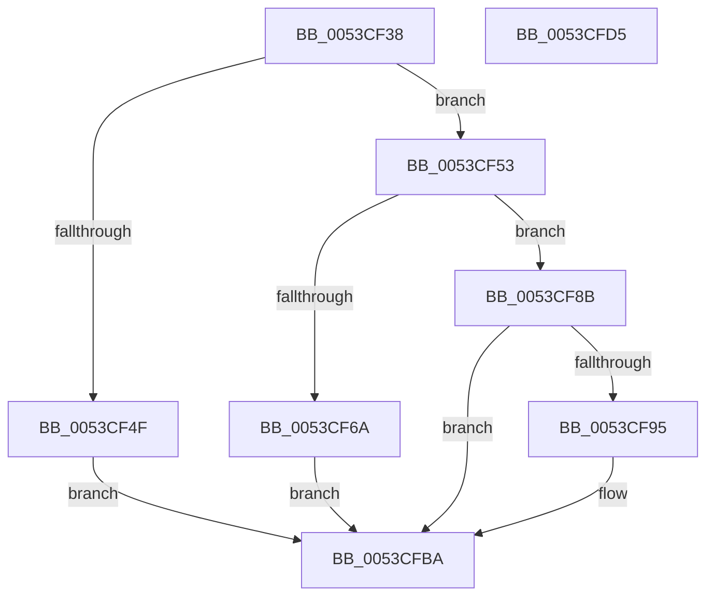

# HalpTimerInitialize

- RVA: `0x0053CF38`–`0x0053CFD6` (길이 `158` bytes)
- VA: `0x000000014053CF38`
- 실행 섹션: `.text`
- PDB 이름 있음: `예`; PDB Function 태그: `아니요`
- unwind 정보 RVA: `0x0006E5F8`
- 디코드: `45`개 명령, `158/158` bytes 표시
- 미해석 바이트: `0` (있으면 어셈블리에 `.byte`로 보존)

> 이 문서는 커널 이미지의 기계어와 PDB 기호를 분석해 생성했습니다. 4번과 5번은 함수 원형과 자료형을 바이너리 사용 방식에서 추정한 C 해석이며 원본 소스 복구 결과는 아닙니다.

## 1. Dependencies

- 직접 호출 지점: **6**; 고유 호출 대상: **4**
- 직접 호출자로 확인된 함수: **4**
- RIP 상대 이미지 참조: **1**

### Outgoing calls
- `0x0053CF53` → [HalpTimerGetInternalData](../20/HalpTimerGetInternalData_function_00209500.md) (function, `0x00209500`)
- `0x0053CF5F` → [guard_dispatch_icall](../6B/guard_dispatch_icall_function_006BAAD0.md) (function, `0x006BAAD0`)
- `0x0053CF84` → [HalpTimerSetProblemEx](../4F/HalpTimerSetProblemEx_function_004FAEC4.md) (function, `0x004FAEC4`)
- `0x0053CF98` → [HalpTimerGetInternalData](../20/HalpTimerGetInternalData_function_00209500.md) (function, `0x00209500`)
- `0x0053CFA4` → [guard_dispatch_icall](../6B/guard_dispatch_icall_function_006BAAD0.md) (function, `0x006BAAD0`)
- `0x0053CFB5` → [HalpTimerCalibratePerformanceCounter](../4A/HalpTimerCalibratePerformanceCounter_function_004AB874.md) (function, `0x004AB874`)

### Direct callers
- [HalpTimerInitializeEarlyStallSource](HalpTimerInitializeEarlyStallSource_function_0053CFDC.md) at `0x0053D079`
- [HalpTimerSelectRoles](HalpTimerSelectRoles_function_0053D4B0.md) at `0x0053D4D4`
- [HalpTimerSelectRoles](HalpTimerSelectRoles_function_0053D4B0.md) at `0x0053D51A`
- [HalpTimerSelectRoles](HalpTimerSelectRoles_function_0053D4B0.md) at `0x0053D564`
- [HalpTimerSelectRoles](HalpTimerSelectRoles_function_0053D4B0.md) at `0x0053D614`
- [HalpTimerSelectRoles](HalpTimerSelectRoles_function_0053D4B0.md) at `0x0053D659`
- [HalpTimerSelectRoles](HalpTimerSelectRoles_function_0053D4B0.md) at `0x0053D6BF`
- [HalpTimerSelectRoles](HalpTimerSelectRoles_function_0053D4B0.md) at `0x0053D77D`
- [HalpTimerSelectRoles](HalpTimerSelectRoles_function_0053D4B0.md) at `0x0053D805`
- [HalpTimerSelectRoles](HalpTimerSelectRoles_function_0053D4B0.md) at `0x0053D854`
- [HalpTimerSelectRoles](HalpTimerSelectRoles_function_0053D4B0.md) at `0x0053D8F2`
- [HalpTimerMeasureFrequencies](../54/HalpTimerMeasureFrequencies_function_005493C0.md) at `0x00549427`
- [HalpTimerInitializeHypervisorTimer](../54/HalpTimerInitializeHypervisorTimer_function_0054B8F4.md) at `0x0054B994`

### Static image references
- `0x0053CF6A` → RVA `0x0001BE98` (`.rdata`; read)

## 2. Other-region calls and transfers

- 다른 실행 섹션으로 향하는 call: **0**
- 별도 외부 분기/꼬리 이동을 확인하지 못했습니다.

## 3. Assembly (complete function range)

```asm
0053CF38  48 89 5C 24 08                  mov qword ptr [rsp + 8], rbx
0053CF3D  57                              push rdi
0053CF3E  48 83 EC 30                     sub rsp, 0x30
0053CF42  8B 81 B8 00 00 00               mov eax, dword ptr [rcx + 0xb8]
0053CF48  48 8B D9                        mov rbx, rcx
0053CF4B  A8 02                           test al, 2
0053CF4D  74 04                           je 0x14053cf53
0053CF4F  33 FF                           xor edi, edi
0053CF51  EB 67                           jmp 0x14053cfba
0053CF53  E8 A8 C5 CC FF                  call 0x140209500
0053CF58  48 8B C8                        mov rcx, rax
0053CF5B  48 8B 43 68                     mov rax, qword ptr [rbx + 0x68]
0053CF5F  E8 6C DB 17 00                  call 0x1406baad0
0053CF64  8B F8                           mov edi, eax
0053CF66  85 C0                           test eax, eax
0053CF68  79 21                           jns 0x14053cf8b
0053CF6A  4C 8D 0D 27 EF AD FF            lea r9, [rip - 0x5210d9]
0053CF71  C7 44 24 20 1D 0A 00 00         mov dword ptr [rsp + 0x20], 0xa1d
0053CF79  44 8B C0                        mov r8d, eax
0053CF7C  BA 0F 00 00 00                  mov edx, 0xf
0053CF81  48 8B CB                        mov rcx, rbx
0053CF84  E8 3B DF FB FF                  call 0x1404faec4
0053CF89  EB 2F                           jmp 0x14053cfba
0053CF8B  8B 83 E0 00 00 00               mov eax, dword ptr [rbx + 0xe0]
0053CF91  A8 02                           test al, 2
0053CF93  74 25                           je 0x14053cfba
0053CF95  48 8B CB                        mov rcx, rbx
0053CF98  E8 63 C5 CC FF                  call 0x140209500
0053CF9D  48 8B C8                        mov rcx, rax
0053CFA0  48 8B 43 70                     mov rax, qword ptr [rbx + 0x70]
0053CFA4  E8 27 DB 17 00                  call 0x1406baad0
0053CFA9  48 87 83 C8 00 00 00            xchg qword ptr [rbx + 0xc8], rax
0053CFB0  33 D2                           xor edx, edx
0053CFB2  48 8B CB                        mov rcx, rbx
0053CFB5  E8 BA E8 F6 FF                  call 0x1404ab874
0053CFBA  8B C7                           mov eax, edi
0053CFBC  C1 F8 1F                        sar eax, 0x1f
0053CFBF  83 C0 02                        add eax, 2
0053CFC2  09 83 B8 00 00 00               or dword ptr [rbx + 0xb8], eax
0053CFC8  8B C7                           mov eax, edi
0053CFCA  48 8B 5C 24 40                  mov rbx, qword ptr [rsp + 0x40]
0053CFCF  48 83 C4 30                     add rsp, 0x30
0053CFD3  5F                              pop rdi
0053CFD4  C3                              ret
0053CFD5  CC                              int3
```

## 4. C-style interpretation (structured pseudocode)

```c
__int64 __fastcall HalpTimerInitialize(__int64 a1)
{
    __int64 result;
    __int64 v_rdi;
    __int64 v_rsp;
    unsigned int v_stack_m18;
    unsigned __int64 v_stack_p8;

    v_stack_p8 = v_rbx;
    v_rsp = (v_rsp) - (48);
    if ((((unsigned __int8)((unsigned int)(*(unsigned int *)(a1 + 184)))) & (2)) == 0) goto loc_0053CF53;
    v_rdi = 0;
    goto loc_0053CFBA;
loc_0053CF53:
    result = HalpTimerGetInternalData(a1, a2, a3, a4);
    result = guard_dispatch_icall(result, a2, a3, a4);
    if (!sign_flag) goto loc_0053CF8B;
    v_stack_m18 = 0xA1DULL;
    result = HalpTimerSetProblemEx(a1, 15, (unsigned int)((unsigned int)(result)), v_rip - 5378265);
    goto loc_0053CFBA;
loc_0053CF8B:
    result = (unsigned int)(*(unsigned int *)(a1 + 224));
    if ((((unsigned __int8)((unsigned int)(*(unsigned int *)(a1 + 224)))) & (2)) != 0) {
        a1 = a1;
        result = HalpTimerGetInternalData(a1, 15, (unsigned int)((unsigned int)(result)), v_rip - 5378265);
        a1 = result;
        result = *(unsigned __int64 *)(a1 + 112);
        result = guard_dispatch_icall(a1, 15, (unsigned int)((unsigned int)(result)), v_rip - 5378265);
        a2 = 0;
        a1 = a1;
        result = HalpTimerCalibratePerformanceCounter(a1, a2, (unsigned int)((unsigned int)(result)), v_rip - 5378265);
    }
    result = (unsigned int)(((unsigned int)((unsigned int)((unsigned int)((unsigned int)(result))))) >> (31));
    result = (unsigned int)((result) + (2));
    v_rsp = (v_rsp) + (48);
    return (unsigned int)((unsigned int)((unsigned int)((unsigned int)(result))));
}
```

## 5. (Beta) C Style

```c
int64_t HalpTimerInitialize(void *Arg1)
{
    uint8_t *arg1 = (uint8_t *)Arg1;

    int64_t result;
    int64_t local_rdi;
    int64_t local_rsp;
    uint32_t v_stack_m18;
    uint64_t v_stack_p8;

    v_stack_p8 = local_rbx;
    local_rsp = (local_rsp) - (48);
    if ((((uint8_t)((uint32_t)(*(uint32_t *)(arg1 + 0xB8)))) & (2)) == 0) goto loc_0053CF53;
    local_rdi = 0;
    goto loc_0053CFBA;
loc_0053CF53:
    result = HalpTimerGetInternalData(Arg1, a2, a3, a4);
    result = guard_dispatch_icall(result, a2, a3, a4);
    if (!sign_flag) goto loc_0053CF8B;
    v_stack_m18 = 0xA1DULL;
    result = HalpTimerSetProblemEx(Arg1, 15, (uint32_t)((uint32_t)(result)), v_rip - 5378265);
    goto loc_0053CFBA;
loc_0053CF8B:
    result = (uint32_t)(*(uint32_t *)(arg1 + 0xE0));
    if ((((uint8_t)((uint32_t)(*(uint32_t *)(arg1 + 0xE0)))) & (2)) != 0) {
        Arg1 = Arg1;
        result = HalpTimerGetInternalData(Arg1, 15, (uint32_t)((uint32_t)(result)), v_rip - 5378265);
        Arg1 = result;
        result = *(uint64_t *)(arg1 + 0x70);
        result = guard_dispatch_icall(Arg1, 15, (uint32_t)((uint32_t)(result)), v_rip - 5378265);
        a2 = 0;
        Arg1 = Arg1;
        result = HalpTimerCalibratePerformanceCounter(Arg1, a2, (uint32_t)((uint32_t)(result)), v_rip - 5378265);
    }
    result = (uint32_t)(((uint32_t)((uint32_t)((uint32_t)((uint32_t)(result))))) >> (31));
    result = (uint32_t)((result) + (2));
    local_rsp = (local_rsp) + (48);
    return (uint32_t)((uint32_t)((uint32_t)((uint32_t)(result))));
}
```

### 관측된 메모리 오프셋

구조체 형식이 확인되지 않은 접근은 인자 기준의 오프셋으로만 기록했습니다.

| 기준 인자 | 오프셋 표현 | 폭 (bit) | 접근 |
|---|---:|---:|---|
| `Arg1` | `+ 0x68` | `64` | `R` |
| `Arg1` | `+ 0x70` | `64` | `R` |
| `Arg1` | `+ 0xB8` | `32` | `R` |
| `Arg1` | `+ 0xB8` | `32` | `R/W` |
| `Arg1` | `+ 0xC8` | `64` | `R/W` |
| `Arg1` | `+ 0xE0` | `32` | `R` |

## 6. Execution-region graph

[열기: 2D/3D 그래프와 함수 탐색 컨트롤 패널](../../../control-panel.html?section=text&rva=0x0053CF38&view=graph)

- 2D 그래프는 위에서 아래로 흐르고, 3D 그래프는 빈 공간을 드래그해 회전합니다. Shift+드래그는 이동, 휠은 확대·축소, 함수 노드 선택은 대상 보고서 이동입니다.

### Static fallback


