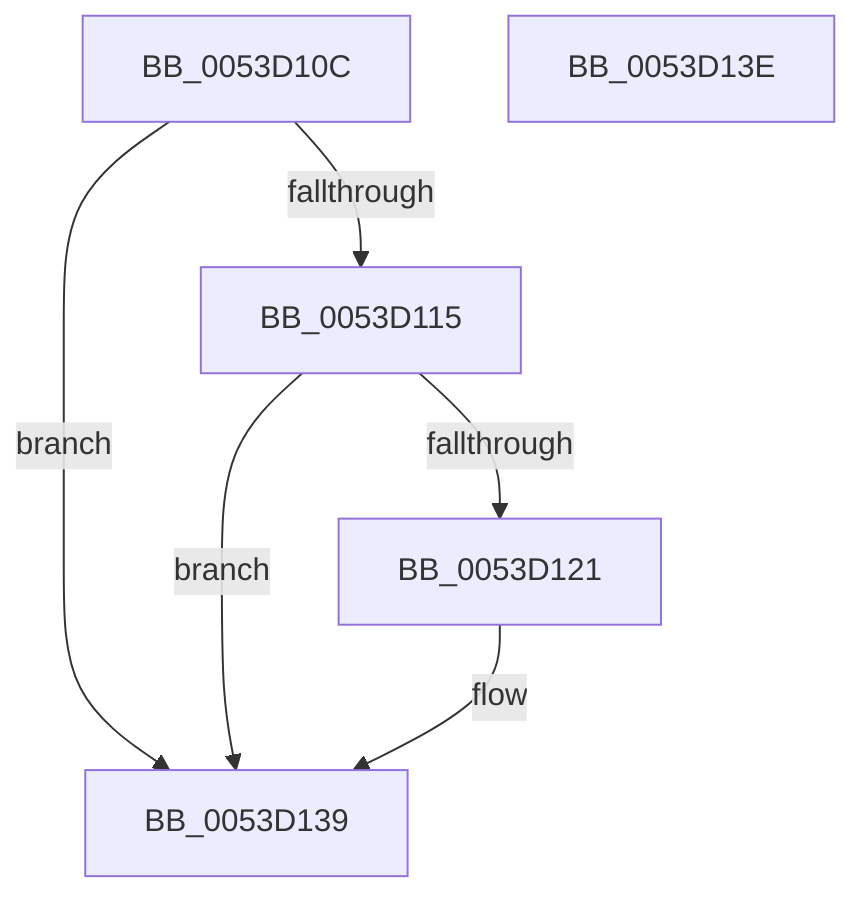

# HalpTimerMarkHiberPhase

- RVA: `0x0053D10C`–`0x0053D13F` (길이 `51` bytes)
- VA: `0x000000014053D10C`
- 실행 섹션: `.text`
- PDB 이름 있음: `예`; PDB Function 태그: `아니요`
- unwind 정보 RVA: `0x0005D2F4`
- 디코드: `13`개 명령, `51/51` bytes 표시
- 미해석 바이트: `0` (있으면 어셈블리에 `.byte`로 보존)

> 이 문서는 커널 이미지의 기계어와 PDB 기호를 분석해 생성했습니다. 4번과 5번은 함수 원형과 자료형을 바이너리 사용 방식에서 추정한 C 해석이며 원본 소스 복구 결과는 아닙니다.

## 1. Dependencies

- 직접 호출 지점: **1**; 고유 호출 대상: **1**
- 직접 호출자로 확인된 함수: **1**
- RIP 상대 이미지 참조: **1**

### Outgoing calls
- `0x0053D134` → [PoSetHiberRange](../47/PoSetHiberRange_function_0047C580.md) (function, `0x0047C580`)

### Direct callers
- [HaliLocateHiberRanges](../../pagelk/B5/HaliLocateHiberRanges_function_00B5CE50.md) at `0x00B5D0BB`

### Static image references
- `0x0053D115` → RVA `0x00FC40E0` (`.data`; read)

## 2. Other-region calls and transfers

- 다른 실행 섹션으로 향하는 call: **0**
- 별도 외부 분기/꼬리 이동을 확인하지 못했습니다.

## 3. Assembly (complete function range)

```asm
0053D10C  48 83 EC 38                     sub rsp, 0x38
0053D110  48 85 C9                        test rcx, rcx
0053D113  75 24                           jne 0x14053d139
0053D115  4C 8B 05 C4 6F A8 00            mov r8, qword ptr [rip + 0xa86fc4]
0053D11C  4D 85 C0                        test r8, r8
0053D11F  74 18                           je 0x14053d139
0053D121  BA 00 00 01 00                  mov edx, 0x10000
0053D126  C7 44 24 20 68 61 6C 63         mov dword ptr [rsp + 0x20], 0x636c6168
0053D12E  41 B9 00 10 00 00               mov r9d, 0x1000
0053D134  E8 47 F4 F3 FF                  call 0x14047c580
0053D139  48 83 C4 38                     add rsp, 0x38
0053D13D  C3                              ret
0053D13E  CC                              int3
```

## 4. C-style interpretation (structured pseudocode)

```c
__int64 __fastcall HalpTimerMarkHiberPhase(__int64 a1)
{
    __int64 result;
    __int64 v_rsp;
    unsigned int v_stack_m18;

    v_rsp = (v_rsp) - (56);
    if (a1 != 0) goto loc_0053D139;
    if (*(unsigned __int64 *)(v_rip + 11038660) != 0) {
        a2 = 0x10000ULL;
        v_stack_m18 = 0x636C6168ULL;
        a4 = 0x1000ULL;
        result = PoSetHiberRange(a1, a2, *(unsigned __int64 *)(v_rip + 11038660), a4);
    }
    v_rsp = (v_rsp) + (56);
    return result;
}
```

## 5. (Beta) C Style

```c
int64_t HalpTimerMarkHiberPhase(int64_t Arg1)
{
    int64_t result;
    int64_t local_rsp;
    uint32_t v_stack_m18;

    local_rsp = (local_rsp) - (56);
    if (Arg1 != 0) goto loc_0053D139;
    if (*(uint64_t *)(v_rip + 0xA86FC4) != 0) {
        a2 = 0x10000ULL;
        v_stack_m18 = 0x636C6168ULL;
        a4 = 0x1000ULL;
        result = PoSetHiberRange(Arg1, a2, *(uint64_t *)(v_rip + 0xA86FC4), a4);
    }
    local_rsp = (local_rsp) + (56);
    return result;
}
```

## 6. Execution-region graph

[열기: 2D/3D 그래프와 함수 탐색 컨트롤 패널](../../../control-panel.html?section=text&rva=0x0053D10C&view=graph)

- 2D 그래프는 위에서 아래로 흐르고, 3D 그래프는 빈 공간을 드래그해 회전합니다. Shift+드래그는 이동, 휠은 확대·축소, 함수 노드 선택은 대상 보고서 이동입니다.

### Static fallback


