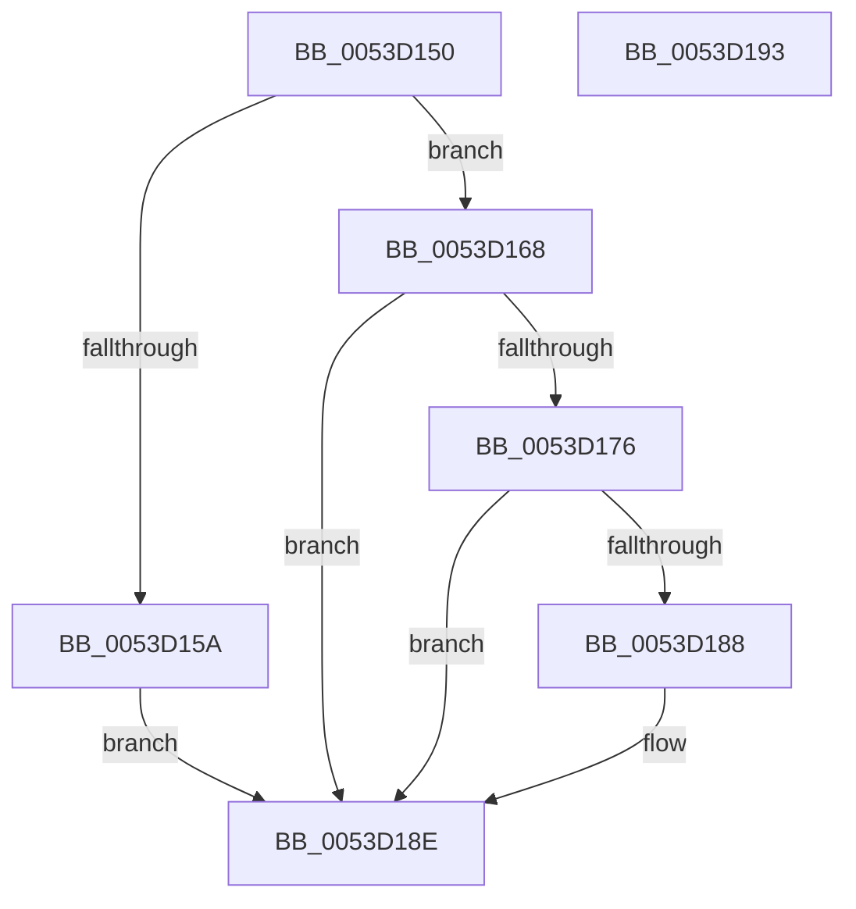

# HalpTimerNotifyProcessorFreeze

- RVA: `0x0053D150`–`0x0053D194` (길이 `68` bytes)
- VA: `0x000000014053D150`
- 실행 섹션: `.text`
- PDB 이름 있음: `예`; PDB Function 태그: `아니요`
- unwind 정보 RVA: `0x0005C788`
- 디코드: `19`개 명령, `68/68` bytes 표시
- 미해석 바이트: `0` (있으면 어셈블리에 `.byte`로 보존)

> 이 문서는 커널 이미지의 기계어와 PDB 기호를 분석해 생성했습니다. 4번과 5번은 함수 원형과 자료형을 바이너리 사용 방식에서 추정한 C 해석이며 원본 소스 복구 결과는 아닙니다.

## 1. Dependencies

- 직접 호출 지점: **1**; 고유 호출 대상: **1**
- 직접 호출자로 확인된 함수: **0**
- RIP 상대 이미지 참조: **3**

### Outgoing calls
- `0x0053D161` → [HalpTimerResetProfileAdjustment](../54/HalpTimerResetProfileAdjustment_function_0054B660.md) (function, `0x0054B660`)

### Direct callers
- 이 함수 시작 RVA로 연결되는 직접 call은 확인되지 않았습니다. 간접 호출은 완전히 역산할 수 없습니다.

### Static image references
- `0x0053D15A` → RVA `0x00FC4060` (`.data`; read/write)
- `0x0053D17E` → RVA `0x00E0A804` (`.data`; read)
- `0x0053D188` → RVA `0x00E0A804` (`.data`; read/write)

## 2. Other-region calls and transfers

- 다른 실행 섹션으로 향하는 call: **0**
- 별도 외부 분기/꼬리 이동을 확인하지 못했습니다.

## 3. Assembly (complete function range)

```asm
0053D150  48 83 EC 28                     sub rsp, 0x28
0053D154  8A C2                           mov al, dl
0053D156  84 C9                           test cl, cl
0053D158  74 0E                           je 0x14053d168
0053D15A  F0 FF 05 FF 6E A8 00            lock inc dword ptr [rip + 0xa86eff]
0053D161  E8 FA E4 00 00                  call 0x14054b660
0053D166  EB 26                           jmp 0x14053d18e
0053D168  83 CA FF                        or edx, 0xffffffff
0053D16B  F0 01 15 EE 6E A8 00            lock add dword ptr [rip + 0xa86eee], edx
0053D172  84 C0                           test al, al
0053D174  74 18                           je 0x14053d18e
0053D176  65 8B 0C 25 A4 01 00 00         mov ecx, dword ptr gs:[0x1a4]
0053D17E  8B 05 80 D6 8C 00               mov eax, dword ptr [rip + 0x8cd680]
0053D184  3B C1                           cmp eax, ecx
0053D186  75 06                           jne 0x14053d18e
0053D188  87 15 76 D6 8C 00               xchg dword ptr [rip + 0x8cd676], edx
0053D18E  48 83 C4 28                     add rsp, 0x28
0053D192  C3                              ret
0053D193  CC                              int3
```

## 4. C-style interpretation (structured pseudocode)

```c
__int64 __fastcall HalpTimerNotifyProcessorFreeze(unsigned __int8 a1, int a2)
{
    __int64 result;
    __int64 v_rsp;

    v_rsp = (v_rsp) - (40);
    if (a1 == 0) goto loc_0053D168;
    result = HalpTimerResetProfileAdjustment(a1, a2, a3, a4);
    goto loc_0053D18E;
loc_0053D168:
    a2 = (unsigned int)((a2) | (0xFFFFFFFFULL));
    if ((unsigned __int8)(result) == 0) goto loc_0053D18E;
    if (((unsigned int)((unsigned int)(*(unsigned int *)(v_rip + 9229952)))) == ((unsigned int)((unsigned int)(*(unsigned int *)(gs_base + (0 + 420)))))) {
    }
    v_rsp = (v_rsp) + (40);
    return (unsigned int)(*(unsigned int *)(v_rip + 9229952));
}
```

## 5. (Beta) C Style

```c
int64_t HalpTimerNotifyProcessorFreeze(uint8_t Arg1, int32_t Arg2)
{
    int64_t result;
    int64_t local_rsp;

    local_rsp = (local_rsp) - (40);
    if (Arg1 == 0) goto loc_0053D168;
    result = HalpTimerResetProfileAdjustment(Arg1, Arg2, a3, a4);
    goto loc_0053D18E;
loc_0053D168:
    Arg2 = (uint32_t)((Arg2) | (0xFFFFFFFFULL));
    if ((uint8_t)(result) == 0) goto loc_0053D18E;
    if (((uint32_t)((uint32_t)(*(uint32_t *)(v_rip + 0x8CD680)))) == ((uint32_t)((uint32_t)(*(uint32_t *)(gs_base + (0 + 0x1A4)))))) {
    }
    local_rsp = (local_rsp) + (40);
    return (uint32_t)(*(uint32_t *)(v_rip + 0x8CD680));
}
```

## 6. Execution-region graph

[열기: 2D/3D 그래프와 함수 탐색 컨트롤 패널](../../../control-panel.html?section=text&rva=0x0053D150&view=graph)

- 2D 그래프는 위에서 아래로 흐르고, 3D 그래프는 빈 공간을 드래그해 회전합니다. Shift+드래그는 이동, 휠은 확대·축소, 함수 노드 선택은 대상 보고서 이동입니다.

### Static fallback


