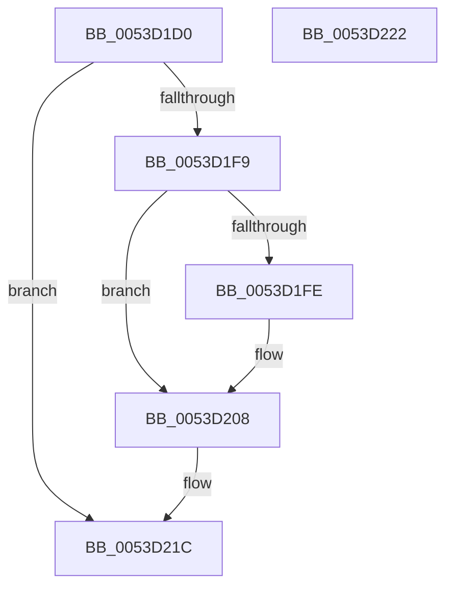

# HalpTimerQueryCycleCounter

- RVA: `0x0053D1D0`–`0x0053D223` (길이 `83` bytes)
- VA: `0x000000014053D1D0`
- 실행 섹션: `.text`
- PDB 이름 있음: `예`; PDB Function 태그: `아니요`
- unwind 정보 RVA: `0x00064C80`
- 디코드: `25`개 명령, `83/83` bytes 표시
- 미해석 바이트: `0` (있으면 어셈블리에 `.byte`로 보존)

> 이 문서는 커널 이미지의 기계어와 PDB 기호를 분석해 생성했습니다. 4번과 5번은 함수 원형과 자료형을 바이너리 사용 방식에서 추정한 C 해석이며 원본 소스 복구 결과는 아닙니다.

## 1. Dependencies

- 직접 호출 지점: **3**; 고유 호출 대상: **3**
- 직접 호출자로 확인된 함수: **0**
- RIP 상대 이미지 참조: **0**

### Outgoing calls
- `0x0053D1EC` → [HalpFindTimer](../54/HalpFindTimer_function_005488D0.md) (function, `0x005488D0`)
- `0x0053D20B` → [HalpTimerGetInternalData](../20/HalpTimerGetInternalData_function_00209500.md) (function, `0x00209500`)
- `0x0053D217` → [guard_dispatch_icall](../6B/guard_dispatch_icall_function_006BAAD0.md) (function, `0x006BAAD0`)

### Direct callers
- 이 함수 시작 RVA로 연결되는 직접 call은 확인되지 않았습니다. 간접 호출은 완전히 역산할 수 없습니다.

### Static image references
- 디코드된 RIP-relative 메모리 참조가 없습니다.

## 2. Other-region calls and transfers

- 다른 실행 섹션으로 향하는 call: **0**
- 별도 외부 분기/꼬리 이동을 확인하지 못했습니다.

## 3. Assembly (complete function range)

```asm
0053D1D0  40 53                           push rbx
0053D1D2  48 83 EC 30                     sub rsp, 0x30
0053D1D6  33 D2                           xor edx, edx
0053D1D8  C7 44 24 20 01 00 00 00         mov dword ptr [rsp + 0x20], 1
0053D1E0  48 8B D9                        mov rbx, rcx
0053D1E3  45 33 C9                        xor r9d, r9d
0053D1E6  45 33 C0                        xor r8d, r8d
0053D1E9  8D 4A 05                        lea ecx, [rdx + 5]
0053D1EC  E8 DF B6 00 00                  call 0x1405488d0
0053D1F1  48 8B D0                        mov rdx, rax
0053D1F4  48 85 C0                        test rax, rax
0053D1F7  74 23                           je 0x14053d21c
0053D1F9  48 85 DB                        test rbx, rbx
0053D1FC  74 0A                           je 0x14053d208
0053D1FE  48 8B 80 C0 00 00 00            mov rax, qword ptr [rax + 0xc0]
0053D205  48 89 03                        mov qword ptr [rbx], rax
0053D208  48 8B CA                        mov rcx, rdx
0053D20B  E8 F0 C2 CC FF                  call 0x140209500
0053D210  48 8B C8                        mov rcx, rax
0053D213  48 8B 42 70                     mov rax, qword ptr [rdx + 0x70]
0053D217  E8 B4 D8 17 00                  call 0x1406baad0
0053D21C  48 83 C4 30                     add rsp, 0x30
0053D220  5B                              pop rbx
0053D221  C3                              ret
0053D222  CC                              int3
```

## 4. C-style interpretation (structured pseudocode)

```c
__int64 __fastcall HalpTimerQueryCycleCounter(__int64 a1, int a2, int a3, int a4)
{
    __int64 result;
    __int64 v_rsp;
    unsigned int v_stack_m18;

    v_rsp = (v_rsp) - (48);
    a2 = 0;
    v_stack_m18 = 1;
    a4 = 0;
    a3 = 0;
    result = HalpFindTimer(a2 + 5, a2, a3, a4);
    if (result == 0) goto loc_0053D21C;
    if (a1 != 0) {
        result = *(unsigned __int64 *)(result + 192);
        *(unsigned __int64 *)(a1) = result;
    }
    result = HalpTimerGetInternalData(result, result, a3, a4);
    result = guard_dispatch_icall(result, result, a3, a4);
loc_0053D21C:
    v_rsp = (v_rsp) + (48);
    return result;
}
```

## 5. (Beta) C Style

```c
int64_t HalpTimerQueryCycleCounter(int64_t Arg1, int32_t Arg2, int32_t Arg3, int32_t Arg4)
{
    int64_t result;
    int64_t local_rsp;
    uint32_t v_stack_m18;

    local_rsp = (local_rsp) - (48);
    Arg2 = 0;
    v_stack_m18 = 1;
    Arg4 = 0;
    Arg3 = 0;
    result = HalpFindTimer(Arg2 + 5, Arg2, Arg3, Arg4);
    if (result == 0) goto loc_0053D21C;
    if (Arg1 != 0) {
        result = *(uint64_t *)(result + 0xC0);
        *(uint64_t *)(Arg1) = result;
    }
    result = HalpTimerGetInternalData(result, result, Arg3, Arg4);
    result = guard_dispatch_icall(result, result, Arg3, Arg4);
loc_0053D21C:
    local_rsp = (local_rsp) + (48);
    return result;
}
```

## 6. Execution-region graph

[열기: 2D/3D 그래프와 함수 탐색 컨트롤 패널](../../../control-panel.html?section=text&rva=0x0053D1D0&view=graph)

- 2D 그래프는 위에서 아래로 흐르고, 3D 그래프는 빈 공간을 드래그해 회전합니다. Shift+드래그는 이동, 휠은 확대·축소, 함수 노드 선택은 대상 보고서 이동입니다.

### Static fallback


