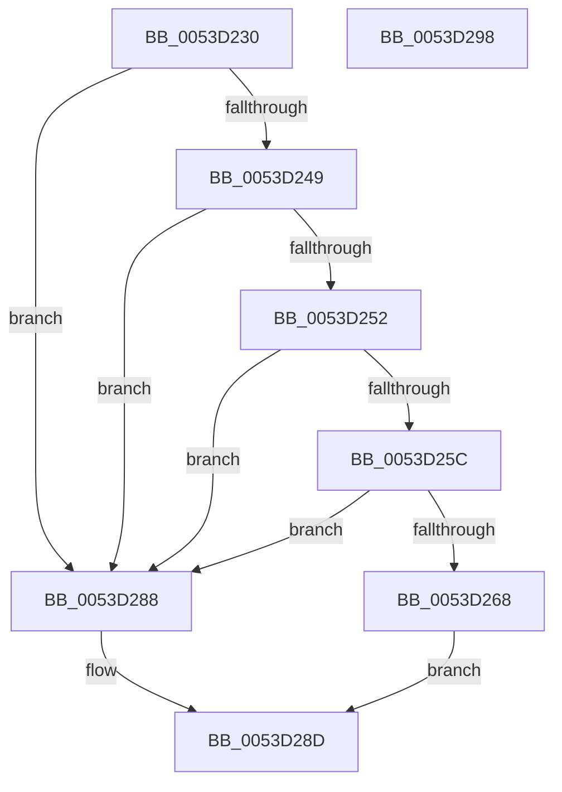

# HalpTimerQueryHostPerformanceCounter

- RVA: `0x0053D230`–`0x0053D299` (길이 `105` bytes)
- VA: `0x000000014053D230`
- 실행 섹션: `.text`
- PDB 이름 있음: `예`; PDB Function 태그: `아니요`
- unwind 정보 RVA: `0x0005CAAC`
- 디코드: `29`개 명령, `105/105` bytes 표시
- 미해석 바이트: `0` (있으면 어셈블리에 `.byte`로 보존)

> 이 문서는 커널 이미지의 기계어와 PDB 기호를 분석해 생성했습니다. 4번과 5번은 함수 원형과 자료형을 바이너리 사용 방식에서 추정한 C 해석이며 원본 소스 복구 결과는 아닙니다.

## 1. Dependencies

- 직접 호출 지점: **2**; 고유 호출 대상: **1**
- 직접 호출자로 확인된 함수: **0**
- RIP 상대 이미지 참조: **3**

### Outgoing calls
- `0x0053D26A` → [guard_dispatch_icall](../6B/guard_dispatch_icall_function_006BAAD0.md) (function, `0x006BAAD0`)
- `0x0053D279` → [guard_dispatch_icall](../6B/guard_dispatch_icall_function_006BAAD0.md) (function, `0x006BAAD0`)

### Direct callers
- 이 함수 시작 RVA로 연결되는 직접 call은 확인되지 않았습니다. 간접 호출은 완전히 역산할 수 없습니다.

### Static image references
- `0x0053D23A` → RVA `0x00FC3FD0` (`.data`; read)
- `0x0053D252` → RVA `0x00FC1DF0` (`.data`; read)
- `0x0053D25C` → RVA `0x00FC1C88` (`.data`; read)

## 2. Other-region calls and transfers

- 다른 실행 섹션으로 향하는 call: **0**
- 별도 외부 분기/꼬리 이동을 확인하지 못했습니다.

## 3. Assembly (complete function range)

```asm
0053D230  48 89 5C 24 08                  mov qword ptr [rsp + 8], rbx
0053D235  57                              push rdi
0053D236  48 83 EC 20                     sub rsp, 0x20
0053D23A  48 8B 05 8F 6D A8 00            mov rax, qword ptr [rip + 0xa86d8f]
0053D241  48 8B F9                        mov rdi, rcx
0053D244  48 85 C0                        test rax, rax
0053D247  74 3F                           je 0x14053d288
0053D249  83 B8 E4 00 00 00 08            cmp dword ptr [rax + 0xe4], 8
0053D250  75 36                           jne 0x14053d288
0053D252  48 83 3D 96 4B A8 00 00         cmp qword ptr [rip + 0xa84b96], 0
0053D25A  74 2C                           je 0x14053d288
0053D25C  48 8B 05 25 4A A8 00            mov rax, qword ptr [rip + 0xa84a25]
0053D263  48 85 C0                        test rax, rax
0053D266  74 20                           je 0x14053d288
0053D268  33 C9                           xor ecx, ecx
0053D26A  E8 61 D8 17 00                  call 0x1406baad0
0053D26F  48 8B D8                        mov rbx, rax
0053D272  48 8B 05 77 4B A8 00            mov rax, qword ptr [rip + 0xa84b77]
0053D279  E8 52 D8 17 00                  call 0x1406baad0
0053D27E  48 03 D8                        add rbx, rax
0053D281  48 89 1F                        mov qword ptr [rdi], rbx
0053D284  33 C0                           xor eax, eax
0053D286  EB 05                           jmp 0x14053d28d
0053D288  B8 BB 00 00 C0                  mov eax, 0xc00000bb
0053D28D  48 8B 5C 24 30                  mov rbx, qword ptr [rsp + 0x30]
0053D292  48 83 C4 20                     add rsp, 0x20
0053D296  5F                              pop rdi
0053D297  C3                              ret
0053D298  CC                              int3
```

## 4. C-style interpretation (structured pseudocode)

```c
__int64 __fastcall HalpTimerQueryHostPerformanceCounter(__int64 a1)
{
    __int64 result;
    __int64 v_rbx;
    __int64 v_rsp;
    unsigned __int64 v_stack_p8;

    v_stack_p8 = v_rbx;
    v_rsp = (v_rsp) - (32);
    if (*(unsigned __int64 *)(v_rip + 11038095) == 0) goto loc_0053D288;
    if ((*(unsigned int *)(*(unsigned __int64 *)(v_rip + 11038095) + 228)) != 8) goto loc_0053D288;
    if ((*(unsigned __int64 *)(v_rip + 11029398)) == 0) goto loc_0053D288;
    if (*(unsigned __int64 *)(v_rip + 11029029) == 0) goto loc_0053D288;
    a1 = 0;
    result = guard_dispatch_icall(a1, a2, a3, a4);
    result = guard_dispatch_icall(a1, a2, a3, a4);
    v_rbx = (result) + (result);
    *(unsigned __int64 *)(a1) = v_rbx;
    result = 0;
    goto loc_0053D28D;
loc_0053D288:
loc_0053D28D:
    v_rsp = (v_rsp) + (32);
    return (unsigned int)(0xC00000BBULL);
}
```

## 5. (Beta) C Style

```c
int64_t HalpTimerQueryHostPerformanceCounter(void *Arg1)
{
    uint8_t *arg1 = (uint8_t *)Arg1;

    int64_t result;
    int64_t local_rbx;
    int64_t local_rsp;
    uint64_t v_stack_p8;

    v_stack_p8 = local_rbx;
    local_rsp = (local_rsp) - (32);
    if (*(uint64_t *)(v_rip + 0xA86D8F) == 0) goto loc_0053D288;
    if ((*(uint32_t *)(*(uint64_t *)(v_rip + 0xA86D8F) + 0xE4)) != 8) goto loc_0053D288;
    if ((*(uint64_t *)(v_rip + 0xA84B96)) == 0) goto loc_0053D288;
    if (*(uint64_t *)(v_rip + 0xA84A25) == 0) goto loc_0053D288;
    Arg1 = 0;
    result = guard_dispatch_icall(Arg1, a2, a3, a4);
    result = guard_dispatch_icall(Arg1, a2, a3, a4);
    local_rbx = (result) + (result);
    *(uint64_t *)(arg1) = local_rbx;
    result = 0;
    goto loc_0053D28D;
loc_0053D288:
loc_0053D28D:
    local_rsp = (local_rsp) + (32);
    return (uint32_t)(0xC00000BBULL);
}
```

### 관측된 메모리 오프셋

구조체 형식이 확인되지 않은 접근은 인자 기준의 오프셋으로만 기록했습니다.

| 기준 인자 | 오프셋 표현 | 폭 (bit) | 접근 |
|---|---:|---:|---|
| `Arg1` | `+ 0x0` | `64` | `W` |

## 6. Execution-region graph

[열기: 2D/3D 그래프와 함수 탐색 컨트롤 패널](../../../control-panel.html?section=text&rva=0x0053D230&view=graph)

- 2D 그래프는 위에서 아래로 흐르고, 3D 그래프는 빈 공간을 드래그해 회전합니다. Shift+드래그는 이동, 휠은 확대·축소, 함수 노드 선택은 대상 보고서 이동입니다.

### Static fallback


