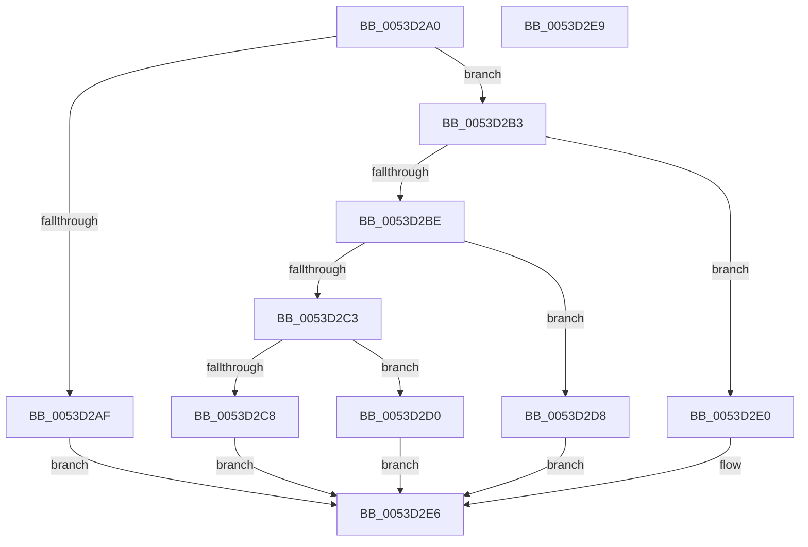

# HalpTimerQueryWatchdogType

- RVA: `0x0053D2A0`–`0x0053D2EA` (길이 `74` bytes)
- VA: `0x000000014053D2A0`
- 실행 섹션: `.text`
- PDB 이름 있음: `예`; PDB Function 태그: `아니요`
- unwind 정보 RVA: `0x000DB714`
- 디코드: `23`개 명령, `74/74` bytes 표시
- 미해석 바이트: `0` (있으면 어셈블리에 `.byte`로 보존)

> 이 문서는 커널 이미지의 기계어와 PDB 기호를 분석해 생성했습니다. 4번과 5번은 함수 원형과 자료형을 바이너리 사용 방식에서 추정한 C 해석이며 원본 소스 복구 결과는 아닙니다.

## 1. Dependencies

- 직접 호출 지점: **0**; 고유 호출 대상: **0**
- 직접 호출자로 확인된 함수: **1**
- RIP 상대 이미지 참조: **1**

### Outgoing calls
- 직접 디코드된 call 명령이 없습니다.

### Direct callers
- [sub_00B80AC2](../../pagelk/B8/Unknown_function_00B80AC2.md) at `0x00B80C1C`

### Static image references
- `0x0053D2A3` → RVA `0x00FC4028` (`.data`; read)

## 2. Other-region calls and transfers

- 다른 실행 섹션으로 향하는 call: **0**
- 별도 외부 분기/꼬리 이동을 확인하지 못했습니다.

## 3. Assembly (complete function range)

```asm
0053D2A0  48 8B D1                        mov rdx, rcx
0053D2A3  48 8B 0D 7E 6D A8 00            mov rcx, qword ptr [rip + 0xa86d7e]
0053D2AA  48 85 C9                        test rcx, rcx
0053D2AD  75 04                           jne 0x14053d2b3
0053D2AF  21 0A                           and dword ptr [rdx], ecx
0053D2B1  EB 33                           jmp 0x14053d2e6
0053D2B3  8B 89 E4 00 00 00               mov ecx, dword ptr [rcx + 0xe4]
0053D2B9  83 E9 08                        sub ecx, 8
0053D2BC  74 22                           je 0x14053d2e0
0053D2BE  83 E9 05                        sub ecx, 5
0053D2C1  74 15                           je 0x14053d2d8
0053D2C3  83 F9 01                        cmp ecx, 1
0053D2C6  74 08                           je 0x14053d2d0
0053D2C8  C7 02 03 00 00 00               mov dword ptr [rdx], 3
0053D2CE  EB 16                           jmp 0x14053d2e6
0053D2D0  C7 02 04 00 00 00               mov dword ptr [rdx], 4
0053D2D6  EB 0E                           jmp 0x14053d2e6
0053D2D8  C7 02 02 00 00 00               mov dword ptr [rdx], 2
0053D2DE  EB 06                           jmp 0x14053d2e6
0053D2E0  C7 02 01 00 00 00               mov dword ptr [rdx], 1
0053D2E6  33 C0                           xor eax, eax
0053D2E8  C3                              ret
0053D2E9  CC                              int3
```

## 4. C-style interpretation (structured pseudocode)

```c
__int64 __fastcall HalpTimerQueryWatchdogType(__int64 a1)
{
    __int64 result;

    if (*(unsigned __int64 *)(v_rip + 11038078) != 0) goto loc_0053D2B3;
    goto loc_0053D2E6;
loc_0053D2B3:
    a1 = (unsigned int)(((unsigned int)(*(unsigned int *)(*(unsigned __int64 *)(v_rip + 11038078) + 228))) - (8));
    if (condition_is_equal) goto loc_0053D2E0;
    a1 = (unsigned int)((a1) - (5));
    if (condition_is_equal) goto loc_0053D2D8;
    if (((unsigned int)(a1)) == 1) goto loc_0053D2D0;
    *(unsigned int *)(a1) = 3;
    goto loc_0053D2E6;
loc_0053D2D0:
    *(unsigned int *)(a1) = 4;
    goto loc_0053D2E6;
loc_0053D2D8:
    *(unsigned int *)(a1) = 2;
    goto loc_0053D2E6;
loc_0053D2E0:
    *(unsigned int *)(a1) = 1;
loc_0053D2E6:
    result = 0;
    return result;
}
```

## 5. (Beta) C Style

```c
int64_t HalpTimerQueryWatchdogType(void *Arg1)
{
    uint8_t *arg1 = (uint8_t *)Arg1;

    int64_t result;

    if (*(uint64_t *)(v_rip + 0xA86D7E) != 0) goto loc_0053D2B3;
    goto loc_0053D2E6;
loc_0053D2B3:
    Arg1 = (uint32_t)(((uint32_t)(*(uint32_t *)(*(uint64_t *)(v_rip + 0xA86D7E) + 0xE4))) - (8));
    if (condition_is_equal) goto loc_0053D2E0;
    Arg1 = (uint32_t)((Arg1) - (5));
    if (condition_is_equal) goto loc_0053D2D8;
    if (((uint32_t)(Arg1)) == 1) goto loc_0053D2D0;
    *(uint32_t *)(arg1) = 3;
    goto loc_0053D2E6;
loc_0053D2D0:
    *(uint32_t *)(arg1) = 4;
    goto loc_0053D2E6;
loc_0053D2D8:
    *(uint32_t *)(arg1) = 2;
    goto loc_0053D2E6;
loc_0053D2E0:
    *(uint32_t *)(arg1) = 1;
loc_0053D2E6:
    result = 0;
    return result;
}
```

### 관측된 메모리 오프셋

구조체 형식이 확인되지 않은 접근은 인자 기준의 오프셋으로만 기록했습니다.

| 기준 인자 | 오프셋 표현 | 폭 (bit) | 접근 |
|---|---:|---:|---|
| `Arg1` | `+ 0x0` | `32` | `R/W` |
| `Arg1` | `+ 0x0` | `32` | `W` |

## 6. Execution-region graph

[열기: 2D/3D 그래프와 함수 탐색 컨트롤 패널](../../../control-panel.html?section=text&rva=0x0053D2A0&view=graph)

- 2D 그래프는 위에서 아래로 흐르고, 3D 그래프는 빈 공간을 드래그해 회전합니다. Shift+드래그는 이동, 휠은 확대·축소, 함수 노드 선택은 대상 보고서 이동입니다.

### Static fallback


