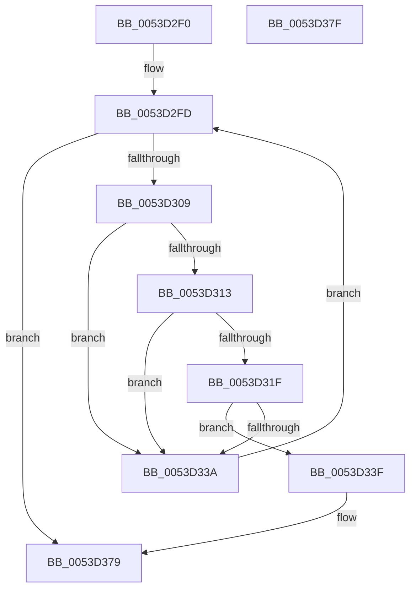

# HalpTimerReinitializeThisProcessor

- RVA: `0x0053D2F0`–`0x0053D380` (길이 `144` bytes)
- VA: `0x000000014053D2F0`
- 실행 섹션: `.text`
- PDB 이름 있음: `예`; PDB Function 태그: `아니요`
- unwind 정보 RVA: `0x00064C80`
- 디코드: `40`개 명령, `144/144` bytes 표시
- 미해석 바이트: `0` (있으면 어셈블리에 `.byte`로 보존)

> 이 문서는 커널 이미지의 기계어와 PDB 기호를 분석해 생성했습니다. 4번과 5번은 함수 원형과 자료형을 바이너리 사용 방식에서 추정한 C 해석이며 원본 소스 복구 결과는 아닙니다.

## 1. Dependencies

- 직접 호출 지점: **4**; 고유 호출 대상: **4**
- 직접 호출자로 확인된 함수: **1**
- RIP 상대 이미지 참조: **2**

### Outgoing calls
- `0x0053D322` → [HalpTimerGetInternalData](../20/HalpTimerGetInternalData_function_00209500.md) (function, `0x00209500`)
- `0x0053D32E` → [guard_dispatch_icall](../6B/guard_dispatch_icall_function_006BAAD0.md) (function, `0x006BAAD0`)
- `0x0053D35A` → [HalpTimerSetProblemEx](../4F/HalpTimerSetProblemEx_function_004FAEC4.md) (function, `0x004FAEC4`)
- `0x0053D373` → [KeBugCheckEx](../4F/KeBugCheckEx_function_004FD660.md) (function, `0x004FD660`)

### Direct callers
- [HalpPostSleepMP](../../pagelk/B5/HalpPostSleepMP_function_00B5ECC4.md) at `0x00B5ED0A`

### Static image references
- `0x0053D2F6` → RVA `0x00FC4120` (`.data`; read)
- `0x0053D350` → RVA `0x0001BE98` (`.rdata`; read)

## 2. Other-region calls and transfers

- 다른 실행 섹션으로 향하는 call: **0**
- 별도 외부 분기/꼬리 이동을 확인하지 못했습니다.

## 3. Assembly (complete function range)

```asm
0053D2F0  40 53                           push rbx
0053D2F2  48 83 EC 30                     sub rsp, 0x30
0053D2F6  48 8B 1D 23 6E A8 00            mov rbx, qword ptr [rip + 0xa86e23]
0053D2FD  48 8D 05 1C 6E A8 00            lea rax, [rip + 0xa86e1c]
0053D304  48 3B D8                        cmp rbx, rax
0053D307  74 70                           je 0x14053d379
0053D309  8B 83 E0 00 00 00               mov eax, dword ptr [rbx + 0xe0]
0053D30F  A8 01                           test al, 1
0053D311  74 27                           je 0x14053d33a
0053D313  8B 83 B8 00 00 00               mov eax, dword ptr [rbx + 0xb8]
0053D319  24 05                           and al, 5
0053D31B  3C 04                           cmp al, 4
0053D31D  75 1B                           jne 0x14053d33a
0053D31F  48 8B CB                        mov rcx, rbx
0053D322  E8 D9 C1 CC FF                  call 0x140209500
0053D327  48 8B C8                        mov rcx, rax
0053D32A  48 8B 43 68                     mov rax, qword ptr [rbx + 0x68]
0053D32E  E8 9D D7 17 00                  call 0x1406baad0
0053D333  4C 63 C0                        movsxd r8, eax
0053D336  85 C0                           test eax, eax
0053D338  78 05                           js 0x14053d33f
0053D33A  48 8B 1B                        mov rbx, qword ptr [rbx]
0053D33D  EB BE                           jmp 0x14053d2fd
0053D33F  41 BA 0F 00 00 00               mov r10d, 0xf
0053D345  C7 44 24 20 32 0C 00 00         mov dword ptr [rsp + 0x20], 0xc32
0053D34D  41 8B D2                        mov edx, r10d
0053D350  4C 8D 0D 41 EB AD FF            lea r9, [rip - 0x5214bf]
0053D357  48 8B CB                        mov rcx, rbx
0053D35A  E8 65 DB FB FF                  call 0x1404faec4
0053D35F  4C 89 44 24 20                  mov qword ptr [rsp + 0x20], r8
0053D364  41 8D 4A 4D                     lea ecx, [r10 + 0x4d]
0053D368  4C 8B C3                        mov r8, rbx
0053D36B  45 8B CA                        mov r9d, r10d
0053D36E  BA 10 01 00 00                  mov edx, 0x110
0053D373  E8 E8 02 FC FF                  call 0x1404fd660
0053D378  CC                              int3
0053D379  48 83 C4 30                     add rsp, 0x30
0053D37D  5B                              pop rbx
0053D37E  C3                              ret
0053D37F  CC                              int3
```

## 4. C-style interpretation (structured pseudocode)

```c
__int64 __fastcall HalpTimerReinitializeThisProcessor(void)
{
    __int64 result;
    __int64 v_rsp;
    unsigned int v_stack_m18;

    v_rsp = (v_rsp) - (48);
loc_0053D2FD:
    if ((*(unsigned __int64 *)(v_rip + 11038243)) == (v_rip + 11038236)) goto loc_0053D379;
    if ((((unsigned __int8)((unsigned int)(*(unsigned int *)(*(unsigned __int64 *)(v_rip + 11038243) + 224)))) & (1)) == 0) goto loc_0053D33A;
    result = (unsigned __int8)(((unsigned int)(*(unsigned int *)(*(unsigned __int64 *)(v_rip + 11038243) + 184))) & (5));
    if (((unsigned __int8)(result)) != 4) goto loc_0053D33A;
    result = HalpTimerGetInternalData(*(unsigned __int64 *)(v_rip + 11038243), a2, a3, a4);
    result = guard_dispatch_icall(result, a2, a3, a4);
    if (sign_flag) goto loc_0053D33F;
loc_0053D33A:
    goto loc_0053D2FD;
loc_0053D33F:
    v_stack_m18 = 0xC32ULL;
    result = HalpTimerSetProblemEx(*(unsigned __int64 *)(*(unsigned __int64 *)(v_rip + 11038243)), 15, (int)((unsigned int)(result)), v_rip - 5379263);
    v_stack_m18 = (int)((unsigned int)(result));
    result = KeBugCheckEx(15 + 77, 272, *(unsigned __int64 *)(*(unsigned __int64 *)(v_rip + 11038243)), 15);
loc_0053D379:
    v_rsp = (v_rsp) + (48);
    return result;
}
```

## 5. (Beta) C Style

```c
void HalpTimerReinitializeThisProcessor(void)
{
    int64_t result;
    int64_t local_rsp;
    uint32_t v_stack_m18;

    local_rsp = (local_rsp) - (48);
loc_0053D2FD:
    if ((*(uint64_t *)(v_rip + 0xA86E23)) == (v_rip + 11038236)) goto loc_0053D379;
    if ((((uint8_t)((uint32_t)(*(uint32_t *)(*(uint64_t *)(v_rip + 0xA86E23) + 0xE0)))) & (1)) == 0) goto loc_0053D33A;
    result = (uint8_t)(((uint32_t)(*(uint32_t *)(*(uint64_t *)(v_rip + 0xA86E23) + 0xB8))) & (5));
    if (((uint8_t)(result)) != 4) goto loc_0053D33A;
    result = HalpTimerGetInternalData(*(uint64_t *)(v_rip + 0xA86E23), a2, a3, a4);
    result = guard_dispatch_icall(result, a2, a3, a4);
    if (sign_flag) goto loc_0053D33F;
loc_0053D33A:
    goto loc_0053D2FD;
loc_0053D33F:
    v_stack_m18 = 0xC32ULL;
    result = HalpTimerSetProblemEx(*(uint64_t *)(*(uint64_t *)(v_rip + 0xA86E23)), 15, (int32_t)((uint32_t)(result)), v_rip - 5379263);
    v_stack_m18 = (int32_t)((uint32_t)(result));
    result = KeBugCheckEx(15 + 77, 272, *(uint64_t *)(*(uint64_t *)(v_rip + 0xA86E23)), 15);
loc_0053D379:
    local_rsp = (local_rsp) + (48);
    return result;
}
```

## 6. Execution-region graph

[열기: 2D/3D 그래프와 함수 탐색 컨트롤 패널](../../../control-panel.html?section=text&rva=0x0053D2F0&view=graph)

- 2D 그래프는 위에서 아래로 흐르고, 3D 그래프는 빈 공간을 드래그해 회전합니다. Shift+드래그는 이동, 휠은 확대·축소, 함수 노드 선택은 대상 보고서 이동입니다.

### Static fallback


