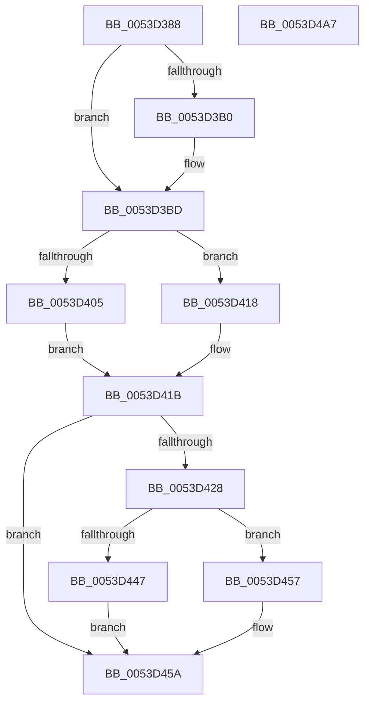

# HalpTimerSchedulePeriodicQueries

- RVA: `0x0053D388`–`0x0053D4A8` (길이 `288` bytes)
- VA: `0x000000014053D388`
- 실행 섹션: `.text`
- PDB 이름 있음: `예`; PDB Function 태그: `아니요`
- unwind 정보 RVA: `0x000717F8`
- 디코드: `70`개 명령, `288/288` bytes 표시
- 미해석 바이트: `0` (있으면 어셈블리에 `.byte`로 보존)

> 이 문서는 커널 이미지의 기계어와 PDB 기호를 분석해 생성했습니다. 4번과 5번은 함수 원형과 자료형을 바이너리 사용 방식에서 추정한 C 해석이며 원본 소스 복구 결과는 아닙니다.

## 1. Dependencies

- 직접 호출 지점: **4**; 고유 호출 대상: **3**
- 직접 호출자로 확인된 함수: **2**
- RIP 상대 이미지 참조: **5**

### Outgoing calls
- `0x0053D3BF` → [KeQueryPerformanceCounter](../37/KeQueryPerformanceCounter_function_0037E7E0.md) (function, `0x0037E7E0`)
- `0x0053D3F7` → [RtlULongLongMult](../43/RtlULongLongMult_function_0043E530.md) (function, `0x0043E530`)
- `0x0053D43E` → [RtlULongLongMult](../43/RtlULongLongMult_function_0043E530.md) (function, `0x0043E530`)
- `0x0053D492` → [KiSetTimerEx](../23/KiSetTimerEx_function_00232CB0.md) (function, `0x00232CB0`)

### Direct callers
- [HalpTimerInitSystem](HalpTimerInitSystem_function_0053CB70.md) at `0x0053CC20`
- [HalpTscFallbackToPlatformSource](../54/HalpTscFallbackToPlatformSource_function_0054AD14.md) at `0x0054AD74`

### Static image references
- `0x0053D39D` → RVA `0x00FC4140` (`.data`; read)
- `0x0053D3A4` → RVA `0x00FC3FD0` (`.data`; read)
- `0x0053D3E1` → RVA `0x00FC22A0` (`.data`; write)
- `0x0053D45D` → RVA `0x00FC3FE0` (`.data`; read)
- `0x0053D486` → RVA `0x00FC4080` (`.data`; read)

## 2. Other-region calls and transfers

- 다른 실행 섹션으로 향하는 call: **0**
- 별도 외부 분기/꼬리 이동을 확인하지 못했습니다.

## 3. Assembly (complete function range)

```asm
0053D388  48 89 5C 24 10                  mov qword ptr [rsp + 0x10], rbx
0053D38D  48 89 74 24 18                  mov qword ptr [rsp + 0x18], rsi
0053D392  57                              push rdi
0053D393  48 83 EC 30                     sub rsp, 0x30
0053D397  48 83 64 24 40 00               and qword ptr [rsp + 0x40], 0
0053D39D  48 8B 1D 9C 6D A8 00            mov rbx, qword ptr [rip + 0xa86d9c]
0053D3A4  48 8B 3D 25 6C A8 00            mov rdi, qword ptr [rip + 0xa86c25]
0053D3AB  48 85 DB                        test rbx, rbx
0053D3AE  74 0D                           je 0x14053d3bd
0053D3B0  83 BB DC 00 00 00 40            cmp dword ptr [rbx + 0xdc], 0x40
0053D3B7  48 1B C0                        sbb rax, rax
0053D3BA  48 23 D8                        and rbx, rax
0053D3BD  33 C9                           xor ecx, ecx
0053D3BF  E8 1C 14 E4 FF                  call 0x14037e7e0
0053D3C4  48 B8 14 00 00 00 80 F7 FF FF   movabs rax, 0xfffff78000000014
0053D3CE  4C 8D 44 24 40                  lea r8, [rsp + 0x40]
0053D3D3  41 B9 01 00 00 00               mov r9d, 1
0053D3D9  BA FA 00 00 00                  mov edx, 0xfa
0053D3DE  48 8B 00                        mov rax, qword ptr [rax]
0053D3E1  48 89 05 B8 4E A8 00            mov qword ptr [rip + 0xa84eb8], rax
0053D3E8  41 8B C1                        mov eax, r9d
0053D3EB  8B 8F DC 00 00 00               mov ecx, dword ptr [rdi + 0xdc]
0053D3F1  48 D3 E0                        shl rax, cl
0053D3F4  48 8B C8                        mov rcx, rax
0053D3F7  E8 34 11 F0 FF                  call 0x14043e530
0053D3FC  BE C0 D4 01 00                  mov esi, 0x1d4c0
0053D401  85 C0                           test eax, eax
0053D403  78 13                           js 0x14053d418
0053D405  48 8B 44 24 40                  mov rax, qword ptr [rsp + 0x40]
0053D40A  33 D2                           xor edx, edx
0053D40C  48 F7 B7 C0 00 00 00            div qword ptr [rdi + 0xc0]
0053D413  4C 8B D0                        mov r10, rax
0053D416  EB 03                           jmp 0x14053d41b
0053D418  4C 8B D6                        mov r10, rsi
0053D41B  4C 89 54 24 40                  mov qword ptr [rsp + 0x40], r10
0053D420  49 8B C2                        mov rax, r10
0053D423  48 85 DB                        test rbx, rbx
0053D426  74 32                           je 0x14053d45a
0053D428  8B 8B DC 00 00 00               mov ecx, dword ptr [rbx + 0xdc]
0053D42E  4C 8D 44 24 40                  lea r8, [rsp + 0x40]
0053D433  49 D3 E1                        shl r9, cl
0053D436  BA FA 00 00 00                  mov edx, 0xfa
0053D43B  49 8B C9                        mov rcx, r9
0053D43E  E8 ED 10 F0 FF                  call 0x14043e530
0053D443  85 C0                           test eax, eax
0053D445  78 10                           js 0x14053d457
0053D447  48 8B 44 24 40                  mov rax, qword ptr [rsp + 0x40]
0053D44C  33 D2                           xor edx, edx
0053D44E  48 F7 B3 C0 00 00 00            div qword ptr [rbx + 0xc0]
0053D455  EB 03                           jmp 0x14053d45a
0053D457  48 8B C6                        mov rax, rsi
0053D45A  49 3B C2                        cmp rax, r10
0053D45D  48 8D 0D 7C 6B A8 00            lea rcx, [rip + 0xa86b7c]
0053D464  4C 0F 42 D0                     cmovb r10, rax
0053D468  49 8D 42 FF                     lea rax, [r10 - 1]
0053D46C  48 3D BF D4 01 00               cmp rax, 0x1d4bf
0053D472  4C 0F 47 D6                     cmova r10, rsi
0053D476  45 33 C9                        xor r9d, r9d
0053D479  49 63 C2                        movsxd rax, r10d
0053D47C  45 8B C2                        mov r8d, r10d
0053D47F  48 69 D0 F0 D8 FF FF            imul rdx, rax, -0x2710
0053D486  48 8D 05 F3 6B A8 00            lea rax, [rip + 0xa86bf3]
0053D48D  48 89 44 24 20                  mov qword ptr [rsp + 0x20], rax
0053D492  E8 19 58 CF FF                  call 0x140232cb0
0053D497  48 8B 5C 24 48                  mov rbx, qword ptr [rsp + 0x48]
0053D49C  48 8B 74 24 50                  mov rsi, qword ptr [rsp + 0x50]
0053D4A1  48 83 C4 30                     add rsp, 0x30
0053D4A5  5F                              pop rdi
0053D4A6  C3                              ret
0053D4A7  CC                              int3
```

## 4. C-style interpretation (structured pseudocode)

```c
__int64 __fastcall HalpTimerSchedulePeriodicQueries(int a1)
{
    __int64 result;
    __int64 v_r10;
    __int64 v_rbx;
    __int64 v_rsp;
    unsigned __int64 v_stack_m18;
    unsigned __int64 v_stack_p10;
    unsigned __int64 v_stack_p18;
    unsigned __int64 v_stack_p8;

    v_stack_p10 = v_rbx;
    v_stack_p18 = v_rsi;
    v_rsp = (v_rsp) - (48);
    v_rbx = *(unsigned __int64 *)(v_rip + 11038108);
    if (*(unsigned __int64 *)(v_rip + 11038108) != 0) {
        v_rbx = (*(unsigned __int64 *)(v_rip + 11038108)) & (result);
    }
    a1 = 0;
    result = KeQueryPerformanceCounter(a1, a2, a3, a4);
    *(unsigned __int64 *)(v_rip + 11030200) = *(unsigned __int64 *)(result);
    result = (1) << ((unsigned __int8)((unsigned int)(*(unsigned int *)(*(unsigned __int64 *)(v_rip + 11037733) + 220))));
    result = RtlULongLongMult(result, 250, v_stack_p8, 1);
    if (sign_flag) goto loc_0053D418;
    a2 = 0;
    goto loc_0053D41B;
loc_0053D418:
loc_0053D41B:
    v_stack_p8 = (unsigned int)(0x1D4C0ULL);
    if (v_rbx == 0) goto loc_0053D45A;
    a4 = (1) << ((unsigned __int8)((unsigned int)(*(unsigned int *)(v_rbx + 220))));
    result = RtlULongLongMult(a4, 250, v_stack_p8, a4);
    if (sign_flag) goto loc_0053D457;
    a2 = 0;
    goto loc_0053D45A;
loc_0053D457:
loc_0053D45A:
    v_r10 = (unsigned int)(0x1D4C0ULL);
    if (((unsigned int)(0x1D4C0ULL)) < ((unsigned int)(0x1D4C0ULL))) { v_r10 = (unsigned int)(0x1D4C0ULL); }
    if ((v_r10 - 1) > 0x1D4BFULL) { v_r10 = (unsigned int)(0x1D4C0ULL); }
    a4 = 0;
    a2 = (a2) * ((int)((unsigned int)(v_r10)));
    v_stack_m18 = v_rip + 11037683;
    result = KiSetTimerEx(v_rip + 11037564, a2, (unsigned int)((unsigned int)(v_r10)), a4);
    v_rsp = (v_rsp) + (48);
    return result;
}
```

## 5. (Beta) C Style

```c
int64_t HalpTimerSchedulePeriodicQueries(int32_t Arg1)
{
    int64_t result;
    int64_t local_r10;
    int64_t local_rbx;
    int64_t local_rsp;
    uint64_t v_stack_m18;
    uint64_t v_stack_p10;
    uint64_t v_stack_p18;
    uint64_t v_stack_p8;

    v_stack_p10 = local_rbx;
    v_stack_p18 = local_rsi;
    local_rsp = (local_rsp) - (48);
    local_rbx = *(uint64_t *)(v_rip + 0xA86D9C);
    if (*(uint64_t *)(v_rip + 0xA86D9C) != 0) {
        local_rbx = (*(uint64_t *)(v_rip + 0xA86D9C)) & (result);
    }
    Arg1 = 0;
    result = KeQueryPerformanceCounter(Arg1, a2, a3, a4);
    *(uint64_t *)(v_rip + 0xA84EB8) = *(uint64_t *)(result);
    result = (1) << ((uint8_t)((uint32_t)(*(uint32_t *)(*(uint64_t *)(v_rip + 0xA86C25) + 0xDC))));
    result = RtlULongLongMult(result, 250, v_stack_p8, 1);
    if (sign_flag) goto loc_0053D418;
    a2 = 0;
    goto loc_0053D41B;
loc_0053D418:
loc_0053D41B:
    v_stack_p8 = (uint32_t)(0x1D4C0ULL);
    if (local_rbx == 0) goto loc_0053D45A;
    a4 = (1) << ((uint8_t)((uint32_t)(*(uint32_t *)(local_rbx + 0xDC))));
    result = RtlULongLongMult(a4, 250, v_stack_p8, a4);
    if (sign_flag) goto loc_0053D457;
    a2 = 0;
    goto loc_0053D45A;
loc_0053D457:
loc_0053D45A:
    local_r10 = (uint32_t)(0x1D4C0ULL);
    if (((uint32_t)(0x1D4C0ULL)) < ((uint32_t)(0x1D4C0ULL))) { local_r10 = (uint32_t)(0x1D4C0ULL); }
    if ((local_r10 - 1) > 0x1D4BFULL) { local_r10 = (uint32_t)(0x1D4C0ULL); }
    a4 = 0;
    a2 = (a2) * ((int32_t)((uint32_t)(local_r10)));
    v_stack_m18 = v_rip + 11037683;
    result = KiSetTimerEx(v_rip + 11037564, a2, (uint32_t)((uint32_t)(local_r10)), a4);
    local_rsp = (local_rsp) + (48);
    return result;
}
```

## 6. Execution-region graph

[열기: 2D/3D 그래프와 함수 탐색 컨트롤 패널](../../../control-panel.html?section=text&rva=0x0053D388&view=graph)

- 2D 그래프는 위에서 아래로 흐르고, 3D 그래프는 빈 공간을 드래그해 회전합니다. Shift+드래그는 이동, 휠은 확대·축소, 함수 노드 선택은 대상 보고서 이동입니다.

### Static fallback


