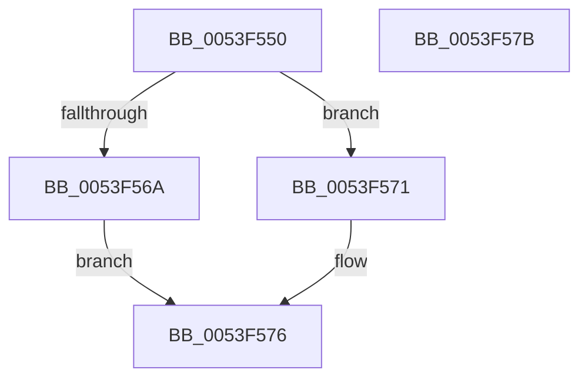

# IoFreeMapRegistersThunk

- RVA: `0x0053F550`–`0x0053F57C` (길이 `44` bytes)
- VA: `0x000000014053F550`
- 실행 섹션: `.text`
- PDB 이름 있음: `예`; PDB Function 태그: `아니요`
- unwind 정보 RVA: `0x0005C788`
- 디코드: `14`개 명령, `44/44` bytes 표시
- 미해석 바이트: `0` (있으면 어셈블리에 `.byte`로 보존)

> 이 문서는 커널 이미지의 기계어와 PDB 기호를 분석해 생성했습니다. 4번과 5번은 함수 원형과 자료형을 바이너리 사용 방식에서 추정한 C 해석이며 원본 소스 복구 결과는 아닙니다.

## 1. Dependencies

- 직접 호출 지점: **3**; 고유 호출 대상: **3**
- 직접 호출자로 확인된 함수: **1**
- RIP 상대 이미지 참조: **0**

### Outgoing calls
- `0x0053F55A` → [HalpDmaGetAdapterVersion](../3D/HalpDmaGetAdapterVersion_function_003DEC8C.md) (function, `0x003DEC8C`)
- `0x0053F56A` → [IoFreeMapRegistersV3](../3D/IoFreeMapRegistersV3_function_003DAAD0.md) (function, `0x003DAAD0`)
- `0x0053F571` → [IoFreeMapRegistersV2](../3D/IoFreeMapRegistersV2_function_003DF440.md) (function, `0x003DF440`)

### Direct callers
- [HalpAllocateMapRegisters](../../page/70/HalpAllocateMapRegisters_function_00707640.md) at `0x00707734`

### Static image references
- 디코드된 RIP-relative 메모리 참조가 없습니다.

## 2. Other-region calls and transfers

- 다른 실행 섹션으로 향하는 call: **0**
- 별도 외부 분기/꼬리 이동을 확인하지 못했습니다.

## 3. Assembly (complete function range)

```asm
0053F550  48 83 EC 28                     sub rsp, 0x28
0053F554  4C 8B D2                        mov r10, rdx
0053F557  4C 8B C9                        mov r9, rcx
0053F55A  E8 2D F7 E9 FF                  call 0x1403dec8c
0053F55F  49 8B D2                        mov rdx, r10
0053F562  49 8B C9                        mov rcx, r9
0053F565  83 E8 02                        sub eax, 2
0053F568  74 07                           je 0x14053f571
0053F56A  E8 61 B5 E9 FF                  call 0x1403daad0
0053F56F  EB 05                           jmp 0x14053f576
0053F571  E8 CA FE E9 FF                  call 0x1403df440
0053F576  48 83 C4 28                     add rsp, 0x28
0053F57A  C3                              ret
0053F57B  CC                              int3
```

## 4. C-style interpretation (structured pseudocode)

```c
__int64 __fastcall IoFreeMapRegistersThunk(__int64 a1, __int64 a2)
{
    __int64 result;
    __int64 v_rsp;

    v_rsp = (v_rsp) - (40);
    result = HalpDmaGetAdapterVersion(a1, a2, a3, a1);
    result = (unsigned int)((result) - (2));
    if (condition_is_equal) goto loc_0053F571;
    result = IoFreeMapRegistersV3(a1, a2, a3, a1);
    goto loc_0053F576;
loc_0053F571:
    result = IoFreeMapRegistersV2(a1, a2, a3, a1);
loc_0053F576:
    v_rsp = (v_rsp) + (40);
    return result;
}
```

## 5. (Beta) C Style

```c
int64_t IoFreeMapRegistersThunk(int64_t Arg1, int64_t Arg2)
{
    int64_t result;
    int64_t local_rsp;

    local_rsp = (local_rsp) - (40);
    result = HalpDmaGetAdapterVersion(Arg1, Arg2, a3, Arg1);
    result = (uint32_t)((result) - (2));
    if (condition_is_equal) goto loc_0053F571;
    result = IoFreeMapRegistersV3(Arg1, Arg2, a3, Arg1);
    goto loc_0053F576;
loc_0053F571:
    result = IoFreeMapRegistersV2(Arg1, Arg2, a3, Arg1);
loc_0053F576:
    local_rsp = (local_rsp) + (40);
    return result;
}
```

## 6. Execution-region graph

[열기: 2D/3D 그래프와 함수 탐색 컨트롤 패널](../../../control-panel.html?section=text&rva=0x0053F550&view=graph)

- 2D 그래프는 위에서 아래로 흐르고, 3D 그래프는 빈 공간을 드래그해 회전합니다. Shift+드래그는 이동, 휠은 확대·축소, 함수 노드 선택은 대상 보고서 이동입니다.

### Static fallback


