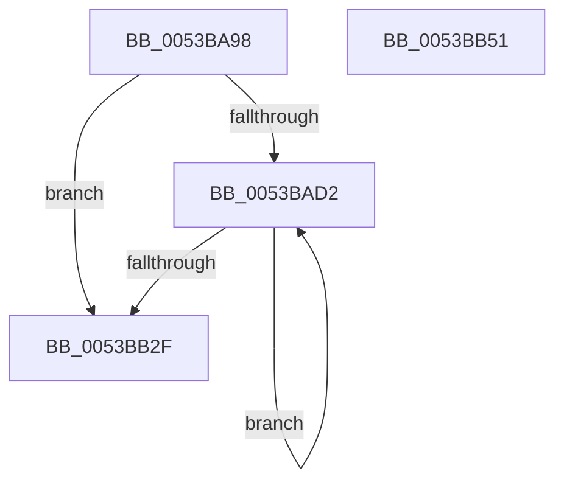

# MakeGdtReadOnly

- RVA: `0x0053BA98`–`0x0053BB52` (길이 `186` bytes)
- VA: `0x000000014053BA98`
- 실행 섹션: `.text`
- PDB 이름 있음: `예`; PDB Function 태그: `아니요`
- unwind 정보 RVA: `0x000C3764`
- 디코드: `48`개 명령, `186/186` bytes 표시
- 미해석 바이트: `0` (있으면 어셈블리에 `.byte`로 보존)

> 이 문서는 커널 이미지의 기계어와 PDB 기호를 분석해 생성했습니다. 4번과 5번은 함수 원형과 자료형을 바이너리 사용 방식에서 추정한 C 해석이며 원본 소스 복구 결과는 아닙니다.

## 1. Dependencies

- 직접 호출 지점: **4**; 고유 호출 대상: **4**
- 직접 호출자로 확인된 함수: **1**
- RIP 상대 이미지 참조: **3**

### Outgoing calls
- `0x0053BB07` → [KeSetSystemGroupAffinityThread](../39/KeSetSystemGroupAffinityThread_function_00399140.md) (function, `0x00399140`)
- `0x0053BB1E` → [KeWriteProtectProcessorState](../../pagelk/B6/KeWriteProtectProcessorState_function_00B66BB0.md) (function, `0x00B66BB0`)
- `0x0053BB34` → [KeRevertToUserGroupAffinityThread](../39/KeRevertToUserGroupAffinityThread_function_00398EC0.md) (function, `0x00398EC0`)
- `0x0053BB41` → [_security_check_cookie](../6A/_security_check_cookie_function_006AC640.md) (function, `0x006AC640`)

### Direct callers
- [Phase1InitializationDiscard](../../init/C1/Phase1InitializationDiscard_function_00C1C728.md) at `0x00C1D07D`

### Static image references
- `0x0053BAA2` → RVA `0x00E0A740` (`.data`; read)
- `0x0053BAB1` → RVA `0x00FC6A80` (`ALMOSTRO`; read)
- `0x0053BAD2` → RVA `0x00F231B0` (`.data`; read)

## 2. Other-region calls and transfers

- 다른 실행 섹션으로 향하는 call: **1**
  - `0x0053BB1E` → [KeWriteProtectProcessorState](../../pagelk/B6/KeWriteProtectProcessorState_function_00B66BB0.md) (`.text` → `PAGELK`)
- 별도 외부 분기/꼬리 이동을 확인하지 못했습니다.

## 3. Assembly (complete function range)

```asm
0053BA98  48 89 5C 24 08                  mov qword ptr [rsp + 8], rbx
0053BA9D  57                              push rdi
0053BA9E  48 83 EC 50                     sub rsp, 0x50
0053BAA2  48 8B 05 97 EC 8C 00            mov rax, qword ptr [rip + 0x8cec97]
0053BAA9  48 33 C4                        xor rax, rsp
0053BAAC  48 89 44 24 40                  mov qword ptr [rsp + 0x40], rax
0053BAB1  8B 05 C9 AF A8 00               mov eax, dword ptr [rip + 0xa8afc9]
0053BAB7  48 8D 7C 24 30                  lea rdi, [rsp + 0x30]
0053BABC  33 DB                           xor ebx, ebx
0053BABE  0F 57 C0                        xorps xmm0, xmm0
0053BAC1  0F 57 C9                        xorps xmm1, xmm1
0053BAC4  0F 11 44 24 30                  movups xmmword ptr [rsp + 0x30], xmm0
0053BAC9  0F 11 4C 24 20                  movups xmmword ptr [rsp + 0x20], xmm1
0053BACE  85 C0                           test eax, eax
0053BAD0  74 5D                           je 0x14053bb2f
0053BAD2  48 8B 05 D7 76 9E 00            mov rax, qword ptr [rip + 0x9e76d7]
0053BAD9  33 D2                           xor edx, edx
0053BADB  89 54 24 2A                     mov dword ptr [rsp + 0x2a], edx
0053BADF  66 89 54 24 2E                  mov word ptr [rsp + 0x2e], dx
0053BAE4  8B 0C 98                        mov ecx, dword ptr [rax + rbx*4]
0053BAE7  8B C1                           mov eax, ecx
0053BAE9  C1 E8 06                        shr eax, 6
0053BAEC  83 E1 3F                        and ecx, 0x3f
0053BAEF  66 89 44 24 28                  mov word ptr [rsp + 0x28], ax
0053BAF4  8D 42 01                        lea eax, [rdx + 1]
0053BAF7  48 D3 E0                        shl rax, cl
0053BAFA  48 8B D7                        mov rdx, rdi
0053BAFD  48 8D 4C 24 20                  lea rcx, [rsp + 0x20]
0053BB02  48 89 44 24 20                  mov qword ptr [rsp + 0x20], rax
0053BB07  E8 34 D6 E5 FF                  call 0x140399140
0053BB0C  65 48 8B 0C 25 20 00 00 00      mov rcx, qword ptr gs:[0x20]
0053BB15  33 FF                           xor edi, edi
0053BB17  48 81 C1 80 FE FF FF            add rcx, -0x180
0053BB1E  E8 8D B0 62 00                  call 0x140b66bb0
0053BB23  8B 05 57 AF A8 00               mov eax, dword ptr [rip + 0xa8af57]
0053BB29  FF C3                           inc ebx
0053BB2B  3B D8                           cmp ebx, eax
0053BB2D  72 A3                           jb 0x14053bad2
0053BB2F  48 8D 4C 24 30                  lea rcx, [rsp + 0x30]
0053BB34  E8 87 D3 E5 FF                  call 0x140398ec0
0053BB39  48 8B 4C 24 40                  mov rcx, qword ptr [rsp + 0x40]
0053BB3E  48 33 CC                        xor rcx, rsp
0053BB41  E8 FA 0A 17 00                  call 0x1406ac640
0053BB46  48 8B 5C 24 60                  mov rbx, qword ptr [rsp + 0x60]
0053BB4B  48 83 C4 50                     add rsp, 0x50
0053BB4F  5F                              pop rdi
0053BB50  C3                              ret
0053BB51  CC                              int3
```

## 4. C-style interpretation (structured pseudocode)

```c
__int64 __fastcall MakeGdtReadOnly(__int64 a1, int a2)
{
    __int64 result;
    __int64 v_rbx;
    __int64 v_rdi;
    __int64 v_rsp;
    unsigned __int64 v_stack_m18;
    unsigned __int64 v_stack_m28;
    unsigned __int16 v_stack_m2A;
    unsigned int v_stack_m2E;
    unsigned __int16 v_stack_m30;
    unsigned __int64 v_stack_m38;
    unsigned __int64 v_stack_p8;

    v_stack_p8 = v_rbx;
    v_rsp = (v_rsp) - (80);
    result = (*(unsigned __int64 *)(v_rip + 9235607)) ^ (v_rsp);
    v_stack_m18 = result;
    v_rbx = 0;
    v_stack_m28 = v_xmm0;
    v_stack_m38 = v_xmm1;
    if ((unsigned int)((unsigned int)(*(unsigned int *)(v_rip + 11055049))) == 0) goto loc_0053BB2F;
loc_0053BAD2:
    a2 = 0;
    v_stack_m2E = 0;
    v_stack_m2A = 0;
    result = (unsigned int)(((unsigned int)((unsigned int)((unsigned int)(*(unsigned int *)(*(unsigned __int64 *)(v_rip + 10385111) + v_rbx * 4))))) >> (6));
    a1 = (unsigned int)(((unsigned int)(*(unsigned int *)(*(unsigned __int64 *)(v_rip + 10385111) + v_rbx * 4))) & (63));
    v_stack_m30 = (unsigned __int16)(result);
    result = (a2 + 1) << ((unsigned __int8)(a1));
    v_stack_m38 = result;
    result = KeSetSystemGroupAffinityThread(v_stack_m38, v_stack_m28, a3, a4);
    v_rdi = 0;
    a1 = (*(unsigned __int64 *)(gs_base + (0 + 32))) + (-384);
    result = KeWriteProtectProcessorState(a1, v_stack_m28, a3, a4);
    v_rbx = (unsigned int)((v_rbx) + 1);
    if (((unsigned int)(v_rbx)) < ((unsigned int)((unsigned int)(*(unsigned int *)(v_rip + 11054935))))) goto loc_0053BAD2;
loc_0053BB2F:
    result = KeRevertToUserGroupAffinityThread(v_stack_m28, v_stack_m28, a3, a4);
    a1 = (v_stack_m18) ^ (v_rsp);
    result = _security_check_cookie(a1, v_stack_m28, a3, a4);
    v_rsp = (v_rsp) + (80);
    return result;
}
```

## 5. (Beta) C Style

```c
int64_t MakeGdtReadOnly(int64_t Arg1, int32_t Arg2)
{
    int64_t result;
    int64_t local_rbx;
    int64_t local_rdi;
    int64_t local_rsp;
    uint64_t v_stack_m18;
    uint64_t v_stack_m28;
    uint16_t v_stack_m2A;
    uint32_t v_stack_m2E;
    uint16_t v_stack_m30;
    uint64_t v_stack_m38;
    uint64_t v_stack_p8;

    v_stack_p8 = local_rbx;
    local_rsp = (local_rsp) - (80);
    result = (*(uint64_t *)(v_rip + 0x8CEC97)) ^ (local_rsp);
    v_stack_m18 = result;
    local_rbx = 0;
    v_stack_m28 = v_xmm0;
    v_stack_m38 = v_xmm1;
    if ((uint32_t)((uint32_t)(*(uint32_t *)(v_rip + 0xA8AFC9))) == 0) goto loc_0053BB2F;
loc_0053BAD2:
    Arg2 = 0;
    v_stack_m2E = 0;
    v_stack_m2A = 0;
    result = (uint32_t)(((uint32_t)((uint32_t)((uint32_t)(*(uint32_t *)(*(uint64_t *)(v_rip + 0x9E76D7) + local_rbx * 4))))) >> (6));
    Arg1 = (uint32_t)(((uint32_t)(*(uint32_t *)(*(uint64_t *)(v_rip + 0x9E76D7) + local_rbx * 4))) & (63));
    v_stack_m30 = (uint16_t)(result);
    result = (Arg2 + 1) << ((uint8_t)(Arg1));
    v_stack_m38 = result;
    result = KeSetSystemGroupAffinityThread(v_stack_m38, v_stack_m28, a3, a4);
    local_rdi = 0;
    Arg1 = (*(uint64_t *)(gs_base + (0 + 0x20))) + (-384);
    result = KeWriteProtectProcessorState(Arg1, v_stack_m28, a3, a4);
    local_rbx = (uint32_t)((local_rbx) + 1);
    if (((uint32_t)(local_rbx)) < ((uint32_t)((uint32_t)(*(uint32_t *)(v_rip + 0xA8AF57))))) goto loc_0053BAD2;
loc_0053BB2F:
    result = KeRevertToUserGroupAffinityThread(v_stack_m28, v_stack_m28, a3, a4);
    Arg1 = (v_stack_m18) ^ (local_rsp);
    result = _security_check_cookie(Arg1, v_stack_m28, a3, a4);
    local_rsp = (local_rsp) + (80);
    return result;
}
```

## 6. Execution-region graph

[열기: 2D/3D 그래프와 함수 탐색 컨트롤 패널](../../../control-panel.html?section=text&rva=0x0053BA98&view=graph)

- 2D 그래프는 위에서 아래로 흐르고, 3D 그래프는 빈 공간을 드래그해 회전합니다. Shift+드래그는 이동, 휠은 확대·축소, 함수 노드 선택은 대상 보고서 이동입니다.

### Static fallback


