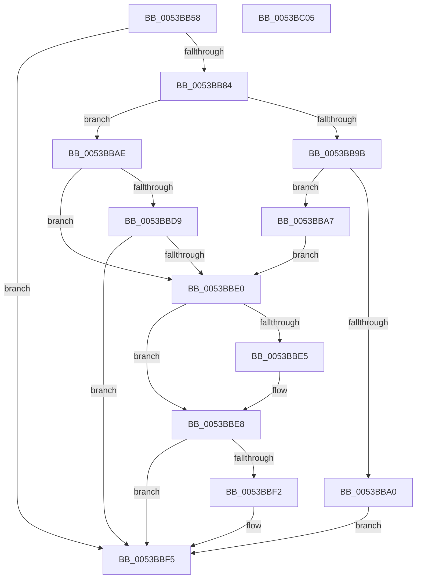

# RtlStringCbCatExA

- RVA: `0x0053BB58`–`0x0053BC06` (길이 `174` bytes)
- VA: `0x000000014053BB58`
- 실행 섹션: `.text`
- PDB 이름 있음: `예`; PDB Function 태그: `아니요`
- unwind 정보 RVA: `0x000A2690`
- 디코드: `50`개 명령, `174/174` bytes 표시
- 미해석 바이트: `0` (있으면 어셈블리에 `.byte`로 보존)

> 이 문서는 커널 이미지의 기계어와 PDB 기호를 분석해 생성했습니다. 4번과 5번은 함수 원형과 자료형을 바이너리 사용 방식에서 추정한 C 해석이며 원본 소스 복구 결과는 아닙니다.

## 1. Dependencies

- 직접 호출 지점: **2**; 고유 호출 대상: **2**
- 직접 호출자로 확인된 함수: **1**
- RIP 상대 이미지 참조: **1**

### Outgoing calls
- `0x0053BB7B` → [RtlStringLengthWorkerA](RtlStringLengthWorkerA_function_0053BF18.md) (function, `0x0053BF18`)
- `0x0053BBC6` → [RtlStringCopyWorkerA](../44/RtlStringCopyWorkerA_function_00448140.md) (function, `0x00448140`)

### Direct callers
- [InitBootProcessor](../../init/C1/InitBootProcessor_function_00C1B1C8.md) at `0x00C1BAFC`

### Static image references
- `0x0053BBB4` → RVA `0x00C78C00` (` ?? ::PBOPGDP::`string'`; read)

## 2. Other-region calls and transfers

- 다른 실행 섹션으로 향하는 call: **0**
- 별도 외부 분기/꼬리 이동을 확인하지 못했습니다.

## 3. Assembly (complete function range)

```asm
0053BB58  48 8B C4                        mov rax, rsp
0053BB5B  48 89 58 08                     mov qword ptr [rax + 8], rbx
0053BB5F  48 89 70 10                     mov qword ptr [rax + 0x10], rsi
0053BB63  4C 89 40 18                     mov qword ptr [rax + 0x18], r8
0053BB67  57                              push rdi
0053BB68  48 83 EC 30                     sub rsp, 0x30
0053BB6C  48 83 60 18 00                  and qword ptr [rax + 0x18], 0
0053BB71  4C 8D 40 18                     lea r8, [rax + 0x18]
0053BB75  49 8B F1                        mov rsi, r9
0053BB78  4C 8B D1                        mov r10, rcx
0053BB7B  E8 98 03 00 00                  call 0x14053bf18
0053BB80  85 C0                           test eax, eax
0053BB82  78 71                           js 0x14053bbf5
0053BB84  48 8B 44 24 50                  mov rax, qword ptr [rsp + 0x50]
0053BB89  BB 00 01 00 00                  mov ebx, 0x100
0053BB8E  48 2B D8                        sub rbx, rax
0053BB91  4A 8D 3C 10                     lea rdi, [rax + r10]
0053BB95  48 83 FB 01                     cmp rbx, 1
0053BB99  77 13                           ja 0x14053bbae
0053BB9B  4D 85 D2                        test r10, r10
0053BB9E  75 07                           jne 0x14053bba7
0053BBA0  B8 0D 00 00 C0                  mov eax, 0xc000000d
0053BBA5  EB 4E                           jmp 0x14053bbf5
0053BBA7  B8 05 00 00 80                  mov eax, 0x80000005
0053BBAC  EB 32                           jmp 0x14053bbe0
0053BBAE  48 83 64 24 50 00               and qword ptr [rsp + 0x50], 0
0053BBB4  4C 8D 0D 45 D0 73 00            lea r9, [rip + 0x73d045]
0053BBBB  4C 8D 44 24 50                  lea r8, [rsp + 0x50]
0053BBC0  48 8B D3                        mov rdx, rbx
0053BBC3  48 8B CF                        mov rcx, rdi
0053BBC6  E8 75 C5 F0 FF                  call 0x140448140
0053BBCB  48 03 7C 24 50                  add rdi, qword ptr [rsp + 0x50]
0053BBD0  48 2B 5C 24 50                  sub rbx, qword ptr [rsp + 0x50]
0053BBD5  85 C0                           test eax, eax
0053BBD7  79 07                           jns 0x14053bbe0
0053BBD9  3D 05 00 00 80                  cmp eax, 0x80000005
0053BBDE  75 15                           jne 0x14053bbf5
0053BBE0  48 85 F6                        test rsi, rsi
0053BBE3  74 03                           je 0x14053bbe8
0053BBE5  48 89 3E                        mov qword ptr [rsi], rdi
0053BBE8  48 8B 4C 24 60                  mov rcx, qword ptr [rsp + 0x60]
0053BBED  48 85 C9                        test rcx, rcx
0053BBF0  74 03                           je 0x14053bbf5
0053BBF2  48 89 19                        mov qword ptr [rcx], rbx
0053BBF5  48 8B 5C 24 40                  mov rbx, qword ptr [rsp + 0x40]
0053BBFA  48 8B 74 24 48                  mov rsi, qword ptr [rsp + 0x48]
0053BBFF  48 83 C4 30                     add rsp, 0x30
0053BC03  5F                              pop rdi
0053BC04  C3                              ret
0053BC05  CC                              int3
```

## 4. C-style interpretation (structured pseudocode)

```c
__int64 __fastcall RtlStringCbCatExA(__int64 a1, __int64 a2, __int64 a3, __int64 a4, __int64 a5)
{
    __int64 result;
    __int64 v_rbx;
    __int64 v_rdi;
    __int64 v_rsp;
    unsigned __int64 v_stack_p10;
    unsigned __int64 v_stack_p18;
    unsigned __int64 v_stack_p8;

    *(unsigned __int64 *)(v_rsp + 8) = v_rbx;
    *(unsigned __int64 *)(v_rsp + 16) = v_rsi;
    *(unsigned __int64 *)(v_rsp + 24) = a3;
    v_rsp = (v_rsp) - (48);
    result = RtlStringLengthWorkerA(a1, a2, v_rsp + 24, a4);
    if (sign_flag) goto loc_0053BBF5;
    v_rbx = (256) - (v_stack_p18);
    if (v_rbx > 1) goto loc_0053BBAE;
    if (a1 != 0) goto loc_0053BBA7;
    goto loc_0053BBF5;
loc_0053BBA7:
    goto loc_0053BBE0;
loc_0053BBAE:
    result = RtlStringCopyWorkerA(v_stack_p18 + a1 * 1, v_rbx, v_stack_p18, v_rip + 7589957);
    v_rdi = (v_stack_p18 + a1 * 1) + (v_stack_p18);
    v_rbx = (v_rbx) - (v_stack_p18);
    if (!sign_flag) goto loc_0053BBE0;
    if (((unsigned int)(result)) != 0x80000005ULL) goto loc_0053BBF5;
loc_0053BBE0:
    if (a4 != 0) {
        *(unsigned __int64 *)(a4) = v_rdi;
    }
    if (a5 != 0) {
        *(unsigned __int64 *)(a5) = v_rbx;
    }
    v_rsp = (v_rsp) + (48);
    return result;
}
```

## 5. (Beta) C Style

```c
int64_t RtlStringCbCatExA(int64_t Arg1, int64_t Arg2, int64_t Arg3, int64_t Arg4, int64_t Arg5)
{
    int64_t result;
    int64_t local_rbx;
    int64_t local_rdi;
    int64_t local_rsp;
    uint64_t v_stack_p10;
    uint64_t v_stack_p18;
    uint64_t v_stack_p8;

    *(uint64_t *)(local_rsp + 0x8) = local_rbx;
    *(uint64_t *)(local_rsp + 0x10) = local_rsi;
    *(uint64_t *)(local_rsp + 0x18) = Arg3;
    local_rsp = (local_rsp) - (48);
    result = RtlStringLengthWorkerA(Arg1, Arg2, local_rsp + 24, Arg4);
    if (sign_flag) goto loc_0053BBF5;
    local_rbx = (256) - (v_stack_p18);
    if (local_rbx > 1) goto loc_0053BBAE;
    if (Arg1 != 0) goto loc_0053BBA7;
    goto loc_0053BBF5;
loc_0053BBA7:
    goto loc_0053BBE0;
loc_0053BBAE:
    result = RtlStringCopyWorkerA(v_stack_p18 + Arg1 * 1, local_rbx, v_stack_p18, v_rip + 7589957);
    local_rdi = (v_stack_p18 + Arg1 * 1) + (v_stack_p18);
    local_rbx = (local_rbx) - (v_stack_p18);
    if (!sign_flag) goto loc_0053BBE0;
    if (((uint32_t)(result)) != 0x80000005ULL) goto loc_0053BBF5;
loc_0053BBE0:
    if (Arg4 != 0) {
        *(uint64_t *)(Arg4) = local_rdi;
    }
    if (Arg5 != 0) {
        *(uint64_t *)(Arg5) = local_rbx;
    }
    local_rsp = (local_rsp) + (48);
    return result;
}
```

## 6. Execution-region graph

[열기: 2D/3D 그래프와 함수 탐색 컨트롤 패널](../../../control-panel.html?section=text&rva=0x0053BB58&view=graph)

- 2D 그래프는 위에서 아래로 흐르고, 3D 그래프는 빈 공간을 드래그해 회전합니다. Shift+드래그는 이동, 휠은 확대·축소, 함수 노드 선택은 대상 보고서 이동입니다.

### Static fallback


