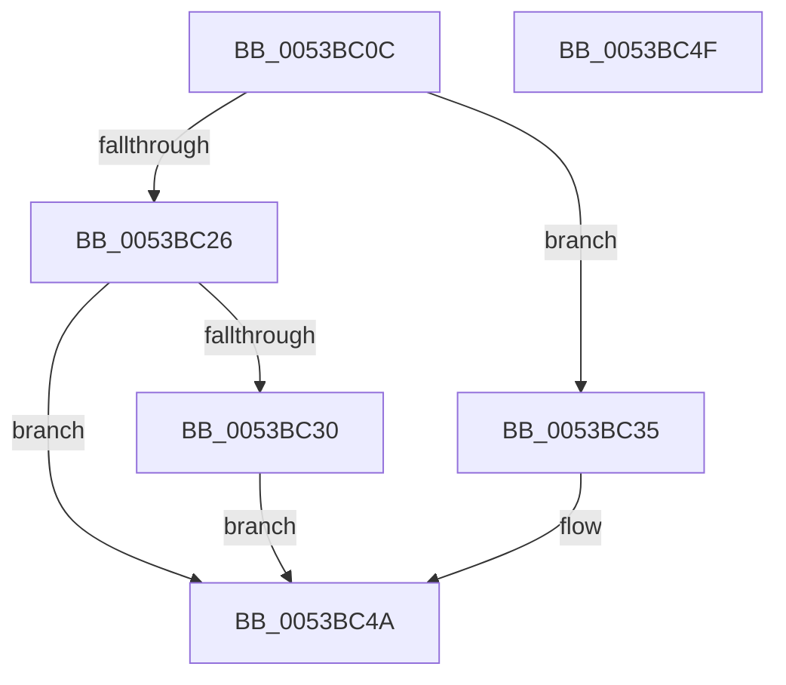

# RtlStringCbPrintfA

- RVA: `0x0053BC0C`–`0x0053BC50` (길이 `68` bytes)
- VA: `0x000000014053BC0C`
- 실행 섹션: `.text`
- PDB 이름 있음: `예`; PDB Function 태그: `아니요`
- unwind 정보 RVA: `0x000C389C`
- 디코드: `19`개 명령, `68/68` bytes 표시
- 미해석 바이트: `0` (있으면 어셈블리에 `.byte`로 보존)

> 이 문서는 커널 이미지의 기계어와 PDB 기호를 분석해 생성했습니다. 4번과 5번은 함수 원형과 자료형을 바이너리 사용 방식에서 추정한 C 해석이며 원본 소스 복구 결과는 아닙니다.

## 1. Dependencies

- 직접 호출 지점: **1**; 고유 호출 대상: **1**
- 직접 호출자로 확인된 함수: **20**
- RIP 상대 이미지 참조: **0**

### Outgoing calls
- `0x0053BC45` → [RtlStringVPrintfWorkerA](RtlStringVPrintfWorkerA_function_0053BF5C.md) (function, `0x0053BF5C`)

### Direct callers
- [RtlpVerCompare](../45/RtlpVerCompare_function_00457A5C.md) at `0x00457ADF`
- [RtlpVerCompare](../45/RtlpVerCompare_function_00457A5C.md) at `0x00457AF8`
- [KiDumpParameterImages](../5B/KiDumpParameterImages_function_005B4CE0.md) at `0x005B4E10`
- [KiDumpParameterImages](../5B/KiDumpParameterImages_function_005B4CE0.md) at `0x005B4EFF`
- [ViErrorReport1](../61/ViErrorReport1_function_00614584.md) at `0x006145C4`
- [ViErrorReport10](../61/ViErrorReport10_function_00614608.md) at `0x00614654`
- [ViErrorReport4](../61/ViErrorReport4_function_0061469C.md) at `0x006146F7`
- [ViErrorReport6](../61/ViErrorReport6_function_00614740.md) at `0x0061478B`
- [ExpSystemErrorHandler2](../../pagelk/B7/ExpSystemErrorHandler2_function_00B72C30.md) at `0x00B73030`
- [ExpSystemErrorHandler2](../../pagelk/B7/ExpSystemErrorHandler2_function_00B72C30.md) at `0x00B73073`
- [ExpSystemErrorHandler2](../../pagelk/B7/ExpSystemErrorHandler2_function_00B72C30.md) at `0x00B7315C`
- [ExpSystemErrorHandler2](../../pagelk/B7/ExpSystemErrorHandler2_function_00B72C30.md) at `0x00B731D4`
- [ViGenericVerifyIrpStackDownward](../../pagevrfy/B9/ViGenericVerifyIrpStackDownward_function_00B93F90.md) at `0x00B9407F`
- [ViGenericVerifyNewIrp](../../pagevrfy/B9/ViGenericVerifyNewIrp_function_00B94260.md) at `0x00B94312`
- [VfIoDeleteDevice](../../pagevrfy/BA/VfIoDeleteDevice_function_00BA221C.md) at `0x00BA2289`
- [VfIoDeleteDevice](../../pagevrfy/BA/VfIoDeleteDevice_function_00BA221C.md) at `0x00BA22E1`
- [VfIoDetachDevice](../../pagevrfy/BA/VfIoDetachDevice_function_00BA234C.md) at `0x00BA239B`
- [VfErrorReport7](../../pagevrfy/BA/VfErrorReport7_function_00BA34B0.md) at `0x00BA34FE`
- [VfErrorReport8](../../pagevrfy/BA/VfErrorReport8_function_00BA3548.md) at `0x00BA358B`
- [VerifierNtCreateFile](../../pagevrfy/BB/VerifierNtCreateFile_function_00BB10A0.md) at `0x00BB1117`
- [VerifierNtReadFile](../../pagevrfy/BB/VerifierNtReadFile_function_00BB1250.md) at `0x00BB12DF`
- [VerifierNtWriteFile](../../pagevrfy/BB/VerifierNtWriteFile_function_00BB13A0.md) at `0x00BB142F`
- [InitBootProcessor](../../init/C1/InitBootProcessor_function_00C1B1C8.md) at `0x00C1BAB2`
- [InitBootProcessor](../../init/C1/InitBootProcessor_function_00C1B1C8.md) at `0x00C1BB37`
- [InitBootProcessor](../../init/C1/InitBootProcessor_function_00C1B1C8.md) at `0x00C1BC30`
- [InitLoadDebuggerSymbols](../../init/C1/InitLoadDebuggerSymbols_function_00C1BEB0.md) at `0x00C1BFB0`
- [Phase1InitializationDiscard](../../init/C1/Phase1InitializationDiscard_function_00C1C728.md) at `0x00C1CC49`
- [Phase1InitializationDiscard](../../init/C1/Phase1InitializationDiscard_function_00C1C728.md) at `0x00C1CC99`
- [Phase1InitializationDiscard](../../init/C1/Phase1InitializationDiscard_function_00C1C728.md) at `0x00C1D181`
- [RamdiskCreateSymbolicLink](../../init/C6/RamdiskCreateSymbolicLink_function_00C6EDB8.md) at `0x00C6EE3C`

### Static image references
- 디코드된 RIP-relative 메모리 참조가 없습니다.

## 2. Other-region calls and transfers

- 다른 실행 섹션으로 향하는 call: **0**
- 별도 외부 분기/꼬리 이동을 확인하지 못했습니다.

## 3. Assembly (complete function range)

```asm
0053BC0C  4C 89 44 24 18                  mov qword ptr [rsp + 0x18], r8
0053BC11  4C 89 4C 24 20                  mov qword ptr [rsp + 0x20], r9
0053BC16  48 83 EC 48                     sub rsp, 0x48
0053BC1A  48 8D 42 FF                     lea rax, [rdx - 1]
0053BC1E  48 3D FE FF FF 7F               cmp rax, 0x7ffffffe
0053BC24  76 0F                           jbe 0x14053bc35
0053BC26  B8 0D 00 00 C0                  mov eax, 0xc000000d
0053BC2B  48 85 D2                        test rdx, rdx
0053BC2E  74 1A                           je 0x14053bc4a
0053BC30  C6 01 00                        mov byte ptr [rcx], 0
0053BC33  EB 15                           jmp 0x14053bc4a
0053BC35  48 8D 44 24 68                  lea rax, [rsp + 0x68]
0053BC3A  4D 8B C8                        mov r9, r8
0053BC3D  45 33 C0                        xor r8d, r8d
0053BC40  48 89 44 24 20                  mov qword ptr [rsp + 0x20], rax
0053BC45  E8 12 03 00 00                  call 0x14053bf5c
0053BC4A  48 83 C4 48                     add rsp, 0x48
0053BC4E  C3                              ret
0053BC4F  CC                              int3
```

## 4. C-style interpretation (structured pseudocode)

```c
__int64 __fastcall RtlStringCbPrintfA(__int64 a1, __int64 a2, __int64 a3, __int64 a4)
{
    __int64 result;
    __int64 v_rsp;
    unsigned __int64 v_stack_m28;
    unsigned __int64 v_stack_p18;
    unsigned __int64 v_stack_p20;

    v_stack_p18 = a3;
    v_stack_p20 = a4;
    v_rsp = (v_rsp) - (72);
    if ((a2 - 1) <= 0x7FFFFFFEULL) goto loc_0053BC35;
    if (a2 == 0) goto loc_0053BC4A;
    *(unsigned __int8 *)(a1) = 0;
    goto loc_0053BC4A;
loc_0053BC35:
    a3 = 0;
    v_stack_m28 = v_stack_p20;
    result = RtlStringVPrintfWorkerA(a1, a2, a3, a3);
loc_0053BC4A:
    v_rsp = (v_rsp) + (72);
    return result;
}
```

## 5. (Beta) C Style

```c
int64_t RtlStringCbPrintfA(void *Arg1, void *Arg2, int64_t Arg3, int64_t Arg4)
{
    uint8_t *arg1 = (uint8_t *)Arg1;
    uint8_t *arg2 = (uint8_t *)Arg2;

    int64_t result;
    int64_t local_rsp;
    uint64_t v_stack_m28;
    uint64_t v_stack_p18;
    uint64_t v_stack_p20;

    v_stack_p18 = Arg3;
    v_stack_p20 = Arg4;
    local_rsp = (local_rsp) - (72);
    if ((Arg2 - 1) <= 0x7FFFFFFEULL) goto loc_0053BC35;
    if (Arg2 == NULL) goto loc_0053BC4A;
    *(uint8_t *)(arg1) = 0;
    goto loc_0053BC4A;
loc_0053BC35:
    Arg3 = 0;
    v_stack_m28 = v_stack_p20;
    result = RtlStringVPrintfWorkerA(Arg1, Arg2, Arg3, Arg3);
loc_0053BC4A:
    local_rsp = (local_rsp) + (72);
    return result;
}
```

### 관측된 메모리 오프셋

구조체 형식이 확인되지 않은 접근은 인자 기준의 오프셋으로만 기록했습니다.

| 기준 인자 | 오프셋 표현 | 폭 (bit) | 접근 |
|---|---:|---:|---|
| `Arg1` | `+ 0x0` | `8` | `W` |
| `Arg2` | `- 0x1` | `64` | `R` |

## 6. Execution-region graph

[열기: 2D/3D 그래프와 함수 탐색 컨트롤 패널](../../../control-panel.html?section=text&rva=0x0053BC0C&view=graph)

- 2D 그래프는 위에서 아래로 흐르고, 3D 그래프는 빈 공간을 드래그해 회전합니다. Shift+드래그는 이동, 휠은 확대·축소, 함수 노드 선택은 대상 보고서 이동입니다.

### Static fallback


