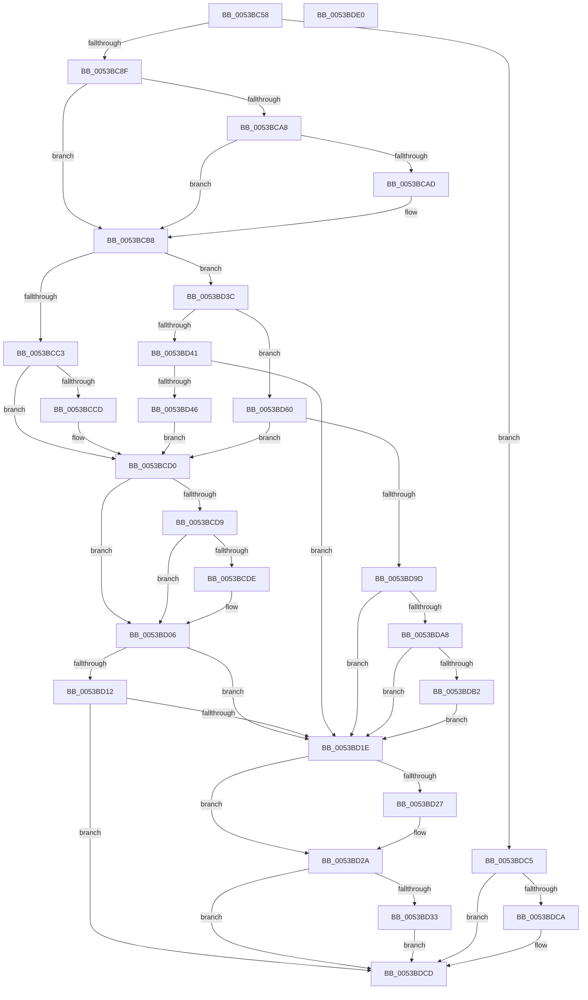

# RtlStringCbPrintfExA

- RVA: `0x0053BC58`–`0x0053BDE1` (길이 `393` bytes)
- VA: `0x000000014053BC58`
- 실행 섹션: `.text`
- PDB 이름 있음: `예`; PDB Function 태그: `아니요`
- unwind 정보 RVA: `0x000C3880`
- 디코드: `117`개 명령, `393/393` bytes 표시
- 미해석 바이트: `0` (있으면 어셈블리에 `.byte`로 보존)

> 이 문서는 커널 이미지의 기계어와 PDB 기호를 분석해 생성했습니다. 4번과 5번은 함수 원형과 자료형을 바이너리 사용 방식에서 추정한 C 해석이며 원본 소스 복구 결과는 아닙니다.

## 1. Dependencies

- 직접 호출 지점: **4**; 고유 호출 대상: **4**
- 직접 호출자로 확인된 함수: **2**
- RIP 상대 이미지 참조: **1**

### Outgoing calls
- `0x0053BC80` → [RtlStringExValidateDestA](RtlStringExValidateDestA_function_0053BED8.md) (function, `0x0053BED8`)
- `0x0053BCF9` → [RtlStringExHandleOtherFlagsA](RtlStringExHandleOtherFlagsA_function_0053BE14.md) (function, `0x0053BE14`)
- `0x0053BD7B` → [RtlStringVPrintfWorkerA](RtlStringVPrintfWorkerA_function_0053BF5C.md) (function, `0x0053BF5C`)
- `0x0053BDBB` → [RtlStringExHandleFillBehindNullA](RtlStringExHandleFillBehindNullA_function_0053BDE8.md) (function, `0x0053BDE8`)

### Direct callers
- [KiDisplayBlueScreen](../5B/KiDisplayBlueScreen_function_005B494C.md) at `0x005B4AD7`
- [Phase1InitializationDiscard](../../init/C1/Phase1InitializationDiscard_function_00C1C728.md) at `0x00C1CBEC`

### Static image references
- `0x0053BCAD` → RVA `0x006C7800` (` ?? ::FNODOBFM::`string'`; read)

## 2. Other-region calls and transfers

- 다른 실행 섹션으로 향하는 call: **0**
- 별도 외부 분기/꼬리 이동을 확인하지 못했습니다.

## 3. Assembly (complete function range)

```asm
0053BC58  4C 89 44 24 18                  mov qword ptr [rsp + 0x18], r8
0053BC5D  55                              push rbp
0053BC5E  53                              push rbx
0053BC5F  56                              push rsi
0053BC60  57                              push rdi
0053BC61  41 54                           push r12
0053BC63  41 55                           push r13
0053BC65  41 56                           push r14
0053BC67  41 57                           push r15
0053BC69  48 8B EC                        mov rbp, rsp
0053BC6C  48 83 EC 48                     sub rsp, 0x48
0053BC70  44 8B 7D 68                     mov r15d, dword ptr [rbp + 0x68]
0053BC74  4D 8B E9                        mov r13, r9
0053BC77  45 8B CF                        mov r9d, r15d
0053BC7A  48 8B FA                        mov rdi, rdx
0053BC7D  48 8B F1                        mov rsi, rcx
0053BC80  E8 53 02 00 00                  call 0x14053bed8
0053BC85  8B D8                           mov ebx, eax
0053BC87  85 C0                           test eax, eax
0053BC89  0F 88 36 01 00 00               js 0x14053bdc5
0053BC8F  4C 8B 4D 70                     mov r9, qword ptr [rbp + 0x70]
0053BC93  4C 8B E6                        mov r12, rsi
0053BC96  48 89 75 E8                     mov qword ptr [rbp - 0x18], rsi
0053BC9A  4C 8B F7                        mov r14, rdi
0053BC9D  48 89 7D F0                     mov qword ptr [rbp - 0x10], rdi
0053BCA1  41 0F BA E7 08                  bt r15d, 8
0053BCA6  73 10                           jae 0x14053bcb8
0053BCA8  4D 85 C9                        test r9, r9
0053BCAB  75 0B                           jne 0x14053bcb8
0053BCAD  4C 8D 0D 4C BB 18 00            lea r9, [rip + 0x18bb4c]
0053BCB4  4C 89 4D 70                     mov qword ptr [rbp + 0x70], r9
0053BCB8  33 DB                           xor ebx, ebx
0053BCBA  41 F7 C7 00 E0 FF FF            test r15d, 0xffffe000
0053BCC1  74 79                           je 0x14053bd3c
0053BCC3  BB 0D 00 00 C0                  mov ebx, 0xc000000d
0053BCC8  48 85 FF                        test rdi, rdi
0053BCCB  74 03                           je 0x14053bcd0
0053BCCD  C6 06 00                        mov byte ptr [rsi], 0
0053BCD0  41 F7 C7 00 1C 00 00            test r15d, 0x1c00
0053BCD7  74 2D                           je 0x14053bd06
0053BCD9  48 85 FF                        test rdi, rdi
0053BCDC  74 28                           je 0x14053bd06
0053BCDE  48 8D 45 F0                     lea rax, [rbp - 0x10]
0053BCE2  44 89 7C 24 28                  mov dword ptr [rsp + 0x28], r15d
0053BCE7  4C 8D 4D E8                     lea r9, [rbp - 0x18]
0053BCEB  48 89 44 24 20                  mov qword ptr [rsp + 0x20], rax
0053BCF0  45 33 C0                        xor r8d, r8d
0053BCF3  48 8B D7                        mov rdx, rdi
0053BCF6  48 8B CE                        mov rcx, rsi
0053BCF9  E8 16 01 00 00                  call 0x14053be14
0053BCFE  4C 8B 65 E8                     mov r12, qword ptr [rbp - 0x18]
0053BD02  4C 8B 75 F0                     mov r14, qword ptr [rbp - 0x10]
0053BD06  B9 00 00 00 80                  mov ecx, 0x80000000
0053BD0B  8D 04 0B                        lea eax, [rbx + rcx]
0053BD0E  85 C1                           test ecx, eax
0053BD10  75 0C                           jne 0x14053bd1e
0053BD12  81 FB 05 00 00 80               cmp ebx, 0x80000005
0053BD18  0F 85 AF 00 00 00               jne 0x14053bdcd
0053BD1E  48 8B 45 58                     mov rax, qword ptr [rbp + 0x58]
0053BD22  48 85 C0                        test rax, rax
0053BD25  74 03                           je 0x14053bd2a
0053BD27  4C 89 20                        mov qword ptr [rax], r12
0053BD2A  4D 85 ED                        test r13, r13
0053BD2D  0F 84 9A 00 00 00               je 0x14053bdcd
0053BD33  4D 89 75 00                     mov qword ptr [r13], r14
0053BD37  E9 91 00 00 00                  jmp 0x14053bdcd
0053BD3C  48 85 FF                        test rdi, rdi
0053BD3F  75 1F                           jne 0x14053bd60
0053BD41  41 38 19                        cmp byte ptr [r9], bl
0053BD44  74 D8                           je 0x14053bd1e
0053BD46  48 8B C6                        mov rax, rsi
0053BD49  BB 0D 00 00 C0                  mov ebx, 0xc000000d
0053BD4E  48 F7 D8                        neg rax
0053BD51  1B C9                           sbb ecx, ecx
0053BD53  81 E1 F8 FF FF BF               and ecx, 0xbffffff8
0053BD59  03 D9                           add ebx, ecx
0053BD5B  E9 70 FF FF FF                  jmp 0x14053bcd0
0053BD60  48 21 5D F0                     and qword ptr [rbp - 0x10], rbx
0053BD64  48 8D 45 78                     lea rax, [rbp + 0x78]
0053BD68  48 21 5D E8                     and qword ptr [rbp - 0x18], rbx
0053BD6C  4C 8D 45 F0                     lea r8, [rbp - 0x10]
0053BD70  48 8B D7                        mov rdx, rdi
0053BD73  48 89 44 24 20                  mov qword ptr [rsp + 0x20], rax
0053BD78  48 8B CE                        mov rcx, rsi
0053BD7B  E8 DC 01 00 00                  call 0x14053bf5c
0053BD80  8B D8                           mov ebx, eax
0053BD82  48 8B 45 F0                     mov rax, qword ptr [rbp - 0x10]
0053BD86  4C 2B F0                        sub r14, rax
0053BD89  4C 89 75 F0                     mov qword ptr [rbp - 0x10], r14
0053BD8D  4C 8D 24 30                     lea r12, [rax + rsi]
0053BD91  4C 89 65 E8                     mov qword ptr [rbp - 0x18], r12
0053BD95  85 DB                           test ebx, ebx
0053BD97  0F 88 33 FF FF FF               js 0x14053bcd0
0053BD9D  41 0F BA E7 09                  bt r15d, 9
0053BDA2  0F 83 76 FF FF FF               jae 0x14053bd1e
0053BDA8  49 83 FE 01                     cmp r14, 1
0053BDAC  0F 86 6C FF FF FF               jbe 0x14053bd1e
0053BDB2  45 8B C7                        mov r8d, r15d
0053BDB5  49 8B D6                        mov rdx, r14
0053BDB8  49 8B CC                        mov rcx, r12
0053BDBB  E8 28 00 00 00                  call 0x14053bde8
0053BDC0  E9 59 FF FF FF                  jmp 0x14053bd1e
0053BDC5  48 85 FF                        test rdi, rdi
0053BDC8  74 03                           je 0x14053bdcd
0053BDCA  C6 06 00                        mov byte ptr [rsi], 0
0053BDCD  8B C3                           mov eax, ebx
0053BDCF  48 83 C4 48                     add rsp, 0x48
0053BDD3  41 5F                           pop r15
0053BDD5  41 5E                           pop r14
0053BDD7  41 5D                           pop r13
0053BDD9  41 5C                           pop r12
0053BDDB  5F                              pop rdi
0053BDDC  5E                              pop rsi
0053BDDD  5B                              pop rbx
0053BDDE  5D                              pop rbp
0053BDDF  C3                              ret
0053BDE0  CC                              int3
```

## 4. C-style interpretation (structured pseudocode)

```c
__int64 __fastcall RtlStringCbPrintfExA(__int64 a1, __int64 a2, __int64 a3, __int64 a4, unsigned int a5, __int64 a6, __int64 a7)
{
    __int64 result;
    __int64 v_r12;
    __int64 v_r14;
    __int64 v_rbx;
    __int64 v_rsp;
    unsigned __int64 v_stack_m50;
    unsigned __int64 v_stack_m58;
    unsigned int v_stack_m60;
    unsigned __int64 v_stack_m68;
    unsigned __int64 v_stack_p18;
    unsigned __int64 v_stack_p30;

    v_stack_p18 = a3;
    v_rsp = (v_rsp) - (72);
    result = RtlStringExValidateDestA(a1, a2, a3, (unsigned int)((unsigned int)((unsigned int)(a5))));
    if (sign_flag) goto loc_0053BDC5;
    v_stack_m58 = a1;
    v_stack_m50 = a2;
    if (condition_is_above_or_equal) goto loc_0053BCB8;
    if (a6 == 0) {
        a4 = v_rip + 1620812;
        v_stack_p30 = a4;
    }
    v_rbx = 0;
    if ((((unsigned int)((unsigned int)(a5))) & (0xFFFFE000ULL)) == 0) goto loc_0053BD3C;
    if (a2 != 0) {
        *(unsigned __int8 *)(a1) = 0;
    }
    if ((((unsigned int)((unsigned int)(a5))) & (0x1C00ULL)) == 0) goto loc_0053BD06;
    v_r12 = a1;
    v_r14 = a2;
    if (a2 != 0) {
        result = v_stack_m50;
        v_stack_m60 = (unsigned int)((unsigned int)(a5));
        a4 = v_stack_m58;
        v_stack_m68 = result;
        a3 = 0;
        a2 = a2;
        a1 = a1;
        result = RtlStringExHandleOtherFlagsA(a1, a2, a3, a4);
        v_r12 = v_stack_m58;
        v_r14 = v_stack_m50;
    }
    if ((((unsigned int)((unsigned int)(0x80000000ULL))) & ((unsigned int)((unsigned int)(0xC000000DULL) + (unsigned int)(0x80000000ULL) * 1))) != 0) goto loc_0053BD1E;
    if (((unsigned int)((unsigned int)(0xC000000DULL))) != 0x80000005ULL) goto loc_0053BDCD;
loc_0053BD1E:
    if (v_stack_p18 != 0) {
        *(unsigned __int64 *)(v_stack_p18) = v_r12;
    }
    if (a4 == 0) goto loc_0053BDCD;
    *(unsigned __int64 *)(a4) = v_r14;
    goto loc_0053BDCD;
loc_0053BD3C:
    if (a2 != 0) goto loc_0053BD60;
    if ((*(unsigned __int8 *)(a4)) == ((unsigned __int8)((unsigned int)(0xC000000DULL)))) goto loc_0053BD1E;
    result = -(a1);
    a1 = (unsigned int)(((unsigned int)(0x80000000ULL)) & (0xBFFFFFF8ULL));
    v_rbx = (unsigned int)(((unsigned int)(0xC000000DULL)) + ((unsigned int)(a1)));
    goto loc_0053BCD0;
loc_0053BD60:
    v_stack_m68 = a7;
    result = RtlStringVPrintfWorkerA(a1, a2, v_stack_m50, a4);
    v_r14 = (v_r14) - (v_stack_m50);
    v_stack_m50 = v_r14;
    v_stack_m58 = v_stack_m50 + a1 * 1;
    if (sign_flag) goto loc_0053BCD0;
    if (condition_is_above_or_equal) goto loc_0053BD1E;
    if (v_r14 <= 1) goto loc_0053BD1E;
    result = RtlStringExHandleFillBehindNullA(v_stack_m50 + a1 * 1, v_r14, (unsigned int)((unsigned int)((unsigned int)(a5))), a4);
    goto loc_0053BD1E;
loc_0053BDC5:
    if (a2 != 0) {
        *(unsigned __int8 *)(a1) = 0;
    }
    v_rsp = (v_rsp) + (72);
    return (unsigned int)((unsigned int)((unsigned int)((unsigned int)(result))));
}
```

## 5. (Beta) C Style

```c
int64_t RtlStringCbPrintfExA(void *Arg1, int64_t Arg2, int64_t Arg3, int64_t Arg4, uint32_t Arg5, int64_t Arg6, int64_t Arg7)
{
    uint8_t *arg1 = (uint8_t *)Arg1;

    int64_t result;
    int64_t local_r12;
    int64_t local_r14;
    int64_t local_rbx;
    int64_t local_rsp;
    uint64_t v_stack_m50;
    uint64_t v_stack_m58;
    uint32_t v_stack_m60;
    uint64_t v_stack_m68;
    uint64_t v_stack_p18;
    uint64_t v_stack_p30;

    v_stack_p18 = Arg3;
    local_rsp = (local_rsp) - (72);
    result = RtlStringExValidateDestA(Arg1, Arg2, Arg3, (uint32_t)((uint32_t)((uint32_t)(Arg5))));
    if (sign_flag) goto loc_0053BDC5;
    v_stack_m58 = Arg1;
    v_stack_m50 = Arg2;
    if (condition_is_above_or_equal) goto loc_0053BCB8;
    if (Arg6 == 0) {
        Arg4 = v_rip + 1620812;
        v_stack_p30 = Arg4;
    }
    local_rbx = 0;
    if ((((uint32_t)((uint32_t)(Arg5))) & (0xFFFFE000ULL)) == 0) goto loc_0053BD3C;
    if (Arg2 != 0) {
        *(uint8_t *)(arg1) = 0;
    }
    if ((((uint32_t)((uint32_t)(Arg5))) & (0x1C00ULL)) == 0) goto loc_0053BD06;
    local_r12 = Arg1;
    local_r14 = Arg2;
    if (Arg2 != 0) {
        result = v_stack_m50;
        v_stack_m60 = (uint32_t)((uint32_t)(Arg5));
        Arg4 = v_stack_m58;
        v_stack_m68 = result;
        Arg3 = 0;
        Arg2 = Arg2;
        Arg1 = Arg1;
        result = RtlStringExHandleOtherFlagsA(Arg1, Arg2, Arg3, Arg4);
        local_r12 = v_stack_m58;
        local_r14 = v_stack_m50;
    }
    if ((((uint32_t)((uint32_t)(0x80000000ULL))) & ((uint32_t)((uint32_t)(0xC000000DULL) + (uint32_t)(0x80000000ULL) * 1))) != 0) goto loc_0053BD1E;
    if (((uint32_t)((uint32_t)(0xC000000DULL))) != 0x80000005ULL) goto loc_0053BDCD;
loc_0053BD1E:
    if (v_stack_p18 != 0) {
        *(uint64_t *)(v_stack_p18) = local_r12;
    }
    if (Arg4 == 0) goto loc_0053BDCD;
    *(uint64_t *)(Arg4) = local_r14;
    goto loc_0053BDCD;
loc_0053BD3C:
    if (Arg2 != 0) goto loc_0053BD60;
    if ((*(uint8_t *)(Arg4)) == ((uint8_t)((uint32_t)(0xC000000DULL)))) goto loc_0053BD1E;
    result = -(Arg1);
    Arg1 = (uint32_t)(((uint32_t)(0x80000000ULL)) & (0xBFFFFFF8ULL));
    local_rbx = (uint32_t)(((uint32_t)(0xC000000DULL)) + ((uint32_t)(Arg1)));
    goto loc_0053BCD0;
loc_0053BD60:
    v_stack_m68 = Arg7;
    result = RtlStringVPrintfWorkerA(Arg1, Arg2, v_stack_m50, Arg4);
    local_r14 = (local_r14) - (v_stack_m50);
    v_stack_m50 = local_r14;
    v_stack_m58 = v_stack_m50 + Arg1 * 1;
    if (sign_flag) goto loc_0053BCD0;
    if (condition_is_above_or_equal) goto loc_0053BD1E;
    if (local_r14 <= 1) goto loc_0053BD1E;
    result = RtlStringExHandleFillBehindNullA(v_stack_m50 + Arg1 * 1, local_r14, (uint32_t)((uint32_t)((uint32_t)(Arg5))), Arg4);
    goto loc_0053BD1E;
loc_0053BDC5:
    if (Arg2 != 0) {
        *(uint8_t *)(arg1) = 0;
    }
    local_rsp = (local_rsp) + (72);
    return (uint32_t)((uint32_t)((uint32_t)((uint32_t)(result))));
}
```

### 관측된 메모리 오프셋

구조체 형식이 확인되지 않은 접근은 인자 기준의 오프셋으로만 기록했습니다.

| 기준 인자 | 오프셋 표현 | 폭 (bit) | 접근 |
|---|---:|---:|---|
| `Arg1` | `+ 0x0` | `8` | `W` |

## 6. Execution-region graph

[열기: 2D/3D 그래프와 함수 탐색 컨트롤 패널](../../../control-panel.html?section=text&rva=0x0053BC58&view=graph)

- 2D 그래프는 위에서 아래로 흐르고, 3D 그래프는 빈 공간을 드래그해 회전합니다. Shift+드래그는 이동, 휠은 확대·축소, 함수 노드 선택은 대상 보고서 이동입니다.

### Static fallback


