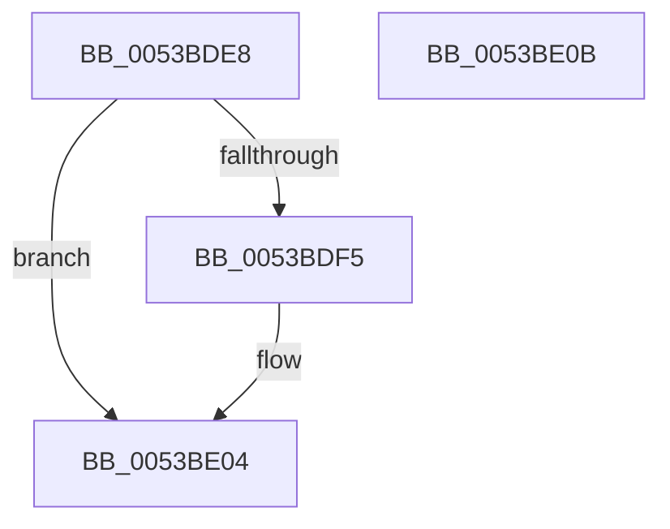

# RtlStringExHandleFillBehindNullA

- RVA: `0x0053BDE8`–`0x0053BE0C` (길이 `36` bytes)
- VA: `0x000000014053BDE8`
- 실행 섹션: `.text`
- PDB 이름 있음: `예`; PDB Function 태그: `예`
- unwind 정보 RVA: `0x0005C788`
- 디코드: `12`개 명령, `36/36` bytes 표시
- 미해석 바이트: `0` (있으면 어셈블리에 `.byte`로 보존)

> 이 문서는 커널 이미지의 기계어와 PDB 기호를 분석해 생성했습니다. 4번과 5번은 함수 원형과 자료형을 바이너리 사용 방식에서 추정한 C 해석이며 원본 소스 복구 결과는 아닙니다.

## 1. Dependencies

- 직접 호출 지점: **1**; 고유 호출 대상: **1**
- 직접 호출자로 확인된 함수: **1**
- RIP 상대 이미지 참조: **0**

### Outgoing calls
- `0x0053BDFF` → [memset](../6C/memset_function_006C6C40.md) (function, `0x006C6C40`)

### Direct callers
- [RtlStringCbPrintfExA](RtlStringCbPrintfExA_function_0053BC58.md) at `0x0053BDBB`

### Static image references
- 디코드된 RIP-relative 메모리 참조가 없습니다.

## 2. Other-region calls and transfers

- 다른 실행 섹션으로 향하는 call: **0**
- 별도 외부 분기/꼬리 이동을 확인하지 못했습니다.

## 3. Assembly (complete function range)

```asm
0053BDE8  48 83 EC 28                     sub rsp, 0x28
0053BDEC  41 8B C0                        mov eax, r8d
0053BDEF  48 83 FA 01                     cmp rdx, 1
0053BDF3  76 0F                           jbe 0x14053be04
0053BDF5  4C 8D 42 FF                     lea r8, [rdx - 1]
0053BDF9  48 FF C1                        inc rcx
0053BDFC  0F B6 D0                        movzx edx, al
0053BDFF  E8 3C AE 18 00                  call 0x1406c6c40
0053BE04  33 C0                           xor eax, eax
0053BE06  48 83 C4 28                     add rsp, 0x28
0053BE0A  C3                              ret
0053BE0B  CC                              int3
```

## 4. C-style interpretation (structured pseudocode)

```c
__int64 __fastcall RtlStringExHandleFillBehindNullA(__int64 a1, __int64 a2, int a3)
{
    __int64 result;
    __int64 v_rsp;

    v_rsp = (v_rsp) - (40);
    result = (unsigned int)(a3);
    if (a2 >= = 1) {
        a3 = a2 - 1;
        a1 = (a1) + 1;
        a2 = (unsigned __int8)((unsigned int)(a3));
        result = memset(a1, a2, a3, a4);
    }
    result = 0;
    v_rsp = (v_rsp) + (40);
    return result;
}
```

## 5. (Beta) C Style

```c
int64_t RtlStringExHandleFillBehindNullA(int64_t Arg1, int64_t Arg2, int32_t Arg3)
{
    int64_t result;
    int64_t local_rsp;

    local_rsp = (local_rsp) - (40);
    result = (uint32_t)(Arg3);
    if (Arg2 >= = 1) {
        Arg3 = Arg2 - 1;
        Arg1 = (Arg1) + 1;
        Arg2 = (uint8_t)((uint32_t)(Arg3));
        result = memset(Arg1, Arg2, Arg3, a4);
    }
    result = 0;
    local_rsp = (local_rsp) + (40);
    return result;
}
```

## 6. Execution-region graph

[열기: 2D/3D 그래프와 함수 탐색 컨트롤 패널](../../../control-panel.html?section=text&rva=0x0053BDE8&view=graph)

- 2D 그래프는 위에서 아래로 흐르고, 3D 그래프는 빈 공간을 드래그해 회전합니다. Shift+드래그는 이동, 휠은 확대·축소, 함수 노드 선택은 대상 보고서 이동입니다.

### Static fallback


