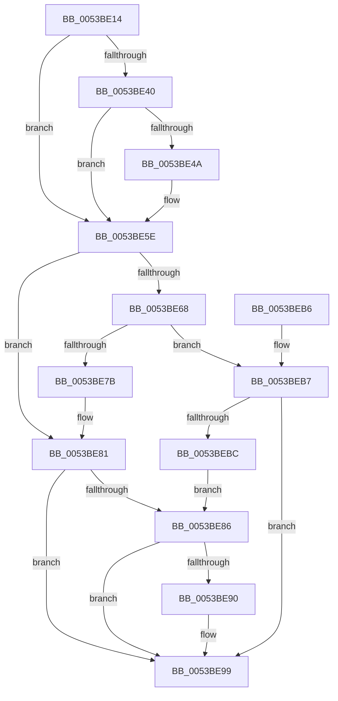

# RtlStringExHandleOtherFlagsA

- RVA: `0x0053BE14`–`0x0053BED2` (길이 `190` bytes)
- VA: `0x000000014053BE14`
- 실행 섹션: `.text`
- PDB 이름 있음: `예`; PDB Function 태그: `예`
- unwind 정보 RVA: `0x000C3864`
- 디코드: `55`개 명령, `190/190` bytes 표시
- 미해석 바이트: `0` (있으면 어셈블리에 `.byte`로 보존)

> 이 문서는 커널 이미지의 기계어와 PDB 기호를 분석해 생성했습니다. 4번과 5번은 함수 원형과 자료형을 바이너리 사용 방식에서 추정한 C 해석이며 원본 소스 복구 결과는 아닙니다.

## 1. Dependencies

- 직접 호출 지점: **1**; 고유 호출 대상: **1**
- 직접 호출자로 확인된 함수: **1**
- RIP 상대 이미지 참조: **0**

### Outgoing calls
- `0x0053BE72` → [memset](../6C/memset_function_006C6C40.md) (function, `0x006C6C40`)

### Direct callers
- [RtlStringCbPrintfExA](RtlStringCbPrintfExA_function_0053BC58.md) at `0x0053BCF9`

### Static image references
- 디코드된 RIP-relative 메모리 참조가 없습니다.

## 2. Other-region calls and transfers

- 다른 실행 섹션으로 향하는 call: **0**
- 별도 외부 분기/꼬리 이동을 확인하지 못했습니다.

## 3. Assembly (complete function range)

```asm
0053BE14  48 8B C4                        mov rax, rsp
0053BE17  48 89 58 08                     mov qword ptr [rax + 8], rbx
0053BE1B  48 89 70 10                     mov qword ptr [rax + 0x10], rsi
0053BE1F  48 89 78 18                     mov qword ptr [rax + 0x18], rdi
0053BE23  4C 89 70 20                     mov qword ptr [rax + 0x20], r14
0053BE27  41 57                           push r15
0053BE29  48 83 EC 20                     sub rsp, 0x20
0053BE2D  4C 8B 7C 24 50                  mov r15, qword ptr [rsp + 0x50]
0053BE32  4D 8B F1                        mov r14, r9
0053BE35  48 8B FA                        mov rdi, rdx
0053BE38  48 8B F1                        mov rsi, rcx
0053BE3B  48 85 D2                        test rdx, rdx
0053BE3E  74 1E                           je 0x14053be5e
0053BE40  F7 44 24 58 00 10 00 00         test dword ptr [rsp + 0x58], 0x1000
0053BE48  74 14                           je 0x14053be5e
0053BE4A  4E 8D 0C 01                     lea r9, [rcx + r8]
0053BE4E  48 8B C2                        mov rax, rdx
0053BE51  49 2B C0                        sub rax, r8
0053BE54  4D 89 0E                        mov qword ptr [r14], r9
0053BE57  49 89 07                        mov qword ptr [r15], rax
0053BE5A  41 C6 01 00                     mov byte ptr [r9], 0
0053BE5E  F7 44 24 58 00 04 00 00         test dword ptr [rsp + 0x58], 0x400
0053BE66  74 19                           je 0x14053be81
0053BE68  0F B6 5C 24 58                  movzx ebx, byte ptr [rsp + 0x58]
0053BE6D  4C 8B C7                        mov r8, rdi
0053BE70  8B D3                           mov edx, ebx
0053BE72  E8 C9 AD 18 00                  call 0x1406c6c40
0053BE77  85 DB                           test ebx, ebx
0053BE79  75 3C                           jne 0x14053beb7
0053BE7B  49 89 36                        mov qword ptr [r14], rsi
0053BE7E  49 89 3F                        mov qword ptr [r15], rdi
0053BE81  48 85 FF                        test rdi, rdi
0053BE84  74 13                           je 0x14053be99
0053BE86  F7 44 24 58 00 08 00 00         test dword ptr [rsp + 0x58], 0x800
0053BE8E  74 09                           je 0x14053be99
0053BE90  49 89 36                        mov qword ptr [r14], rsi
0053BE93  49 89 3F                        mov qword ptr [r15], rdi
0053BE96  C6 06 00                        mov byte ptr [rsi], 0
0053BE99  48 8B 5C 24 30                  mov rbx, qword ptr [rsp + 0x30]
0053BE9E  33 C0                           xor eax, eax
0053BEA0  48 8B 74 24 38                  mov rsi, qword ptr [rsp + 0x38]
0053BEA5  48 8B 7C 24 40                  mov rdi, qword ptr [rsp + 0x40]
0053BEAA  4C 8B 74 24 48                  mov r14, qword ptr [rsp + 0x48]
0053BEAF  48 83 C4 20                     add rsp, 0x20
0053BEB3  41 5F                           pop r15
0053BEB5  C3                              ret
0053BEB6  CC                              int3
0053BEB7  48 85 FF                        test rdi, rdi
0053BEBA  74 DD                           je 0x14053be99
0053BEBC  48 8D 47 FF                     lea rax, [rdi - 1]
0053BEC0  49 C7 07 01 00 00 00            mov qword ptr [r15], 1
0053BEC7  48 03 C6                        add rax, rsi
0053BECA  49 89 06                        mov qword ptr [r14], rax
0053BECD  C6 00 00                        mov byte ptr [rax], 0
0053BED0  EB B4                           jmp 0x14053be86
```

## 4. C-style interpretation (structured pseudocode)

```c
__int64 __fastcall RtlStringExHandleOtherFlagsA(__int64 a1, __int64 a2, __int64 a3, __int64 a4, __int64 a5, unsigned __int8 a6)
{
    __int64 result;
    __int64 v_rsp;
    unsigned __int64 v_stack_p10;
    unsigned __int64 v_stack_p18;
    unsigned __int64 v_stack_p20;
    unsigned __int64 v_stack_p8;

    *(unsigned __int64 *)(v_rsp + 8) = v_rbx;
    *(unsigned __int64 *)(v_rsp + 16) = v_rsi;
    *(unsigned __int64 *)(v_rsp + 24) = v_rdi;
    *(unsigned __int64 *)(v_rsp + 32) = v_r14;
    v_rsp = (v_rsp) - (32);
    if (a2 == 0) goto loc_0053BE5E;
    result = v_rsp;
    if (((a6) & (0x1000ULL)) != 0) {
        a4 = a1 + a3 * 1;
        result = a2;
        result = (result) - (a3);
        *(unsigned __int64 *)(a4) = a4;
        *(unsigned __int64 *)(a5) = result;
        *(unsigned __int8 *)(a4) = 0;
    }
    if (((a6) & (0x400ULL)) == 0) goto loc_0053BE81;
    result = memset(a1, (unsigned int)(a6), a2, a4);
    if (a6 != 0) goto loc_0053BEB7;
    *(unsigned __int64 *)(a4) = a1;
    *(unsigned __int64 *)(a5) = a2;
loc_0053BE81:
    if (a2 == 0) goto loc_0053BE99;
loc_0053BE86:
    if (((a6) & (0x800ULL)) != 0) {
        *(unsigned __int64 *)(a4) = a1;
        *(unsigned __int64 *)(a5) = a2;
        *(unsigned __int8 *)(a1) = 0;
    }
    result = 0;
    v_rsp = (v_rsp) + (32);
    return result;
loc_0053BEB7:
    if (v_stack_p18 == 0) goto loc_0053BE99;
    *(unsigned __int64 *)(a5) = 1;
    result = (v_stack_p18 - 1) + (v_stack_p10);
    *(unsigned __int64 *)(v_stack_p20) = result;
    *(unsigned __int8 *)(result) = 0;
    goto loc_0053BE86;
}
```

## 5. (Beta) C Style

```c
int64_t RtlStringExHandleOtherFlagsA(void *Arg1, int64_t Arg2, int64_t Arg3, void *Arg4, void *Arg5, uint8_t Arg6)
{
    uint8_t *arg1 = (uint8_t *)Arg1;
    uint8_t *arg4 = (uint8_t *)Arg4;
    uint8_t *arg5 = (uint8_t *)Arg5;

    int64_t result;
    int64_t local_rsp;
    uint64_t v_stack_p10;
    uint64_t v_stack_p18;
    uint64_t v_stack_p20;
    uint64_t v_stack_p8;

    *(uint64_t *)(local_rsp + 0x8) = local_rbx;
    *(uint64_t *)(local_rsp + 0x10) = local_rsi;
    *(uint64_t *)(local_rsp + 0x18) = local_rdi;
    *(uint64_t *)(local_rsp + 0x20) = local_r14;
    local_rsp = (local_rsp) - (32);
    if (Arg2 == 0) goto loc_0053BE5E;
    result = local_rsp;
    if (((Arg6) & (0x1000ULL)) != 0) {
        Arg4 = Arg1 + Arg3 * 1;
        result = Arg2;
        result = (result) - (Arg3);
        *(void **)(arg4) = Arg4;
        *(uint64_t *)(arg5) = result;
        *(uint8_t *)(arg4) = 0;
    }
    if (((Arg6) & (0x400ULL)) == 0) goto loc_0053BE81;
    result = memset(Arg1, (uint32_t)(Arg6), Arg2, Arg4);
    if (Arg6 != 0) goto loc_0053BEB7;
    *(void **)(arg4) = Arg1;
    *(uint64_t *)(arg5) = Arg2;
loc_0053BE81:
    if (Arg2 == 0) goto loc_0053BE99;
loc_0053BE86:
    if (((Arg6) & (0x800ULL)) != 0) {
        *(void **)(arg4) = Arg1;
        *(uint64_t *)(arg5) = Arg2;
        *(uint8_t *)(arg1) = 0;
    }
    result = 0;
    local_rsp = (local_rsp) + (32);
    return result;
loc_0053BEB7:
    if (v_stack_p18 == 0) goto loc_0053BE99;
    *(uint64_t *)(arg5) = 1;
    result = (v_stack_p18 - 1) + (v_stack_p10);
    *(uint64_t *)(v_stack_p20) = result;
    *(uint8_t *)(result) = 0;
    goto loc_0053BE86;
}
```

### 관측된 메모리 오프셋

구조체 형식이 확인되지 않은 접근은 인자 기준의 오프셋으로만 기록했습니다.

| 기준 인자 | 오프셋 표현 | 폭 (bit) | 접근 |
|---|---:|---:|---|
| `Arg1` | `+ 0x0` | `8` | `W` |
| `Arg1` | `+ 0x0 + r8*1` | `64` | `R` |
| `Arg4` | `+ 0x0` | `64` | `W` |
| `Arg5` | `+ 0x0` | `64` | `W` |

## 6. Execution-region graph

[열기: 2D/3D 그래프와 함수 탐색 컨트롤 패널](../../../control-panel.html?section=text&rva=0x0053BE14&view=graph)

- 2D 그래프는 위에서 아래로 흐르고, 3D 그래프는 빈 공간을 드래그해 회전합니다. Shift+드래그는 이동, 휠은 확대·축소, 함수 노드 선택은 대상 보고서 이동입니다.

### Static fallback


