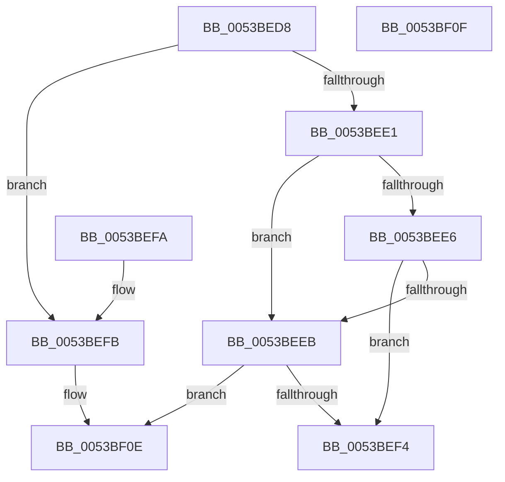

# RtlStringExValidateDestA

- RVA: `0x0053BED8`–`0x0053BF10` (길이 `56` bytes)
- VA: `0x000000014053BED8`
- 실행 섹션: `.text`
- PDB 이름 있음: `예`; PDB Function 태그: `예`
- unwind 정보 RVA: `0x000DB714`
- 디코드: `18`개 명령, `56/56` bytes 표시
- 미해석 바이트: `0` (있으면 어셈블리에 `.byte`로 보존)

> 이 문서는 커널 이미지의 기계어와 PDB 기호를 분석해 생성했습니다. 4번과 5번은 함수 원형과 자료형을 바이너리 사용 방식에서 추정한 C 해석이며 원본 소스 복구 결과는 아닙니다.

## 1. Dependencies

- 직접 호출 지점: **0**; 고유 호출 대상: **0**
- 직접 호출자로 확인된 함수: **2**
- RIP 상대 이미지 참조: **0**

### Outgoing calls
- 직접 디코드된 call 명령이 없습니다.

### Direct callers
- [RtlStringCbPrintfExA](RtlStringCbPrintfExA_function_0053BC58.md) at `0x0053BC80`
- [InitBootProcessor](../../init/C1/InitBootProcessor_function_00C1B1C8.md) at `0x00C1BB67`

### Static image references
- 디코드된 RIP-relative 메모리 참조가 없습니다.

## 2. Other-region calls and transfers

- 다른 실행 섹션으로 향하는 call: **0**
- 별도 외부 분기/꼬리 이동을 확인하지 못했습니다.

## 3. Assembly (complete function range)

```asm
0053BED8  33 C0                           xor eax, eax
0053BEDA  41 0F BA E1 08                  bt r9d, 8
0053BEDF  73 1A                           jae 0x14053befb
0053BEE1  48 85 C9                        test rcx, rcx
0053BEE4  75 05                           jne 0x14053beeb
0053BEE6  48 85 D2                        test rdx, rdx
0053BEE9  75 09                           jne 0x14053bef4
0053BEEB  48 81 FA FF FF FF 7F            cmp rdx, 0x7fffffff
0053BEF2  76 1A                           jbe 0x14053bf0e
0053BEF4  B8 0D 00 00 C0                  mov eax, 0xc000000d
0053BEF9  C3                              ret
0053BEFA  CC                              int3
0053BEFB  48 8D 4A FF                     lea rcx, [rdx - 1]
0053BEFF  BA 0D 00 00 C0                  mov edx, 0xc000000d
0053BF04  48 81 F9 FE FF FF 7F            cmp rcx, 0x7ffffffe
0053BF0B  0F 47 C2                        cmova eax, edx
0053BF0E  C3                              ret
0053BF0F  CC                              int3
```

## 4. C-style interpretation (structured pseudocode)

```c
__int64 __fastcall RtlStringExValidateDestA(__int64 a1, __int64 a2, __int64 a3, int a4)
{
    __int64 result;

    result = 0;
    if (condition_is_above_or_equal) goto loc_0053BEFB;
    if (a1 != 0) goto loc_0053BEEB;
    if (a2 != 0) goto loc_0053BEF4;
loc_0053BEEB:
    if (a2 <= 0x7FFFFFFFULL) goto loc_0053BF0E;
loc_0053BEF4:
    return (unsigned int)(0xC000000DULL);
loc_0053BEFB:
    result = (unsigned int)(0xC000000DULL);
    if ((a2 - 1) > 0x7FFFFFFEULL) { result = (unsigned int)((unsigned int)(0xC000000DULL)); }
loc_0053BF0E:
    return result;
}
```

## 5. (Beta) C Style

```c
int64_t RtlStringExValidateDestA(int64_t Arg1, void *Arg2, int64_t Arg3, int32_t Arg4)
{
    uint8_t *arg2 = (uint8_t *)Arg2;

    int64_t result;

    result = 0;
    if (condition_is_above_or_equal) goto loc_0053BEFB;
    if (Arg1 != 0) goto loc_0053BEEB;
    if (Arg2 != NULL) goto loc_0053BEF4;
loc_0053BEEB:
    if (Arg2 <= 0x7FFFFFFFULL) goto loc_0053BF0E;
loc_0053BEF4:
    return (uint32_t)(0xC000000DULL);
loc_0053BEFB:
    result = (uint32_t)(0xC000000DULL);
    if ((Arg2 - 1) > 0x7FFFFFFEULL) { result = (uint32_t)((uint32_t)(0xC000000DULL)); }
loc_0053BF0E:
    return result;
}
```

### 관측된 메모리 오프셋

구조체 형식이 확인되지 않은 접근은 인자 기준의 오프셋으로만 기록했습니다.

| 기준 인자 | 오프셋 표현 | 폭 (bit) | 접근 |
|---|---:|---:|---|
| `Arg2` | `- 0x1` | `64` | `R` |

## 6. Execution-region graph

[열기: 2D/3D 그래프와 함수 탐색 컨트롤 패널](../../../control-panel.html?section=text&rva=0x0053BED8&view=graph)

- 2D 그래프는 위에서 아래로 흐르고, 3D 그래프는 빈 공간을 드래그해 회전합니다. Shift+드래그는 이동, 휠은 확대·축소, 함수 노드 선택은 대상 보고서 이동입니다.

### Static fallback


