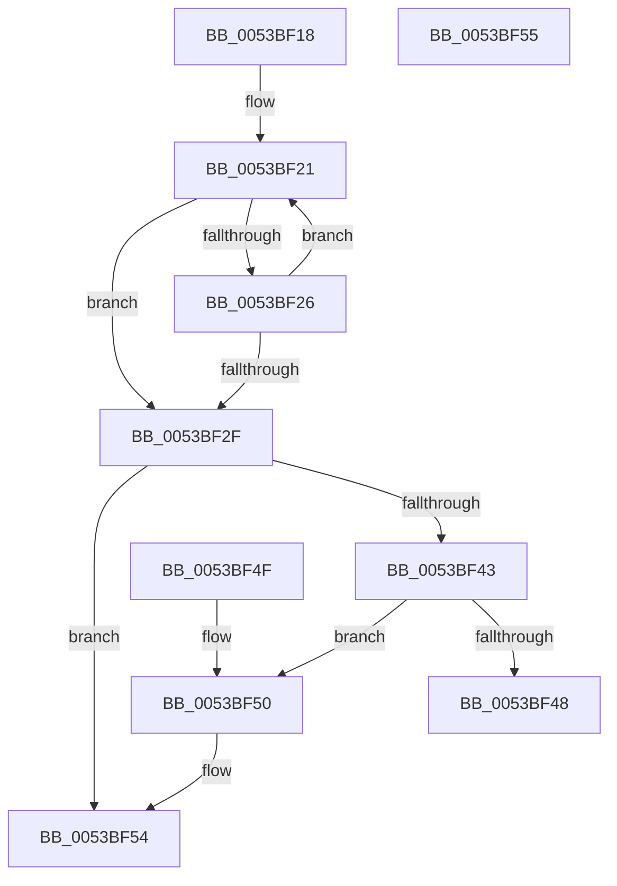

# RtlStringLengthWorkerA

- RVA: `0x0053BF18`–`0x0053BF56` (길이 `62` bytes)
- VA: `0x000000014053BF18`
- 실행 섹션: `.text`
- PDB 이름 있음: `예`; PDB Function 태그: `예`
- unwind 정보 RVA: `0x000DB714`
- 디코드: `23`개 명령, `62/62` bytes 표시
- 미해석 바이트: `0` (있으면 어셈블리에 `.byte`로 보존)

> 이 문서는 커널 이미지의 기계어와 PDB 기호를 분석해 생성했습니다. 4번과 5번은 함수 원형과 자료형을 바이너리 사용 방식에서 추정한 C 해석이며 원본 소스 복구 결과는 아닙니다.

## 1. Dependencies

- 직접 호출 지점: **0**; 고유 호출 대상: **0**
- 직접 호출자로 확인된 함수: **1**
- RIP 상대 이미지 참조: **0**

### Outgoing calls
- 직접 디코드된 call 명령이 없습니다.

### Direct callers
- [RtlStringCbCatExA](RtlStringCbCatExA_function_0053BB58.md) at `0x0053BB7B`

### Static image references
- 디코드된 RIP-relative 메모리 참조가 없습니다.

## 2. Other-region calls and transfers

- 다른 실행 섹션으로 향하는 call: **0**
- 별도 외부 분기/꼬리 이동을 확인하지 못했습니다.

## 3. Assembly (complete function range)

```asm
0053BF18  41 B9 00 01 00 00               mov r9d, 0x100
0053BF1E  41 8B D1                        mov edx, r9d
0053BF21  80 39 00                        cmp byte ptr [rcx], 0
0053BF24  74 09                           je 0x14053bf2f
0053BF26  48 FF C1                        inc rcx
0053BF29  48 83 EA 01                     sub rdx, 1
0053BF2D  75 F2                           jne 0x14053bf21
0053BF2F  48 8B C2                        mov rax, rdx
0053BF32  48 F7 D8                        neg rax
0053BF35  1B C0                           sbb eax, eax
0053BF37  F7 D0                           not eax
0053BF39  25 0D 00 00 C0                  and eax, 0xc000000d
0053BF3E  4D 85 C0                        test r8, r8
0053BF41  74 11                           je 0x14053bf54
0053BF43  48 85 D2                        test rdx, rdx
0053BF46  74 08                           je 0x14053bf50
0053BF48  4C 2B CA                        sub r9, rdx
0053BF4B  4D 89 08                        mov qword ptr [r8], r9
0053BF4E  C3                              ret
0053BF4F  CC                              int3
0053BF50  49 83 20 00                     and qword ptr [r8], 0
0053BF54  C3                              ret
0053BF55  CC                              int3
```

## 4. C-style interpretation (structured pseudocode)

```c
__int64 __fastcall RtlStringLengthWorkerA(__int64 a1, __int64 a2, __int64 a3)
{
    __int64 result;

loc_0053BF21:
    if ((*(unsigned __int8 *)(a1)) == 0) goto loc_0053BF2F;
    a1 = (a1) + 1;
    a2 = (256) - (1);
    if (condition_is_not_equal) goto loc_0053BF21;
loc_0053BF2F:
    result = -(a2);
    result = (unsigned int)(~(result));
    result = (unsigned int)((result) & (0xC000000DULL));
    if (a3 == 0) goto loc_0053BF54;
    if (a2 == 0) goto loc_0053BF50;
    a4 = (256) - (a2);
    *(unsigned __int64 *)(a3) = a4;
    return result;
loc_0053BF50:
loc_0053BF54:
    return result;
}
```

## 5. (Beta) C Style

```c
int64_t RtlStringLengthWorkerA(int64_t Arg1, int64_t Arg2, int64_t Arg3)
{
    int64_t result;

loc_0053BF21:
    if ((*(uint8_t *)(Arg1)) == 0) goto loc_0053BF2F;
    Arg1 = (Arg1) + 1;
    Arg2 = (256) - (1);
    if (condition_is_not_equal) goto loc_0053BF21;
loc_0053BF2F:
    result = -(Arg2);
    result = (uint32_t)(~(result));
    result = (uint32_t)((result) & (0xC000000DULL));
    if (Arg3 == 0) goto loc_0053BF54;
    if (Arg2 == 0) goto loc_0053BF50;
    a4 = (256) - (Arg2);
    *(uint64_t *)(Arg3) = a4;
    return result;
loc_0053BF50:
loc_0053BF54:
    return result;
}
```

## 6. Execution-region graph

[열기: 2D/3D 그래프와 함수 탐색 컨트롤 패널](../../../control-panel.html?section=text&rva=0x0053BF18&view=graph)

- 2D 그래프는 위에서 아래로 흐르고, 3D 그래프는 빈 공간을 드래그해 회전합니다. Shift+드래그는 이동, 휠은 확대·축소, 함수 노드 선택은 대상 보고서 이동입니다.

### Static fallback


