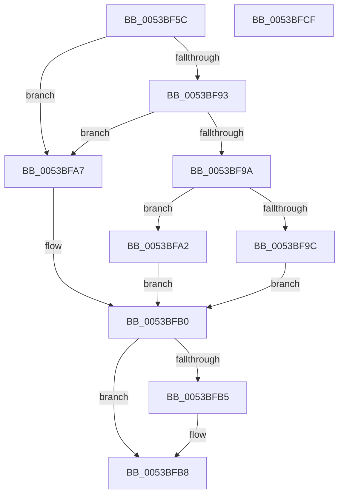

# RtlStringVPrintfWorkerA

- RVA: `0x0053BF5C`–`0x0053BFD0` (길이 `116` bytes)
- VA: `0x000000014053BF5C`
- 실행 섹션: `.text`
- PDB 이름 있음: `예`; PDB Function 태그: `예`
- unwind 정보 RVA: `0x0005C954`
- 디코드: `37`개 명령, `116/116` bytes 표시
- 미해석 바이트: `0` (있으면 어셈블리에 `.byte`로 보존)

> 이 문서는 커널 이미지의 기계어와 PDB 기호를 분석해 생성했습니다. 4번과 5번은 함수 원형과 자료형을 바이너리 사용 방식에서 추정한 C 해석이며 원본 소스 복구 결과는 아닙니다.

## 1. Dependencies

- 직접 호출 지점: **1**; 고유 호출 대상: **1**
- 직접 호출자로 확인된 함수: **2**
- RIP 상대 이미지 참조: **0**

### Outgoing calls
- `0x0053BF8A` → [vsnprintf](../4F/vsnprintf_function_004FF050.md) (function, `0x004FF050`)

### Direct callers
- [RtlStringCbPrintfA](RtlStringCbPrintfA_function_0053BC0C.md) at `0x0053BC45`
- [RtlStringCbPrintfExA](RtlStringCbPrintfExA_function_0053BC58.md) at `0x0053BD7B`

### Static image references
- 디코드된 RIP-relative 메모리 참조가 없습니다.

## 2. Other-region calls and transfers

- 다른 실행 섹션으로 향하는 call: **0**
- 별도 외부 분기/꼬리 이동을 확인하지 못했습니다.

## 3. Assembly (complete function range)

```asm
0053BF5C  48 89 5C 24 08                  mov qword ptr [rsp + 8], rbx
0053BF61  48 89 6C 24 10                  mov qword ptr [rsp + 0x10], rbp
0053BF66  48 89 74 24 18                  mov qword ptr [rsp + 0x18], rsi
0053BF6B  57                              push rdi
0053BF6C  48 83 EC 20                     sub rsp, 0x20
0053BF70  49 8B C1                        mov rax, r9
0053BF73  48 8D 5A FF                     lea rbx, [rdx - 1]
0053BF77  4C 8B 4C 24 50                  mov r9, qword ptr [rsp + 0x50]
0053BF7C  49 8B F0                        mov rsi, r8
0053BF7F  4C 8B C0                        mov r8, rax
0053BF82  48 8B D3                        mov rdx, rbx
0053BF85  48 8B F9                        mov rdi, rcx
0053BF88  33 ED                           xor ebp, ebp
0053BF8A  E8 C1 30 FC FF                  call 0x1404ff050
0053BF8F  85 C0                           test eax, eax
0053BF91  78 14                           js 0x14053bfa7
0053BF93  48 98                           cdqe
0053BF95  48 3B C3                        cmp rax, rbx
0053BF98  77 0D                           ja 0x14053bfa7
0053BF9A  75 06                           jne 0x14053bfa2
0053BF9C  40 88 2C 3B                     mov byte ptr [rbx + rdi], bpl
0053BFA0  EB 0E                           jmp 0x14053bfb0
0053BFA2  48 8B D8                        mov rbx, rax
0053BFA5  EB 09                           jmp 0x14053bfb0
0053BFA7  40 88 2C 3B                     mov byte ptr [rbx + rdi], bpl
0053BFAB  BD 05 00 00 80                  mov ebp, 0x80000005
0053BFB0  48 85 F6                        test rsi, rsi
0053BFB3  74 03                           je 0x14053bfb8
0053BFB5  48 89 1E                        mov qword ptr [rsi], rbx
0053BFB8  48 8B 5C 24 30                  mov rbx, qword ptr [rsp + 0x30]
0053BFBD  8B C5                           mov eax, ebp
0053BFBF  48 8B 6C 24 38                  mov rbp, qword ptr [rsp + 0x38]
0053BFC4  48 8B 74 24 40                  mov rsi, qword ptr [rsp + 0x40]
0053BFC9  48 83 C4 20                     add rsp, 0x20
0053BFCD  5F                              pop rdi
0053BFCE  C3                              ret
0053BFCF  CC                              int3
```

## 4. C-style interpretation (structured pseudocode)

```c
__int64 __fastcall RtlStringVPrintfWorkerA(__int64 a1, __int64 a2, __int64 a3, __int64 a4, __int64 a5)
{
    __int64 result;
    __int64 v_rbp;
    __int64 v_rsp;
    unsigned __int64 v_stack_p10;
    unsigned __int64 v_stack_p18;
    unsigned __int64 v_stack_p8;

    v_stack_p8 = v_rbx;
    v_stack_p10 = v_rbp;
    v_stack_p18 = v_rsi;
    v_rsp = (v_rsp) - (32);
    v_rbp = 0;
    result = vsnprintf(a1, a2 - 1, a4, a5);
    if (sign_flag) goto loc_0053BFA7;
    if (result > (a2 - 1)) goto loc_0053BFA7;
    if (result != (a2 - 1)) goto loc_0053BFA2;
    *(unsigned __int8 *)(a2 - 1 + a1 * 1) = 0;
    goto loc_0053BFB0;
loc_0053BFA2:
    goto loc_0053BFB0;
loc_0053BFA7:
    *(unsigned __int8 *)(result + a1 * 1) = 0;
loc_0053BFB0:
    if (a3 != 0) {
        *(unsigned __int64 *)(a3) = result;
    }
    v_rsp = (v_rsp) + (32);
    return (unsigned int)((unsigned int)((unsigned int)(0x80000005ULL)));
}
```

## 5. (Beta) C Style

```c
int64_t RtlStringVPrintfWorkerA(int64_t Arg1, void *Arg2, int64_t Arg3, int64_t Arg4, int64_t Arg5)
{
    uint8_t *arg2 = (uint8_t *)Arg2;

    int64_t result;
    int64_t local_rbp;
    int64_t local_rsp;
    uint64_t v_stack_p10;
    uint64_t v_stack_p18;
    uint64_t v_stack_p8;

    v_stack_p8 = local_rbx;
    v_stack_p10 = local_rbp;
    v_stack_p18 = local_rsi;
    local_rsp = (local_rsp) - (32);
    local_rbp = 0;
    result = vsnprintf(Arg1, Arg2 - 1, Arg4, Arg5);
    if (sign_flag) goto loc_0053BFA7;
    if (result > (Arg2 - 1)) goto loc_0053BFA7;
    if (result != (Arg2 - 1)) goto loc_0053BFA2;
    *(uint8_t *)(arg2 - 0x1 + Arg1 * 1) = 0;
    goto loc_0053BFB0;
loc_0053BFA2:
    goto loc_0053BFB0;
loc_0053BFA7:
    *(uint8_t *)(result + Arg1 * 1) = 0;
loc_0053BFB0:
    if (Arg3 != 0) {
        *(uint64_t *)(Arg3) = result;
    }
    local_rsp = (local_rsp) + (32);
    return (uint32_t)((uint32_t)((uint32_t)(0x80000005ULL)));
}
```

### 관측된 메모리 오프셋

구조체 형식이 확인되지 않은 접근은 인자 기준의 오프셋으로만 기록했습니다.

| 기준 인자 | 오프셋 표현 | 폭 (bit) | 접근 |
|---|---:|---:|---|
| `Arg2` | `- 0x1` | `64` | `R` |
| `Arg2` | `+ 0x0 + rdi*1` | `8` | `W` |

## 6. Execution-region graph

[열기: 2D/3D 그래프와 함수 탐색 컨트롤 패널](../../../control-panel.html?section=text&rva=0x0053BF5C&view=graph)

- 2D 그래프는 위에서 아래로 흐르고, 3D 그래프는 빈 공간을 드래그해 회전합니다. Shift+드래그는 이동, 휠은 확대·축소, 함수 노드 선택은 대상 보고서 이동입니다.

### Static fallback


