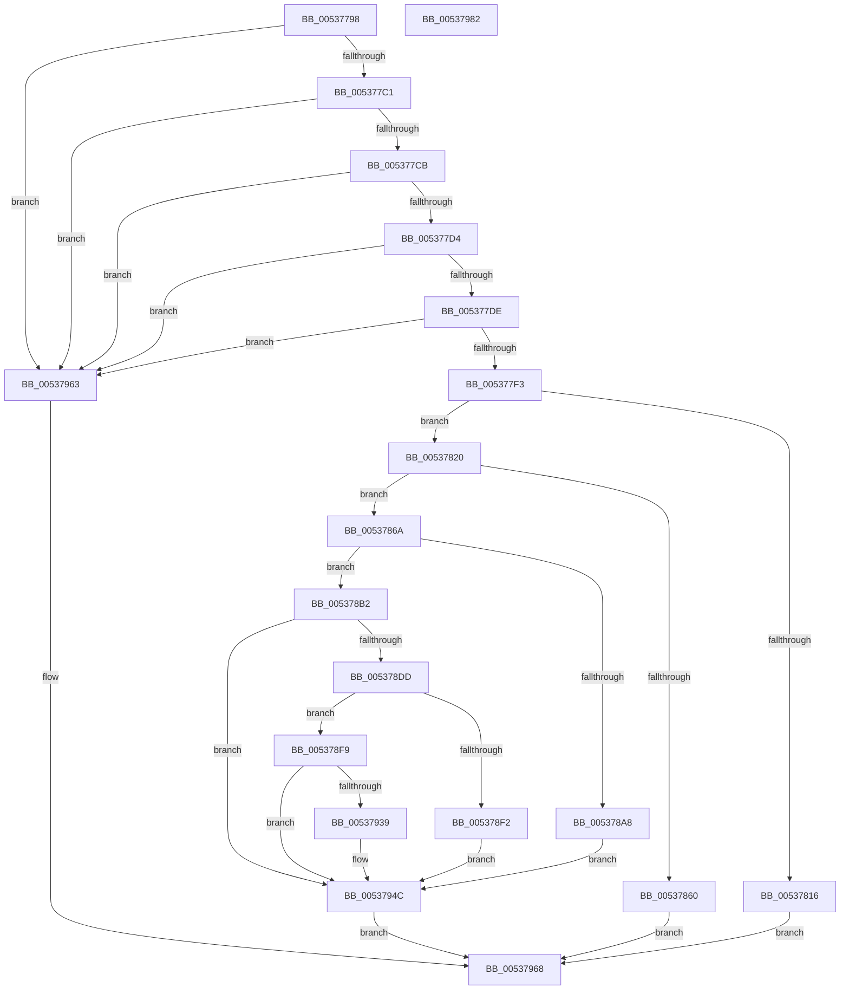

# SymCryptEcDhSecretAgreement

- RVA: `0x00537798`–`0x00537983` (길이 `491` bytes)
- VA: `0x0000000140537798`
- 실행 섹션: `.text`
- PDB 이름 있음: `예`; PDB Function 태그: `아니요`
- unwind 정보 RVA: `0x000C3598`
- 디코드: `132`개 명령, `491/491` bytes 표시
- 미해석 바이트: `0` (있으면 어셈블리에 `.byte`로 보존)

> 이 문서는 커널 이미지의 기계어와 PDB 기호를 분석해 생성했습니다. 4번과 5번은 함수 원형과 자료형을 바이너리 사용 방식에서 추정한 C 해석이며 원본 소스 복구 결과는 아닙니다.

## 1. Dependencies

- 직접 호출 지점: **12**; 고유 호출 대상: **11**
- 직접 호출자로 확인된 함수: **1**
- RIP 상대 이미지 참조: **0**

### Outgoing calls
- `0x005377E6` → [SymCryptEcurveIsSame](../52/SymCryptEcurveIsSame_function_0052473C.md) (function, `0x0052473C`)
- `0x005377FA` → [SymCryptSizeofEcpointFromCurve](../52/SymCryptSizeofEcpointFromCurve_function_0052CEF0.md) (function, `0x0052CEF0`)
- `0x00537804` → [SymCryptEcurveSizeofFieldElement](../52/SymCryptEcurveSizeofFieldElement_function_005247FC.md) (function, `0x005247FC`)
- `0x00537853` → [SymCryptCallbackAlloc](../6A/SymCryptCallbackAlloc_function_006AC530.md) (function, `0x006AC530`)
- `0x00537877` → [SymCryptEcpointCreate](../52/SymCryptEcpointCreate_function_0052C5A0.md) (function, `0x0052C5A0`)
- `0x0053789F` → [SymCryptEcpointIsZero](../52/SymCryptEcpointIsZero_function_0052D028.md) (function, `0x0052D028`)
- `0x005378D2` → [SymCryptEcpointScalarMul](../52/SymCryptEcpointScalarMul_function_0052D11C.md) (function, `0x0052D11C`)
- `0x005378E9` → [SymCryptEcpointIsZero](../52/SymCryptEcpointIsZero_function_0052D028.md) (function, `0x0052D028`)
- `0x0053792E` → [SymCryptEcpointGetValue](../52/SymCryptEcpointGetValue_function_0052C650.md) (function, `0x0052C650`)
- `0x00537947` → [memcpy](../6C/memcpy_function_006C6840.md) (function, `0x006C6840`)
- `0x00537954` → [SymCryptWipe](../51/SymCryptWipe_function_0051F914.md) (function, `0x0051F914`)
- `0x0053795C` → [SymCryptCallbackFree](../6A/SymCryptCallbackFree_function_006AC568.md) (function, `0x006AC568`)

### Direct callers
- [SymCryptEcDhSecretAgreementSelftest](../52/SymCryptEcDhSecretAgreementSelftest_function_0052B2C4.md) at `0x0052B3DA`

### Static image references
- 디코드된 RIP-relative 메모리 참조가 없습니다.

## 2. Other-region calls and transfers

- 다른 실행 섹션으로 향하는 call: **0**
- 별도 외부 분기/꼬리 이동을 확인하지 못했습니다.

## 3. Assembly (complete function range)

```asm
00537798  48 89 5C 24 10                  mov qword ptr [rsp + 0x10], rbx
0053779D  44 89 44 24 18                  mov dword ptr [rsp + 0x18], r8d
005377A2  55                              push rbp
005377A3  56                              push rsi
005377A4  57                              push rdi
005377A5  41 54                           push r12
005377A7  41 55                           push r13
005377A9  41 56                           push r14
005377AB  41 57                           push r15
005377AD  48 83 EC 60                     sub rsp, 0x60
005377B1  0F BA 21 0D                     bt dword ptr [rcx], 0xd
005377B5  4C 8B F2                        mov r14, rdx
005377B8  48 8B F1                        mov rsi, rcx
005377BB  0F 83 A2 01 00 00               jae 0x140537963
005377C1  0F BA 22 0D                     bt dword ptr [rdx], 0xd
005377C5  0F 83 98 01 00 00               jae 0x140537963
005377CB  45 85 C9                        test r9d, r9d
005377CE  0F 85 8F 01 00 00               jne 0x140537963
005377D4  44 38 49 04                     cmp byte ptr [rcx + 4], r9b
005377D8  0F 84 85 01 00 00               je 0x140537963
005377DE  48 8B 52 08                     mov rdx, qword ptr [rdx + 8]
005377E2  48 8B 49 08                     mov rcx, qword ptr [rcx + 8]
005377E6  E8 51 CF FE FF                  call 0x14052473c
005377EB  84 C0                           test al, al
005377ED  0F 84 70 01 00 00               je 0x140537963
005377F3  48 8B 7E 08                     mov rdi, qword ptr [rsi + 8]
005377F7  48 8B CF                        mov rcx, rdi
005377FA  E8 F1 56 FF FF                  call 0x14052cef0
005377FF  48 8B CF                        mov rcx, rdi
00537802  8B D8                           mov ebx, eax
00537804  E8 F3 CF FE FF                  call 0x1405247fc
00537809  44 8B F8                        mov r15d, eax
0053780C  4C 39 BC 24 C8 00 00 00         cmp qword ptr [rsp + 0xc8], r15
00537814  74 0A                           je 0x140537820
00537816  BB 02 80 00 00                  mov ebx, 0x8002
0053781B  E9 48 01 00 00                  jmp 0x140537968
00537820  8B 47 38                        mov eax, dword ptr [rdi + 0x38]
00537823  4C 8B EB                        mov r13, rbx
00537826  8B 57 34                        mov edx, dword ptr [rdi + 0x34]
00537829  03 57 30                        add edx, dword ptr [rdi + 0x30]
0053782C  3B D0                           cmp edx, eax
0053782E  48 89 9C 24 A0 00 00 00         mov qword ptr [rsp + 0xa0], rbx
00537836  0F 46 D0                        cmovbe edx, eax
00537839  8B 47 2C                        mov eax, dword ptr [rdi + 0x2c]
0053783C  3B C2                           cmp eax, edx
0053783E  0F 47 D0                        cmova edx, eax
00537841  49 8D 04 1F                     lea rax, [r15 + rbx]
00537845  44 8B E2                        mov r12d, edx
00537848  49 03 C4                        add rax, r12
0053784B  48 8B C8                        mov rcx, rax
0053784E  48 89 44 24 50                  mov qword ptr [rsp + 0x50], rax
00537853  E8 D8 4C 17 00                  call 0x1406ac530
00537858  48 8B E8                        mov rbp, rax
0053785B  48 85 C0                        test rax, rax
0053785E  75 0A                           jne 0x14053786a
00537860  BB 0F 80 00 00                  mov ebx, 0x800f
00537865  E9 FE 00 00 00                  jmp 0x140537968
0053786A  49 8D 1C 04                     lea rbx, [r12 + rax]
0053786E  4C 8B C7                        mov r8, rdi
00537871  48 8B CB                        mov rcx, rbx
00537874  49 8B D5                        mov rdx, r13
00537877  E8 24 4D FF FF                  call 0x14052c5a0
0053787C  49 8B 56 10                     mov rdx, qword ptr [r14 + 0x10]
00537880  4C 8B E8                        mov r13, rax
00537883  48 8B 84 24 A0 00 00 00         mov rax, qword ptr [rsp + 0xa0]
0053788B  4D 8B CC                        mov r9, r12
0053788E  48 03 C3                        add rax, rbx
00537891  4C 8B C5                        mov r8, rbp
00537894  48 8B CF                        mov rcx, rdi
00537897  48 89 84 24 A0 00 00 00         mov qword ptr [rsp + 0xa0], rax
0053789F  E8 84 57 FF FF                  call 0x14052d028
005378A4  85 C0                           test eax, eax
005378A6  74 0A                           je 0x1405378b2
005378A8  BB 0E 80 00 00                  mov ebx, 0x800e
005378AD  E9 9A 00 00 00                  jmp 0x14053794c
005378B2  4D 8B 46 10                     mov r8, qword ptr [r14 + 0x10]
005378B6  41 B9 20 00 00 00               mov r9d, 0x20
005378BC  48 8B 56 18                     mov rdx, qword ptr [rsi + 0x18]
005378C0  48 8B CF                        mov rcx, rdi
005378C3  4C 89 64 24 30                  mov qword ptr [rsp + 0x30], r12
005378C8  48 89 6C 24 28                  mov qword ptr [rsp + 0x28], rbp
005378CD  4C 89 6C 24 20                  mov qword ptr [rsp + 0x20], r13
005378D2  E8 45 58 FF FF                  call 0x14052d11c
005378D7  8B D8                           mov ebx, eax
005378D9  85 C0                           test eax, eax
005378DB  75 6F                           jne 0x14053794c
005378DD  4D 8B CC                        mov r9, r12
005378E0  4C 8B C5                        mov r8, rbp
005378E3  49 8B D5                        mov rdx, r13
005378E6  48 8B CF                        mov rcx, rdi
005378E9  E8 3A 57 FF FF                  call 0x14052d028
005378EE  85 C0                           test eax, eax
005378F0  74 07                           je 0x1405378f9
005378F2  BB 0C 80 00 00                  mov ebx, 0x800c
005378F7  EB 53                           jmp 0x14053794c
005378F9  48 8B B4 24 A0 00 00 00         mov rsi, qword ptr [rsp + 0xa0]
00537901  41 B9 01 00 00 00               mov r9d, 1
00537907  44 8B 84 24 B0 00 00 00         mov r8d, dword ptr [rsp + 0xb0]
0053790F  49 8B D5                        mov rdx, r13
00537912  4C 89 64 24 40                  mov qword ptr [rsp + 0x40], r12
00537917  48 8B CF                        mov rcx, rdi
0053791A  48 89 6C 24 38                  mov qword ptr [rsp + 0x38], rbp
0053791F  83 64 24 30 00                  and dword ptr [rsp + 0x30], 0
00537924  4C 89 7C 24 28                  mov qword ptr [rsp + 0x28], r15
00537929  48 89 74 24 20                  mov qword ptr [rsp + 0x20], rsi
0053792E  E8 1D 4D FF FF                  call 0x14052c650
00537933  8B D8                           mov ebx, eax
00537935  85 C0                           test eax, eax
00537937  75 13                           jne 0x14053794c
00537939  48 8B 8C 24 C0 00 00 00         mov rcx, qword ptr [rsp + 0xc0]
00537941  4D 8B C7                        mov r8, r15
00537944  48 8B D6                        mov rdx, rsi
00537947  E8 F4 EE 18 00                  call 0x1406c6840
0053794C  48 8B 54 24 50                  mov rdx, qword ptr [rsp + 0x50]
00537951  48 8B CD                        mov rcx, rbp
00537954  E8 BB 7F FE FF                  call 0x14051f914
00537959  48 8B CD                        mov rcx, rbp
0053795C  E8 07 4C 17 00                  call 0x1406ac568
00537961  EB 05                           jmp 0x140537968
00537963  BB 0E 80 00 00                  mov ebx, 0x800e
00537968  8B C3                           mov eax, ebx
0053796A  48 8B 9C 24 A8 00 00 00         mov rbx, qword ptr [rsp + 0xa8]
00537972  48 83 C4 60                     add rsp, 0x60
00537976  41 5F                           pop r15
00537978  41 5E                           pop r14
0053797A  41 5D                           pop r13
0053797C  41 5C                           pop r12
0053797E  5F                              pop rdi
0053797F  5E                              pop rsi
00537980  5D                              pop rbp
00537981  C3                              ret
00537982  CC                              int3
```

## 4. C-style interpretation (structured pseudocode)

```c
__int64 __fastcall SymCryptEcDhSecretAgreement(__int64 a1, __int64 a2, int a3, int a4, __int64 a5, __int64 a6)
{
    __int64 result;
    __int64 v_rsp;
    unsigned __int64 v_stack_m48;
    unsigned __int64 v_stack_m58;
    unsigned __int64 v_stack_m60;
    unsigned __int64 v_stack_m68;
    unsigned __int64 v_stack_m70;
    unsigned __int64 v_stack_m78;
    unsigned __int64 v_stack_p10;
    unsigned int v_stack_p18;
    unsigned __int64 v_stack_p8;

    v_stack_p10 = v_rbx;
    v_stack_p18 = a3;
    v_rsp = (v_rsp) - (96);
    if (condition_is_above_or_equal) goto loc_00537963;
    if (condition_is_above_or_equal) goto loc_00537963;
    if (a4 != 0) goto loc_00537963;
    if ((*(unsigned __int8 *)(a1 + 4)) == ((unsigned __int8)(a4))) goto loc_00537963;
    result = SymCryptEcurveIsSame(*(unsigned __int64 *)(a1 + 8), *(unsigned __int64 *)(a2 + 8), a3, a4);
    if ((unsigned __int8)(result) == 0) goto loc_00537963;
    result = SymCryptSizeofEcpointFromCurve(*(unsigned __int64 *)(a1 + 8), *(unsigned __int64 *)(a2 + 8), a3, a4);
    result = SymCryptEcurveSizeofFieldElement(*(unsigned __int64 *)(a1 + 8), *(unsigned __int64 *)(a2 + 8), a3, a4);
    if (a6 == ((unsigned int)((unsigned int)(result)))) goto loc_00537820;
    goto loc_00537968;
loc_00537820:
    a2 = (unsigned int)(((unsigned int)(*(unsigned int *)(*(unsigned __int64 *)(a1 + 8) + 52))) + (*(unsigned int *)(*(unsigned __int64 *)(a1 + 8) + 48)));
    v_stack_p8 = (unsigned int)(0x8002ULL);
    if (((unsigned int)(a2)) <= ((unsigned int)((unsigned int)(*(unsigned int *)(*(unsigned __int64 *)(a1 + 8) + 56))))) { a2 = (unsigned int)((unsigned int)(*(unsigned int *)(*(unsigned __int64 *)(a1 + 8) + 56))); }
    if (((unsigned int)((unsigned int)(*(unsigned int *)(*(unsigned __int64 *)(a1 + 8) + 44)))) > ((unsigned int)(a2))) { a2 = (unsigned int)((unsigned int)(*(unsigned int *)(*(unsigned __int64 *)(a1 + 8) + 44))); }
    result = ((unsigned int)((unsigned int)(result)) + (unsigned int)(0x8002ULL) * 1) + ((unsigned int)((unsigned int)(a2)));
    v_stack_m48 = result;
    result = SymCryptCallbackAlloc(result, a2, a3, a4);
    if (result != 0) goto loc_0053786A;
    goto loc_00537968;
loc_0053786A:
    result = SymCryptEcpointCreate((unsigned int)((unsigned int)(a2)) + result * 1, (unsigned int)(0x8002ULL), *(unsigned __int64 *)(a1 + 8), a4);
    result = (v_stack_p8) + ((unsigned int)((unsigned int)(a2)) + result * 1);
    v_stack_p8 = result;
    result = SymCryptEcpointIsZero(*(unsigned __int64 *)(a1 + 8), *(unsigned __int64 *)(a2 + 16), result, (unsigned int)((unsigned int)(a2)));
    if ((unsigned int)(result) == 0) goto loc_005378B2;
    goto loc_0053794C;
loc_005378B2:
    v_stack_m68 = (unsigned int)((unsigned int)(a2));
    v_stack_m70 = result;
    v_stack_m78 = result;
    result = SymCryptEcpointScalarMul(*(unsigned __int64 *)(a1 + 8), *(unsigned __int64 *)(a1 + 24), *(unsigned __int64 *)(a2 + 16), 32);
    if ((unsigned int)(result) != 0) goto loc_0053794C;
    result = SymCryptEcpointIsZero(*(unsigned __int64 *)(a1 + 8), result, result, (unsigned int)((unsigned int)(a2)));
    if ((unsigned int)(result) == 0) goto loc_005378F9;
    goto loc_0053794C;
loc_005378F9:
    v_stack_m58 = (unsigned int)((unsigned int)(a2));
    v_stack_m60 = result;
    v_stack_m70 = (unsigned int)((unsigned int)(result));
    v_stack_m78 = v_stack_p8;
    result = SymCryptEcpointGetValue(*(unsigned __int64 *)(a1 + 8), result, (unsigned int)(v_stack_p18), 1);
    if ((unsigned int)(result) == 0) {
        a1 = a5;
        a3 = (unsigned int)((unsigned int)(result));
        a2 = v_stack_p8;
        result = memcpy(a1, a2, a3, 1);
    }
    result = SymCryptWipe(result, v_stack_m48, a3, 1);
    result = SymCryptCallbackFree(result, v_stack_m48, a3, 1);
    goto loc_00537968;
loc_00537963:
loc_00537968:
    v_rsp = (v_rsp) + (96);
    return (unsigned int)((unsigned int)((unsigned int)(0x800EULL)));
}
```

## 5. (Beta) C Style

```c
int64_t SymCryptEcDhSecretAgreement(void *Arg1, void *Arg2, int32_t Arg3, int32_t Arg4, int64_t Arg5, int64_t Arg6)
{
    uint8_t *arg1 = (uint8_t *)Arg1;
    uint8_t *arg2 = (uint8_t *)Arg2;

    int64_t result;
    int64_t local_rsp;
    uint64_t v_stack_m48;
    uint64_t v_stack_m58;
    uint64_t v_stack_m60;
    uint64_t v_stack_m68;
    uint64_t v_stack_m70;
    uint64_t v_stack_m78;
    uint64_t v_stack_p10;
    uint32_t v_stack_p18;
    uint64_t v_stack_p8;

    v_stack_p10 = local_rbx;
    v_stack_p18 = Arg3;
    local_rsp = (local_rsp) - (96);
    if (condition_is_above_or_equal) goto loc_00537963;
    if (condition_is_above_or_equal) goto loc_00537963;
    if (Arg4 != 0) goto loc_00537963;
    if ((*(uint8_t *)(arg1 + 0x4)) == ((uint8_t)(Arg4))) goto loc_00537963;
    result = SymCryptEcurveIsSame(*(uint64_t *)(arg1 + 0x8), *(uint64_t *)(arg2 + 0x8), Arg3, Arg4);
    if ((uint8_t)(result) == 0) goto loc_00537963;
    result = SymCryptSizeofEcpointFromCurve(*(uint64_t *)(arg1 + 0x8), *(uint64_t *)(arg2 + 0x8), Arg3, Arg4);
    result = SymCryptEcurveSizeofFieldElement(*(uint64_t *)(arg1 + 0x8), *(uint64_t *)(arg2 + 0x8), Arg3, Arg4);
    if (Arg6 == ((uint32_t)((uint32_t)(result)))) goto loc_00537820;
    goto loc_00537968;
loc_00537820:
    Arg2 = (uint32_t)(((uint32_t)(*(uint32_t *)(*(uint64_t *)(arg1 + 0x8) + 0x34))) + (*(uint32_t *)(*(uint64_t *)(arg1 + 0x8) + 0x30)));
    v_stack_p8 = (uint32_t)(0x8002ULL);
    if (((uint32_t)(Arg2)) <= ((uint32_t)((uint32_t)(*(uint32_t *)(*(uint64_t *)(arg1 + 0x8) + 0x38))))) { Arg2 = (uint32_t)((uint32_t)(*(uint32_t *)(*(uint64_t *)(arg1 + 0x8) + 0x38))); }
    if (((uint32_t)((uint32_t)(*(uint32_t *)(*(uint64_t *)(arg1 + 0x8) + 0x2C)))) > ((uint32_t)(Arg2))) { Arg2 = (uint32_t)((uint32_t)(*(uint32_t *)(*(uint64_t *)(arg1 + 0x8) + 0x2C))); }
    result = ((uint32_t)((uint32_t)(result)) + (uint32_t)(0x8002ULL) * 1) + ((uint32_t)((uint32_t)(Arg2)));
    v_stack_m48 = result;
    result = SymCryptCallbackAlloc(result, Arg2, Arg3, Arg4);
    if (result != 0) goto loc_0053786A;
    goto loc_00537968;
loc_0053786A:
    result = SymCryptEcpointCreate((uint32_t)((uint32_t)(Arg2)) + result * 1, (uint32_t)(0x8002ULL), *(uint64_t *)(arg1 + 0x8), Arg4);
    result = (v_stack_p8) + ((uint32_t)((uint32_t)(Arg2)) + result * 1);
    v_stack_p8 = result;
    result = SymCryptEcpointIsZero(*(uint64_t *)(arg1 + 0x8), *(uint64_t *)(arg2 + 0x10), result, (uint32_t)((uint32_t)(Arg2)));
    if ((uint32_t)(result) == 0) goto loc_005378B2;
    goto loc_0053794C;
loc_005378B2:
    v_stack_m68 = (uint32_t)((uint32_t)(Arg2));
    v_stack_m70 = result;
    v_stack_m78 = result;
    result = SymCryptEcpointScalarMul(*(uint64_t *)(arg1 + 0x8), *(uint64_t *)(arg1 + 0x18), *(uint64_t *)(arg2 + 0x10), 32);
    if ((uint32_t)(result) != 0) goto loc_0053794C;
    result = SymCryptEcpointIsZero(*(uint64_t *)(arg1 + 0x8), result, result, (uint32_t)((uint32_t)(Arg2)));
    if ((uint32_t)(result) == 0) goto loc_005378F9;
    goto loc_0053794C;
loc_005378F9:
    v_stack_m58 = (uint32_t)((uint32_t)(Arg2));
    v_stack_m60 = result;
    v_stack_m70 = (uint32_t)((uint32_t)(result));
    v_stack_m78 = v_stack_p8;
    result = SymCryptEcpointGetValue(*(uint64_t *)(arg1 + 0x8), result, (uint32_t)(v_stack_p18), 1);
    if ((uint32_t)(result) == 0) {
        Arg1 = Arg5;
        Arg3 = (uint32_t)((uint32_t)(result));
        Arg2 = v_stack_p8;
        result = memcpy(Arg1, Arg2, Arg3, 1);
    }
    result = SymCryptWipe(result, v_stack_m48, Arg3, 1);
    result = SymCryptCallbackFree(result, v_stack_m48, Arg3, 1);
    goto loc_00537968;
loc_00537963:
loc_00537968:
    local_rsp = (local_rsp) + (96);
    return (uint32_t)((uint32_t)((uint32_t)(0x800EULL)));
}
```

### 관측된 메모리 오프셋

구조체 형식이 확인되지 않은 접근은 인자 기준의 오프셋으로만 기록했습니다.

| 기준 인자 | 오프셋 표현 | 폭 (bit) | 접근 |
|---|---:|---:|---|
| `Arg1` | `+ 0x0` | `32` | `R` |
| `Arg1` | `+ 0x4` | `8` | `R` |
| `Arg1` | `+ 0x8` | `64` | `R` |
| `Arg1` | `+ 0x18` | `64` | `R` |
| `Arg2` | `+ 0x0` | `32` | `R` |
| `Arg2` | `+ 0x8` | `64` | `R` |
| `Arg2` | `+ 0x10` | `64` | `R` |

## 6. Execution-region graph

[열기: 2D/3D 그래프와 함수 탐색 컨트롤 패널](../../../control-panel.html?section=text&rva=0x00537798&view=graph)

- 2D 그래프는 위에서 아래로 흐르고, 3D 그래프는 빈 공간을 드래그해 회전합니다. Shift+드래그는 이동, 휠은 확대·축소, 함수 노드 선택은 대상 보고서 이동입니다.

### Static fallback


