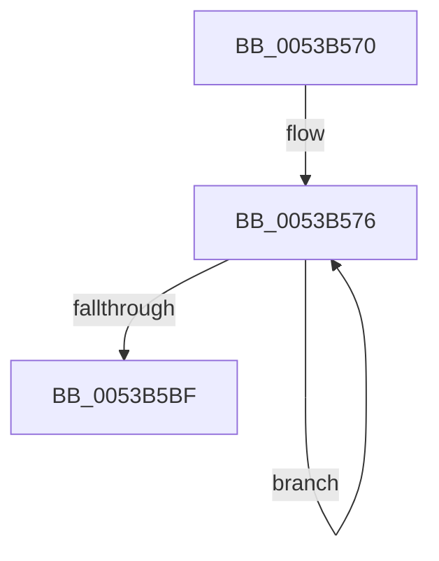

# SymCryptFdef369MaskedCopyAsm

- RVA: `0x0053B570`–`0x0053B5C0` (길이 `80` bytes)
- VA: `0x000000014053B570`
- 실행 섹션: `.text`
- PDB 이름 있음: `예`; PDB Function 태그: `아니요`
- unwind 정보 RVA: `0x000C3108`
- 디코드: `25`개 명령, `80/80` bytes 표시
- 미해석 바이트: `0` (있으면 어셈블리에 `.byte`로 보존)

> 이 문서는 커널 이미지의 기계어와 PDB 기호를 분석해 생성했습니다. 4번과 5번은 함수 원형과 자료형을 바이너리 사용 방식에서 추정한 C 해석이며 원본 소스 복구 결과는 아닙니다.

## 1. Dependencies

- 직접 호출 지점: **0**; 고유 호출 대상: **0**
- 직접 호출자로 확인된 함수: **2**
- RIP 상대 이미지 참조: **0**

### Outgoing calls
- 직접 디코드된 call 명령이 없습니다.

### Direct callers
- [SymCryptFdef369ModAddGeneric](SymCryptFdef369ModAddGeneric_function_005373C0.md) at `0x0053743E`
- [SymCryptFdef369ModSubGeneric](SymCryptFdef369ModSubGeneric_function_005376C0.md) at `0x0053773D`

### Static image references
- 디코드된 RIP-relative 메모리 참조가 없습니다.

## 2. Other-region calls and transfers

- 다른 실행 섹션으로 향하는 call: **0**
- 별도 외부 분기/꼬리 이동을 확인하지 못했습니다.

## 3. Assembly (complete function range)

```asm
0053B570  41 FF C0                        inc r8d
0053B573  4D 63 C9                        movsxd r9, r9d
0053B576  48 8B 01                        mov rax, qword ptr [rcx]
0053B579  4C 8B 12                        mov r10, qword ptr [rdx]
0053B57C  49 33 C2                        xor rax, r10
0053B57F  49 23 C1                        and rax, r9
0053B582  49 33 C2                        xor rax, r10
0053B585  48 89 02                        mov qword ptr [rdx], rax
0053B588  48 8B 41 08                     mov rax, qword ptr [rcx + 8]
0053B58C  4C 8B 52 08                     mov r10, qword ptr [rdx + 8]
0053B590  49 33 C2                        xor rax, r10
0053B593  49 23 C1                        and rax, r9
0053B596  49 33 C2                        xor rax, r10
0053B599  48 89 42 08                     mov qword ptr [rdx + 8], rax
0053B59D  48 8B 41 10                     mov rax, qword ptr [rcx + 0x10]
0053B5A1  4C 8B 52 10                     mov r10, qword ptr [rdx + 0x10]
0053B5A5  49 33 C2                        xor rax, r10
0053B5A8  49 23 C1                        and rax, r9
0053B5AB  49 33 C2                        xor rax, r10
0053B5AE  48 89 42 10                     mov qword ptr [rdx + 0x10], rax
0053B5B2  48 83 C1 18                     add rcx, 0x18
0053B5B6  48 83 C2 18                     add rdx, 0x18
0053B5BA  41 FF C8                        dec r8d
0053B5BD  75 B7                           jne 0x14053b576
0053B5BF  C3                              ret
```

## 4. C-style interpretation (structured pseudocode)

```c
__int64 __fastcall SymCryptFdef369MaskedCopyAsm(__int64 a1, __int64 a2, int a3, int a4)
{
    __int64 result;

    a3 = (unsigned int)((a3) + 1);
loc_0053B576:
    result = (*(unsigned __int64 *)(a1)) ^ (*(unsigned __int64 *)(a2));
    result = (result) & ((int)(a4));
    result = (result) ^ (*(unsigned __int64 *)(a2));
    *(unsigned __int64 *)(a2) = result;
    result = (*(unsigned __int64 *)(a1 + 8)) ^ (*(unsigned __int64 *)(a2 + 8));
    result = (result) & ((int)(a4));
    result = (result) ^ (*(unsigned __int64 *)(a2 + 8));
    *(unsigned __int64 *)(a2 + 8) = result;
    result = (*(unsigned __int64 *)(a1 + 16)) ^ (*(unsigned __int64 *)(a2 + 16));
    result = (result) & ((int)(a4));
    result = (result) ^ (*(unsigned __int64 *)(a2 + 16));
    *(unsigned __int64 *)(a2 + 16) = result;
    a1 = (a1) + (24);
    a2 = (a2) + (24);
    a3 = (unsigned int)((a3) - 1);
    if (condition_is_not_equal) goto loc_0053B576;
    return result;
}
```

## 5. (Beta) C Style

```c
int64_t SymCryptFdef369MaskedCopyAsm(void *Arg1, void *Arg2, int32_t Arg3, int32_t Arg4)
{
    uint8_t *arg1 = (uint8_t *)Arg1;
    uint8_t *arg2 = (uint8_t *)Arg2;

    int64_t result;

    Arg3 = (uint32_t)((Arg3) + 1);
loc_0053B576:
    result = (*(uint64_t *)(arg1)) ^ (*(uint64_t *)(arg2));
    result = (result) & ((int32_t)(Arg4));
    result = (result) ^ (*(uint64_t *)(arg2));
    *(uint64_t *)(arg2) = result;
    result = (*(uint64_t *)(arg1 + 0x8)) ^ (*(uint64_t *)(arg2 + 0x8));
    result = (result) & ((int32_t)(Arg4));
    result = (result) ^ (*(uint64_t *)(arg2 + 0x8));
    *(uint64_t *)(arg2 + 0x8) = result;
    result = (*(uint64_t *)(arg1 + 0x10)) ^ (*(uint64_t *)(arg2 + 0x10));
    result = (result) & ((int32_t)(Arg4));
    result = (result) ^ (*(uint64_t *)(arg2 + 0x10));
    *(uint64_t *)(arg2 + 0x10) = result;
    Arg1 = (Arg1) + (24);
    Arg2 = (Arg2) + (24);
    Arg3 = (uint32_t)((Arg3) - 1);
    if (condition_is_not_equal) goto loc_0053B576;
    return result;
}
```

### 관측된 메모리 오프셋

구조체 형식이 확인되지 않은 접근은 인자 기준의 오프셋으로만 기록했습니다.

| 기준 인자 | 오프셋 표현 | 폭 (bit) | 접근 |
|---|---:|---:|---|
| `Arg1` | `+ 0x0` | `64` | `R` |
| `Arg1` | `+ 0x8` | `64` | `R` |
| `Arg1` | `+ 0x10` | `64` | `R` |
| `Arg2` | `+ 0x0` | `64` | `R` |
| `Arg2` | `+ 0x0` | `64` | `W` |
| `Arg2` | `+ 0x8` | `64` | `R` |
| `Arg2` | `+ 0x8` | `64` | `W` |
| `Arg2` | `+ 0x10` | `64` | `R` |
| `Arg2` | `+ 0x10` | `64` | `W` |

## 6. Execution-region graph

[열기: 2D/3D 그래프와 함수 탐색 컨트롤 패널](../../../control-panel.html?section=text&rva=0x0053B570&view=graph)

- 2D 그래프는 위에서 아래로 흐르고, 3D 그래프는 빈 공간을 드래그해 회전합니다. Shift+드래그는 이동, 휠은 확대·축소, 함수 노드 선택은 대상 보고서 이동입니다.

### Static fallback


