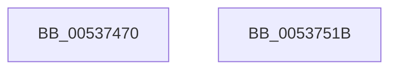

# SymCryptFdef369ModInvMontgomery

- RVA: `0x00537470`–`0x0053751C` (길이 `172` bytes)
- VA: `0x0000000140537470`
- 실행 섹션: `.text`
- PDB 이름 있음: `예`; PDB Function 태그: `아니요`
- unwind 정보 RVA: `0x00084C9C`
- 디코드: `51`개 명령, `172/172` bytes 표시
- 미해석 바이트: `0` (있으면 어셈블리에 `.byte`로 보존)

> 이 문서는 커널 이미지의 기계어와 PDB 기호를 분석해 생성했습니다. 4번과 5번은 함수 원형과 자료형을 바이너리 사용 방식에서 추정한 C 해석이며 원본 소스 복구 결과는 아닙니다.

## 1. Dependencies

- 직접 호출 지점: **6**; 고유 호출 대상: **4**
- 직접 호출자로 확인된 함수: **0**
- RIP 상대 이미지 참조: **0**

### Outgoing calls
- `0x005374A9` → [memcpy](../6C/memcpy_function_006C6840.md) (function, `0x006C6840`)
- `0x005374B7` → [SymCryptWipe](../51/SymCryptWipe_function_0051F914.md) (function, `0x0051F914`)
- `0x005374C5` → [SymCryptFdef369MontgomeryReduceAsm](SymCryptFdef369MontgomeryReduceAsm_function_0053B6F0.md) (function, `0x0053B6F0`)
- `0x005374CF` → [SymCryptWipe](../51/SymCryptWipe_function_0051F914.md) (function, `0x0051F914`)
- `0x005374DD` → [SymCryptFdef369MontgomeryReduceAsm](SymCryptFdef369MontgomeryReduceAsm_function_0053B6F0.md) (function, `0x0053B6F0`)
- `0x005374FD` → [SymCryptFdefModInvGeneric](SymCryptFdefModInvGeneric_function_005348C0.md) (function, `0x005348C0`)

### Direct callers
- 이 함수 시작 RVA로 연결되는 직접 call은 확인되지 않았습니다. 간접 호출은 완전히 역산할 수 없습니다.

### Static image references
- 디코드된 RIP-relative 메모리 참조가 없습니다.

## 2. Other-region calls and transfers

- 다른 실행 섹션으로 향하는 call: **0**
- 별도 외부 분기/꼬리 이동을 확인하지 못했습니다.

## 3. Assembly (complete function range)

```asm
00537470  48 89 5C 24 08                  mov qword ptr [rsp + 8], rbx
00537475  48 89 6C 24 10                  mov qword ptr [rsp + 0x10], rbp
0053747A  48 89 74 24 18                  mov qword ptr [rsp + 0x18], rsi
0053747F  57                              push rdi
00537480  41 56                           push r14
00537482  41 57                           push r15
00537484  48 83 EC 30                     sub rsp, 0x30
00537488  8B 41 04                        mov eax, dword ptr [rcx + 4]
0053748B  4D 8B F8                        mov r15, r8
0053748E  48 8B 74 24 70                  mov rsi, qword ptr [rsp + 0x70]
00537493  FF C0                           inc eax
00537495  4C 8B F1                        mov r14, rcx
00537498  41 8B E9                        mov ebp, r9d
0053749B  48 8B CE                        mov rcx, rsi
0053749E  8D 04 40                        lea eax, [rax + rax*2]
005374A1  C1 E0 03                        shl eax, 3
005374A4  44 8B C0                        mov r8d, eax
005374A7  8B F8                           mov edi, eax
005374A9  E8 92 F3 18 00                  call 0x1406c6840
005374AE  48 8D 1C 37                     lea rbx, [rdi + rsi]
005374B2  8B D7                           mov edx, edi
005374B4  48 8B CB                        mov rcx, rbx
005374B7  E8 58 84 FE FF                  call 0x14051f914
005374BC  4C 8B C6                        mov r8, rsi
005374BF  48 8B D6                        mov rdx, rsi
005374C2  49 8B CE                        mov rcx, r14
005374C5  E8 26 42 00 00                  call 0x14053b6f0
005374CA  8B D7                           mov edx, edi
005374CC  48 8B CB                        mov rcx, rbx
005374CF  E8 40 84 FE FF                  call 0x14051f914
005374D4  4D 8B C7                        mov r8, r15
005374D7  48 8B D6                        mov rdx, rsi
005374DA  49 8B CE                        mov rcx, r14
005374DD  E8 0E 42 00 00                  call 0x14053b6f0
005374E2  48 8B 44 24 78                  mov rax, qword ptr [rsp + 0x78]
005374E7  44 8B CD                        mov r9d, ebp
005374EA  48 89 44 24 28                  mov qword ptr [rsp + 0x28], rax
005374EF  4D 8B C7                        mov r8, r15
005374F2  49 8B D7                        mov rdx, r15
005374F5  48 89 74 24 20                  mov qword ptr [rsp + 0x20], rsi
005374FA  49 8B CE                        mov rcx, r14
005374FD  E8 BE D3 FF FF                  call 0x1405348c0
00537502  48 8B 5C 24 50                  mov rbx, qword ptr [rsp + 0x50]
00537507  48 8B 6C 24 58                  mov rbp, qword ptr [rsp + 0x58]
0053750C  48 8B 74 24 60                  mov rsi, qword ptr [rsp + 0x60]
00537511  48 83 C4 30                     add rsp, 0x30
00537515  41 5F                           pop r15
00537517  41 5E                           pop r14
00537519  5F                              pop rdi
0053751A  C3                              ret
0053751B  CC                              int3
```

## 4. C-style interpretation (structured pseudocode)

```c
__int64 __fastcall SymCryptFdef369ModInvMontgomery(__int64 a1, __int64 a2, __int64 a3, int a4, __int64 a5, __int64 a6)
{
    __int64 result;
    __int64 v_rsp;
    unsigned __int64 v_stack_m20;
    unsigned __int64 v_stack_m28;
    unsigned __int64 v_stack_p10;
    unsigned __int64 v_stack_p18;
    unsigned __int64 v_stack_p8;

    v_stack_p8 = v_rbx;
    v_stack_p10 = v_rbp;
    v_stack_p18 = v_rsi;
    v_rsp = (v_rsp) - (48);
    result = (unsigned int)(((unsigned int)(*(unsigned int *)(a1 + 4))) + 1);
    result = (unsigned int)((result + result * 2) << (3));
    result = memcpy(a5, a2, (unsigned int)((unsigned int)(result)), a4);
    result = SymCryptWipe((unsigned int)((unsigned int)(result)) + a5 * 1, (unsigned int)((unsigned int)((unsigned int)((unsigned int)(result)))), (unsigned int)((unsigned int)(result)), a4);
    result = SymCryptFdef369MontgomeryReduceAsm(a1, a5, a5, a4);
    result = SymCryptWipe((unsigned int)((unsigned int)(result)) + a5 * 1, (unsigned int)((unsigned int)((unsigned int)((unsigned int)(result)))), a5, a4);
    result = SymCryptFdef369MontgomeryReduceAsm(a1, a5, a3, a4);
    v_stack_m20 = a6;
    v_stack_m28 = a5;
    result = SymCryptFdefModInvGeneric(a1, a3, a3, (unsigned int)((unsigned int)((unsigned int)(a4))));
    v_rsp = (v_rsp) + (48);
    return result;
}
```

## 5. (Beta) C Style

```c
int64_t SymCryptFdef369ModInvMontgomery(void *Arg1, int64_t Arg2, int64_t Arg3, int32_t Arg4, int64_t Arg5, int64_t Arg6)
{
    uint8_t *arg1 = (uint8_t *)Arg1;

    int64_t result;
    int64_t local_rsp;
    uint64_t v_stack_m20;
    uint64_t v_stack_m28;
    uint64_t v_stack_p10;
    uint64_t v_stack_p18;
    uint64_t v_stack_p8;

    v_stack_p8 = local_rbx;
    v_stack_p10 = local_rbp;
    v_stack_p18 = local_rsi;
    local_rsp = (local_rsp) - (48);
    result = (uint32_t)(((uint32_t)(*(uint32_t *)(arg1 + 0x4))) + 1);
    result = (uint32_t)((result + result * 2) << (3));
    result = memcpy(Arg5, Arg2, (uint32_t)((uint32_t)(result)), Arg4);
    result = SymCryptWipe((uint32_t)((uint32_t)(result)) + Arg5 * 1, (uint32_t)((uint32_t)((uint32_t)((uint32_t)(result)))), (uint32_t)((uint32_t)(result)), Arg4);
    result = SymCryptFdef369MontgomeryReduceAsm(Arg1, Arg5, Arg5, Arg4);
    result = SymCryptWipe((uint32_t)((uint32_t)(result)) + Arg5 * 1, (uint32_t)((uint32_t)((uint32_t)((uint32_t)(result)))), Arg5, Arg4);
    result = SymCryptFdef369MontgomeryReduceAsm(Arg1, Arg5, Arg3, Arg4);
    v_stack_m20 = Arg6;
    v_stack_m28 = Arg5;
    result = SymCryptFdefModInvGeneric(Arg1, Arg3, Arg3, (uint32_t)((uint32_t)((uint32_t)(Arg4))));
    local_rsp = (local_rsp) + (48);
    return result;
}
```

### 관측된 메모리 오프셋

구조체 형식이 확인되지 않은 접근은 인자 기준의 오프셋으로만 기록했습니다.

| 기준 인자 | 오프셋 표현 | 폭 (bit) | 접근 |
|---|---:|---:|---|
| `Arg1` | `+ 0x4` | `32` | `R` |

## 6. Execution-region graph

[열기: 2D/3D 그래프와 함수 탐색 컨트롤 패널](../../../control-panel.html?section=text&rva=0x00537470&view=graph)

- 2D 그래프는 위에서 아래로 흐르고, 3D 그래프는 빈 공간을 드래그해 회전합니다. Shift+드래그는 이동, 휠은 확대·축소, 함수 노드 선택은 대상 보고서 이동입니다.

### Static fallback


