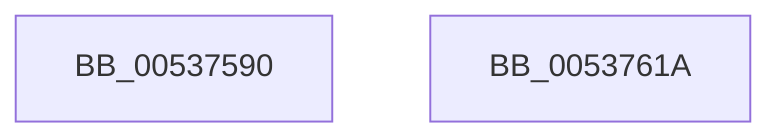

# SymCryptFdef369ModPreGetMontgomery

- RVA: `0x00537590`–`0x0053761B` (길이 `139` bytes)
- VA: `0x0000000140537590`
- 실행 섹션: `.text`
- PDB 이름 있음: `예`; PDB Function 태그: `아니요`
- unwind 정보 RVA: `0x0005E6B4`
- 디코드: `39`개 명령, `139/139` bytes 표시
- 미해석 바이트: `0` (있으면 어셈블리에 `.byte`로 보존)

> 이 문서는 커널 이미지의 기계어와 PDB 기호를 분석해 생성했습니다. 4번과 5번은 함수 원형과 자료형을 바이너리 사용 방식에서 추정한 C 해석이며 원본 소스 복구 결과는 아닙니다.

## 1. Dependencies

- 직접 호출 지점: **4**; 고유 호출 대상: **3**
- 직접 호출자로 확인된 함수: **0**
- RIP 상대 이미지 참조: **0**

### Outgoing calls
- `0x005375CA` → [memcpy](../6C/memcpy_function_006C6840.md) (function, `0x006C6840`)
- `0x005375D9` → [SymCryptWipe](../51/SymCryptWipe_function_0051F914.md) (function, `0x0051F914`)
- `0x005375E7` → [SymCryptFdef369MontgomeryReduceAsm](SymCryptFdef369MontgomeryReduceAsm_function_0053B6F0.md) (function, `0x0053B6F0`)
- `0x005375F7` → [SymCryptWipe](../51/SymCryptWipe_function_0051F914.md) (function, `0x0051F914`)

### Direct callers
- 이 함수 시작 RVA로 연결되는 직접 call은 확인되지 않았습니다. 간접 호출은 완전히 역산할 수 없습니다.

### Static image references
- 디코드된 RIP-relative 메모리 참조가 없습니다.

## 2. Other-region calls and transfers

- 다른 실행 섹션으로 향하는 call: **0**
- 별도 외부 분기/꼬리 이동을 확인하지 못했습니다.

## 3. Assembly (complete function range)

```asm
00537590  48 8B C4                        mov rax, rsp
00537593  48 89 58 08                     mov qword ptr [rax + 8], rbx
00537597  48 89 68 10                     mov qword ptr [rax + 0x10], rbp
0053759B  48 89 70 18                     mov qword ptr [rax + 0x18], rsi
0053759F  48 89 78 20                     mov qword ptr [rax + 0x20], rdi
005375A3  41 56                           push r14
005375A5  48 83 EC 20                     sub rsp, 0x20
005375A9  8B 69 04                        mov ebp, dword ptr [rcx + 4]
005375AC  4D 8B F0                        mov r14, r8
005375AF  48 8B F1                        mov rsi, rcx
005375B2  49 8B CE                        mov rcx, r14
005375B5  8D 45 01                        lea eax, [rbp + 1]
005375B8  44 8D 0C 40                     lea r9d, [rax + rax*2]
005375BC  45 03 C9                        add r9d, r9d
005375BF  4A 8D 3C 8D 00 00 00 00         lea rdi, [r9*4]
005375C7  4C 8B C7                        mov r8, rdi
005375CA  E8 71 F2 18 00                  call 0x1406c6840
005375CF  4A 8D 1C 37                     lea rbx, [rdi + r14]
005375D3  48 8B D7                        mov rdx, rdi
005375D6  48 8B CB                        mov rcx, rbx
005375D9  E8 36 83 FE FF                  call 0x14051f914
005375DE  4D 8B C6                        mov r8, r14
005375E1  49 8B D6                        mov rdx, r14
005375E4  48 8B CE                        mov rcx, rsi
005375E7  E8 04 41 00 00                  call 0x14053b6f0
005375EC  C1 E5 06                        shl ebp, 6
005375EF  48 8B CB                        mov rcx, rbx
005375F2  8B D5                           mov edx, ebp
005375F4  48 2B D7                        sub rdx, rdi
005375F7  E8 18 83 FE FF                  call 0x14051f914
005375FC  48 8B 5C 24 30                  mov rbx, qword ptr [rsp + 0x30]
00537601  49 8B C6                        mov rax, r14
00537604  48 8B 6C 24 38                  mov rbp, qword ptr [rsp + 0x38]
00537609  48 8B 74 24 40                  mov rsi, qword ptr [rsp + 0x40]
0053760E  48 8B 7C 24 48                  mov rdi, qword ptr [rsp + 0x48]
00537613  48 83 C4 20                     add rsp, 0x20
00537617  41 5E                           pop r14
00537619  C3                              ret
0053761A  CC                              int3
```

## 4. C-style interpretation (structured pseudocode)

```c
__int64 __fastcall SymCryptFdef369ModPreGetMontgomery(__int64 a1, __int64 a2, __int64 a3)
{
    __int64 result;
    __int64 v_rbp;
    __int64 v_rsp;
    unsigned __int64 v_stack_p10;
    unsigned __int64 v_stack_p18;
    unsigned __int64 v_stack_p20;
    unsigned __int64 v_stack_p8;

    *(unsigned __int64 *)(v_rsp + 8) = v_rbx;
    *(unsigned __int64 *)(v_rsp + 16) = v_rbp;
    *(unsigned __int64 *)(v_rsp + 24) = v_rsi;
    *(unsigned __int64 *)(v_rsp + 32) = v_rdi;
    v_rsp = (v_rsp) - (32);
    a4 = (unsigned int)(((unsigned int)(*(unsigned int *)(a1 + 4)) + 1 + (unsigned int)(*(unsigned int *)(a1 + 4)) + 1 * 2) + ((unsigned int)((unsigned int)(*(unsigned int *)(a1 + 4)) + 1 + (unsigned int)(*(unsigned int *)(a1 + 4)) + 1 * 2)));
    result = memcpy(a3, a2, a4 * 4, a4);
    result = SymCryptWipe(a4 * 4 + a3 * 1, a4 * 4, a4 * 4, a4);
    result = SymCryptFdef369MontgomeryReduceAsm(a1, a3, a3, a4);
    v_rbp = (unsigned int)(((unsigned int)(*(unsigned int *)(a1 + 4))) << (6));
    a2 = ((unsigned int)((unsigned int)(v_rbp))) - (a4 * 4);
    result = SymCryptWipe(a4 * 4 + a3 * 1, a2, a3, a4);
    v_rsp = (v_rsp) + (32);
    return a3;
}
```

## 5. (Beta) C Style

```c
int64_t SymCryptFdef369ModPreGetMontgomery(void *Arg1, int64_t Arg2, int64_t Arg3)
{
    uint8_t *arg1 = (uint8_t *)Arg1;

    int64_t result;
    int64_t local_rbp;
    int64_t local_rsp;
    uint64_t v_stack_p10;
    uint64_t v_stack_p18;
    uint64_t v_stack_p20;
    uint64_t v_stack_p8;

    *(uint64_t *)(local_rsp + 0x8) = local_rbx;
    *(uint64_t *)(local_rsp + 0x10) = local_rbp;
    *(uint64_t *)(local_rsp + 0x18) = local_rsi;
    *(uint64_t *)(local_rsp + 0x20) = local_rdi;
    local_rsp = (local_rsp) - (32);
    a4 = (uint32_t)(((uint32_t)(*(uint32_t *)(arg1 + 0x4)) + 1 + (uint32_t)(*(uint32_t *)(arg1 + 0x4)) + 1 * 2) + ((uint32_t)((uint32_t)(*(uint32_t *)(arg1 + 0x4)) + 1 + (uint32_t)(*(uint32_t *)(arg1 + 0x4)) + 1 * 2)));
    result = memcpy(Arg3, Arg2, a4 * 4, a4);
    result = SymCryptWipe(a4 * 4 + Arg3 * 1, a4 * 4, a4 * 4, a4);
    result = SymCryptFdef369MontgomeryReduceAsm(Arg1, Arg3, Arg3, a4);
    local_rbp = (uint32_t)(((uint32_t)(*(uint32_t *)(arg1 + 0x4))) << (6));
    Arg2 = ((uint32_t)((uint32_t)(local_rbp))) - (a4 * 4);
    result = SymCryptWipe(a4 * 4 + Arg3 * 1, Arg2, Arg3, a4);
    local_rsp = (local_rsp) + (32);
    return Arg3;
}
```

### 관측된 메모리 오프셋

구조체 형식이 확인되지 않은 접근은 인자 기준의 오프셋으로만 기록했습니다.

| 기준 인자 | 오프셋 표현 | 폭 (bit) | 접근 |
|---|---:|---:|---|
| `Arg1` | `+ 0x4` | `32` | `R` |

## 6. Execution-region graph

[열기: 2D/3D 그래프와 함수 탐색 컨트롤 패널](../../../control-panel.html?section=text&rva=0x00537590&view=graph)

- 2D 그래프는 위에서 아래로 흐르고, 3D 그래프는 빈 공간을 드래그해 회전합니다. Shift+드래그는 이동, 휠은 확대·축소, 함수 노드 선택은 대상 보고서 이동입니다.

### Static fallback


