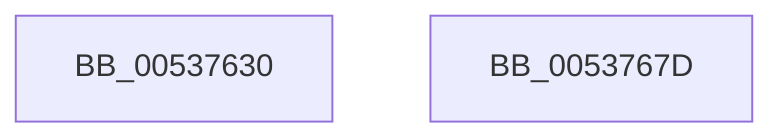

# SymCryptFdef369ModSetPostMontgomery

- RVA: `0x00537630`–`0x0053767E` (길이 `78` bytes)
- VA: `0x0000000140537630`
- 실행 섹션: `.text`
- PDB 이름 있음: `예`; PDB Function 태그: `아니요`
- unwind 정보 RVA: `0x000794E0`
- 디코드: `23`개 명령, `78/78` bytes 표시
- 미해석 바이트: `0` (있으면 어셈블리에 `.byte`로 보존)

> 이 문서는 커널 이미지의 기계어와 PDB 기호를 분석해 생성했습니다. 4번과 5번은 함수 원형과 자료형을 바이너리 사용 방식에서 추정한 C 해석이며 원본 소스 복구 결과는 아닙니다.

## 1. Dependencies

- 직접 호출 지점: **2**; 고유 호출 대상: **2**
- 직접 호출자로 확인된 함수: **0**
- RIP 상대 이미지 참조: **0**

### Outgoing calls
- `0x0053765A` → [SymCryptFdef369RawMulAsm](SymCryptFdef369RawMulAsm_function_0053B5D0.md) (function, `0x0053B5D0`)
- `0x00537668` → [SymCryptFdef369MontgomeryReduceAsm](SymCryptFdef369MontgomeryReduceAsm_function_0053B6F0.md) (function, `0x0053B6F0`)

### Direct callers
- 이 함수 시작 RVA로 연결되는 직접 call은 확인되지 않았습니다. 간접 호출은 완전히 역산할 수 없습니다.

### Static image references
- 디코드된 RIP-relative 메모리 참조가 없습니다.

## 2. Other-region calls and transfers

- 다른 실행 섹션으로 향하는 call: **0**
- 별도 외부 분기/꼬리 이동을 확인하지 못했습니다.

## 3. Assembly (complete function range)

```asm
00537630  48 89 5C 24 08                  mov qword ptr [rsp + 8], rbx
00537635  48 89 74 24 10                  mov qword ptr [rsp + 0x10], rsi
0053763A  57                              push rdi
0053763B  48 83 EC 30                     sub rsp, 0x30
0053763F  48 8B DA                        mov rbx, rdx
00537642  4C 89 44 24 20                  mov qword ptr [rsp + 0x20], r8
00537647  8B 51 04                        mov edx, dword ptr [rcx + 4]
0053764A  49 8B F0                        mov rsi, r8
0053764D  4C 8B 41 28                     mov r8, qword ptr [rcx + 0x28]
00537651  48 8B F9                        mov rdi, rcx
00537654  44 8B CA                        mov r9d, edx
00537657  48 8B CB                        mov rcx, rbx
0053765A  E8 71 3F 00 00                  call 0x14053b5d0
0053765F  4C 8B C3                        mov r8, rbx
00537662  48 8B D6                        mov rdx, rsi
00537665  48 8B CF                        mov rcx, rdi
00537668  E8 83 40 00 00                  call 0x14053b6f0
0053766D  48 8B 5C 24 40                  mov rbx, qword ptr [rsp + 0x40]
00537672  48 8B 74 24 48                  mov rsi, qword ptr [rsp + 0x48]
00537677  48 83 C4 30                     add rsp, 0x30
0053767B  5F                              pop rdi
0053767C  C3                              ret
0053767D  CC                              int3
```

## 4. C-style interpretation (structured pseudocode)

```c
__int64 __fastcall SymCryptFdef369ModSetPostMontgomery(__int64 a1, __int64 a2, __int64 a3)
{
    __int64 result;
    __int64 v_rsp;
    unsigned __int64 v_stack_m18;
    unsigned __int64 v_stack_p10;
    unsigned __int64 v_stack_p8;

    v_stack_p8 = v_rbx;
    v_stack_p10 = v_rsi;
    v_rsp = (v_rsp) - (48);
    v_stack_m18 = a3;
    result = SymCryptFdef369RawMulAsm(a2, (unsigned int)(*(unsigned int *)(a1 + 4)), *(unsigned __int64 *)(a1 + 40), (unsigned int)((unsigned int)((unsigned int)(*(unsigned int *)(a1 + 4)))));
    result = SymCryptFdef369MontgomeryReduceAsm(a1, a3, a2, (unsigned int)((unsigned int)((unsigned int)(*(unsigned int *)(a1 + 4)))));
    v_rsp = (v_rsp) + (48);
    return result;
}
```

## 5. (Beta) C Style

```c
int64_t SymCryptFdef369ModSetPostMontgomery(void *Arg1, int64_t Arg2, int64_t Arg3)
{
    uint8_t *arg1 = (uint8_t *)Arg1;

    int64_t result;
    int64_t local_rsp;
    uint64_t v_stack_m18;
    uint64_t v_stack_p10;
    uint64_t v_stack_p8;

    v_stack_p8 = local_rbx;
    v_stack_p10 = local_rsi;
    local_rsp = (local_rsp) - (48);
    v_stack_m18 = Arg3;
    result = SymCryptFdef369RawMulAsm(Arg2, (uint32_t)(*(uint32_t *)(arg1 + 0x4)), *(uint64_t *)(arg1 + 0x28), (uint32_t)((uint32_t)((uint32_t)(*(uint32_t *)(arg1 + 0x4)))));
    result = SymCryptFdef369MontgomeryReduceAsm(Arg1, Arg3, Arg2, (uint32_t)((uint32_t)((uint32_t)(*(uint32_t *)(arg1 + 0x4)))));
    local_rsp = (local_rsp) + (48);
    return result;
}
```

### 관측된 메모리 오프셋

구조체 형식이 확인되지 않은 접근은 인자 기준의 오프셋으로만 기록했습니다.

| 기준 인자 | 오프셋 표현 | 폭 (bit) | 접근 |
|---|---:|---:|---|
| `Arg1` | `+ 0x4` | `32` | `R` |
| `Arg1` | `+ 0x28` | `64` | `R` |

## 6. Execution-region graph

[열기: 2D/3D 그래프와 함수 탐색 컨트롤 패널](../../../control-panel.html?section=text&rva=0x00537630&view=graph)

- 2D 그래프는 위에서 아래로 흐르고, 3D 그래프는 빈 공간을 드래그해 회전합니다. Shift+드래그는 이동, 휠은 확대·축소, 함수 노드 선택은 대상 보고서 이동입니다.

### Static fallback


