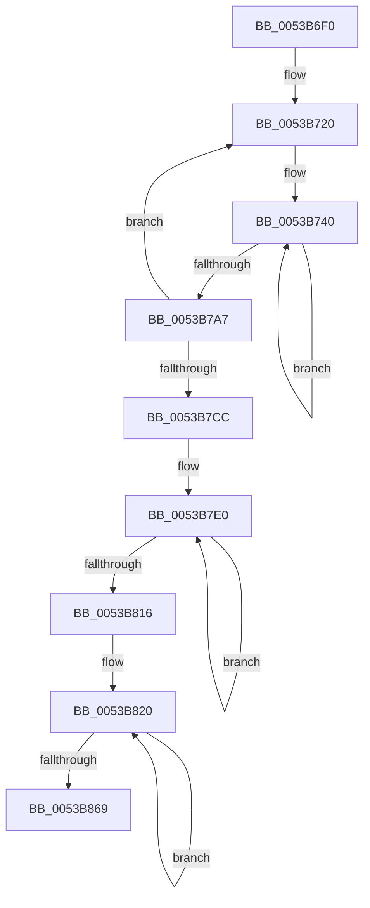

# SymCryptFdef369MontgomeryReduceAsm

- RVA: `0x0053B6F0`–`0x0053B874` (길이 `388` bytes)
- VA: `0x000000014053B6F0`
- 실행 섹션: `.text`
- PDB 이름 있음: `예`; PDB Function 태그: `아니요`
- unwind 정보 RVA: `0x000C3530`
- 디코드: `110`개 명령, `388/388` bytes 표시
- 미해석 바이트: `0` (있으면 어셈블리에 `.byte`로 보존)

> 이 문서는 커널 이미지의 기계어와 PDB 기호를 분석해 생성했습니다. 4번과 5번은 함수 원형과 자료형을 바이너리 사용 방식에서 추정한 C 해석이며 원본 소스 복구 결과는 아닙니다.

## 1. Dependencies

- 직접 호출 지점: **0**; 고유 호출 대상: **0**
- 직접 호출자로 확인된 함수: **4**
- RIP 상대 이미지 참조: **0**

### Outgoing calls
- 직접 디코드된 call 명령이 없습니다.

### Direct callers
- [SymCryptFdef369ModInvMontgomery](SymCryptFdef369ModInvMontgomery_function_00537470.md) at `0x005374C5`
- [SymCryptFdef369ModInvMontgomery](SymCryptFdef369ModInvMontgomery_function_00537470.md) at `0x005374DD`
- [SymCryptFdef369ModMulMontgomery](SymCryptFdef369ModMulMontgomery_function_00537530.md) at `0x00537569`
- [SymCryptFdef369ModPreGetMontgomery](SymCryptFdef369ModPreGetMontgomery_function_00537590.md) at `0x005375E7`
- [SymCryptFdef369ModSetPostMontgomery](SymCryptFdef369ModSetPostMontgomery_function_00537630.md) at `0x00537668`

### Static image references
- 디코드된 RIP-relative 메모리 참조가 없습니다.

## 2. Other-region calls and transfers

- 다른 실행 섹션으로 향하는 call: **0**
- 별도 외부 분기/꼬리 이동을 확인하지 못했습니다.

## 3. Assembly (complete function range)

```asm
0053B6F0  48 56                           push rsi
0053B6F2  57                              push rdi
0053B6F3  55                              push rbp
0053B6F4  53                              push rbx
0053B6F5  41 54                           push r12
0053B6F7  41 55                           push r13
0053B6F9  41 56                           push r14
0053B6FB  4C 8B D2                        mov r10, rdx
0053B6FE  44 8B 49 04                     mov r9d, dword ptr [rcx + 4]
0053B702  41 FF C1                        inc r9d
0053B705  4C 8B 59 18                     mov r11, qword ptr [rcx + 0x18]
0053B709  48 8D 89 80 00 00 00            lea rcx, [rcx + 0x80]
0053B710  67 47 8D 34 49                  lea r14d, [r9d + r9d*2]
0053B715  33 ED                           xor ebp, ebp
0053B717  66 0F 1F 84 00 00 00 00 00      nop word ptr [rax + rax]
0053B720  49 8B 32                        mov rsi, qword ptr [r10]
0053B723  4D 8B E2                        mov r12, r10
0053B726  48 8B D9                        mov rbx, rcx
0053B729  49 0F AF F3                     imul rsi, r11
0053B72D  45 8B E9                        mov r13d, r9d
0053B730  33 FF                           xor edi, edi
0053B732  66 66 66 66 66 66 0F 1F 84 00 00 00 00 00  nop word ptr [rax + rax]
0053B740  48 8B 03                        mov rax, qword ptr [rbx]
0053B743  48 F7 E6                        mul rsi
0053B746  49 03 04 24                     add rax, qword ptr [r12]
0053B74A  48 83 D2 00                     adc rdx, 0
0053B74E  48 03 C7                        add rax, rdi
0053B751  48 83 D2 00                     adc rdx, 0
0053B755  49 89 04 24                     mov qword ptr [r12], rax
0053B759  48 8B FA                        mov rdi, rdx
0053B75C  48 8B 43 08                     mov rax, qword ptr [rbx + 8]
0053B760  48 F7 E6                        mul rsi
0053B763  49 03 44 24 08                  add rax, qword ptr [r12 + 8]
0053B768  48 83 D2 00                     adc rdx, 0
0053B76C  48 03 C7                        add rax, rdi
0053B76F  48 83 D2 00                     adc rdx, 0
0053B773  49 89 44 24 08                  mov qword ptr [r12 + 8], rax
0053B778  48 8B FA                        mov rdi, rdx
0053B77B  48 8B 43 10                     mov rax, qword ptr [rbx + 0x10]
0053B77F  48 F7 E6                        mul rsi
0053B782  49 03 44 24 10                  add rax, qword ptr [r12 + 0x10]
0053B787  48 83 D2 00                     adc rdx, 0
0053B78B  48 03 C7                        add rax, rdi
0053B78E  48 83 D2 00                     adc rdx, 0
0053B792  49 89 44 24 10                  mov qword ptr [r12 + 0x10], rax
0053B797  48 8B FA                        mov rdi, rdx
0053B79A  48 83 C3 18                     add rbx, 0x18
0053B79E  49 83 C4 18                     add r12, 0x18
0053B7A2  41 FF CD                        dec r13d
0053B7A5  75 99                           jne 0x14053b740
0053B7A7  48 03 FD                        add rdi, rbp
0053B7AA  BD 00 00 00 00                  mov ebp, 0
0053B7AF  48 83 D5 00                     adc rbp, 0
0053B7B3  49 03 3C 24                     add rdi, qword ptr [r12]
0053B7B7  48 83 D5 00                     adc rbp, 0
0053B7BB  49 89 3C 24                     mov qword ptr [r12], rdi
0053B7BF  49 83 C2 08                     add r10, 8
0053B7C3  41 FF CE                        dec r14d
0053B7C6  0F 85 54 FF FF FF               jne 0x14053b720
0053B7CC  45 8B E9                        mov r13d, r9d
0053B7CF  4D 8B E2                        mov r12, r10
0053B7D2  48 8B D9                        mov rbx, rcx
0053B7D5  49 8B F8                        mov rdi, r8
0053B7D8  0F 1F 84 00 00 00 00 00         nop dword ptr [rax + rax]
0053B7E0  49 8B 04 24                     mov rax, qword ptr [r12]
0053B7E4  48 1B 03                        sbb rax, qword ptr [rbx]
0053B7E7  48 89 07                        mov qword ptr [rdi], rax
0053B7EA  49 8B 44 24 08                  mov rax, qword ptr [r12 + 8]
0053B7EF  48 1B 43 08                     sbb rax, qword ptr [rbx + 8]
0053B7F3  48 89 47 08                     mov qword ptr [rdi + 8], rax
0053B7F7  49 8B 44 24 10                  mov rax, qword ptr [r12 + 0x10]
0053B7FC  48 1B 43 10                     sbb rax, qword ptr [rbx + 0x10]
0053B800  48 89 47 10                     mov qword ptr [rdi + 0x10], rax
0053B804  4D 8D 64 24 18                  lea r12, [r12 + 0x18]
0053B809  48 8D 5B 18                     lea rbx, [rbx + 0x18]
0053B80D  48 8D 7F 18                     lea rdi, [rdi + 0x18]
0053B811  41 FF CD                        dec r13d
0053B814  75 CA                           jne 0x14053b7e0
0053B816  48 83 DD 00                     sbb rbp, 0
0053B81A  66 0F 1F 44 00 00               nop word ptr [rax + rax]
0053B820  49 8B 02                        mov rax, qword ptr [r10]
0053B823  49 8B 08                        mov rcx, qword ptr [r8]
0053B826  48 33 C1                        xor rax, rcx
0053B829  48 23 C5                        and rax, rbp
0053B82C  48 33 C1                        xor rax, rcx
0053B82F  49 89 00                        mov qword ptr [r8], rax
0053B832  49 8B 42 08                     mov rax, qword ptr [r10 + 8]
0053B836  49 8B 48 08                     mov rcx, qword ptr [r8 + 8]
0053B83A  48 33 C1                        xor rax, rcx
0053B83D  48 23 C5                        and rax, rbp
0053B840  48 33 C1                        xor rax, rcx
0053B843  49 89 40 08                     mov qword ptr [r8 + 8], rax
0053B847  49 8B 42 10                     mov rax, qword ptr [r10 + 0x10]
0053B84B  49 8B 48 10                     mov rcx, qword ptr [r8 + 0x10]
0053B84F  48 33 C1                        xor rax, rcx
0053B852  48 23 C5                        and rax, rbp
0053B855  48 33 C1                        xor rax, rcx
0053B858  49 89 40 10                     mov qword ptr [r8 + 0x10], rax
0053B85C  49 83 C2 18                     add r10, 0x18
0053B860  49 83 C0 18                     add r8, 0x18
0053B864  41 FF C9                        dec r9d
0053B867  75 B7                           jne 0x14053b820
0053B869  41 5E                           pop r14
0053B86B  41 5D                           pop r13
0053B86D  41 5C                           pop r12
0053B86F  5B                              pop rbx
0053B870  5D                              pop rbp
0053B871  5F                              pop rdi
0053B872  5E                              pop rsi
0053B873  C3                              ret
```

## 4. C-style interpretation (structured pseudocode)

```c
__int64 __fastcall SymCryptFdef369MontgomeryReduceAsm(__int64 a1, __int64 a2, __int64 a3)
{
    __int64 result;
    __int64 v_r10;
    __int64 v_r12;
    __int64 v_r13;
    __int64 v_r14;
    __int64 v_rbp;
    __int64 v_rbx;
    __int64 v_rdi;
    __int64 v_rsi;

    a4 = (unsigned int)(((unsigned int)(*(unsigned int *)(a1 + 4))) + 1);
    v_rbp = 0;
loc_0053B720:
    v_rsi = (*(unsigned __int64 *)(a2)) * (*(unsigned __int64 *)(a1 + 24));
    v_rdi = 0;
loc_0053B740:
    result = (*(unsigned __int64 *)(a1 + 128)) + (*(unsigned __int64 *)(a2));
    result = (result) + (0);
    *(unsigned __int64 *)(a2) = result;
    result = (*(unsigned __int64 *)(a1 + 128 + 8)) + (*(unsigned __int64 *)(a2 + 8));
    result = (result) + (a2);
    *(unsigned __int64 *)(a2 + 8) = result;
    result = (*(unsigned __int64 *)(a1 + 128 + 16)) + (*(unsigned __int64 *)(a2 + 16));
    result = (result) + (a2);
    *(unsigned __int64 *)(a2 + 16) = result;
    v_rbx = (a1 + 128) + (24);
    v_r12 = (a2) + (24);
    v_r13 = (unsigned int)(((unsigned int)((unsigned int)(a4))) - 1);
    if (condition_is_not_equal) goto loc_0053B740;
    v_rdi = (a2) + (0);
    v_rdi = (v_rdi) + (*(unsigned __int64 *)(v_r12));
    *(unsigned __int64 *)(v_r12) = v_rdi;
    v_r10 = (a2) + (8);
    v_r14 = (unsigned int)((a4 + a4 * 2) - 1);
    if (condition_is_not_equal) goto loc_0053B720;
loc_0053B7E0:
    *(unsigned __int64 *)(a3) = *(unsigned __int64 *)(v_r10);
    *(unsigned __int64 *)(a3 + 8) = *(unsigned __int64 *)(v_r10 + 8);
    *(unsigned __int64 *)(a3 + 16) = *(unsigned __int64 *)(v_r10 + 16);
    v_r13 = (unsigned int)(((unsigned int)((unsigned int)(a4))) - 1);
    if (condition_is_not_equal) goto loc_0053B7E0;
loc_0053B820:
    result = (*(unsigned __int64 *)(v_r10)) ^ (*(unsigned __int64 *)(a3));
    result = (result) & (0);
    result = (result) ^ (*(unsigned __int64 *)(a3));
    *(unsigned __int64 *)(a3) = result;
    result = (*(unsigned __int64 *)(v_r10 + 8)) ^ (*(unsigned __int64 *)(a3 + 8));
    result = (result) & (0);
    result = (result) ^ (*(unsigned __int64 *)(a3 + 8));
    *(unsigned __int64 *)(a3 + 8) = result;
    result = (*(unsigned __int64 *)(v_r10 + 16)) ^ (*(unsigned __int64 *)(a3 + 16));
    result = (result) & (0);
    result = (result) ^ (*(unsigned __int64 *)(a3 + 16));
    *(unsigned __int64 *)(a3 + 16) = result;
    v_r10 = (v_r10) + (24);
    a3 = (a3) + (24);
    a4 = (unsigned int)((a4) - 1);
    if (condition_is_not_equal) goto loc_0053B820;
    return result;
}
```

## 5. (Beta) C Style

```c
int64_t SymCryptFdef369MontgomeryReduceAsm(void *Arg1, void *Arg2, void *Arg3)
{
    uint8_t *arg1 = (uint8_t *)Arg1;
    uint8_t *arg2 = (uint8_t *)Arg2;
    uint8_t *arg3 = (uint8_t *)Arg3;

    int64_t result;
    int64_t local_r10;
    int64_t local_r12;
    int64_t local_r13;
    int64_t local_r14;
    int64_t local_rbp;
    int64_t local_rbx;
    int64_t local_rdi;
    int64_t local_rsi;

    a4 = (uint32_t)(((uint32_t)(*(uint32_t *)(arg1 + 0x4))) + 1);
    local_rbp = 0;
loc_0053B720:
    local_rsi = (*(uint64_t *)(arg2)) * (*(uint64_t *)(arg1 + 0x18));
    local_rdi = 0;
loc_0053B740:
    result = (*(uint64_t *)(arg1 + 0x80)) + (*(uint64_t *)(arg2));
    result = (result) + (0);
    *(uint64_t *)(arg2) = result;
    result = (*(uint64_t *)(arg1 + 0x80 + 0x8)) + (*(uint64_t *)(arg2 + 0x8));
    result = (result) + (Arg2);
    *(uint64_t *)(arg2 + 0x8) = result;
    result = (*(uint64_t *)(arg1 + 0x80 + 0x10)) + (*(uint64_t *)(arg2 + 0x10));
    result = (result) + (Arg2);
    *(uint64_t *)(arg2 + 0x10) = result;
    local_rbx = (Arg1 + 128) + (24);
    local_r12 = (Arg2) + (24);
    local_r13 = (uint32_t)(((uint32_t)((uint32_t)(a4))) - 1);
    if (condition_is_not_equal) goto loc_0053B740;
    local_rdi = (Arg2) + (0);
    local_rdi = (local_rdi) + (*(uint64_t *)(local_r12));
    *(uint64_t *)(local_r12) = local_rdi;
    local_r10 = (Arg2) + (8);
    local_r14 = (uint32_t)((a4 + a4 * 2) - 1);
    if (condition_is_not_equal) goto loc_0053B720;
loc_0053B7E0:
    *(uint64_t *)(arg3) = *(uint64_t *)(local_r10);
    *(uint64_t *)(arg3 + 0x8) = *(uint64_t *)(local_r10 + 0x8);
    *(uint64_t *)(arg3 + 0x10) = *(uint64_t *)(local_r10 + 0x10);
    local_r13 = (uint32_t)(((uint32_t)((uint32_t)(a4))) - 1);
    if (condition_is_not_equal) goto loc_0053B7E0;
loc_0053B820:
    result = (*(uint64_t *)(local_r10)) ^ (*(uint64_t *)(arg3));
    result = (result) & (0);
    result = (result) ^ (*(uint64_t *)(arg3));
    *(uint64_t *)(arg3) = result;
    result = (*(uint64_t *)(local_r10 + 0x8)) ^ (*(uint64_t *)(arg3 + 0x8));
    result = (result) & (0);
    result = (result) ^ (*(uint64_t *)(arg3 + 0x8));
    *(uint64_t *)(arg3 + 0x8) = result;
    result = (*(uint64_t *)(local_r10 + 0x10)) ^ (*(uint64_t *)(arg3 + 0x10));
    result = (result) & (0);
    result = (result) ^ (*(uint64_t *)(arg3 + 0x10));
    *(uint64_t *)(arg3 + 0x10) = result;
    local_r10 = (local_r10) + (24);
    Arg3 = (Arg3) + (24);
    a4 = (uint32_t)((a4) - 1);
    if (condition_is_not_equal) goto loc_0053B820;
    return result;
}
```

### 관측된 메모리 오프셋

구조체 형식이 확인되지 않은 접근은 인자 기준의 오프셋으로만 기록했습니다.

| 기준 인자 | 오프셋 표현 | 폭 (bit) | 접근 |
|---|---:|---:|---|
| `Arg1` | `+ 0x0` | `64` | `R` |
| `Arg1` | `+ 0x4` | `32` | `R` |
| `Arg1` | `+ 0x8` | `64` | `R` |
| `Arg1` | `+ 0x10` | `64` | `R` |
| `Arg1` | `+ 0x18` | `64` | `R` |
| `Arg1` | `+ 0x80` | `64` | `R` |
| `Arg2` | `+ 0x0` | `64` | `R` |
| `Arg2` | `+ 0x0` | `64` | `W` |
| `Arg2` | `+ 0x8` | `64` | `R` |
| `Arg2` | `+ 0x8` | `64` | `W` |
| `Arg2` | `+ 0x10` | `64` | `R` |
| `Arg2` | `+ 0x10` | `64` | `W` |
| `Arg2` | `+ 0x18` | `64` | `R` |
| `Arg3` | `+ 0x0` | `64` | `R` |
| `Arg3` | `+ 0x0` | `64` | `W` |
| `Arg3` | `+ 0x8` | `64` | `R` |
| `Arg3` | `+ 0x8` | `64` | `W` |
| `Arg3` | `+ 0x10` | `64` | `R` |
| `Arg3` | `+ 0x10` | `64` | `W` |
| `Arg3` | `+ 0x18` | `64` | `R` |

## 6. Execution-region graph

[열기: 2D/3D 그래프와 함수 탐색 컨트롤 패널](../../../control-panel.html?section=text&rva=0x0053B6F0&view=graph)

- 2D 그래프는 위에서 아래로 흐르고, 3D 그래프는 빈 공간을 드래그해 회전합니다. Shift+드래그는 이동, 휠은 확대·축소, 함수 노드 선택은 대상 보고서 이동입니다.

### Static fallback


