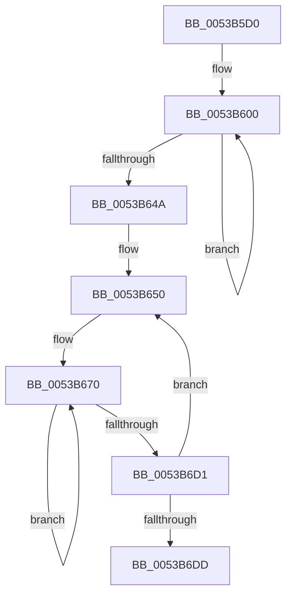

# SymCryptFdef369RawMulAsm

- RVA: `0x0053B5D0`–`0x0053B6E4` (길이 `276` bytes)
- VA: `0x000000014053B5D0`
- 실행 섹션: `.text`
- PDB 이름 있음: `예`; PDB Function 태그: `아니요`
- unwind 정보 RVA: `0x000C36D8`
- 디코드: `85`개 명령, `276/276` bytes 표시
- 미해석 바이트: `0` (있으면 어셈블리에 `.byte`로 보존)

> 이 문서는 커널 이미지의 기계어와 PDB 기호를 분석해 생성했습니다. 4번과 5번은 함수 원형과 자료형을 바이너리 사용 방식에서 추정한 C 해석이며 원본 소스 복구 결과는 아닙니다.

## 1. Dependencies

- 직접 호출 지점: **0**; 고유 호출 대상: **0**
- 직접 호출자로 확인된 함수: **2**
- RIP 상대 이미지 참조: **0**

### Outgoing calls
- 직접 디코드된 call 명령이 없습니다.

### Direct callers
- [SymCryptFdef369ModMulMontgomery](SymCryptFdef369ModMulMontgomery_function_00537530.md) at `0x0053755B`
- [SymCryptFdef369ModSetPostMontgomery](SymCryptFdef369ModSetPostMontgomery_function_00537630.md) at `0x0053765A`

### Static image references
- 디코드된 RIP-relative 메모리 참조가 없습니다.

## 2. Other-region calls and transfers

- 다른 실행 섹션으로 향하는 call: **0**
- 별도 외부 분기/꼬리 이동을 확인하지 못했습니다.

## 3. Assembly (complete function range)

```asm
0053B5D0  48 56                           push rsi
0053B5D2  57                              push rdi
0053B5D3  55                              push rbp
0053B5D4  53                              push rbx
0053B5D5  41 54                           push r12
0053B5D7  4C 8B D2                        mov r10, rdx
0053B5DA  4C 8B 5C 24 50                  mov r11, qword ptr [rsp + 0x50]
0053B5DF  41 FF C2                        inc r10d
0053B5E2  41 FF C1                        inc r9d
0053B5E5  67 47 8D 14 52                  lea r10d, [r10d + r10d*2]
0053B5EA  49 8B F0                        mov rsi, r8
0053B5ED  49 8B FB                        mov rdi, r11
0053B5F0  48 8B 29                        mov rbp, qword ptr [rcx]
0053B5F3  48 33 DB                        xor rbx, rbx
0053B5F6  45 8B E1                        mov r12d, r9d
0053B5F9  0F 1F 80 00 00 00 00            nop dword ptr [rax]
0053B600  48 8B 06                        mov rax, qword ptr [rsi]
0053B603  48 F7 E5                        mul rbp
0053B606  48 03 C3                        add rax, rbx
0053B609  48 83 D2 00                     adc rdx, 0
0053B60D  48 89 07                        mov qword ptr [rdi], rax
0053B610  48 8B DA                        mov rbx, rdx
0053B613  48 8B 46 08                     mov rax, qword ptr [rsi + 8]
0053B617  48 F7 E5                        mul rbp
0053B61A  48 03 C3                        add rax, rbx
0053B61D  48 83 D2 00                     adc rdx, 0
0053B621  48 89 47 08                     mov qword ptr [rdi + 8], rax
0053B625  48 8B DA                        mov rbx, rdx
0053B628  48 8B 46 10                     mov rax, qword ptr [rsi + 0x10]
0053B62C  48 F7 E5                        mul rbp
0053B62F  48 03 C3                        add rax, rbx
0053B632  48 83 D2 00                     adc rdx, 0
0053B636  48 89 47 10                     mov qword ptr [rdi + 0x10], rax
0053B63A  48 8B DA                        mov rbx, rdx
0053B63D  48 83 C6 18                     add rsi, 0x18
0053B641  48 83 C7 18                     add rdi, 0x18
0053B645  41 FF CC                        dec r12d
0053B648  75 B6                           jne 0x14053b600
0053B64A  48 89 17                        mov qword ptr [rdi], rdx
0053B64D  41 FF CA                        dec r10d
0053B650  48 83 C1 08                     add rcx, 8
0053B654  49 83 C3 08                     add r11, 8
0053B658  48 8B 29                        mov rbp, qword ptr [rcx]
0053B65B  49 8B F0                        mov rsi, r8
0053B65E  49 8B FB                        mov rdi, r11
0053B661  48 33 DB                        xor rbx, rbx
0053B664  45 8B E1                        mov r12d, r9d
0053B667  66 0F 1F 84 00 00 00 00 00      nop word ptr [rax + rax]
0053B670  48 8B 06                        mov rax, qword ptr [rsi]
0053B673  48 F7 E5                        mul rbp
0053B676  48 03 07                        add rax, qword ptr [rdi]
0053B679  48 83 D2 00                     adc rdx, 0
0053B67D  48 03 C3                        add rax, rbx
0053B680  48 83 D2 00                     adc rdx, 0
0053B684  48 89 07                        mov qword ptr [rdi], rax
0053B687  48 8B DA                        mov rbx, rdx
0053B68A  48 8B 46 08                     mov rax, qword ptr [rsi + 8]
0053B68E  48 F7 E5                        mul rbp
0053B691  48 03 47 08                     add rax, qword ptr [rdi + 8]
0053B695  48 83 D2 00                     adc rdx, 0
0053B699  48 03 C3                        add rax, rbx
0053B69C  48 83 D2 00                     adc rdx, 0
0053B6A0  48 89 47 08                     mov qword ptr [rdi + 8], rax
0053B6A4  48 8B DA                        mov rbx, rdx
0053B6A7  48 8B 46 10                     mov rax, qword ptr [rsi + 0x10]
0053B6AB  48 F7 E5                        mul rbp
0053B6AE  48 03 47 10                     add rax, qword ptr [rdi + 0x10]
0053B6B2  48 83 D2 00                     adc rdx, 0
0053B6B6  48 03 C3                        add rax, rbx
0053B6B9  48 83 D2 00                     adc rdx, 0
0053B6BD  48 89 47 10                     mov qword ptr [rdi + 0x10], rax
0053B6C1  48 8B DA                        mov rbx, rdx
0053B6C4  48 83 C6 18                     add rsi, 0x18
0053B6C8  48 83 C7 18                     add rdi, 0x18
0053B6CC  41 FF CC                        dec r12d
0053B6CF  75 9F                           jne 0x14053b670
0053B6D1  48 89 17                        mov qword ptr [rdi], rdx
0053B6D4  41 FF CA                        dec r10d
0053B6D7  0F 85 73 FF FF FF               jne 0x14053b650
0053B6DD  41 5C                           pop r12
0053B6DF  5B                              pop rbx
0053B6E0  5D                              pop rbp
0053B6E1  5F                              pop rdi
0053B6E2  5E                              pop rsi
0053B6E3  C3                              ret
```

## 4. C-style interpretation (structured pseudocode)

```c
__int64 __fastcall SymCryptFdef369RawMulAsm(__int64 a1, __int64 a2, __int64 a3, int a4, __int64 a5)
{
    __int64 result;
    __int64 v_r10;
    __int64 v_r11;
    __int64 v_r12;
    __int64 v_rbx;
    __int64 v_rdi;
    __int64 v_rsi;

    v_r10 = (unsigned int)((a2) + 1);
    a4 = (unsigned int)((a4) + 1);
    v_rbx = 0;
loc_0053B600:
    result = (*(unsigned __int64 *)(a3)) + (0);
    *(unsigned __int64 *)(a5) = result;
    result = (*(unsigned __int64 *)(a3 + 8)) + (a2);
    *(unsigned __int64 *)(a5 + 8) = result;
    result = (*(unsigned __int64 *)(a3 + 16)) + (a2);
    *(unsigned __int64 *)(a5 + 16) = result;
    v_rsi = (a3) + (24);
    v_rdi = (a5) + (24);
    v_r12 = (unsigned int)(((unsigned int)(a4)) - 1);
    if (condition_is_not_equal) goto loc_0053B600;
    *(unsigned __int64 *)(v_rdi) = a2;
    v_r10 = (unsigned int)((v_r10 + v_r10 * 2) - 1);
loc_0053B650:
    a1 = (a1) + (8);
    v_r11 = (a5) + (8);
    v_rbx = 0;
loc_0053B670:
    result = (*(unsigned __int64 *)(a3)) + (*(unsigned __int64 *)(v_r11));
    result = (result) + (0);
    *(unsigned __int64 *)(v_r11) = result;
    result = (*(unsigned __int64 *)(a3 + 8)) + (*(unsigned __int64 *)(v_r11 + 8));
    result = (result) + (a2);
    *(unsigned __int64 *)(v_r11 + 8) = result;
    result = (*(unsigned __int64 *)(a3 + 16)) + (*(unsigned __int64 *)(v_r11 + 16));
    result = (result) + (a2);
    *(unsigned __int64 *)(v_r11 + 16) = result;
    v_rsi = (a3) + (24);
    v_rdi = (v_r11) + (24);
    v_r12 = (unsigned int)(((unsigned int)(a4)) - 1);
    if (condition_is_not_equal) goto loc_0053B670;
    *(unsigned __int64 *)(v_rdi) = a2;
    v_r10 = (unsigned int)((v_r10) - 1);
    if (condition_is_not_equal) goto loc_0053B650;
    return result;
}
```

## 5. (Beta) C Style

```c
int64_t SymCryptFdef369RawMulAsm(void *Arg1, int64_t Arg2, void *Arg3, int32_t Arg4, void *Arg5)
{
    uint8_t *arg1 = (uint8_t *)Arg1;
    uint8_t *arg3 = (uint8_t *)Arg3;
    uint8_t *arg5 = (uint8_t *)Arg5;

    int64_t result;
    int64_t local_r10;
    int64_t local_r11;
    int64_t local_r12;
    int64_t local_rbx;
    int64_t local_rdi;
    int64_t local_rsi;

    local_r10 = (uint32_t)((Arg2) + 1);
    Arg4 = (uint32_t)((Arg4) + 1);
    local_rbx = 0;
loc_0053B600:
    result = (*(uint64_t *)(arg3)) + (0);
    *(uint64_t *)(arg5) = result;
    result = (*(uint64_t *)(arg3 + 0x8)) + (Arg2);
    *(uint64_t *)(arg5 + 0x8) = result;
    result = (*(uint64_t *)(arg3 + 0x10)) + (Arg2);
    *(uint64_t *)(arg5 + 0x10) = result;
    local_rsi = (Arg3) + (24);
    local_rdi = (Arg5) + (24);
    local_r12 = (uint32_t)(((uint32_t)(Arg4)) - 1);
    if (condition_is_not_equal) goto loc_0053B600;
    *(uint64_t *)(local_rdi) = Arg2;
    local_r10 = (uint32_t)((local_r10 + local_r10 * 2) - 1);
loc_0053B650:
    Arg1 = (Arg1) + (8);
    local_r11 = (Arg5) + (8);
    local_rbx = 0;
loc_0053B670:
    result = (*(uint64_t *)(arg3)) + (*(uint64_t *)(local_r11));
    result = (result) + (0);
    *(uint64_t *)(local_r11) = result;
    result = (*(uint64_t *)(arg3 + 0x8)) + (*(uint64_t *)(local_r11 + 0x8));
    result = (result) + (Arg2);
    *(uint64_t *)(local_r11 + 0x8) = result;
    result = (*(uint64_t *)(arg3 + 0x10)) + (*(uint64_t *)(local_r11 + 0x10));
    result = (result) + (Arg2);
    *(uint64_t *)(local_r11 + 0x10) = result;
    local_rsi = (Arg3) + (24);
    local_rdi = (local_r11) + (24);
    local_r12 = (uint32_t)(((uint32_t)(Arg4)) - 1);
    if (condition_is_not_equal) goto loc_0053B670;
    *(uint64_t *)(local_rdi) = Arg2;
    local_r10 = (uint32_t)((local_r10) - 1);
    if (condition_is_not_equal) goto loc_0053B650;
    return result;
}
```

### 관측된 메모리 오프셋

구조체 형식이 확인되지 않은 접근은 인자 기준의 오프셋으로만 기록했습니다.

| 기준 인자 | 오프셋 표현 | 폭 (bit) | 접근 |
|---|---:|---:|---|
| `Arg1` | `+ 0x0` | `64` | `R` |
| `Arg3` | `+ 0x0` | `64` | `R` |
| `Arg3` | `+ 0x8` | `64` | `R` |
| `Arg3` | `+ 0x10` | `64` | `R` |
| `Arg5` | `+ 0x0` | `64` | `R` |
| `Arg5` | `+ 0x0` | `64` | `W` |
| `Arg5` | `+ 0x8` | `64` | `R` |
| `Arg5` | `+ 0x8` | `64` | `W` |
| `Arg5` | `+ 0x10` | `64` | `R` |
| `Arg5` | `+ 0x10` | `64` | `W` |

## 6. Execution-region graph

[열기: 2D/3D 그래프와 함수 탐색 컨트롤 패널](../../../control-panel.html?section=text&rva=0x0053B5D0&view=graph)

- 2D 그래프는 위에서 아래로 흐르고, 3D 그래프는 빈 공간을 드래그해 회전합니다. Shift+드래그는 이동, 휠은 확대·축소, 함수 노드 선택은 대상 보고서 이동입니다.

### Static fallback


