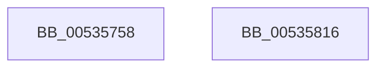

# SymCryptFdefBitsizeOfUint32

- RVA: `0x00535758`–`0x00535817` (길이 `191` bytes)
- VA: `0x0000000140535758`
- 실행 섹션: `.text`
- PDB 이름 있음: `예`; PDB Function 태그: `아니요`
- unwind 정보 RVA: `0x000DB714`
- 디코드: `64`개 명령, `191/191` bytes 표시
- 미해석 바이트: `0` (있으면 어셈블리에 `.byte`로 보존)

> 이 문서는 커널 이미지의 기계어와 PDB 기호를 분석해 생성했습니다. 4번과 5번은 함수 원형과 자료형을 바이너리 사용 방식에서 추정한 C 해석이며 원본 소스 복구 결과는 아닙니다.

## 1. Dependencies

- 직접 호출 지점: **0**; 고유 호출 대상: **0**
- 직접 호출자로 확인된 함수: **1**
- RIP 상대 이미지 참조: **0**

### Outgoing calls
- 직접 디코드된 call 명령이 없습니다.

### Direct callers
- [SymCryptFdefIntBitsizeOfValue](SymCryptFdefIntBitsizeOfValue_function_005359BC.md) at `0x00535A1A`

### Static image references
- 디코드된 RIP-relative 메모리 참조가 없습니다.

## 2. Other-region calls and transfers

- 다른 실행 섹션으로 향하는 call: **0**
- 별도 외부 분기/꼬리 이동을 확인하지 못했습니다.

## 3. Assembly (complete function range)

```asm
00535758  44 8B C1                        mov r8d, ecx
0053575B  41 81 E0 00 00 FF FF            and r8d, 0xffff0000
00535762  41 8B C0                        mov eax, r8d
00535765  48 F7 D8                        neg rax
00535768  41 C1 E8 10                     shr r8d, 0x10
0053576C  48 C1 E8 20                     shr rax, 0x20
00535770  44 23 C0                        and r8d, eax
00535773  44 8B D0                        mov r10d, eax
00535776  F7 D0                           not eax
00535778  41 83 E2 10                     and r10d, 0x10
0053577C  23 C1                           and eax, ecx
0053577E  0F B7 C0                        movzx eax, ax
00535781  44 0B C0                        or r8d, eax
00535784  41 8B C8                        mov ecx, r8d
00535787  81 E1 00 FF 00 00               and ecx, 0xff00
0053578D  F7 D9                           neg ecx
0053578F  C1 E9 10                        shr ecx, 0x10
00535792  8B C1                           mov eax, ecx
00535794  83 E0 08                        and eax, 8
00535797  44 0B D0                        or r10d, eax
0053579A  8B C1                           mov eax, ecx
0053579C  F7 D0                           not eax
0053579E  41 23 C0                        and eax, r8d
005357A1  41 C1 E8 08                     shr r8d, 8
005357A5  44 23 C1                        and r8d, ecx
005357A8  0F B6 D0                        movzx edx, al
005357AB  41 0B D0                        or edx, r8d
005357AE  8B CA                           mov ecx, edx
005357B0  44 8B C2                        mov r8d, edx
005357B3  81 E1 F0 00 00 00               and ecx, 0xf0
005357B9  41 C1 E8 04                     shr r8d, 4
005357BD  F7 D9                           neg ecx
005357BF  C1 E9 10                        shr ecx, 0x10
005357C2  8B C1                           mov eax, ecx
005357C4  44 23 C1                        and r8d, ecx
005357C7  F7 D1                           not ecx
005357C9  83 E0 04                        and eax, 4
005357CC  23 CA                           and ecx, edx
005357CE  44 0B D0                        or r10d, eax
005357D1  83 E1 0F                        and ecx, 0xf
005357D4  44 0B C1                        or r8d, ecx
005357D7  45 8B C8                        mov r9d, r8d
005357DA  41 8B D0                        mov edx, r8d
005357DD  41 83 E1 0C                     and r9d, 0xc
005357E1  C1 EA 02                        shr edx, 2
005357E4  41 F7 D9                        neg r9d
005357E7  41 C1 E9 10                     shr r9d, 0x10
005357EB  41 8B C1                        mov eax, r9d
005357EE  41 23 D1                        and edx, r9d
005357F1  F7 D0                           not eax
005357F3  41 83 E1 02                     and r9d, 2
005357F7  41 23 C0                        and eax, r8d
005357FA  83 E0 03                        and eax, 3
005357FD  0B D0                           or edx, eax
005357FF  8B CA                           mov ecx, edx
00535801  D1 E9                           shr ecx, 1
00535803  83 E1 01                        and ecx, 1
00535806  44 0B C9                        or r9d, ecx
00535809  0B CA                           or ecx, edx
0053580B  83 E1 01                        and ecx, 1
0053580E  45 0B CA                        or r9d, r10d
00535811  42 8D 04 09                     lea eax, [rcx + r9]
00535815  C3                              ret
00535816  CC                              int3
```

## 4. C-style interpretation (structured pseudocode)

```c
__int64 __fastcall SymCryptFdefBitsizeOfUint32(int a1)
{
    __int64 result;
    __int64 v_r10;

    a3 = (unsigned int)(((unsigned int)(a1)) & (0xFFFF0000ULL));
    result = -((unsigned int)((unsigned int)(a3)));
    a3 = (unsigned int)((a3) >> (16));
    result = (result) >> (32);
    a3 = (unsigned int)((a3) & ((unsigned int)(result)));
    result = (unsigned int)(~(result));
    v_r10 = (unsigned int)(((unsigned int)((unsigned int)(result))) & (16));
    result = (unsigned int)((result) & (a1));
    a3 = (unsigned int)((a3) | ((unsigned int)((unsigned __int16)(result))));
    a1 = (unsigned int)(((unsigned int)((unsigned int)(a3))) & (0xFF00ULL));
    a1 = (unsigned int)(-(a1));
    a1 = (unsigned int)((a1) >> (16));
    result = (unsigned int)(((unsigned int)(a1)) & (8));
    v_r10 = (unsigned int)((v_r10) | ((unsigned int)(result)));
    result = (unsigned int)(~((unsigned int)(a1)));
    result = (unsigned int)((result) & ((unsigned int)(a3)));
    a3 = (unsigned int)((a3) >> (8));
    a3 = (unsigned int)((a3) & (a1));
    a2 = (unsigned int)(((unsigned __int8)(result)) | ((unsigned int)(a3)));
    a1 = (unsigned int)(((unsigned int)((unsigned int)(a2))) & (240));
    a3 = (unsigned int)(((unsigned int)((unsigned int)(a2))) >> (4));
    a1 = (unsigned int)(-(a1));
    a1 = (unsigned int)((a1) >> (16));
    a3 = (unsigned int)((a3) & (a1));
    a1 = (unsigned int)(~(a1));
    result = (unsigned int)(((unsigned int)(a1)) & (4));
    a1 = (unsigned int)((a1) & ((unsigned int)(a2)));
    v_r10 = (unsigned int)((v_r10) | ((unsigned int)(result)));
    a1 = (unsigned int)((a1) & (15));
    a3 = (unsigned int)((a3) | (a1));
    a4 = (unsigned int)(((unsigned int)((unsigned int)(a3))) & (12));
    a2 = (unsigned int)(((unsigned int)((unsigned int)(a3))) >> (2));
    a4 = (unsigned int)(-(a4));
    a4 = (unsigned int)((a4) >> (16));
    a2 = (unsigned int)((a2) & ((unsigned int)(a4)));
    result = (unsigned int)(~((unsigned int)((unsigned int)(a4))));
    a4 = (unsigned int)((a4) & (2));
    result = (unsigned int)((result) & ((unsigned int)(a3)));
    result = (unsigned int)((result) & (3));
    a2 = (unsigned int)((a2) | ((unsigned int)(result)));
    a1 = (unsigned int)(((unsigned int)((unsigned int)(a2))) >> (1));
    a1 = (unsigned int)((a1) & (1));
    a4 = (unsigned int)((a4) | (a1));
    a1 = (unsigned int)((a1) | ((unsigned int)(a2)));
    a1 = (unsigned int)((a1) & (1));
    a4 = (unsigned int)((a4) | ((unsigned int)(v_r10)));
    return a1 + a4 * 1;
}
```

## 5. (Beta) C Style

```c
int64_t SymCryptFdefBitsizeOfUint32(int32_t Arg1)
{
    int64_t result;
    int64_t local_r10;

    a3 = (uint32_t)(((uint32_t)(Arg1)) & (0xFFFF0000ULL));
    result = -((uint32_t)((uint32_t)(a3)));
    a3 = (uint32_t)((a3) >> (16));
    result = (result) >> (32);
    a3 = (uint32_t)((a3) & ((uint32_t)(result)));
    result = (uint32_t)(~(result));
    local_r10 = (uint32_t)(((uint32_t)((uint32_t)(result))) & (16));
    result = (uint32_t)((result) & (Arg1));
    a3 = (uint32_t)((a3) | ((uint32_t)((uint16_t)(result))));
    Arg1 = (uint32_t)(((uint32_t)((uint32_t)(a3))) & (0xFF00ULL));
    Arg1 = (uint32_t)(-(Arg1));
    Arg1 = (uint32_t)((Arg1) >> (16));
    result = (uint32_t)(((uint32_t)(Arg1)) & (8));
    local_r10 = (uint32_t)((local_r10) | ((uint32_t)(result)));
    result = (uint32_t)(~((uint32_t)(Arg1)));
    result = (uint32_t)((result) & ((uint32_t)(a3)));
    a3 = (uint32_t)((a3) >> (8));
    a3 = (uint32_t)((a3) & (Arg1));
    a2 = (uint32_t)(((uint8_t)(result)) | ((uint32_t)(a3)));
    Arg1 = (uint32_t)(((uint32_t)((uint32_t)(a2))) & (240));
    a3 = (uint32_t)(((uint32_t)((uint32_t)(a2))) >> (4));
    Arg1 = (uint32_t)(-(Arg1));
    Arg1 = (uint32_t)((Arg1) >> (16));
    a3 = (uint32_t)((a3) & (Arg1));
    Arg1 = (uint32_t)(~(Arg1));
    result = (uint32_t)(((uint32_t)(Arg1)) & (4));
    Arg1 = (uint32_t)((Arg1) & ((uint32_t)(a2)));
    local_r10 = (uint32_t)((local_r10) | ((uint32_t)(result)));
    Arg1 = (uint32_t)((Arg1) & (15));
    a3 = (uint32_t)((a3) | (Arg1));
    a4 = (uint32_t)(((uint32_t)((uint32_t)(a3))) & (12));
    a2 = (uint32_t)(((uint32_t)((uint32_t)(a3))) >> (2));
    a4 = (uint32_t)(-(a4));
    a4 = (uint32_t)((a4) >> (16));
    a2 = (uint32_t)((a2) & ((uint32_t)(a4)));
    result = (uint32_t)(~((uint32_t)((uint32_t)(a4))));
    a4 = (uint32_t)((a4) & (2));
    result = (uint32_t)((result) & ((uint32_t)(a3)));
    result = (uint32_t)((result) & (3));
    a2 = (uint32_t)((a2) | ((uint32_t)(result)));
    Arg1 = (uint32_t)(((uint32_t)((uint32_t)(a2))) >> (1));
    Arg1 = (uint32_t)((Arg1) & (1));
    a4 = (uint32_t)((a4) | (Arg1));
    Arg1 = (uint32_t)((Arg1) | ((uint32_t)(a2)));
    Arg1 = (uint32_t)((Arg1) & (1));
    a4 = (uint32_t)((a4) | ((uint32_t)(local_r10)));
    return Arg1 + a4 * 1;
}
```

## 6. Execution-region graph

[열기: 2D/3D 그래프와 함수 탐색 컨트롤 패널](../../../control-panel.html?section=text&rva=0x00535758&view=graph)

- 2D 그래프는 위에서 아래로 흐르고, 3D 그래프는 빈 공간을 드래그해 회전합니다. Shift+드래그는 이동, 휠은 확대·축소, 함수 노드 선택은 대상 보고서 이동입니다.

### Static fallback


