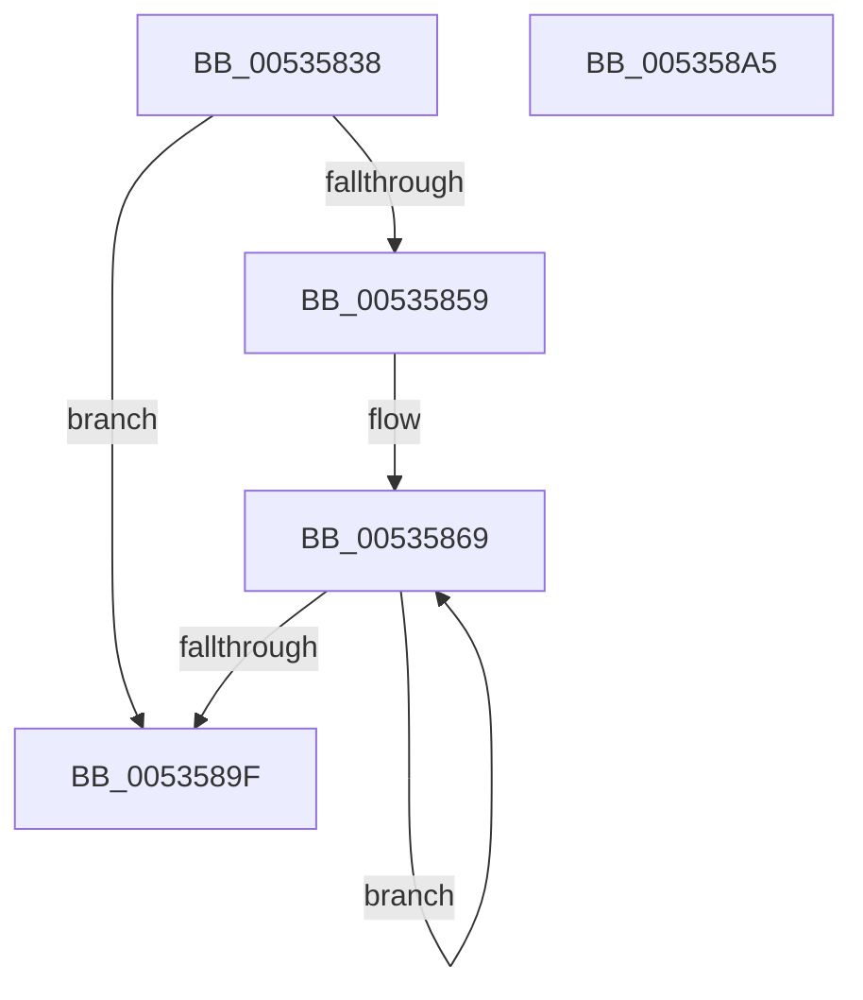

# SymCryptFdefConditionalSwapC

- RVA: `0x00535838`–`0x005358A6` (길이 `110` bytes)
- VA: `0x0000000140535838`
- 실행 섹션: `.text`
- PDB 이름 있음: `예`; PDB Function 태그: `아니요`
- unwind 정보 RVA: `0x00071750`
- 디코드: `33`개 명령, `110/110` bytes 표시
- 미해석 바이트: `0` (있으면 어셈블리에 `.byte`로 보존)

> 이 문서는 커널 이미지의 기계어와 PDB 기호를 분석해 생성했습니다. 4번과 5번은 함수 원형과 자료형을 바이너리 사용 방식에서 추정한 C 해석이며 원본 소스 복구 결과는 아닙니다.

## 1. Dependencies

- 직접 호출 지점: **0**; 고유 호출 대상: **0**
- 직접 호출자로 확인된 함수: **2**
- RIP 상대 이미지 참조: **0**

### Outgoing calls
- 직접 디코드된 call 명령이 없습니다.

### Direct callers
- [SymCryptFdefConditionalSwap](SymCryptFdefConditionalSwap_function_00535820.md) at `0x00535824`
- [SymCryptFdefIntConditionalSwap](SymCryptFdefIntConditionalSwap_function_00535A64.md) at `0x00535A77`

### Static image references
- 디코드된 RIP-relative 메모리 참조가 없습니다.

## 2. Other-region calls and transfers

- 다른 실행 섹션으로 향하는 call: **0**
- 별도 외부 분기/꼬리 이동을 확인하지 못했습니다.

## 3. Assembly (complete function range)

```asm
00535838  48 89 5C 24 08                  mov qword ptr [rsp + 8], rbx
0053583D  41 8B D9                        mov ebx, r9d
00535840  41 C1 E0 06                     shl r8d, 6
00535844  83 E3 01                        and ebx, 1
00535847  45 8B C8                        mov r9d, r8d
0053584A  48 F7 DB                        neg rbx
0053584D  49 C1 E9 03                     shr r9, 3
00535851  4C 8B D9                        mov r11, rcx
00535854  4D 85 C9                        test r9, r9
00535857  74 46                           je 0x14053589f
00535859  4C 2B DA                        sub r11, rdx
0053585C  4C 8D 52 08                     lea r10, [rdx + 8]
00535860  49 FF C9                        dec r9
00535863  49 D1 E9                        shr r9, 1
00535866  49 FF C1                        inc r9
00535869  4F 8B 44 13 F8                  mov r8, qword ptr [r11 + r10 - 8]
0053586E  4B 8B 0C 13                     mov rcx, qword ptr [r11 + r10]
00535872  49 8B D0                        mov rdx, r8
00535875  49 33 52 F8                     xor rdx, qword ptr [r10 - 8]
00535879  49 33 0A                        xor rcx, qword ptr [r10]
0053587C  48 23 D3                        and rdx, rbx
0053587F  48 23 CB                        and rcx, rbx
00535882  4C 33 C2                        xor r8, rdx
00535885  4F 89 44 13 F8                  mov qword ptr [r11 + r10 - 8], r8
0053588A  49 31 52 F8                     xor qword ptr [r10 - 8], rdx
0053588E  4B 31 0C 13                     xor qword ptr [r11 + r10], rcx
00535892  49 31 0A                        xor qword ptr [r10], rcx
00535895  4D 8D 52 10                     lea r10, [r10 + 0x10]
00535899  49 83 E9 01                     sub r9, 1
0053589D  75 CA                           jne 0x140535869
0053589F  48 8B 5C 24 08                  mov rbx, qword ptr [rsp + 8]
005358A4  C3                              ret
005358A5  CC                              int3
```

## 4. C-style interpretation (structured pseudocode)

```c
void __fastcall SymCryptFdefConditionalSwapC(__int64 a1, __int64 a2, int a3, int a4)
{
    __int64 v_r11;
    __int64 v_rbx;
    unsigned __int64 v_stack_p8;

    v_stack_p8 = v_rbx;
    a3 = (unsigned int)((a3) << (6));
    v_rbx = (unsigned int)(((unsigned int)(a4)) & (1));
    v_rbx = -(v_rbx);
    a4 = ((unsigned int)(a3)) >> (3);
    if (a4 == 0) goto loc_0053589F;
    v_r11 = (a1) - (a2);
    a4 = (a4) - 1;
    a4 = (a4) >> (1);
    a4 = (a4) + 1;
loc_00535869:
    a2 = (*(unsigned __int64 *)(v_r11 + a2 + 8 * 1 - 8)) ^ (*(unsigned __int64 *)(a2 + 8 - 8));
    a1 = (*(unsigned __int64 *)(v_r11 + a2 + 8 * 1)) ^ (*(unsigned __int64 *)(a2 + 8));
    a2 = (a2) & (v_rbx);
    a1 = (a1) & (v_rbx);
    a3 = (*(unsigned __int64 *)(v_r11 + a2 + 8 * 1 - 8)) ^ (a2);
    *(unsigned __int64 *)(v_r11 + a2 + 8 * 1 - 8) = a3;
    a4 = (a4) - (1);
    if (condition_is_not_equal) goto loc_00535869;
loc_0053589F:
    return;
}
```

## 5. (Beta) C Style

```c
void SymCryptFdefConditionalSwapC(void *Arg1, void *Arg2, int32_t Arg3, int32_t Arg4)
{
    uint8_t *arg1 = (uint8_t *)Arg1;
    uint8_t *arg2 = (uint8_t *)Arg2;

    int64_t local_r11;
    int64_t local_rbx;
    uint64_t v_stack_p8;

    v_stack_p8 = local_rbx;
    Arg3 = (uint32_t)((Arg3) << (6));
    local_rbx = (uint32_t)(((uint32_t)(Arg4)) & (1));
    local_rbx = -(local_rbx);
    Arg4 = ((uint32_t)(Arg3)) >> (3);
    if (Arg4 == 0) goto loc_0053589F;
    local_r11 = (Arg1) - (Arg2);
    Arg4 = (Arg4) - 1;
    Arg4 = (Arg4) >> (1);
    Arg4 = (Arg4) + 1;
loc_00535869:
    Arg2 = (*(uint64_t *)(local_r11 + arg2 + 0x8 * 1 - 0x8)) ^ (*(uint64_t *)(arg2 + 0x8 - 0x8));
    Arg1 = (*(uint64_t *)(local_r11 + arg2 + 0x8 * 1)) ^ (*(uint64_t *)(arg2 + 0x8));
    Arg2 = (Arg2) & (local_rbx);
    Arg1 = (Arg1) & (local_rbx);
    Arg3 = (*(uint64_t *)(local_r11 + arg2 + 0x8 * 1 - 0x8)) ^ (Arg2);
    *(uint64_t *)(local_r11 + arg2 + 0x8 * 1 - 0x8) = Arg3;
    Arg4 = (Arg4) - (1);
    if (condition_is_not_equal) goto loc_00535869;
loc_0053589F:
    return;
}
```

### 관측된 메모리 오프셋

구조체 형식이 확인되지 않은 접근은 인자 기준의 오프셋으로만 기록했습니다.

| 기준 인자 | 오프셋 표현 | 폭 (bit) | 접근 |
|---|---:|---:|---|
| `Arg1` | `- 0x8 + r10*1` | `64` | `R` |
| `Arg1` | `- 0x8 + r10*1` | `64` | `W` |
| `Arg1` | `+ 0x0 + r10*1` | `64` | `R` |
| `Arg1` | `+ 0x0 + r10*1` | `64` | `R/W` |
| `Arg2` | `- 0x8` | `64` | `R` |
| `Arg2` | `- 0x8` | `64` | `R/W` |
| `Arg2` | `+ 0x0` | `64` | `R` |
| `Arg2` | `+ 0x0` | `64` | `R/W` |
| `Arg2` | `+ 0x8` | `64` | `R` |
| `Arg2` | `+ 0x10` | `64` | `R` |

## 6. Execution-region graph

[열기: 2D/3D 그래프와 함수 탐색 컨트롤 패널](../../../control-panel.html?section=text&rva=0x00535838&view=graph)

- 2D 그래프는 위에서 아래로 흐르고, 3D 그래프는 빈 공간을 드래그해 회전합니다. Shift+드래그는 이동, 휠은 확대·축소, 함수 노드 선택은 대상 보고서 이동입니다.

### Static fallback


