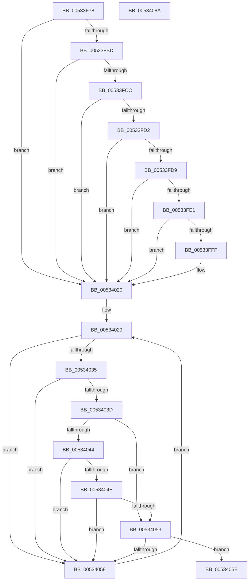

# SymCryptFdefDecideModulusType

- RVA: `0x00533F78`–`0x0053408B` (길이 `275` bytes)
- VA: `0x0000000140533F78`
- 실행 섹션: `.text`
- PDB 이름 있음: `예`; PDB Function 태그: `아니요`
- unwind 정보 RVA: `0x000D9464`
- 디코드: `80`개 명령, `275/275` bytes 표시
- 미해석 바이트: `0` (있으면 어셈블리에 `.byte`로 보존)

> 이 문서는 커널 이미지의 기계어와 PDB 기호를 분석해 생성했습니다. 4번과 5번은 함수 원형과 자료형을 바이너리 사용 방식에서 추정한 C 해석이며 원본 소스 복구 결과는 아닙니다.

## 1. Dependencies

- 직접 호출 지점: **7**; 고유 호출 대상: **7**
- 직접 호출자로 확인된 함수: **1**
- RIP 상대 이미지 참조: **4**

### Outgoing calls
- `0x00533FAE` → [SymCryptIntBitsizeOfValue](../52/SymCryptIntBitsizeOfValue_function_005254F4.md) (function, `0x005254F4`)
- `0x00533FC0` → [SymCryptIntGetValueLsbits32](../52/SymCryptIntGetValueLsbits32_function_00525668.md) (function, `0x00525668`)
- `0x00533FF6` → [SymCryptFdefRawGetValue](SymCryptFdefRawGetValue_function_00535DCC.md) (function, `0x00535DCC`)
- `0x00534013` → [memcmp](../6C/memcmp_function_006C6B10.md) (function, `0x006C6B10`)
- `0x0053402C` → [SymCryptCpuFeaturesNeverPresent](../49/SymCryptCpuFeaturesNeverPresent_function_00498CB0.md) (function, `0x00498CB0`)
- `0x00534044` → [SymCryptDigitsFromBits](../52/SymCryptDigitsFromBits_function_0052544C.md) (function, `0x0052544C`)
- `0x00534068` → [_security_check_cookie](../6A/_security_check_cookie_function_006AC640.md) (function, `0x006AC640`)

### Direct callers
- [SymCryptFdefIntToModulus](SymCryptFdefIntToModulus_function_00534144.md) at `0x00534197`

### Static image references
- `0x00533F93` → RVA `0x00E0A740` (`.data`; read)
- `0x00533FFF` → RVA `0x00006BF8` (`.rdata`; read)
- `0x00534020` → RVA `0x0001FBF0` (`.rdata`; read)
- `0x00534035` → RVA `0x00E0A730` (`.data`; reference)

## 2. Other-region calls and transfers

- 다른 실행 섹션으로 향하는 call: **0**
- 별도 외부 분기/꼬리 이동을 확인하지 못했습니다.

## 3. Assembly (complete function range)

```asm
00533F78  48 89 5C 24 10                  mov qword ptr [rsp + 0x10], rbx
00533F7D  48 89 6C 24 18                  mov qword ptr [rsp + 0x18], rbp
00533F82  48 89 74 24 20                  mov qword ptr [rsp + 0x20], rsi
00533F87  57                              push rdi
00533F88  41 56                           push r14
00533F8A  41 57                           push r15
00533F8C  48 81 EC 80 00 00 00            sub rsp, 0x80
00533F93  48 8B 05 A6 67 8D 00            mov rax, qword ptr [rip + 0x8d67a6]
00533F9A  48 33 C4                        xor rax, rsp
00533F9D  48 89 44 24 70                  mov qword ptr [rsp + 0x70], rax
00533FA2  41 8B F1                        mov esi, r9d
00533FA5  45 8B F0                        mov r14d, r8d
00533FA8  44 8B FA                        mov r15d, edx
00533FAB  48 8B D9                        mov rbx, rcx
00533FAE  E8 41 15 FF FF                  call 0x1405254f4
00533FB3  33 FF                           xor edi, edi
00533FB5  8B E8                           mov ebp, eax
00533FB7  40 F6 C6 03                     test sil, 3
00533FBB  74 63                           je 0x140534020
00533FBD  48 8B CB                        mov rcx, rbx
00533FC0  E8 A3 16 FF FF                  call 0x140525668
00533FC5  8D 57 01                        lea edx, [rdi + 1]
00533FC8  84 C2                           test dl, al
00533FCA  74 54                           je 0x140534020
00533FCC  41 83 FE 0A                     cmp r14d, 0xa
00533FD0  72 4E                           jb 0x140534020
00533FD2  8B FA                           mov edi, edx
00533FD4  40 84 F2                        test dl, sil
00533FD7  74 47                           je 0x140534020
00533FD9  81 FD 80 01 00 00               cmp ebp, 0x180
00533FDF  75 3F                           jne 0x140534020
00533FE1  48 8D 4B 20                     lea rcx, [rbx + 0x20]
00533FE5  C7 44 24 20 02 00 00 00         mov dword ptr [rsp + 0x20], 2
00533FED  44 8D 4A 3F                     lea r9d, [rdx + 0x3f]
00533FF1  4C 8D 44 24 30                  lea r8, [rsp + 0x30]
00533FF6  E8 D1 1D 00 00                  call 0x140535dcc
00533FFB  85 C0                           test eax, eax
00533FFD  75 21                           jne 0x140534020
00533FFF  48 8B 15 F2 2B AD FF            mov rdx, qword ptr [rip - 0x52d40e]
00534006  44 8D 47 2F                     lea r8d, [rdi + 0x2f]
0053400A  48 83 C2 1C                     add rdx, 0x1c
0053400E  48 8D 4C 24 40                  lea rcx, [rsp + 0x40]
00534013  E8 F8 2A 19 00                  call 0x1406c6b10
00534018  85 C0                           test eax, eax
0053401A  8D 4F 08                        lea ecx, [rdi + 8]
0053401D  0F 44 F9                        cmove edi, ecx
00534020  48 8D 1D C9 BB AE FF            lea rbx, [rip - 0x514437]
00534027  F7 D7                           not edi
00534029  8B 73 04                        mov esi, dword ptr [rbx + 4]
0053402C  E8 7F 4C F6 FF                  call 0x140498cb0
00534031  85 C6                           test esi, eax
00534033  75 23                           jne 0x140534058
00534035  85 35 F5 66 8D 00               test dword ptr [rip + 0x8d66f5], esi
0053403B  75 1B                           jne 0x140534058
0053403D  8B 4B 08                        mov ecx, dword ptr [rbx + 8]
00534040  85 C9                           test ecx, ecx
00534042  74 0F                           je 0x140534053
00534044  E8 03 14 FF FF                  call 0x14052544c
00534049  44 3B F8                        cmp r15d, eax
0053404C  77 0A                           ja 0x140534058
0053404E  3B 6B 08                        cmp ebp, dword ptr [rbx + 8]
00534051  77 05                           ja 0x140534058
00534053  85 7B 0C                        test dword ptr [rbx + 0xc], edi
00534056  74 06                           je 0x14053405e
00534058  48 83 C3 10                     add rbx, 0x10
0053405C  EB CB                           jmp 0x140534029
0053405E  8B 03                           mov eax, dword ptr [rbx]
00534060  48 8B 4C 24 70                  mov rcx, qword ptr [rsp + 0x70]
00534065  48 33 CC                        xor rcx, rsp
00534068  E8 D3 85 17 00                  call 0x1406ac640
0053406D  4C 8D 9C 24 80 00 00 00         lea r11, [rsp + 0x80]
00534075  49 8B 5B 28                     mov rbx, qword ptr [r11 + 0x28]
00534079  49 8B 6B 30                     mov rbp, qword ptr [r11 + 0x30]
0053407D  49 8B 73 38                     mov rsi, qword ptr [r11 + 0x38]
00534081  49 8B E3                        mov rsp, r11
00534084  41 5F                           pop r15
00534086  41 5E                           pop r14
00534088  5F                              pop rdi
00534089  C3                              ret
0053408A  CC                              int3
```

## 4. C-style interpretation (structured pseudocode)

```c
__int64 __fastcall SymCryptFdefDecideModulusType(__int64 a1, int a2, int a3, int a4)
{
    __int64 result;
    __int64 v_rbx;
    __int64 v_rdi;
    __int64 v_rsp;
    unsigned __int64 v_stack_m18;
    unsigned __int64 v_stack_m28;
    unsigned __int64 v_stack_m58;
    unsigned __int64 v_stack_m68;
    unsigned int v_stack_m78;
    unsigned __int64 v_stack_p10;
    unsigned __int64 v_stack_p18;
    unsigned __int64 v_stack_p20;

    v_stack_p10 = v_rbx;
    v_stack_p18 = v_rbp;
    v_stack_p20 = v_rsi;
    v_rsp = (v_rsp) - (128);
    result = (*(unsigned __int64 *)(v_rip + 9267110)) ^ (v_rsp);
    v_stack_m28 = result;
    result = SymCryptIntBitsizeOfValue(a1, a2, a3, a4);
    v_rdi = 0;
    if ((((unsigned __int8)((unsigned int)(a4))) & (3)) == 0) goto loc_00534020;
    result = SymCryptIntGetValueLsbits32(a1, a2, a3, a4);
    if ((((unsigned __int8)(v_rdi + 1)) & ((unsigned __int8)(result))) == 0) goto loc_00534020;
    if (((unsigned int)((unsigned int)(a3))) < 10) goto loc_00534020;
    if ((((unsigned __int8)(v_rdi + 1)) & ((unsigned __int8)((unsigned int)(a4)))) == 0) goto loc_00534020;
    if (((unsigned int)((unsigned int)((unsigned int)(result)))) != 384) goto loc_00534020;
    v_stack_m78 = 2;
    result = SymCryptFdefRawGetValue(a1 + 32, v_rdi + 1, v_stack_m68, v_rdi + 1 + 63);
    v_rdi = (unsigned int)((unsigned int)(v_rdi + 1));
    if ((unsigned int)(result) == 0) {
        a2 = *(unsigned __int64 *)(v_rip - 5428238);
        a3 = (unsigned int)((unsigned int)(v_rdi + 1)) + 47;
        a2 = (a2) + (28);
        a1 = v_stack_m58;
        result = memcmp(a1, a2, a3, v_rdi + 1 + 63);
        a1 = (unsigned int)((unsigned int)(v_rdi + 1)) + 8;
        v_rdi = (unsigned int)((unsigned int)(v_rdi + 1));
        if ((unsigned int)(result) == 0) { v_rdi = (unsigned int)(a1); }
    }
    v_rdi = (unsigned int)(~(v_rdi));
loc_00534029:
    result = SymCryptCpuFeaturesNeverPresent(a1, a2, a3, v_rdi + 1 + 63);
    if ((((unsigned int)((unsigned int)(*(unsigned int *)(v_rip - 5325879 + 4)))) & ((unsigned int)(result))) != 0) goto loc_00534058;
    if (((*(unsigned int *)(v_rip + 9266933)) & ((unsigned int)((unsigned int)(*(unsigned int *)(v_rip - 5325879 + 4))))) != 0) goto loc_00534058;
    if ((unsigned int)((unsigned int)(*(unsigned int *)(v_rip - 5325879 + 8))) == 0) goto loc_00534053;
    result = SymCryptDigitsFromBits((unsigned int)(*(unsigned int *)(v_rip - 5325879 + 8)), a2, a3, v_rdi + 1 + 63);
    if (((unsigned int)((unsigned int)(a2))) > ((unsigned int)(result))) goto loc_00534058;
    if (((unsigned int)((unsigned int)((unsigned int)(result)))) > (*(unsigned int *)(v_rip - 5325879 + 8))) goto loc_00534058;
loc_00534053:
    if (((*(unsigned int *)(v_rip - 5325879 + 12)) & ((unsigned int)(v_rdi))) == 0) goto loc_0053405E;
loc_00534058:
    v_rbx = (v_rip - 5325879) + (16);
    goto loc_00534029;
loc_0053405E:
    a1 = (v_stack_m28) ^ (v_rsp);
    result = _security_check_cookie(a1, a2, a3, v_rdi + 1 + 63);
    return result;
}
```

## 5. (Beta) C Style

```c
int64_t SymCryptFdefDecideModulusType(void *Arg1, int32_t Arg2, int32_t Arg3, int32_t Arg4)
{
    uint8_t *arg1 = (uint8_t *)Arg1;

    int64_t result;
    int64_t local_rbx;
    int64_t local_rdi;
    int64_t local_rsp;
    uint64_t v_stack_m18;
    uint64_t v_stack_m28;
    uint64_t v_stack_m58;
    uint64_t v_stack_m68;
    uint32_t v_stack_m78;
    uint64_t v_stack_p10;
    uint64_t v_stack_p18;
    uint64_t v_stack_p20;

    v_stack_p10 = local_rbx;
    v_stack_p18 = local_rbp;
    v_stack_p20 = local_rsi;
    local_rsp = (local_rsp) - (128);
    result = (*(uint64_t *)(v_rip + 0x8D67A6)) ^ (local_rsp);
    v_stack_m28 = result;
    result = SymCryptIntBitsizeOfValue(Arg1, Arg2, Arg3, Arg4);
    local_rdi = 0;
    if ((((uint8_t)((uint32_t)(Arg4))) & (3)) == 0) goto loc_00534020;
    result = SymCryptIntGetValueLsbits32(Arg1, Arg2, Arg3, Arg4);
    if ((((uint8_t)(local_rdi + 1)) & ((uint8_t)(result))) == 0) goto loc_00534020;
    if (((uint32_t)((uint32_t)(Arg3))) < 10) goto loc_00534020;
    if ((((uint8_t)(local_rdi + 1)) & ((uint8_t)((uint32_t)(Arg4)))) == 0) goto loc_00534020;
    if (((uint32_t)((uint32_t)((uint32_t)(result)))) != 384) goto loc_00534020;
    v_stack_m78 = 2;
    result = SymCryptFdefRawGetValue(Arg1 + 32, local_rdi + 1, v_stack_m68, local_rdi + 1 + 63);
    local_rdi = (uint32_t)((uint32_t)(local_rdi + 1));
    if ((uint32_t)(result) == 0) {
        Arg2 = *(uint64_t *)(v_rip - 0x52D40E);
        Arg3 = (uint32_t)((uint32_t)(local_rdi + 1)) + 47;
        Arg2 = (Arg2) + (28);
        Arg1 = v_stack_m58;
        result = memcmp(Arg1, Arg2, Arg3, local_rdi + 1 + 63);
        Arg1 = (uint32_t)((uint32_t)(local_rdi + 1)) + 8;
        local_rdi = (uint32_t)((uint32_t)(local_rdi + 1));
        if ((uint32_t)(result) == 0) { local_rdi = (uint32_t)(Arg1); }
    }
    local_rdi = (uint32_t)(~(local_rdi));
loc_00534029:
    result = SymCryptCpuFeaturesNeverPresent(Arg1, Arg2, Arg3, local_rdi + 1 + 63);
    if ((((uint32_t)((uint32_t)(*(uint32_t *)(v_rip - 0x514437 + 0x4)))) & ((uint32_t)(result))) != 0) goto loc_00534058;
    if (((*(uint32_t *)(v_rip + 0x8D66F5)) & ((uint32_t)((uint32_t)(*(uint32_t *)(v_rip - 0x514437 + 0x4))))) != 0) goto loc_00534058;
    if ((uint32_t)((uint32_t)(*(uint32_t *)(v_rip - 0x514437 + 0x8))) == 0) goto loc_00534053;
    result = SymCryptDigitsFromBits((uint32_t)(*(uint32_t *)(v_rip - 0x514437 + 0x8)), Arg2, Arg3, local_rdi + 1 + 63);
    if (((uint32_t)((uint32_t)(Arg2))) > ((uint32_t)(result))) goto loc_00534058;
    if (((uint32_t)((uint32_t)((uint32_t)(result)))) > (*(uint32_t *)(v_rip - 0x514437 + 0x8))) goto loc_00534058;
loc_00534053:
    if (((*(uint32_t *)(v_rip - 0x514437 + 0xC)) & ((uint32_t)(local_rdi))) == 0) goto loc_0053405E;
loc_00534058:
    local_rbx = (v_rip - 5325879) + (16);
    goto loc_00534029;
loc_0053405E:
    Arg1 = (v_stack_m28) ^ (local_rsp);
    result = _security_check_cookie(Arg1, Arg2, Arg3, local_rdi + 1 + 63);
    return result;
}
```

### 관측된 메모리 오프셋

구조체 형식이 확인되지 않은 접근은 인자 기준의 오프셋으로만 기록했습니다.

| 기준 인자 | 오프셋 표현 | 폭 (bit) | 접근 |
|---|---:|---:|---|
| `Arg1` | `+ 0x20` | `64` | `R` |

## 6. Execution-region graph

[열기: 2D/3D 그래프와 함수 탐색 컨트롤 패널](../../../control-panel.html?section=text&rva=0x00533F78&view=graph)

- 2D 그래프는 위에서 아래로 흐르고, 3D 그래프는 빈 공간을 드래그해 회전합니다. Shift+드래그는 이동, 휠은 확대·축소, 함수 노드 선택은 대상 보고서 이동입니다.

### Static fallback


