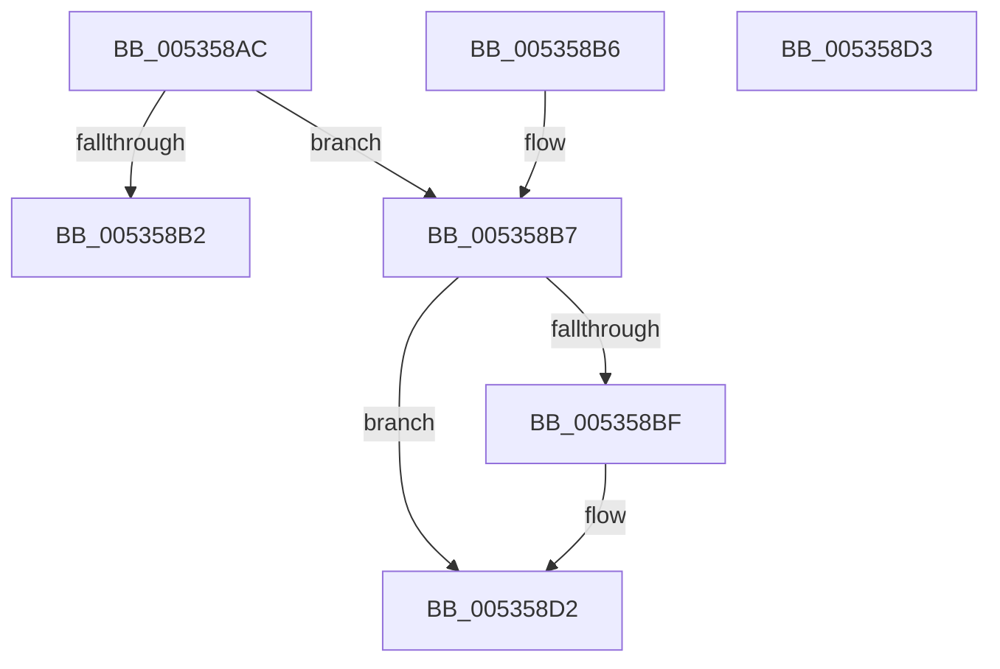

# SymCryptFdefDigitsFromBits

- RVA: `0x005358AC`–`0x005358D4` (길이 `40` bytes)
- VA: `0x00000001405358AC`
- 실행 섹션: `.text`
- PDB 이름 있음: `예`; PDB Function 태그: `아니요`
- unwind 정보 RVA: `0x000DB714`
- 디코드: `17`개 명령, `40/40` bytes 표시
- 미해석 바이트: `0` (있으면 어셈블리에 `.byte`로 보존)

> 이 문서는 커널 이미지의 기계어와 PDB 기호를 분석해 생성했습니다. 4번과 5번은 함수 원형과 자료형을 바이너리 사용 방식에서 추정한 C 해석이며 원본 소스 복구 결과는 아닙니다.

## 1. Dependencies

- 직접 호출 지점: **0**; 고유 호출 대상: **0**
- 직접 호출자로 확인된 함수: **1**
- RIP 상대 이미지 참조: **0**

### Outgoing calls
- 직접 디코드된 call 명령이 없습니다.

### Direct callers
- [SymCryptDigitsFromBits](../52/SymCryptDigitsFromBits_function_0052544C.md) at `0x00525450`

### Static image references
- 디코드된 RIP-relative 메모리 참조가 없습니다.

## 2. Other-region calls and transfers

- 다른 실행 섹션으로 향하는 call: **0**
- 별도 외부 분기/꼬리 이동을 확인하지 못했습니다.

## 3. Assembly (complete function range)

```asm
005358AC  33 C0                           xor eax, eax
005358AE  85 C9                           test ecx, ecx
005358B0  75 05                           jne 0x1405358b7
005358B2  8D 41 01                        lea eax, [rcx + 1]
005358B5  C3                              ret
005358B6  CC                              int3
005358B7  81 F9 00 00 10 00               cmp ecx, 0x100000
005358BD  77 13                           ja 0x1405358d2
005358BF  8B C1                           mov eax, ecx
005358C1  BA FF 01 00 00                  mov edx, 0x1ff
005358C6  23 C2                           and eax, edx
005358C8  C1 E9 09                        shr ecx, 9
005358CB  03 C2                           add eax, edx
005358CD  C1 E8 09                        shr eax, 9
005358D0  03 C1                           add eax, ecx
005358D2  C3                              ret
005358D3  CC                              int3
```

## 4. C-style interpretation (structured pseudocode)

```c
__int64 __fastcall SymCryptFdefDigitsFromBits(__int64 a1)
{
    __int64 result;

    result = 0;
    if ((unsigned int)(a1) != 0) goto loc_005358B7;
    return a1 + 1;
loc_005358B7:
    result = a1 + 1;
    if (((unsigned int)(a1)) <= 0x100000ULL) {
        result = (unsigned int)(a1);
        a2 = 511;
        result = (unsigned int)((result) & ((unsigned int)(a2)));
        a1 = (unsigned int)((a1) >> (9));
        result = (unsigned int)((result) + ((unsigned int)(a2)));
        result = (unsigned int)((result) >> (9));
        result = (unsigned int)((result) + ((unsigned int)(a1)));
    }
    return result;
}
```

## 5. (Beta) C Style

```c
int64_t SymCryptFdefDigitsFromBits(int64_t Arg1)
{
    int64_t result;

    result = 0;
    if ((uint32_t)(Arg1) != 0) goto loc_005358B7;
    return Arg1 + 1;
loc_005358B7:
    result = Arg1 + 1;
    if (((uint32_t)(Arg1)) <= 0x100000ULL) {
        result = (uint32_t)(Arg1);
        a2 = 511;
        result = (uint32_t)((result) & ((uint32_t)(a2)));
        Arg1 = (uint32_t)((Arg1) >> (9));
        result = (uint32_t)((result) + ((uint32_t)(a2)));
        result = (uint32_t)((result) >> (9));
        result = (uint32_t)((result) + ((uint32_t)(Arg1)));
    }
    return result;
}
```

## 6. Execution-region graph

[열기: 2D/3D 그래프와 함수 탐색 컨트롤 패널](../../../control-panel.html?section=text&rva=0x005358AC&view=graph)

- 2D 그래프는 위에서 아래로 흐르고, 3D 그래프는 빈 공간을 드래그해 회전합니다. Shift+드래그는 이동, 휠은 확대·축소, 함수 노드 선택은 대상 보고서 이동입니다.

### Static fallback


