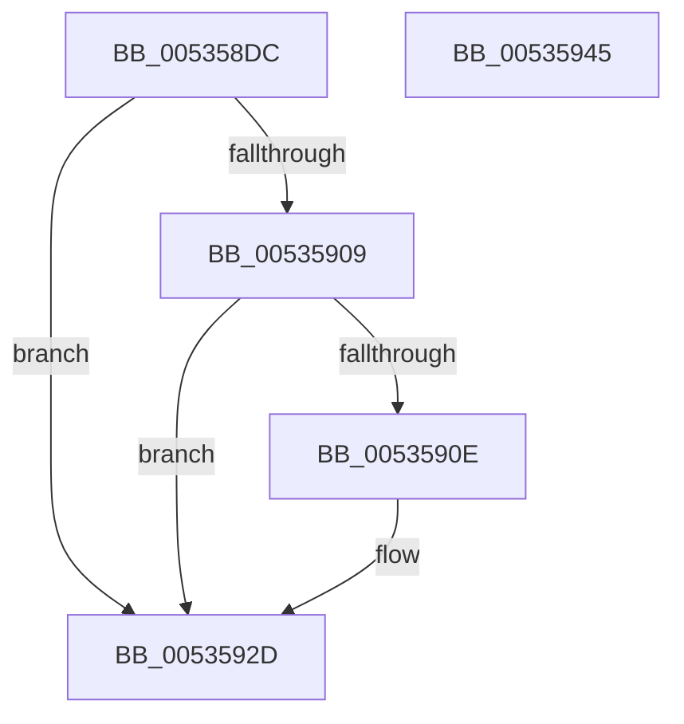

# SymCryptFdefDivisorCreate

- RVA: `0x005358DC`–`0x00535946` (길이 `106` bytes)
- VA: `0x00000001405358DC`
- 실행 섹션: `.text`
- PDB 이름 있음: `예`; PDB Function 태그: `아니요`
- unwind 정보 RVA: `0x0005C954`
- 디코드: `32`개 명령, `106/106` bytes 표시
- 미해석 바이트: `0` (있으면 어셈블리에 `.byte`로 보존)

> 이 문서는 커널 이미지의 기계어와 PDB 기호를 분석해 생성했습니다. 4번과 5번은 함수 원형과 자료형을 바이너리 사용 방식에서 추정한 C 해석이며 원본 소스 복구 결과는 아닙니다.

## 1. Dependencies

- 직접 호출 지점: **2**; 고유 호출 대상: **2**
- 직접 호출자로 확인된 함수: **2**
- RIP 상대 이미지 참조: **0**

### Outgoing calls
- `0x005358FE` → [SymCryptSizeofDivisorFromDigits](../52/SymCryptSizeofDivisorFromDigits_function_00525D0C.md) (function, `0x00525D0C`)
- `0x00535928` → [SymCryptIntCreate](../52/SymCryptIntCreate_function_0052556C.md) (function, `0x0052556C`)

### Direct callers
- [SymCryptDivisorCreate](../52/SymCryptDivisorCreate_function_00525464.md) at `0x00525468`
- [SymCryptFdefModulusCreate](SymCryptFdefModulusCreate_function_0053552C.md) at `0x00535584`

### Static image references
- 디코드된 RIP-relative 메모리 참조가 없습니다.

## 2. Other-region calls and transfers

- 다른 실행 섹션으로 향하는 call: **0**
- 별도 외부 분기/꼬리 이동을 확인하지 못했습니다.

## 3. Assembly (complete function range)

```asm
005358DC  48 89 5C 24 08                  mov qword ptr [rsp + 8], rbx
005358E1  48 89 6C 24 10                  mov qword ptr [rsp + 0x10], rbp
005358E6  48 89 74 24 18                  mov qword ptr [rsp + 0x18], rsi
005358EB  57                              push rdi
005358EC  48 83 EC 20                     sub rsp, 0x20
005358F0  48 8B D9                        mov rbx, rcx
005358F3  41 8B F0                        mov esi, r8d
005358F6  41 8B C8                        mov ecx, r8d
005358F9  48 8B EA                        mov rbp, rdx
005358FC  33 FF                           xor edi, edi
005358FE  E8 09 04 FF FF                  call 0x140525d0c
00535903  8B C8                           mov ecx, eax
00535905  85 C0                           test eax, eax
00535907  74 24                           je 0x14053592d
00535909  48 3B E9                        cmp rbp, rcx
0053590C  72 1F                           jb 0x14053592d
0053590E  89 4B 08                        mov dword ptr [rbx + 8], ecx
00535911  48 8D 55 E0                     lea rdx, [rbp - 0x20]
00535915  48 8D 4B 20                     lea rcx, [rbx + 0x20]
00535919  C7 03 00 00 44 67               mov dword ptr [rbx], 0x67440000
0053591F  44 8B C6                        mov r8d, esi
00535922  89 73 04                        mov dword ptr [rbx + 4], esi
00535925  48 8B FB                        mov rdi, rbx
00535928  E8 3F FC FE FF                  call 0x14052556c
0053592D  48 8B 5C 24 30                  mov rbx, qword ptr [rsp + 0x30]
00535932  48 8B C7                        mov rax, rdi
00535935  48 8B 6C 24 38                  mov rbp, qword ptr [rsp + 0x38]
0053593A  48 8B 74 24 40                  mov rsi, qword ptr [rsp + 0x40]
0053593F  48 83 C4 20                     add rsp, 0x20
00535943  5F                              pop rdi
00535944  C3                              ret
00535945  CC                              int3
```

## 4. C-style interpretation (structured pseudocode)

```c
__int64 __fastcall SymCryptFdefDivisorCreate(__int64 a1, __int64 a2, int a3)
{
    __int64 result;
    __int64 v_rdi;
    __int64 v_rsp;
    unsigned __int64 v_stack_p10;
    unsigned __int64 v_stack_p18;
    unsigned __int64 v_stack_p8;

    v_stack_p8 = v_rbx;
    v_stack_p10 = v_rbp;
    v_stack_p18 = v_rsi;
    v_rsp = (v_rsp) - (32);
    v_rdi = 0;
    result = SymCryptSizeofDivisorFromDigits((unsigned int)(a3), a2, a3, a4);
    if ((unsigned int)(result) == 0) goto loc_0053592D;
    if (a2 >= ((unsigned int)((unsigned int)(result)))) {
        *(unsigned int *)(a1 + 8) = (unsigned int)((unsigned int)((unsigned int)(result)));
        a2 = a2 - 32;
        a1 = a1 + 32;
        *(unsigned int *)(a1) = 0x67440000ULL;
        a3 = (unsigned int)((unsigned int)(a3));
        *(unsigned int *)(a1 + 4) = (unsigned int)((unsigned int)(a3));
        v_rdi = a1;
        result = SymCryptIntCreate(a1, a2, a3, a4);
    }
    v_rsp = (v_rsp) + (32);
    return v_rdi;
}
```

## 5. (Beta) C Style

```c
int64_t SymCryptFdefDivisorCreate(void *Arg1, int64_t Arg2, int32_t Arg3)
{
    uint8_t *arg1 = (uint8_t *)Arg1;

    int64_t result;
    int64_t local_rdi;
    int64_t local_rsp;
    uint64_t v_stack_p10;
    uint64_t v_stack_p18;
    uint64_t v_stack_p8;

    v_stack_p8 = local_rbx;
    v_stack_p10 = local_rbp;
    v_stack_p18 = local_rsi;
    local_rsp = (local_rsp) - (32);
    local_rdi = 0;
    result = SymCryptSizeofDivisorFromDigits((uint32_t)(Arg3), Arg2, Arg3, a4);
    if ((uint32_t)(result) == 0) goto loc_0053592D;
    if (Arg2 >= ((uint32_t)((uint32_t)(result)))) {
        *(uint32_t *)(arg1 + 0x8) = (uint32_t)((uint32_t)((uint32_t)(result)));
        Arg2 = Arg2 - 32;
        Arg1 = Arg1 + 32;
        *(uint32_t *)(arg1) = 0x67440000ULL;
        Arg3 = (uint32_t)((uint32_t)(Arg3));
        *(uint32_t *)(arg1 + 0x4) = (uint32_t)((uint32_t)(Arg3));
        local_rdi = Arg1;
        result = SymCryptIntCreate(Arg1, Arg2, Arg3, a4);
    }
    local_rsp = (local_rsp) + (32);
    return local_rdi;
}
```

### 관측된 메모리 오프셋

구조체 형식이 확인되지 않은 접근은 인자 기준의 오프셋으로만 기록했습니다.

| 기준 인자 | 오프셋 표현 | 폭 (bit) | 접근 |
|---|---:|---:|---|
| `Arg1` | `+ 0x0` | `32` | `W` |
| `Arg1` | `+ 0x4` | `32` | `W` |
| `Arg1` | `+ 0x8` | `32` | `W` |
| `Arg1` | `+ 0x20` | `64` | `R` |

## 6. Execution-region graph

[열기: 2D/3D 그래프와 함수 탐색 컨트롤 패널](../../../control-panel.html?section=text&rva=0x005358DC&view=graph)

- 2D 그래프는 위에서 아래로 흐르고, 3D 그래프는 빈 공간을 드래그해 회전합니다. Shift+드래그는 이동, 휠은 확대·축소, 함수 노드 선택은 대상 보고서 이동입니다.

### Static fallback


