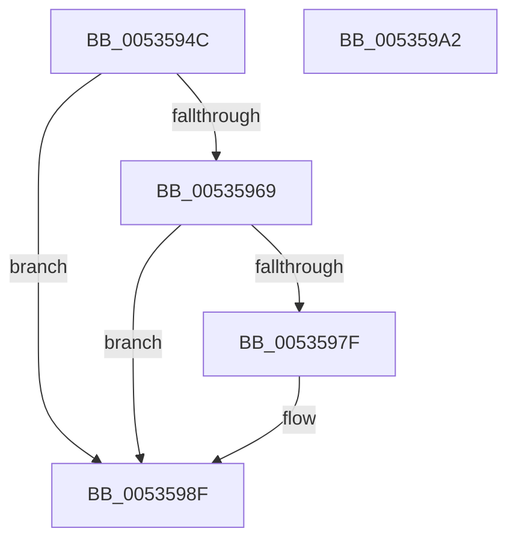

# SymCryptFdefIntAllocate

- RVA: `0x0053594C`–`0x005359A3` (길이 `87` bytes)
- VA: `0x000000014053594C`
- 실행 섹션: `.text`
- PDB 이름 있음: `예`; PDB Function 태그: `아니요`
- unwind 정보 RVA: `0x00060BC4`
- 디코드: `29`개 명령, `87/87` bytes 표시
- 미해석 바이트: `0` (있으면 어셈블리에 `.byte`로 보존)

> 이 문서는 커널 이미지의 기계어와 PDB 기호를 분석해 생성했습니다. 4번과 5번은 함수 원형과 자료형을 바이너리 사용 방식에서 추정한 C 해석이며 원본 소스 복구 결과는 아닙니다.

## 1. Dependencies

- 직접 호출 지점: **2**; 고유 호출 대상: **2**
- 직접 호출자로 확인된 함수: **1**
- RIP 상대 이미지 참조: **0**

### Outgoing calls
- `0x00535975` → [SymCryptCallbackAlloc](../6A/SymCryptCallbackAlloc_function_006AC530.md) (function, `0x006AC530`)
- `0x00535987` → [SymCryptIntCreate](../52/SymCryptIntCreate_function_0052556C.md) (function, `0x0052556C`)

### Direct callers
- [SymCryptIntAllocate](../52/SymCryptIntAllocate_function_005254C4.md) at `0x005254C8`

### Static image references
- 디코드된 RIP-relative 메모리 참조가 없습니다.

## 2. Other-region calls and transfers

- 다른 실행 섹션으로 향하는 call: **0**
- 별도 외부 분기/꼬리 이동을 확인하지 못했습니다.

## 3. Assembly (complete function range)

```asm
0053594C  48 89 5C 24 08                  mov qword ptr [rsp + 8], rbx
00535951  48 89 74 24 10                  mov qword ptr [rsp + 0x10], rsi
00535956  57                              push rdi
00535957  48 83 EC 20                     sub rsp, 0x20
0053595B  33 DB                           xor ebx, ebx
0053595D  8D 41 FF                        lea eax, [rcx - 1]
00535960  8B F9                           mov edi, ecx
00535962  3D FF 07 00 00                  cmp eax, 0x7ff
00535967  77 26                           ja 0x14053598f
00535969  8B C1                           mov eax, ecx
0053596B  C1 E0 06                        shl eax, 6
0053596E  83 C0 20                        add eax, 0x20
00535971  8B C8                           mov ecx, eax
00535973  8B F0                           mov esi, eax
00535975  E8 B6 6B 17 00                  call 0x1406ac530
0053597A  48 85 C0                        test rax, rax
0053597D  74 10                           je 0x14053598f
0053597F  44 8B C7                        mov r8d, edi
00535982  8B D6                           mov edx, esi
00535984  48 8B C8                        mov rcx, rax
00535987  E8 E0 FB FE FF                  call 0x14052556c
0053598C  48 8B D8                        mov rbx, rax
0053598F  48 8B 74 24 38                  mov rsi, qword ptr [rsp + 0x38]
00535994  48 8B C3                        mov rax, rbx
00535997  48 8B 5C 24 30                  mov rbx, qword ptr [rsp + 0x30]
0053599C  48 83 C4 20                     add rsp, 0x20
005359A0  5F                              pop rdi
005359A1  C3                              ret
005359A2  CC                              int3
```

## 4. C-style interpretation (structured pseudocode)

```c
__int64 __fastcall SymCryptFdefIntAllocate(__int64 a1)
{
    __int64 result;
    __int64 v_rbx;
    __int64 v_rsp;
    unsigned __int64 v_stack_p10;
    unsigned __int64 v_stack_p8;

    v_stack_p8 = v_rbx;
    v_stack_p10 = v_rsi;
    v_rsp = (v_rsp) - (32);
    v_rbx = 0;
    if (((unsigned int)(a1 - 1)) > 0x7FFULL) goto loc_0053598F;
    result = (unsigned int)(((unsigned int)((unsigned int)(a1))) << (6));
    result = (unsigned int)((result) + (32));
    result = SymCryptCallbackAlloc((unsigned int)((unsigned int)(result)), a2, a3, a4);
    if (result != 0) {
        a3 = (unsigned int)((unsigned int)((unsigned int)(a1)));
        a2 = (unsigned int)((unsigned int)((unsigned int)(result)));
        a1 = result;
        result = SymCryptIntCreate(a1, a2, a3, a4);
        v_rbx = result;
    }
    v_rsp = (v_rsp) + (32);
    return v_rbx;
}
```

## 5. (Beta) C Style

```c
int64_t SymCryptFdefIntAllocate(void *Arg1)
{
    uint8_t *arg1 = (uint8_t *)Arg1;

    int64_t result;
    int64_t local_rbx;
    int64_t local_rsp;
    uint64_t v_stack_p10;
    uint64_t v_stack_p8;

    v_stack_p8 = local_rbx;
    v_stack_p10 = local_rsi;
    local_rsp = (local_rsp) - (32);
    local_rbx = 0;
    if (((uint32_t)(Arg1 - 1)) > 0x7FFULL) goto loc_0053598F;
    result = (uint32_t)(((uint32_t)((uint32_t)(Arg1))) << (6));
    result = (uint32_t)((result) + (32));
    result = SymCryptCallbackAlloc((uint32_t)((uint32_t)(result)), a2, a3, a4);
    if (result != 0) {
        a3 = (uint32_t)((uint32_t)((uint32_t)(Arg1)));
        a2 = (uint32_t)((uint32_t)((uint32_t)(result)));
        Arg1 = result;
        result = SymCryptIntCreate(Arg1, a2, a3, a4);
        local_rbx = result;
    }
    local_rsp = (local_rsp) + (32);
    return local_rbx;
}
```

### 관측된 메모리 오프셋

구조체 형식이 확인되지 않은 접근은 인자 기준의 오프셋으로만 기록했습니다.

| 기준 인자 | 오프셋 표현 | 폭 (bit) | 접근 |
|---|---:|---:|---|
| `Arg1` | `- 0x1` | `32` | `R` |

## 6. Execution-region graph

[열기: 2D/3D 그래프와 함수 탐색 컨트롤 패널](../../../control-panel.html?section=text&rva=0x0053594C&view=graph)

- 2D 그래프는 위에서 아래로 흐르고, 3D 그래프는 빈 공간을 드래그해 회전합니다. Shift+드래그는 이동, 휠은 확대·축소, 함수 노드 선택은 대상 보고서 이동입니다.

### Static fallback


