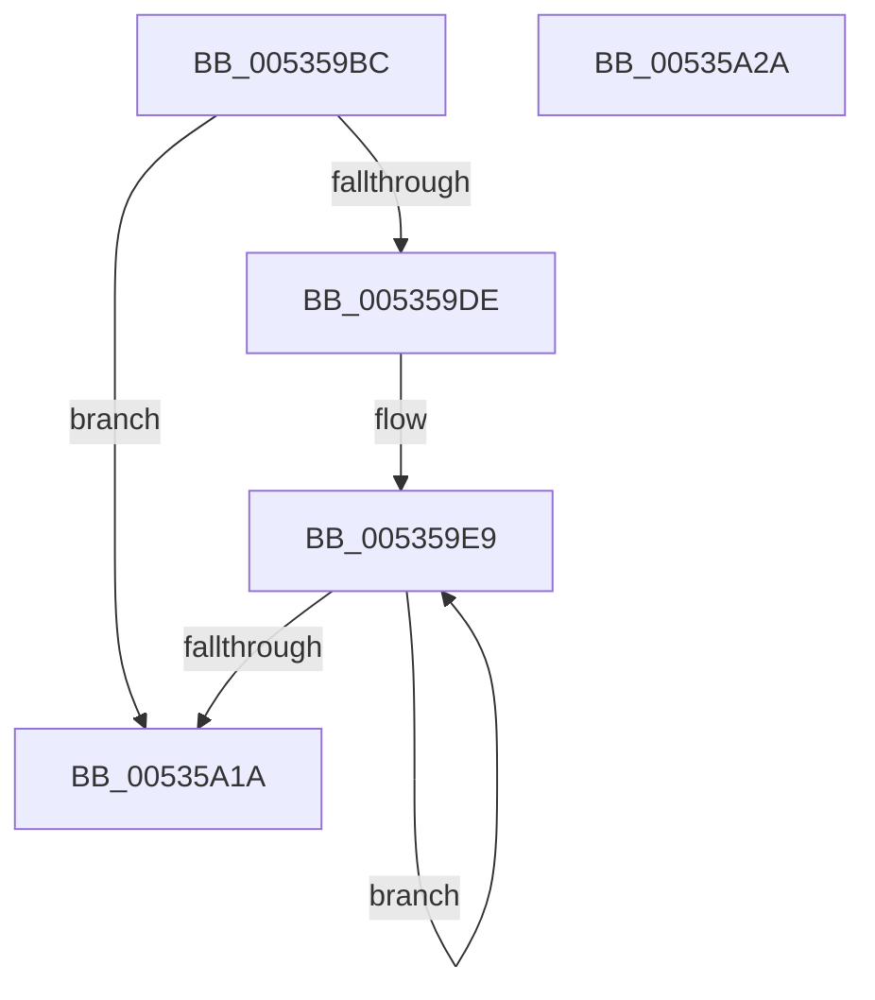

# SymCryptFdefIntBitsizeOfValue

- RVA: `0x005359BC`–`0x00535A2B` (길이 `111` bytes)
- VA: `0x00000001405359BC`
- 실행 섹션: `.text`
- PDB 이름 있음: `예`; PDB Function 태그: `아니요`
- unwind 정보 RVA: `0x0005CF00`
- 디코드: `38`개 명령, `111/111` bytes 표시
- 미해석 바이트: `0` (있으면 어셈블리에 `.byte`로 보존)

> 이 문서는 커널 이미지의 기계어와 PDB 기호를 분석해 생성했습니다. 4번과 5번은 함수 원형과 자료형을 바이너리 사용 방식에서 추정한 C 해석이며 원본 소스 복구 결과는 아닙니다.

## 1. Dependencies

- 직접 호출 지점: **1**; 고유 호출 대상: **1**
- 직접 호출자로 확인된 함수: **1**
- RIP 상대 이미지 참조: **0**

### Outgoing calls
- `0x00535A1A` → [SymCryptFdefBitsizeOfUint32](SymCryptFdefBitsizeOfUint32_function_00535758.md) (function, `0x00535758`)

### Direct callers
- [SymCryptIntBitsizeOfValue](../52/SymCryptIntBitsizeOfValue_function_005254F4.md) at `0x005254F8`

### Static image references
- 디코드된 RIP-relative 메모리 참조가 없습니다.

## 2. Other-region calls and transfers

- 다른 실행 섹션으로 향하는 call: **0**
- 별도 외부 분기/꼬리 이동을 확인하지 못했습니다.

## 3. Assembly (complete function range)

```asm
005359BC  40 53                           push rbx
005359BE  48 83 EC 20                     sub rsp, 0x20
005359C2  48 8B D1                        mov rdx, rcx
005359C5  33 DB                           xor ebx, ebx
005359C7  33 C9                           xor ecx, ecx
005359C9  41 83 CB FF                     or r11d, 0xffffffff
005359CD  44 8B 4A 04                     mov r9d, dword ptr [rdx + 4]
005359D1  41 C1 E1 06                     shl r9d, 6
005359D5  41 C1 E9 02                     shr r9d, 2
005359D9  45 85 C9                        test r9d, r9d
005359DC  74 3C                           je 0x140535a1a
005359DE  45 8B D1                        mov r10d, r9d
005359E1  49 83 C2 08                     add r10, 8
005359E5  4E 8D 14 92                     lea r10, [rdx + r10*4]
005359E9  41 FF C9                        dec r9d
005359EC  4D 8D 52 FC                     lea r10, [r10 - 4]
005359F0  41 8B 12                        mov edx, dword ptr [r10]
005359F3  44 8B C2                        mov r8d, edx
005359F6  49 F7 D8                        neg r8
005359F9  49 C1 E8 20                     shr r8, 0x20
005359FD  45 23 C3                        and r8d, r11d
00535A00  41 8B C0                        mov eax, r8d
00535A03  41 23 C1                        and eax, r9d
00535A06  0B D8                           or ebx, eax
00535A08  41 8B C0                        mov eax, r8d
00535A0B  23 C2                           and eax, edx
00535A0D  41 F7 D0                        not r8d
00535A10  0B C8                           or ecx, eax
00535A12  45 23 D8                        and r11d, r8d
00535A15  45 85 C9                        test r9d, r9d
00535A18  75 CF                           jne 0x1405359e9
00535A1A  E8 39 FD FF FF                  call 0x140535758
00535A1F  C1 E3 05                        shl ebx, 5
00535A22  03 C3                           add eax, ebx
00535A24  48 83 C4 20                     add rsp, 0x20
00535A28  5B                              pop rbx
00535A29  C3                              ret
00535A2A  CC                              int3
```

## 4. C-style interpretation (structured pseudocode)

```c
__int64 __fastcall SymCryptFdefIntBitsizeOfValue(__int64 a1)
{
    __int64 result;
    __int64 v_r10;
    __int64 v_r11;
    __int64 v_rbx;
    __int64 v_rsp;

    v_rsp = (v_rsp) - (32);
    v_rbx = 0;
    a1 = 0;
    v_r11 = (unsigned int)((v_r11) | (0xFFFFFFFFULL));
    a4 = (unsigned int)(((unsigned int)(*(unsigned int *)(a1 + 4))) << (6));
    a4 = (unsigned int)((a4) >> (2));
    if ((unsigned int)(a4) == 0) goto loc_00535A1A;
    v_r10 = ((unsigned int)((unsigned int)(a4))) + (8);
loc_005359E9:
    a4 = (unsigned int)((a4) - 1);
    a3 = -((unsigned int)((unsigned int)((unsigned int)(*(unsigned int *)(a1 + v_r10 * 4 - 4)))));
    a3 = (a3) >> (32);
    a3 = (unsigned int)((a3) & ((unsigned int)(v_r11)));
    result = (unsigned int)(((unsigned int)((unsigned int)(a3))) & ((unsigned int)(a4)));
    v_rbx = (unsigned int)((v_rbx) | ((unsigned int)(result)));
    result = (unsigned int)(((unsigned int)((unsigned int)(a3))) & ((unsigned int)((unsigned int)(*(unsigned int *)(a1 + v_r10 * 4 - 4)))));
    a3 = (unsigned int)(~(a3));
    a1 = (unsigned int)((a1) | ((unsigned int)(result)));
    v_r11 = (unsigned int)((v_r11) & ((unsigned int)(a3)));
    if ((unsigned int)(a4) != 0) goto loc_005359E9;
loc_00535A1A:
    result = SymCryptFdefBitsizeOfUint32(a1, (unsigned int)(*(unsigned int *)(a1 + v_r10 * 4 - 4)), a3, a4);
    v_rbx = (unsigned int)((v_rbx) << (5));
    result = (unsigned int)((result) + ((unsigned int)(v_rbx)));
    v_rsp = (v_rsp) + (32);
    return result;
}
```

## 5. (Beta) C Style

```c
int64_t SymCryptFdefIntBitsizeOfValue(void *Arg1)
{
    uint8_t *arg1 = (uint8_t *)Arg1;

    int64_t result;
    int64_t local_r10;
    int64_t local_r11;
    int64_t local_rbx;
    int64_t local_rsp;

    local_rsp = (local_rsp) - (32);
    local_rbx = 0;
    Arg1 = 0;
    local_r11 = (uint32_t)((local_r11) | (0xFFFFFFFFULL));
    a4 = (uint32_t)(((uint32_t)(*(uint32_t *)(arg1 + 0x4))) << (6));
    a4 = (uint32_t)((a4) >> (2));
    if ((uint32_t)(a4) == 0) goto loc_00535A1A;
    local_r10 = ((uint32_t)((uint32_t)(a4))) + (8);
loc_005359E9:
    a4 = (uint32_t)((a4) - 1);
    a3 = -((uint32_t)((uint32_t)((uint32_t)(*(uint32_t *)(arg1 + local_r10 * 4 - 0x4)))));
    a3 = (a3) >> (32);
    a3 = (uint32_t)((a3) & ((uint32_t)(local_r11)));
    result = (uint32_t)(((uint32_t)((uint32_t)(a3))) & ((uint32_t)(a4)));
    local_rbx = (uint32_t)((local_rbx) | ((uint32_t)(result)));
    result = (uint32_t)(((uint32_t)((uint32_t)(a3))) & ((uint32_t)((uint32_t)(*(uint32_t *)(arg1 + local_r10 * 4 - 0x4)))));
    a3 = (uint32_t)(~(a3));
    Arg1 = (uint32_t)((Arg1) | ((uint32_t)(result)));
    local_r11 = (uint32_t)((local_r11) & ((uint32_t)(a3)));
    if ((uint32_t)(a4) != 0) goto loc_005359E9;
loc_00535A1A:
    result = SymCryptFdefBitsizeOfUint32(Arg1, (uint32_t)(*(uint32_t *)(arg1 + local_r10 * 4 - 0x4)), a3, a4);
    local_rbx = (uint32_t)((local_rbx) << (5));
    result = (uint32_t)((result) + ((uint32_t)(local_rbx)));
    local_rsp = (local_rsp) + (32);
    return result;
}
```

### 관측된 메모리 오프셋

구조체 형식이 확인되지 않은 접근은 인자 기준의 오프셋으로만 기록했습니다.

| 기준 인자 | 오프셋 표현 | 폭 (bit) | 접근 |
|---|---:|---:|---|
| `Arg1` | `- 0x4` | `64` | `R` |
| `Arg1` | `+ 0x0` | `32` | `R` |
| `Arg1` | `+ 0x0 + r10*4` | `64` | `R` |
| `Arg1` | `+ 0x4` | `32` | `R` |

## 6. Execution-region graph

[열기: 2D/3D 그래프와 함수 탐색 컨트롤 패널](../../../control-panel.html?section=text&rva=0x005359BC&view=graph)

- 2D 그래프는 위에서 아래로 흐르고, 3D 그래프는 빈 공간을 드래그해 회전합니다. Shift+드래그는 이동, 휠은 확대·축소, 함수 노드 선택은 대상 보고서 이동입니다.

### Static fallback


