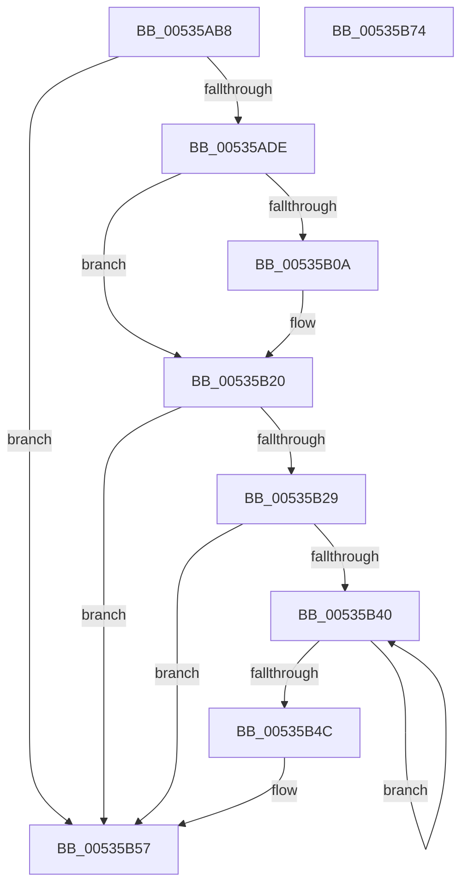

# SymCryptFdefIntCopyMixedSize

- RVA: `0x00535AB8`–`0x00535B75` (길이 `189` bytes)
- VA: `0x0000000140535AB8`
- 실행 섹션: `.text`
- PDB 이름 있음: `예`; PDB Function 태그: `아니요`
- unwind 정보 RVA: `0x0005E6B4`
- 디코드: `61`개 명령, `189/189` bytes 표시
- 미해석 바이트: `0` (있으면 어셈블리에 `.byte`로 보존)

> 이 문서는 커널 이미지의 기계어와 PDB 기호를 분석해 생성했습니다. 4번과 5번은 함수 원형과 자료형을 바이너리 사용 방식에서 추정한 C 해석이며 원본 소스 복구 결과는 아닙니다.

## 1. Dependencies

- 직접 호출 지점: **2**; 고유 호출 대상: **2**
- 직접 호출자로 확인된 함수: **1**
- RIP 상대 이미지 참조: **0**

### Outgoing calls
- `0x00535AF8` → [memcpy](../6C/memcpy_function_006C6840.md) (function, `0x006C6840`)
- `0x00535B1B` → [SymCryptWipe](../51/SymCryptWipe_function_0051F914.md) (function, `0x0051F914`)

### Direct callers
- [SymCryptIntCopyMixedSize](../52/SymCryptIntCopyMixedSize_function_00525554.md) at `0x00525558`

### Static image references
- 디코드된 RIP-relative 메모리 참조가 없습니다.

## 2. Other-region calls and transfers

- 다른 실행 섹션으로 향하는 call: **0**
- 별도 외부 분기/꼬리 이동을 확인하지 못했습니다.

## 3. Assembly (complete function range)

```asm
00535AB8  48 8B C4                        mov rax, rsp
00535ABB  48 89 58 08                     mov qword ptr [rax + 8], rbx
00535ABF  48 89 68 10                     mov qword ptr [rax + 0x10], rbp
00535AC3  48 89 70 18                     mov qword ptr [rax + 0x18], rsi
00535AC7  48 89 78 20                     mov qword ptr [rax + 0x20], rdi
00535ACB  41 56                           push r14
00535ACD  48 83 EC 20                     sub rsp, 0x20
00535AD1  33 DB                           xor ebx, ebx
00535AD3  4C 8B F2                        mov r14, rdx
00535AD6  48 8B F1                        mov rsi, rcx
00535AD9  48 3B CA                        cmp rcx, rdx
00535ADC  74 79                           je 0x140535b57
00535ADE  8B 69 04                        mov ebp, dword ptr [rcx + 4]
00535AE1  8B 42 04                        mov eax, dword ptr [rdx + 4]
00535AE4  3B E8                           cmp ebp, eax
00535AE6  48 8D 51 20                     lea rdx, [rcx + 0x20]
00535AEA  0F 43 E8                        cmovae ebp, eax
00535AED  49 8D 4E 20                     lea rcx, [r14 + 0x20]
00535AF1  44 8B C5                        mov r8d, ebp
00535AF4  41 C1 E0 06                     shl r8d, 6
00535AF8  E8 43 0D 19 00                  call 0x1406c6840
00535AFD  41 8B 46 04                     mov eax, dword ptr [r14 + 4]
00535B01  8B FD                           mov edi, ebp
00535B03  C1 E7 04                        shl edi, 4
00535B06  3B C5                           cmp eax, ebp
00535B08  76 16                           jbe 0x140535b20
00535B0A  2B C5                           sub eax, ebp
00535B0C  C1 E0 06                        shl eax, 6
00535B0F  8B D0                           mov edx, eax
00535B11  8B C7                           mov eax, edi
00535B13  48 83 C0 08                     add rax, 8
00535B17  49 8D 0C 86                     lea rcx, [r14 + rax*4]
00535B1B  E8 F4 9D FE FF                  call 0x14051f914
00535B20  8B 4E 04                        mov ecx, dword ptr [rsi + 4]
00535B23  8B C7                           mov eax, edi
00535B25  3B CD                           cmp ecx, ebp
00535B27  76 2E                           jbe 0x140535b57
00535B29  2B CD                           sub ecx, ebp
00535B2B  48 83 C0 08                     add rax, 8
00535B2F  C1 E1 06                        shl ecx, 6
00535B32  48 8B D3                        mov rdx, rbx
00535B35  C1 E9 03                        shr ecx, 3
00535B38  48 8D 04 86                     lea rax, [rsi + rax*4]
00535B3C  85 C9                           test ecx, ecx
00535B3E  74 17                           je 0x140535b57
00535B40  48 0B 10                        or rdx, qword ptr [rax]
00535B43  48 8D 40 08                     lea rax, [rax + 8]
00535B47  83 C1 FF                        add ecx, -1
00535B4A  75 F4                           jne 0x140535b40
00535B4C  48 85 D2                        test rdx, rdx
00535B4F  B8 0D 80 00 00                  mov eax, 0x800d
00535B54  0F 45 D8                        cmovne ebx, eax
00535B57  48 8B 6C 24 38                  mov rbp, qword ptr [rsp + 0x38]
00535B5C  8B C3                           mov eax, ebx
00535B5E  48 8B 5C 24 30                  mov rbx, qword ptr [rsp + 0x30]
00535B63  48 8B 74 24 40                  mov rsi, qword ptr [rsp + 0x40]
00535B68  48 8B 7C 24 48                  mov rdi, qword ptr [rsp + 0x48]
00535B6D  48 83 C4 20                     add rsp, 0x20
00535B71  41 5E                           pop r14
00535B73  C3                              ret
00535B74  CC                              int3
```

## 4. C-style interpretation (structured pseudocode)

```c
__int64 __fastcall SymCryptFdefIntCopyMixedSize(__int64 a1, __int64 a2)
{
    __int64 result;
    __int64 v_rbp;
    __int64 v_rbx;
    __int64 v_rdi;
    __int64 v_rsp;
    unsigned __int64 v_stack_p10;
    unsigned __int64 v_stack_p18;
    unsigned __int64 v_stack_p20;
    unsigned __int64 v_stack_p8;

    *(unsigned __int64 *)(v_rsp + 8) = v_rbx;
    *(unsigned __int64 *)(v_rsp + 16) = v_rbp;
    *(unsigned __int64 *)(v_rsp + 24) = v_rsi;
    *(unsigned __int64 *)(v_rsp + 32) = v_rdi;
    v_rsp = (v_rsp) - (32);
    v_rbx = 0;
    if (a1 == a2) goto loc_00535B57;
    v_rbp = (unsigned int)(*(unsigned int *)(a1 + 4));
    if (((unsigned int)((unsigned int)(*(unsigned int *)(a1 + 4)))) >= ((unsigned int)((unsigned int)(*(unsigned int *)(a2 + 4))))) { v_rbp = (unsigned int)((unsigned int)(*(unsigned int *)(a2 + 4))); }
    a3 = (unsigned int)(((unsigned int)((unsigned int)(v_rbp))) << (6));
    result = memcpy(a2 + 32, a1 + 32, a3, a4);
    v_rdi = (unsigned int)(((unsigned int)((unsigned int)(v_rbp))) << (4));
    result = (unsigned int)(*(unsigned int *)(a2 + 4));
    if (((unsigned int)((unsigned int)(*(unsigned int *)(a2 + 4)))) >= = ((unsigned int)(v_rbp))) {
        result = (unsigned int)(((unsigned int)(*(unsigned int *)(a2 + 4))) - ((unsigned int)(v_rbp)));
        result = (unsigned int)((result) << (6));
        a2 = (unsigned int)(result);
        result = (unsigned int)(v_rdi);
        result = (result) + (8);
        a1 = a2 + result * 4;
        result = SymCryptWipe(a1, a2, a3, a4);
    }
    if (((unsigned int)((unsigned int)(*(unsigned int *)(a1 + 4)))) <= ((unsigned int)(v_rbp))) goto loc_00535B57;
    a1 = (unsigned int)(((unsigned int)(*(unsigned int *)(a1 + 4))) - ((unsigned int)(v_rbp)));
    result = ((unsigned int)((unsigned int)(v_rdi))) + (8);
    a1 = (unsigned int)((a1) << (6));
    a1 = (unsigned int)((a1) >> (3));
    if ((unsigned int)(a1) == 0) goto loc_00535B57;
loc_00535B40:
    a2 = (0) | (*(unsigned __int64 *)(a1 + result * 4));
    a1 = (unsigned int)((a1) + (-1));
    if (condition_is_not_equal) goto loc_00535B40;
    if (a2 != 0) { v_rbx = (unsigned int)((unsigned int)(0x800DULL)); }
loc_00535B57:
    v_rsp = (v_rsp) + (32);
    return (unsigned int)((unsigned int)(v_rbx));
}
```

## 5. (Beta) C Style

```c
int64_t SymCryptFdefIntCopyMixedSize(void *Arg1, void *Arg2)
{
    uint8_t *arg1 = (uint8_t *)Arg1;
    uint8_t *arg2 = (uint8_t *)Arg2;

    int64_t result;
    int64_t local_rbp;
    int64_t local_rbx;
    int64_t local_rdi;
    int64_t local_rsp;
    uint64_t v_stack_p10;
    uint64_t v_stack_p18;
    uint64_t v_stack_p20;
    uint64_t v_stack_p8;

    *(uint64_t *)(local_rsp + 0x8) = local_rbx;
    *(uint64_t *)(local_rsp + 0x10) = local_rbp;
    *(uint64_t *)(local_rsp + 0x18) = local_rsi;
    *(uint64_t *)(local_rsp + 0x20) = local_rdi;
    local_rsp = (local_rsp) - (32);
    local_rbx = 0;
    if (Arg1 == Arg2) goto loc_00535B57;
    local_rbp = (uint32_t)(*(uint32_t *)(arg1 + 0x4));
    if (((uint32_t)((uint32_t)(*(uint32_t *)(arg1 + 0x4)))) >= ((uint32_t)((uint32_t)(*(uint32_t *)(arg2 + 0x4))))) { local_rbp = (uint32_t)((uint32_t)(*(uint32_t *)(arg2 + 0x4))); }
    a3 = (uint32_t)(((uint32_t)((uint32_t)(local_rbp))) << (6));
    result = memcpy(Arg2 + 32, Arg1 + 32, a3, a4);
    local_rdi = (uint32_t)(((uint32_t)((uint32_t)(local_rbp))) << (4));
    result = (uint32_t)(*(uint32_t *)(arg2 + 0x4));
    if (((uint32_t)((uint32_t)(*(uint32_t *)(arg2 + 0x4)))) >= = ((uint32_t)(local_rbp))) {
        result = (uint32_t)(((uint32_t)(*(uint32_t *)(arg2 + 0x4))) - ((uint32_t)(local_rbp)));
        result = (uint32_t)((result) << (6));
        Arg2 = (uint32_t)(result);
        result = (uint32_t)(local_rdi);
        result = (result) + (8);
        Arg1 = Arg2 + result * 4;
        result = SymCryptWipe(Arg1, Arg2, a3, a4);
    }
    if (((uint32_t)((uint32_t)(*(uint32_t *)(arg1 + 0x4)))) <= ((uint32_t)(local_rbp))) goto loc_00535B57;
    Arg1 = (uint32_t)(((uint32_t)(*(uint32_t *)(arg1 + 0x4))) - ((uint32_t)(local_rbp)));
    result = ((uint32_t)((uint32_t)(local_rdi))) + (8);
    Arg1 = (uint32_t)((Arg1) << (6));
    Arg1 = (uint32_t)((Arg1) >> (3));
    if ((uint32_t)(Arg1) == 0) goto loc_00535B57;
loc_00535B40:
    Arg2 = (0) | (*(uint64_t *)(arg1 + result * 4));
    Arg1 = (uint32_t)((Arg1) + (-1));
    if (condition_is_not_equal) goto loc_00535B40;
    if (Arg2 != NULL) { local_rbx = (uint32_t)((uint32_t)(0x800DULL)); }
loc_00535B57:
    local_rsp = (local_rsp) + (32);
    return (uint32_t)((uint32_t)(local_rbx));
}
```

### 관측된 메모리 오프셋

구조체 형식이 확인되지 않은 접근은 인자 기준의 오프셋으로만 기록했습니다.

| 기준 인자 | 오프셋 표현 | 폭 (bit) | 접근 |
|---|---:|---:|---|
| `Arg1` | `+ 0x0` | `64` | `R` |
| `Arg1` | `+ 0x0 + rax*4` | `64` | `R` |
| `Arg1` | `+ 0x4` | `32` | `R` |
| `Arg1` | `+ 0x8` | `64` | `R` |
| `Arg2` | `+ 0x0 + rax*4` | `64` | `R` |
| `Arg2` | `+ 0x4` | `32` | `R` |
| `Arg2` | `+ 0x20` | `64` | `R` |

## 6. Execution-region graph

[열기: 2D/3D 그래프와 함수 탐색 컨트롤 패널](../../../control-panel.html?section=text&rva=0x00535AB8&view=graph)

- 2D 그래프는 위에서 아래로 흐르고, 3D 그래프는 빈 공간을 드래그해 회전합니다. Shift+드래그는 이동, 휠은 확대·축소, 함수 노드 선택은 대상 보고서 이동입니다.

### Static fallback


